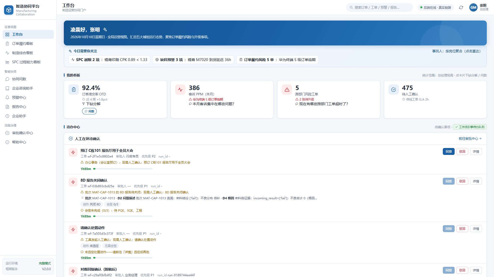
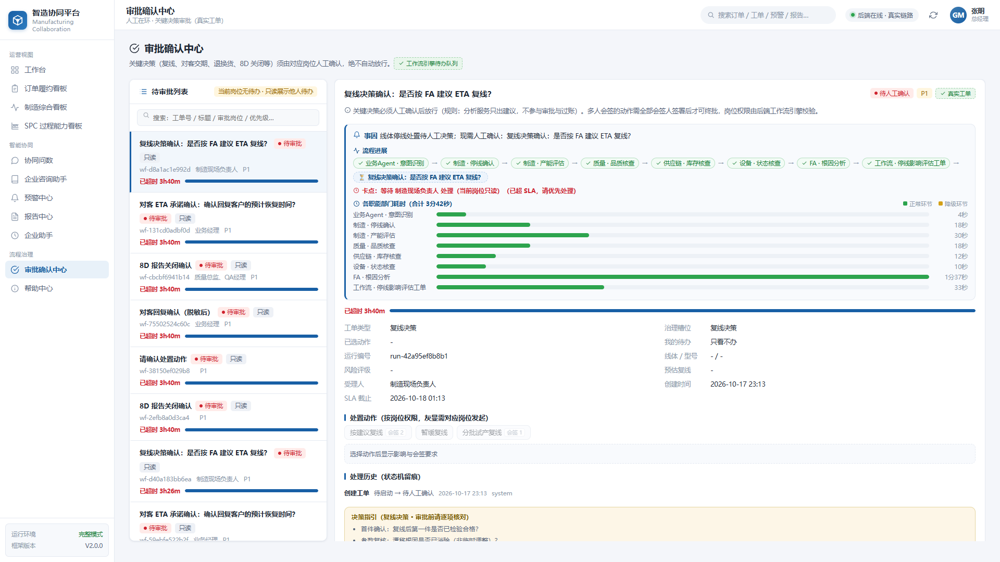
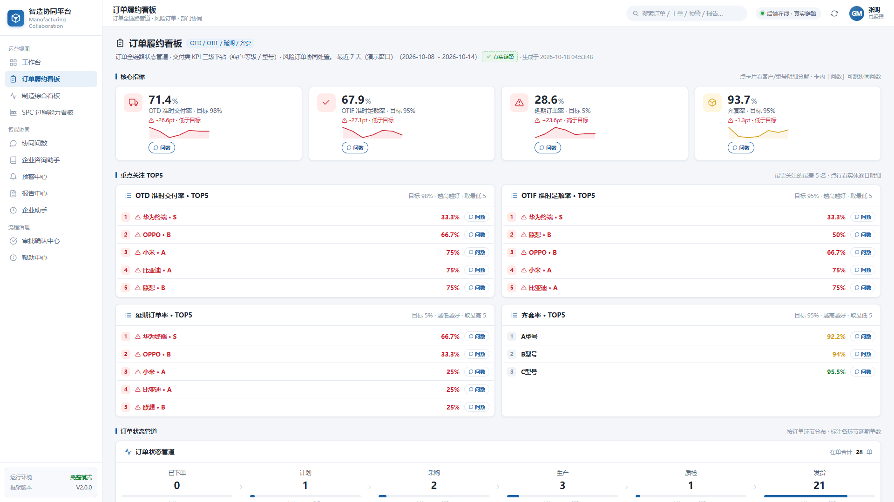
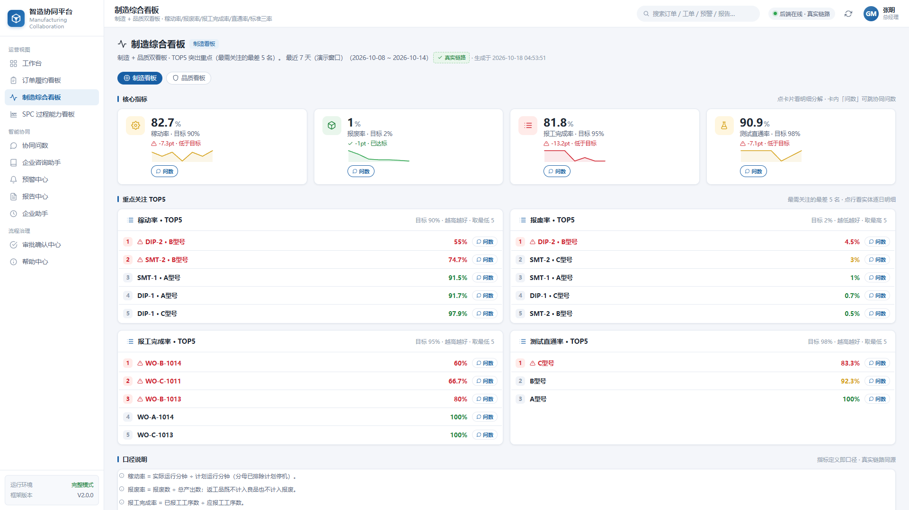
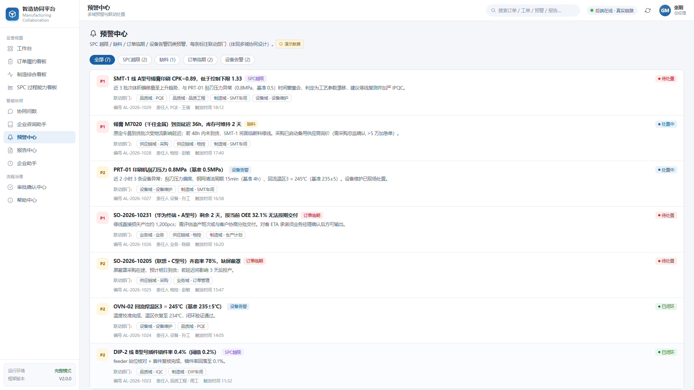
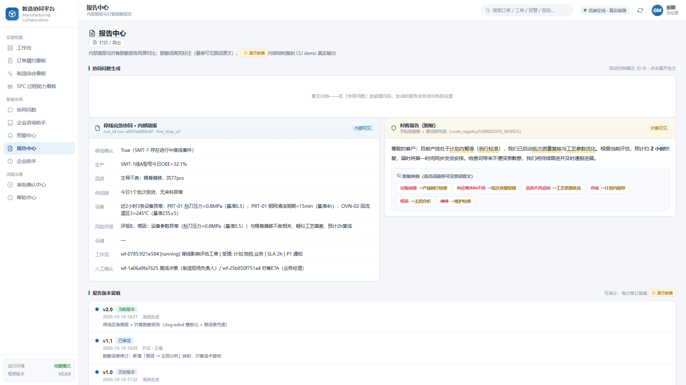
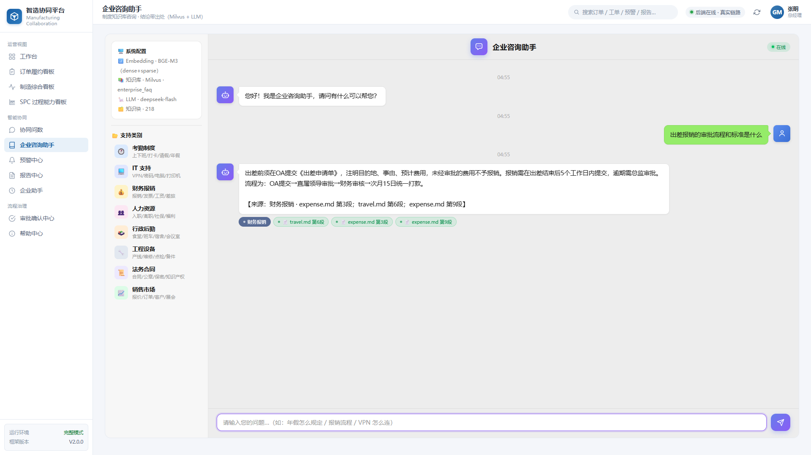
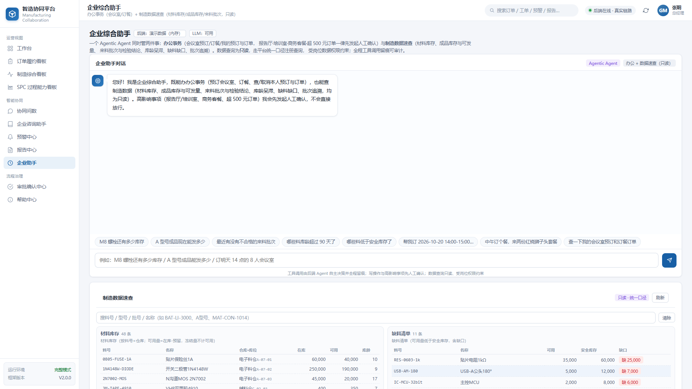
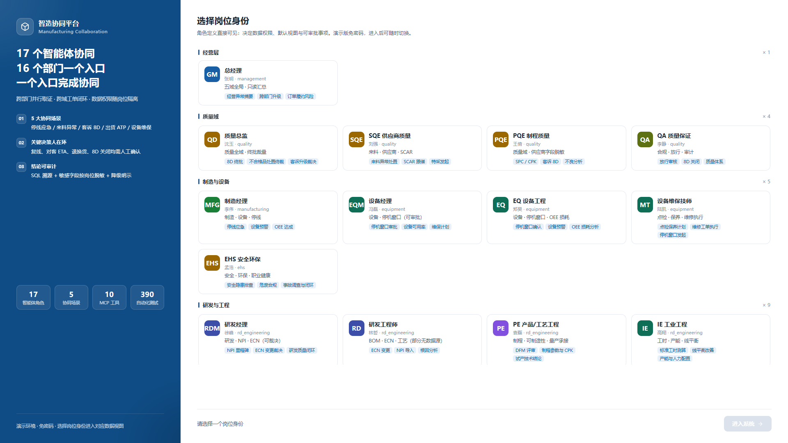
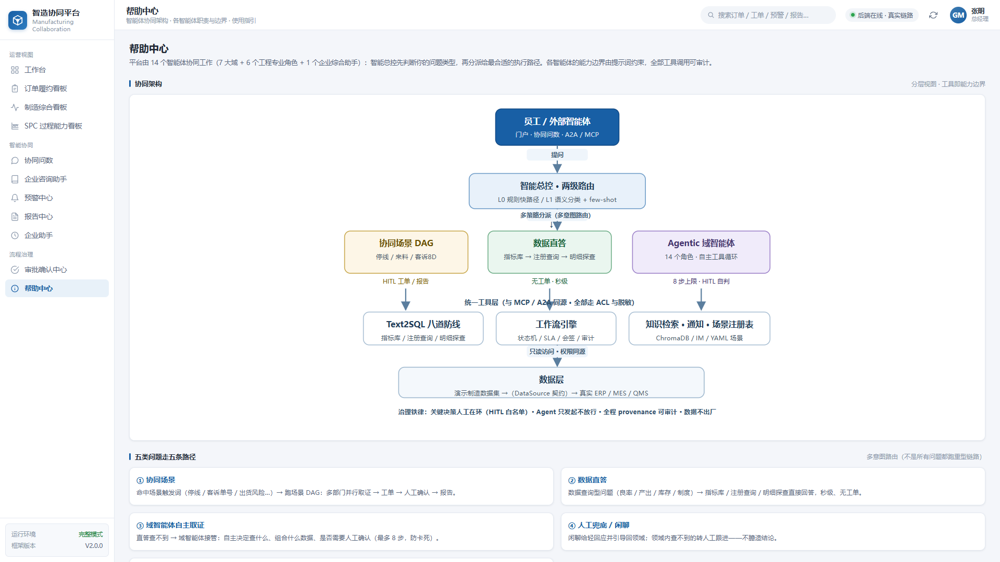

# mfg-agent-platform

制造业多智能体协同平台。17 个领域智能体、7 个协同场景，LangGraph 子图编排、人工在环会签、Text2SQL 只读治理、A2A / MCP 双协议接入。

[](https://github.com/Hulk-Zhao/mfg-agent-platform/actions/workflows/ci.yml)


<p float="left">
  
  
  
  
</p>

**解决的问题**：制造企业的异常响应卡在三处——进度散落在各部门系统与微信群里，跨部门同步以天计；取数靠"问人、导 Excel、写 SQL"；停线、缺料、客诉的跨部门取证靠打电话，闭环周期长。平台把"提问 → 路由 → 多域并行取证 → 工单 → 人工会签 → 对客报告"收敛成一条可审计的链路，每一步都有事件流、SQL 溯源和权限校验。

---

## 技术架构

```
                    ┌────────────────────────────────────────────┐
   Web / IM / A2A   │  接入层                                     │
  ─────────────────►│  FastAPI + SSE 事件流 · 企微回调(AES-CBC)    │
                    │  A2A JSON-RPC (Agent Card + message/send)   │
                    └───────────────┬────────────────────────────┘
                                    ▼
                    ┌────────────────────────────────────────────┐
                    │  TwoLevelRouter                            │
                    │  L0 规则快路径 / L1 LLM 闭集分类 / 模糊兜底   │
                    └───────────────┬────────────────────────────┘
                                    ▼
                    ┌────────────────────────────────────────────┐
                    │  场景编排（YAML 声明式，7 个场景）             │
                    │  加载期编译为 LangGraph StateGraph 子图       │
                    │  节点：agent / fan_out / fan_in /            │
                    │        workflow / hitl                      │
                    │  每节点 timeout_s + on_error: degrade       │
                    └──┬──────────┬──────────┬───────────────────┘
                       ▼          ▼          ▼
                 品质域(QMS)  供应链(SCM)  设备域(EAM)   ← 多域并行取证
                       └──────────┴──────────┘
                                    ▼
                    ┌────────────────────────────────────────────┐
                    │  WorkflowEngine（状态机 + SLA + 分级通知）    │
                    │  HITL 会签：propose → N×cosign → approve    │
                    └────────────────────────────────────────────┘
```

**编排内核**。场景不写代码：YAML 声明节点与依赖，加载期编译成 LangGraph 子图执行。总控（`V2Orchestrator`）有明确边界纪律——不直接查库（必须经 Text2SQLService）、不直接发通知（必须经 NotificationService）、不做审批判断（必须经 WorkflowEngine）。

**分级 LLM**。L1 小模型跑高频低敏任务（意图分类、SQL 初版），L2 大模型跑分析报告。提供方可插拔：Ollama（本地）、任意 OpenAI 兼容网关（DeepSeek / 智谱 / Kimi…）。可用性探针带 TTL 缓存，LLM 不可用时路由走规则、结论用模板、显式标 `degraded`——数字始终取自 SQL，不编造。

**契约层**。外部系统按契约接入，零框架改动：

| 契约 | 方法 | 内置实现 |
|---|---|---|
| `DataSource` | list_tables / run_query / execute_readonly_sql | SQLite（只读连接 `mode=ro`，写操作在驱动层即被拒绝） |
| `VectorStore` | upsert / query | ChromaDB；Milvus 接 Milvus standalone |
| `IMGateway` | 消息收发 + 回调验签 | 企业微信自建应用（AES-CBC + 签名验证） |

新数据源实现三个方法、注册进 `DataSourceRegistry`，即刻出现在 `/api/v2/datasources` 就绪度总览——健康状态、表清单、注册查询数。

**治理层**。声明式权限目录（对标 Huly controlled-documents 范式）：8 个 HITL 槽位 × 3 个动词（propose / cosign / approve）= 24 条权限、32 个治理角色，全部声明在 YAML。`PermissionRegistry` 构造期自检：Agent 身份只允许 `*.propose`，持有 `*.approve` 直接启动失败。会签一人一签、并发幂等。

**Text2SQL 八道防线**。仅 SELECT、多语句拦截、sqlglot AST 提取表名、表级 ACL（fail-closed）、行数上限、按角色脱敏、provenance 全溯源、人工兜底。数字从哪张表哪条 SQL 来，全程可追溯。

**SPC 统计内核**。Cpk / Pp / Ppk / 柏拉图由 `core/spc.py` 纯函数计算，不经过 LLM；无测量数据时输出 `data_gap=True` 并强制走人工确认——缺数据也要人拍板，而不是编一个结论。

**协议接入**。两套标准协议都是最小自实现（零第三方依赖）：

- **MCP Server**：stdio JSON-RPC 2.0，MCP 2024-11-05 规范工具子集，`ToolRegistry` 单一事实源，按域分治（data / asset / quality / workflow / knowledge，单 server ≤ 15 工具），任何 MCP 客户端可挂载。
- **A2A**（Agent-to-Agent，Linux 基金会规范）：`GET /.well-known/agent.json` Agent Card + `POST /a2a` 的 `message/send` / `tasks/get`。外部智能体消费平台能力拿到的是结构化 Task + Artifact，且治理链（ACL / 脱敏 / 会签）与 HTTP 端点同一套——A2A 不是绕过治理的后门。

**数据与缓存**。SQLAlchemy 2.0 抽象：本地开发默认 SQLite（零依赖），生产通过 `DB_URL` 切 MySQL 8.0。向量检索双路召回 + 重排：BGE-M3（dense + sparse）加 BGE-Reranker-v2-M3，后端可换 Milvus standalone。Redis 承担会话上下文缓存、查询结果缓存与单 IP 限流，连接失败自动降级为无缓存。

**认证**。演示门户 31 个岗位免密选择登录，写接口凭 HMAC 签名的岗位访问令牌（8 小时 TTL）；`AUTH_SECRET` 未配置时生成进程级随机密钥并告警。

**前端**。原生 HTML/CSS/JS，零构建零 npm 依赖，挂载于 FastAPI，SSE 实时事件流驱动。

## 部署形态

SQLite + 本地 ChromaDB 是**本地开发的零依赖默认值**，不是平台的边界——所有存储组件都走契约或环境变量，按部署形态切换：

| 形态 | 数据库 | 向量库 | 缓存 | 适用 |
|---|---|---|---|---|
| 本地开发 | SQLite（默认） | ChromaDB 本地持久化 | 无（自动降级） | 跑通全链路、跑测试 |
| Docker 单容器 | 同上（`app_data` 卷） | 同上 | 同上 | 快速演示 |
| 中间件栈 | MySQL 8.0 | Milvus standalone + BGE-M3/Reranker | Redis 7 | 生产部署 |

中间件栈一条命令拉起（含健康检查、端口避让）：

```bash
docker compose -f docker-compose.infra.yml up -d   # MySQL :3307 / Milvus :19531 / Redis :6380
```

再在 `.env` 里设 `DB_URL=mysql+pymysql://...`、`VECTOR_BACKEND=milvus`、`MILVUS_URI=...`、`REDIS_URL=...` 即完成切换，应用代码零改动。

## 快速开始

```bash
git clone https://github.com/Hulk-Zhao/mfg-agent-platform.git
cd mfg-agent-platform
cp .env.example .env           # LLM 相关全部留空 = 离线降级模式，可跑通全链路
uv sync
uv run python -m mfg_agents.common.init_db
uv run uvicorn mfg_agents.v2.demo.api:app --port 8004
```

打开 http://127.0.0.1:8004/demo-ui/ ，选岗位进入。Docker：`docker compose up -d --build`。

不起 UI：`uv run python -m mfg_agents.v2.demo.cli "A型号在SMT-1停线，何时复线？"`，事件流与 provenance 直接打印。

## 演示场景

| 场景 | 示例问题 | 链路特点 |
|---|---|---|
| 停线应急 | A型号在SMT-1停线，何时复线？ | 三域并行取证 + FA 评级 + 复线决策会签 + 对客 ETA 会签 |
| 来料异常 | 今天锡膏批次有问题 | 供应链与品质联合判定，退货/换货/特采走会签 |
| 客户投诉 | 华为投诉BATCH-A-1008 | 品质追溯 + 8D 结构化报告 + 关闭会签 |
| 出货风险 | A型号能发多少货 | 制造加仓储 ATP 核算，交期承诺会签 |
| 设备预警 | SMT-1设备参数异常吗 | 设备日志 + FA 历史案例匹配，停机窗口会签 |
| 订单变更影响 | 订单交期提前两周是否可行 | 制造与供应链联合评估产能与交期，变更承诺会签 |
| SPC 过程异常 | 关键尺寸 Cpk 掉到 0.8 了，要不要介入 | 能力指数判定 + 不良柏拉图取证 + 处置会签 |

同一问题不同岗位可见范围不同：PQE 查来料时供应商字段脱敏，采购可见原文——表级 ACL 与字段脱敏由登录角色驱动。

## 门户一览

| 订单履约看板 | 制造综合看板 |
|---|---|
|  |  |
| **预警中心** | **报告中心** |
|  |  |
| **企业咨询助手（RAG 结论带出处）** | **企业助手（Agentic 工具循环）** |
|  |  |
| **登录选岗（31 岗位 5 组）** | **帮助中心（架构与职责说明）** |
|  |  |

## LLM 接入

提供方通过 `LLM_PROVIDER` 显式指定，留空自动解析；所有提供方走同一 `ChatModel` 抽象，按节点分级分配模型与思考档位。

| 提供方 | 配置 | 说明 |
|---|---|---|
| Ollama（本地） | `OLLAMA_BASE_URL` / `OLLAMA_MODEL` | 零成本跑通，默认 `qwen3.5` 系列 |
| OpenAI 兼容网关 | `OPENAI_BASE_URL` / `OPENAI_API_KEY` / `OPENAI_MODEL` | DeepSeek、智谱、Kimi、vLLM 自部署等任何兼容端点 |
| 全部留空 | — | 离线降级：规则路由 + 模板结论，标 `degraded`，链路完整可演示 |

## 测试

587 条离线确定性测试（探针恒 False、不发外网请求），CI 在 Python 3.11 / 3.12 / 3.13 三个版本执行：

```bash
uv run pytest tests/ -q
```

覆盖：治理链（权限目录自检、会签幂等、越权拦截）、Text2SQL 防线（红队用例）、场景端到端、看板下钻、SPC 内核、MCP / A2A 协议、企微加解密、飞书适配。

## 项目结构

```
mfg-agent-platform/
├── src/mfg_agents/common/        # 基础设施：配置 / LLM 工厂(分级) / RAG / Text2SQL / 建库种子
├── src/mfg_agents/v2/            # 主链路
│   ├── contracts/                #   接入契约：DataSource / VectorStore / IMGateway / 权限
│   ├── core/                     #   编排内核：两级路由 / YAML→LangGraph 子图 / 共享上下文 / SPC 内核 / 缓存
│   ├── agents/                   #   域 Agent（quality / supply_chain / engineering / hitl / office / agentic）
│   ├── intent/                   #   意图分类器与路由策略
│   ├── services/                 #   Text2SQL 服务链 / 工作流引擎 / 通知 / 看板 / 认证 / 飞书日历
│   ├── scenarios/                #   7 个场景 YAML（新场景零代码新增）
│   ├── mcp_tools/                #   ToolRegistry + 自实现 MCP server（stdio JSON-RPC）
│   ├── a2a.py                    #   A2A 协议（Agent Card / message/send / tasks/get）
│   └── demo/                     #   FastAPI 入口 / CLI / 演示门户（纯静态零构建）
├── data/                         # 演示数据种子 SQL + 知识库 JSONL
├── deploy/                       # Milvus standalone 内嵌 etcd 配置
├── tests/                        # 587 条离线测试（治理 / 红队 / 端到端 / 协议）
├── docs/                         # 架构 / 接口 / HITL 设计 / 部署指南
└── scripts/                      # Windows 一键启动脚本（本地 / Docker / 公网隧道）
```

## 生产化清单

当前为单实例演示实现，治理层已落地（声明式权限目录 + 启动自检 + 一人一签幂等）。上线前待办：

- **会签并发与幂等**：进程内 `RLock` 串行化需升级为数据库级——签名拆独立表 + 唯一索引 `(task_uid, role_key, actor, verb)` 幂等。
- **A2A 任务持久化**：`tasks/get` 结果当前进程内保留 1 小时，生产需持久化。
- **公网访问认证**：隧道演示 = 链接即权限，对外正式提供前必须叠加认证并收敛 HITL 匿名写入。
- **企微回调重放防护**：需补 timestamp 窗口验重 + nonce 缓存。
- **超时代签**：字段位已预留（`on_behalf_of` / `overdue_signoff`），入口未开放。

## 文档

- [docs/ARCHITECTURE-V2.md](docs/ARCHITECTURE-V2.md) — 总架构（契约层 / 编排内核 / 治理层设计详述）
- [docs/V2-接口文档.md](docs/V2-接口文档.md) — API 文档（统一入口 / SSE / HITL 回写 / 错误码）
- [docs/V2-HITL-角色协作设计.md](docs/V2-HITL-角色协作设计.md) — 人工在环与会签设计
- [docs/PUBLIC-ACCESS.md](docs/PUBLIC-ACCESS.md) — 内网 / 公网访问部署指南

## License

[MIT](LICENSE)
