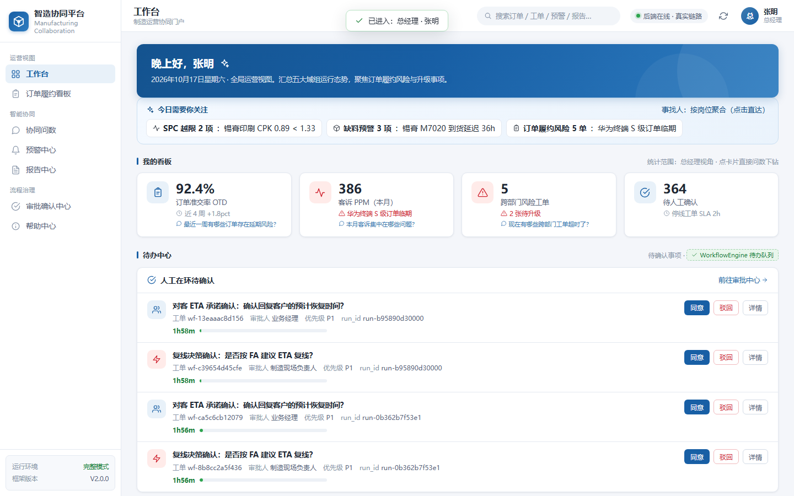
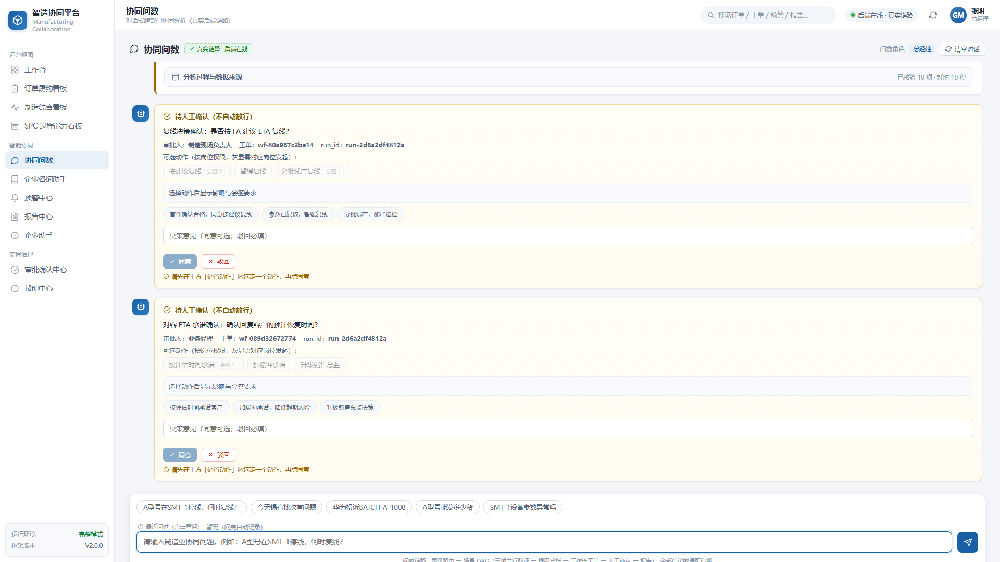
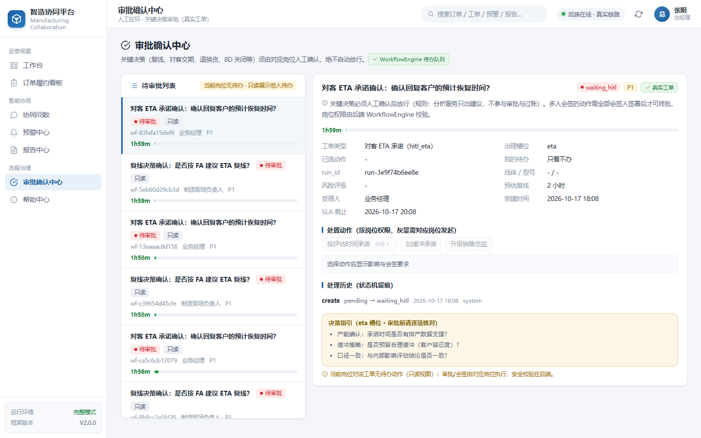

# mfg-agent-platform

[](https://www.python.org/)
[](LICENSE)
[](#测试)

**制造业多智能体协同平台（可运行演示原型）**：以 LangGraph 编排 **13 个领域智能体**，覆盖停线应急、来料异常、客户投诉、出货风险、设备预警 5 大业务场景；内置 **HITL 人工在环与多人会签治理**、**Text2SQL 只读问数（八道防线）**、**RAG 历史案例检索**与**对客报告自动脱敏**。零外部依赖即可全链路演示（SQLite + 本地 ChromaDB，无 LLM 自动降级）。

<p float="left">
  
  
  
</p>

---

## 解决什么问题

制造企业的异常响应长期面临三个痛点：

1. **进度不透明**——订单交付、异常处理进度分散在各部门系统与微信群，跨部门状态从天级延迟到周级；
2. **数据获取难**——一线与中层查数据依赖"问人 / 导 Excel / 写 SQL"；
3. **异常响应慢**——停线、缺料、客诉等异常跨部门取证靠电话，根因定位与闭环时间长。

本平台把"提问 → 路由 → 多域并行取证 → 工单 → 人工会签 → 对客报告"做成一条可审计的智能体链路。

## 核心特性

| 特性 | 说明 |
|---|---|
| 13 个领域智能体 | 7 大域（业务总控 / 制造 / 品质 / 供应链 / 设备 / 仓储物流 / FA 分析）+ 6 个工程专业角色（TE / ME / IE / NPI / 项目经理 / 研发测试），各由提示词约束能力边界 |
| 5 大场景 · 声明式 DAG | 场景 = YAML（agent / fan_out / fan_in / workflow / hitl 五种节点），新增场景零框架改动；节点级 `timeout_s` + `on_error: degrade` |
| HITL 人工在环 | 7 个 HITL 槽位 × propose/cosign/approve = 21 条权限、15 个角色的声明式权限目录；一人一签、并发幂等；**Agent 身份不得持 `*.approve`**（启动自检，违反即失败） |
| Text2SQL 八道防线 | 仅 SELECT / 多语句拦截 / sqlglot AST 表名提取 / 表级 ACL（fail-closed）/ 行数上限 / 角色字段脱敏 /  provenance 全溯源 / 人工兜底 |
| RAG 案例检索 | ChromaDB 本地持久化历史异常案例库，FA 分析自动匹配相似案例并给出 A/B/C/D 评级与复线 ETA |
| 对客报告脱敏 | 禁词映射（如"计划内暂停 ← 停线"）自动生成对客口径，内部简报并行输出 |
| 离线降级 | 无 LLM 时路由规则化、结论模板化并显式标注 `degraded`，**数字仍来自 SQL，绝不编造** |
| 零外部依赖演示 | 本地 SQLite + 本地 ChromaDB，不起 MySQL / 不起向量服务也能跑通全链路 |

## 架构

```
登录选岗（10 岗位免密，角色决定数据权限与脱敏范围）
     │
协同门户（六屏：工作台 / 订单履约看板 / 协同问数 / 预警中心 / 报告中心 / 审批确认中心）
     │  POST /api/v2/query ──────────►  GET /api/v2/events（SSE 实时事件流）
     ▼
TwoLevelRouter（L0 规则快路径 / L1 LLM 闭集分类 / 降级模糊匹配）
     │
场景 DAG（YAML 声明式，5 场景）
     │
     ├─ intake 意图识别 ──► 域判定
     ├─ fan_out 三域并行取证（品质 QMS / 供应链 SCM / 设备 EAM）
     ├─ fan_in 汇聚
     ├─ workflow 工单引擎（状态机 + SLA + P0/P1/P2 分级通知）
     ├─ hitl × N 人工确认（会签门控，waiting_hitl 绝不自动放行）
     └─ report 对客脱敏报告 + 内部简报
     │
数据层：SQLite 演示库（data/mfg_agent.db）+ ChromaDB 案例库（data/chroma）
LLM 层：DeepSeek（默认推荐）/ Ollama / OpenAI 兼容接口；不可用自动降级
```

V1 原型（Streamlit + 8 Agent，`src/mfg_agents/`）保留作行为回归基线，由 `tests/test_v1_regression.py` 守护；V2 可接入框架（`src/mfg_agents/v2/`）是当前主链路，详见 [docs/ARCHITECTURE-V2.md](docs/ARCHITECTURE-V2.md)。

## 快速开始（本地 · uv）

环境要求：Python 3.11+ 与 [uv](https://docs.astral.sh/uv/)。

```powershell
# 1. 克隆并进入仓库
git clone https://github.com/Hulk-Zhao/mfg-agent-platform.git
cd mfg-agent-platform

# 2. 环境变量（LLM 可全部留空——留空即离线降级演示模式）
#    Linux/macOS 用：cp .env.example .env
copy .env.example .env

# 3. 安装依赖
uv sync

# 4. 初始化演示库与知识库（首次）
uv run python -m mfg_agents.db.init_db
uv run python -m mfg_agents.knowledge.seed

# 5. 启动（FastAPI + SSE，门户自带演示 UI）
uv run python -m uvicorn mfg_agents.v2.demo.api:app --port 8004
```

浏览器打开 **http://127.0.0.1:8004/demo-ui/**，选择岗位（如"总经理"）进入。

> Windows 一键启动：双击 `scripts\start_local.bat`（等价于上述 2-5 步，已绑定 `0.0.0.0`，同一局域网可直接访问）。

## Docker 一键部署

```powershell
copy .env.example .env
docker compose up -d --build
# 或双击 scripts\docker_up.bat
```

访问 http://localhost:8004/demo-ui/ 。演示库与向量库持久化在 `app_data` 卷中，删除后下次启动自动重建。

## 内网 / 外网访问（给外部用户演示）

平台默认只监听本机回环地址。要让**外部用户**访问，按场景选一种：

| 方式 | 适用场景 | 操作 | 链接特点 |
|---|---|---|---|
| 内网 | 同一局域网（同一办公室 / 同一 WiFi） | `scripts\start_local.bat` 已绑定 `0.0.0.0`，外部用户浏览器打开 `http://<你的内网IP>:8004/demo-ui/` | 内网 IP，重启不变 |
| 公网 · SSH(443) | 7844 被封但 443 通的网络 | 双击 `scripts\start_public_ssh.bat`，把打印的 `https://xxx.run.pinggy-free.link/demo-ui/` 发给对方 | 免安装；匿名隧道有服务端配额限制，长期用需免费 token |
| 公网 · Cloudflare | **本机已验证可用**（需关闭 VPN 的 TUN 虚拟网卡） | 双击 `scripts\start_public.bat`，把打印的 `https://xxx.trycloudflare.com/demo-ui/` 发给对方 | 随机域名，每次重启变化；免费、无需账号 |
| 公网 · cpolar | 需要 cpolar 固定域名/长期链接 | 安装 cpolar 并执行一次 `cpolar authtoken <your-token>`，双击 `scripts\start_public_cpolar.bat` | 免费版随机域名 |

三个公网脚本统一行为：**自动检查并拉起 8004 服务 → 建隧道 → 提取公网 URL → 实测 `/api/v2/health` 通过后才打印 READY**（Cloudflare 方案额外校验 `Registered tunnel connection`，隧道没真正注册会直接报错并给出排查指引，不会给你一个打不开的死链）。

> ⚠️ **跑 Cloudflare 隧道前，务必先关闭 VPN 客户端的 TUN 虚拟网卡**。本机代理（`iKuuuVPNCore.exe`）的 fake-ip 会把 DNS 劫持成 `198.18.x.x`，导致 cloudflared 连不上边缘端口 7844（Cloudflare 返回 1033）。关闭后 DNS 回到 `198.41.x.x`，隧道 3 秒注册成功——本机已实测。验证：`nslookup region1.v2.argotunnel.com`，结果应为 `198.41.x.x` 而非 `198.18.x.x`。

用完一律双击 `scripts\stop_public.bat` 停止隧道与服务——只按命令行精确匹配杀本项目的进程，**不会影响机器上其他 Python / ssh 会话**。分步图文说明（含 Cloudflare 隧道在国内失效的根因与修复、公网性能优化实测数据）见 [docs/PUBLIC-ACCESS.md](docs/PUBLIC-ACCESS.md)。

> ⚠️ **公网自检**：打开页面后右上角必须显示"**后端在线 · 真实链路**"（绿点）。若显示"后端离线 · 演示模式"（红点），说明看到的是演示假数据，刷新页面重试。

> ⚠️ **安全提醒**：演示门户是 10 岗位免密登录，公网链接等同于"谁拿到链接谁就能进"。请只用于演示、用完即停；对客正式提供前必须接入认证体系（见文末生产化清单）。

## CLI 演示（不起 UI）

```bash
uv run python -m mfg_agents.v2.demo.cli "A型号在SMT-1停线，何时复线？"
```

全链路事件流 + 内部简报 + provenance + degraded 标记，直接打印在终端。

## LLM 配置

| 提供方 | 配置 | 说明 |
|---|---|---|
| DeepSeek（推荐） | `DS_URL` + `DS_KEY`（或直接复用系统环境变量 `ds_url` / `ds_key`） | 统一快模型 `deepseek-flash`；意图路由 / 报告 / Text2SQL 默认关闭思考，FA 根因分析保留轻量思考 |
| Ollama | `LLM_PROVIDER=ollama`，`OLLAMA_BASE_URL` / `OLLAMA_MODEL` | 本地模型，容器内经 `host.docker.internal:11434` 复用宿主机 |
| OpenAI 兼容 | `OPENAI_BASE_URL` / `OPENAI_API_KEY` / `OPENAI_MODEL` | 通用兜底（智谱等） |
| 全部留空 | — | 离线降级：规则路由 + 模板结论，结论标 `degraded`，可人工复核 |

## 演示场景

| 场景 | 示例问题 | 链路特点 |
|---|---|---|
| 停线应急 | "A型号在SMT-1停线，何时复线？" | 三域并行取证 + FA 评级 + 复线决策会签 + 对客 ETA 会签 |
| 来料异常 | "今天锡膏批次有问题" | 供应链 + 品质联合判定，退货/换货/特采需会签 |
| 客户投诉 | "华为投诉BATCH-A-1008" | 品质追溯 + 8D 结构化报告 + 关闭会签 |
| 出货风险 | "A型号能发多少货" | 制造 + 仓储 ATP 核算，交期承诺会签 |
| 设备预警 | "SMT-1设备参数异常吗" | 设备日志 + FA 历史案例匹配，停机窗口会签 |

同一问题在不同岗位登录下可见范围不同（如 PQE 查看来料时供应商字段脱敏、采购可见原文）——表级 ACL 与字段脱敏均由登录角色驱动。

## 测试

```bash
uv run pytest tests/ -q          # 默认屏蔽实网 LLM，结果确定性
MFG_LIVE_LLM=1 uv run pytest tests/ -q   # 真实 LLM 验证（会产生 API 费用，慎用）
```

## 项目结构

```
mfg-agent-platform/
├── src/mfg_agents/               # V1 原型（Streamlit，回归基线）
│   ├── agents/                   #   8 个 Agent + LangGraph 编排
│   ├── graph/ ui/ api.py         #   Streamlit UI 与 FastAPI SSE
│   └── tools/ db/ knowledge/     #   Text2SQL / RAG / 演示库
├── src/mfg_agents/v2/            # V2/V3 主链路（可接入框架）
│   ├── contracts/                #   接入契约：IMGateway / DataSource / VectorStore / 权限
│   ├── core/                     #   编排内核：两级路由 / YAML DAG / 共享上下文 / 事件队列
│   ├── agents/                   #   域 Agent 模块化（quality / supply_chain / engineering / hitl ...）
│   ├── services/                 #   Text2SQL 服务链 / 工作流引擎 / 通知
│   ├── scenarios/                #   5 个场景 YAML（新增场景放这里即可）
│   ├── data/                     #   注册查询 / 指标定义 / 权限目录（YAML）
│   ├── demo/                     #   CLI / FastAPI 入口 / 演示门户（纯静态，零构建）
│   └── mcp_tools/                #   工具注册表 + 最小 MCP server + A2A 闭环
├── data/                         # 演示数据：init.sql / seed_v3.sql（运行时库自动生成，不入库）
├── tests/                        # 单元 / 安全红队 / 场景 / V1 回归
├── docs/                         # 架构 / PRD / 接口 / 设计文档（见 docs/README.md）
└── scripts/                      # Windows 一键启动脚本
```

## 生产化清单（当前为单实例演示实现）

治理层已落地：声明式权限目录 `src/mfg_agents/v2/data/permissions.yaml`（21 权限 = 7 HITL 槽位 × propose/cosign/approve，15 角色）、`PermissionRegistry` 启动自检（Agent 不得持 `*.approve`）、`WorkflowEngine` 的 `select_action → N×cosign → approve` 治理链、一人一签与并发幂等。上线前仍需推进：

- **会签并发与幂等（多实例）**：当前单实例用 `WorkflowEngine` 进程内 `threading.RLock` 串行化「读-判断-写」。**多实例/多进程部署时进程内锁不成立**，需把签名改为独立表 `wf_signoff`（`task_uid, role_key, actor, verb, on_behalf_of, overdue_signoff, created_at`）并加唯一索引 `(task_uid, role_key, actor, verb)` 做 DB 级幂等。
- **超时代签**：仅预留字段位（`on_behalf_of` / `overdue_signoff`），入口未开放；启用时须同时满足「理由必填 + 仅 gm/quality_director 可代签 + on_behalf_of 必填」。
- **Agent 身份隔离**：权限目录已强制 Agent 角色不得持 `*.approve`，但 Agent 身份的凭据签发/鉴权仍依赖后续认证体系。
- **公网暴露无认证**：`scripts/start_public.bat`（Cloudflare / cpolar 隧道）可让外部用户直接访问演示门户，但门户为 10 岗位免密登录，**链接即权限**。对外正式提供前必须叠加认证（至少：访问令牌门禁 + 登录态），并按角色收敛 HITL 审批接口的匿名写入。
- **企微回调无重放防护**：同一合法签名重复提交会被再次接受，生产接入需在 API 层补 timestamp 窗口验重 + nonce 缓存。
- **演示数据口径**：演示库锚定"演示今天 2026-10-15"（自洽，与真实日期无关）；看板 / 预警 / 报告中的部分页面为演示数据（页面已标注），生产接入按 DataSource 契约替换为真实 ERP/MES 数据源。

## 文档

- [docs/ARCHITECTURE-V2.md](docs/ARCHITECTURE-V2.md) — V2 可接入框架总架构
- [docs/PRD.md](docs/PRD.md) / [docs/PRD-V3.md](docs/PRD-V3.md) — 产品需求文档
- [docs/V2-接口文档.md](docs/V2-接口文档.md) — API 文档（统一入口 / SSE / HITL 回写）
- [docs/V2-HITL-角色协作设计.md](docs/V2-HITL-角色协作设计.md) — HITL 与会签设计
- 更多见 [docs/README.md](docs/README.md)

## License

[MIT](LICENSE)
