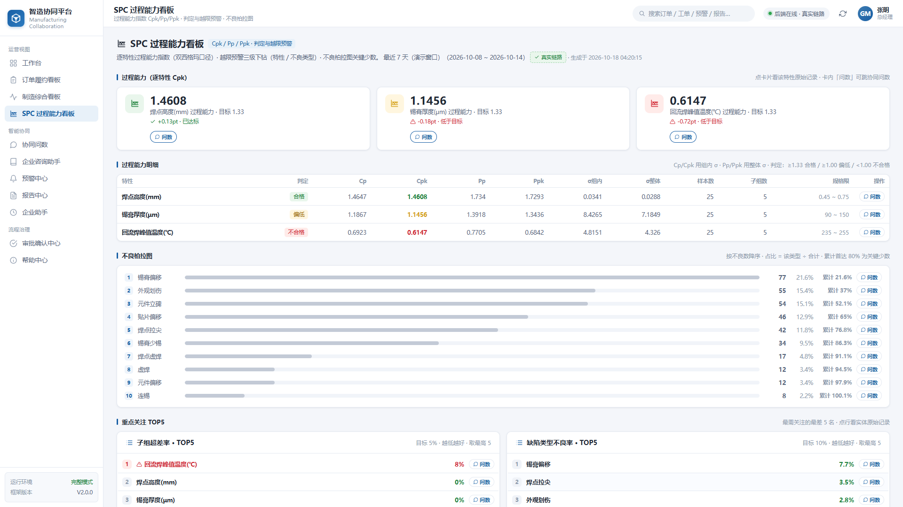

# mfg-agent-platform

制造业多智能体协同平台。17 个领域智能体、7 个业务场景，用 LangGraph 编排，人工在环会签，可离线跑通。

没有大模型、没有外部中间件也能启动：SQLite + 本地 ChromaDB 即可，LLM 不可用时自动降级到规则路由与模板结论，并在结果里显式标 `degraded`。


<p float="left">
  
  
  
  
</p>

---

## 它解决什么

制造企业的异常响应，通常卡在三个环节：

1. 进度不透明。订单交付与异常处理的状态散落在各部门系统和微信群里，跨部门同步滞后以天计。
2. 取数靠人。一线和中层要数据，基本是"问人、导 Excel、写 SQL"三件套。
3. 异常响应慢。停线、缺料、客诉要跨部门取证，靠打电话，根因定位和闭环周期长。

平台把"提问 → 路由 → 多域并行取证 → 工单 → 人工会签 → 对客报告"串成一条链，每一步都有事件流、SQL 溯源和权限校验。

## 能做什么

**编排。** 17 个智能体 = 6 个域组（质量、制造运营、供应链、研发工程、财务、行政人事）+ 11 个专业智能体（TE、ME、IE、NPI、PM、研发测试、经营总览、采购、仓储、EHS、客户服务）。场景用 YAML 声明，节点类型 5 种（agent / fan_out / fan_in / workflow / hitl），加场景不用改框架代码。

**治理。** 8 个 HITL 槽位 × 3 个动词（propose / cosign / approve）= 24 条权限，32 个治理角色，全部声明在 `permissions.yaml`。权限目录启动自检，Agent 身份持有 `*.approve` 直接启动失败。

**问数。** Text2SQL 走八道防线：仅 SELECT、多语句拦截、sqlglot AST 提取表名、表级 ACL（fail-closed）、行数上限、按角色脱敏、provenance 溯源、人工兜底。

**检索。** RAG 案例检索，向量库可换本地 ChromaDB 或 Milvus standalone，BGE-M3 双路召回 + BGE-Reranker-v2-M3 重排。FA 分析自动匹配相似案例，给出 A/B/C/D 评级与复线 ETA。

**脱敏。** 对客报告用禁词映射自动生成（"停线"→"计划内暂停"），同时并行输出内部简报，两条口径分开。

**三个独立模块。** 企业咨询助手（制度知识库 RAG，逐条标出处）、SPC 过程能力看板（Cpk/Pp/Ppk 判定与柏拉图）、企业助手（会议室预订、订餐，ReAct 工具循环，高影响事项只发起人工确认不放行）。

## 架构

```
登录选岗（31 个岗位免密登录，分 5 组，角色决定数据权限与脱敏范围）
     │
协同门户（11 屏：工作台 / 订单履约看板 / 制造综合看板 / SPC 过程能力看板 /
          协同问数 / 企业咨询助手 / 预警中心 / 报告中心 / 企业助手 /
          审批确认中心 / 帮助中心）
     │  POST /api/v2/query ──────────►  GET /api/v2/events（SSE）
     ▼
TwoLevelRouter（L0 规则快路径 / L1 LLM 闭集分类 / 降级模糊匹配）
     │
场景 DAG（YAML 声明式，7 个场景）
     ├─ intake 意图识别 ──► 域判定
     ├─ fan_out 多域并行取证（品质 QMS / 供应链 SCM / 设备 EAM）
     ├─ fan_in 汇聚
     ├─ workflow 工单引擎（状态机 + SLA + P0/P1/P2 分级通知）
     ├─ hitl × N 人工确认（会签门控，waiting_hitl 不会自动放行）
     └─ report 对客脱敏报告 + 内部简报
     │
数据层：SQLite 演示库 + 向量库（默认 ChromaDB，可选 Milvus）
LLM 层：DeepSeek（默认）/ Ollama / OpenAI 兼容接口，不可用自动降级
通知层：P0 电话 / P1 IM / P2 邮件，IM 通道可接企业微信
```

**代码分两层**，不要按字面理解成「V1 / V2 两套并列实现」：

- `src/mfg_agents/common/` — **公共基础设施层**。配置、LLM 工厂、RAG、Text2SQL、DB 客户端、演示库初始化、知识库种子、事件队列、场景关键词规则。V2 主链路在运行时直接依赖这里，**不可删除**。
- `src/mfg_agents/v2/` — **V2/V3 主链路**，详见 [docs/ARCHITECTURE-V2.md](docs/ARCHITECTURE-V2.md)。

> 迁移说明：上述基础设施原先散落在 `mfg_agents/` 顶层及 `tools/`、`db/`、`knowledge/` 包中。由于 V2 运行时依赖它们，早期文档将其笼统称作「V1 原型」容易造成「V1 可以整个删掉」的误解，现已统一收敛到 `common/`。命令行入口同步变更：`python -m mfg_agents.common.init_db`、`python -m mfg_agents.common.seed`。
>
> V1 原型层（`agents/ graph/ ui/ api.py`，Streamlit + 8 Agent）已于 2026-10-18 移除。其行为回归基线迁入 `tests/v2/test_common_baseline.py`（场景关键词路由 / SQL 只读守卫 / 事件队列契约），V1 四域 Agent 的结论基线固化为常量后由 `tests/v2/test_e2e_v2.py::test_domain_conclusions_baseline` 守护。

## 快速开始

需要 Python 3.11+ 和 [uv](https://docs.astral.sh/uv/)。

```bash
git clone https://github.com/Hulk-Zhao/mfg-agent-platform.git
cd mfg-agent-platform
cp .env.example .env          # Windows: copy .env.example .env
uv sync
uv run python -m mfg_agents.common.init_db
uv run python -m mfg_agents.common.seed
uv run python -m uvicorn mfg_agents.v2.demo.api:app --port 8004
```

打开 http://127.0.0.1:8004/demo-ui/ ，选一个岗位进入。

Windows 可双击 `scripts\start_local.bat`，等价于上述第 3 步起的全流程，已绑定 `0.0.0.0`，局域网可直接访问。

Docker：`docker compose up -d --build`（或 `scripts\docker_up.bat`）。演示库持久化在 `app_data` 卷。

> 容器读不到宿主机的系统环境变量。要用云端 LLM，把 key 写进项目 `.env` 的 `DS_KEY=`（该文件不入库），再重启容器。

**可选中间件。** 默认 SQLite + ChromaDB 已够用。需要真实中间件时：`docker compose -f docker-compose.infra.yml up -d`（MySQL 3307 / Milvus 19531），再在 `.env` 设 `VECTOR_BACKEND=milvus` 和 `MILVUS_URI=http://localhost:19531`。端口用 3307 / 19531 是为了避让本机已有实例。

## 演示场景

| 场景 | 示例问题 | 链路特点 |
|---|---|---|
| 停线应急 | A型号在SMT-1停线，何时复线？ | 三域并行取证 + FA 评级 + 复线决策会签 + 对客 ETA 会签 |
| 来料异常 | 今天锡膏批次有问题 | 供应链与品质联合判定，退货/换货/特采走会签 |
| 客户投诉 | 华为投诉BATCH-A-1008 | 品质追溯 + 8D 结构化报告 + 关闭会签 |
| 出货风险 | A型号能发多少货 | 制造加仓储 ATP 核算，交期承诺会签 |
| 设备预警 | SMT-1设备参数异常吗 | 设备日志 + FA 历史案例匹配，停机窗口会签 |
| 订单变更影响 | 订单交期提前两周是否可行 | 制造与供应链联合评估产能与交期，变更承诺会签 |
| SPC 过程异常 | 关键尺寸 Cpk 掉到 0.8 了，要不要介入 | 能力指数判定 + 不良柏拉图取证 + 处置会签 |

同一个问题，不同岗位看到的字段范围不同。PQE 查来料时供应商字段脱敏，采购可见原文——表级 ACL 和字段脱敏都由登录角色驱动。

不起 UI 也可以：`uv run python -m mfg_agents.v2.demo.cli "A型号在SMT-1停线，何时复线？"`，事件流与 provenance 直接打印在终端。

## LLM 配置

| 提供方 | 配置 | 说明 |
|---|---|---|
| DeepSeek（推荐） | `DS_URL` + `DS_KEY` | 快模型统一 `deepseek-flash`；意图路由、工具循环、报告、Text2SQL 的思考档位均为 `disabled`，FA 根因分析有相似案例用 `low`、无案例用 `medium` |
| Ollama | `LLM_PROVIDER=ollama` + `OLLAMA_BASE_URL` / `OLLAMA_MODEL` | 本地模型，容器内经 `host.docker.internal:11434` 复用宿主机 |
| OpenAI 兼容 | `OPENAI_BASE_URL` / `OPENAI_API_KEY` / `OPENAI_MODEL` | 通用兜底（如智谱） |
| 全部留空 | — | 离线降级：规则路由 + 模板结论，标 `degraded` |

## 常见问题

**没有 LLM key 能跑吗？**
能。全部留空即离线降级模式，路由走规则、结论用模板，数字仍取自 SQL，不编造，结论标 `degraded`。适合先看链路再接模型。

**演示数据是真的吗？**
是种子数据，锚定"演示今天 2026-10-15"，与真实日期无关。看板、预警、报告里部分页面是演示数据（页面已标注），接生产时按 `DataSource` 契约替换成真实 ERP/MES。

**Agent 会自己批准放行吗？**
不会。权限目录强制 Agent 身份只持 `*.propose`，`PermissionRegistry` 启动自检，Agent 持 `*.approve` 直接失败。HITL 节点停在 `waiting_hitl` 不会自动放行。

**Text2SQL 会不会改到数据？**
只会 SELECT。多语句被拦截，表名经 sqlglot AST 提取后过表级 ACL（fail-closed），行数有上限，字段按角色脱敏，全链路 provenance 可追溯。

**和直接问通用大模型有什么区别？**
三点是通用大模型给不了的：权限（同一问题不同岗位看到不同字段）、溯源（每个数字能追到具体 SQL 和表）、门控（关键决策必须人工会签，Agent 只发起不放行）。

**需要什么依赖？**
Python 3.11+ 和 uv。默认不装任何中间件，SQLite + 本地 ChromaDB 就够。MySQL 和 Milvus 只在你要接真实中间件时才需要。

**能接我们自己的 ERP/MES 吗？**
能。数据源走 `DataSource` 契约，通知走 `NotificationChannel` 契约，向量库走 `VectorStore` 契约，演示实现都是可替换的内存/本地实现。

**怎么给外部同事演示？**
三种方式：`scripts\start_public_ssh.bat`（SSH 隧道，国内网络首选）、`scripts\start_public.bat`（Cloudflare）、`scripts\start_public_cpolar.bat`（固定域名）。三个脚本都会等 `/api/v2/health` 实测通过才打印链接。详见 [docs/PUBLIC-ACCESS.md](docs/PUBLIC-ACCESS.md)。

**公网演示安全吗？**
演示门户是 31 个岗位免密登录，公网链接等于"谁拿到链接谁就能进"。只用于演示、用完即停（双击 `scripts\stop_public.bat`）。正式对外必须接认证，见下方生产化清单。

**测试怎么跑？**
`uv run pytest tests/ -q`。默认离线，不发外网请求。`tests/v2/test_qa_v1_equivalence.py` 带 `live_llm` 标记会真实调 API 产生费用，本地跑全量前注意。

## 测试

```bash
# 离线确定性（不发任何外网请求）
uv run pytest tests/ -q --ignore=tests/v2/test_qa_v1_equivalence.py

# 含 V1/V2 等价性用例（会真实调用 LLM，产生 API 费用）
uv run pytest tests/ -q

# 放开全部实网 LLM 用例（需已配置 DS_KEY）
MFG_LIVE_LLM=1 uv run pytest tests/ -q
```

CI 在 Python 3.11 / 3.12 / 3.13 三个版本上跑同一套离线用例。

## 项目结构

```
mfg-agent-platform/
├── src/mfg_agents/
│   ├── common/                   # 公共基础设施层（V1/V2 共用，不可删）
│   │                             #   配置 / LLM 工厂 / RAG / Text2SQL / DB 客户端 /
│   │                             #   演示库初始化 / 知识库种子 / 事件队列 / 场景关键词
│   └── v2/                       # V2/V3 主链路
│   ├── contracts/                #   接入契约：IMGateway / DataSource / VectorStore / 权限
│   ├── core/                     #   编排内核：两级路由 / YAML DAG / 共享上下文 / SPC 统计
│   ├── agents/                   #   域 Agent 模块化（quality / supply_chain / engineering / hitl / office / agentic）
│   ├── services/                 #   Text2SQL / 工作流引擎 / 通知 / 看板 / 制度问答 / 办公后端 / 飞书日历
│   ├── scenarios/                #   7 个场景 YAML（新增场景放这里）
│   ├── data/                     #   注册查询 / 指标定义 / 权限目录（YAML）
│   ├── demo/                     #   CLI / FastAPI 入口 / 演示门户（纯静态，零构建）
│   └── mcp_tools/                #   工具注册表 + 最小 MCP server
├── deploy/                       # Milvus standalone 内嵌 etcd 配置
├── data/                         # 演示数据种子 SQL（运行时库自动生成，不入库）
├── tests/                        # 单元 / 安全红队 / 场景 / V1 回归
├── docs/                         # 架构 / PRD / 接口 / 竞品调研
└── scripts/                      # Windows 一键启动脚本
```

## 生产化清单

当前是单实例演示实现。治理层已落地（声明式权限目录 + 启动自检 + 一人一签幂等），上线前还需要做：

- **会签并发与幂等。** 现在靠 `WorkflowEngine` 进程内的 `threading.RLock` 串行化"读-判断-写"，多实例部署时进程内锁不成立。需把签名拆到独立表 `wf_signoff`，加唯一索引 `(task_uid, role_key, actor, verb)` 做数据库级幂等。
- **超时代签。** 字段位已预留（`on_behalf_of` / `overdue_signoff`），入口未开放。启用需同时满足：理由必填、仅 gm / quality_director 可代签、`on_behalf_of` 必填。
- **Agent 身份隔离。** 权限目录已强制 Agent 不持 `*.approve`，但凭据签发与鉴权仍依赖后续认证体系。
- **公网无认证。** 隧道 + 免密登录 = 链接即权限。对外正式提供前必须叠加认证，至少要有访问令牌门禁和登录态，并按角色收敛 HITL 审批接口的匿名写入。
- **企微回调无重放防护。** 同一合法签名重复提交会被再次接受，生产接入需在 API 层补 timestamp 窗口验重 + nonce 缓存。

## 文档

- [docs/ARCHITECTURE-V2.md](docs/ARCHITECTURE-V2.md) — V2 总架构
- [docs/PRD.md](docs/PRD.md) / [docs/PRD-V3.md](docs/PRD-V3.md) — 产品需求文档
- [docs/V2-接口文档.md](docs/V2-接口文档.md) — API 文档（统一入口 / SSE / HITL 回写）
- [docs/V2-HITL-角色协作设计.md](docs/V2-HITL-角色协作设计.md) — HITL 与会签设计
- [docs/PUBLIC-ACCESS.md](docs/PUBLIC-ACCESS.md) — 内网 / 公网访问指南
- [docs/办公助手Agent-竞品调研与植入评估.md](docs/办公助手Agent-竞品调研与植入评估.md) — 办公助手竞品调研
- 更多见 [docs/README.md](docs/README.md)

## License

[MIT](LICENSE)
