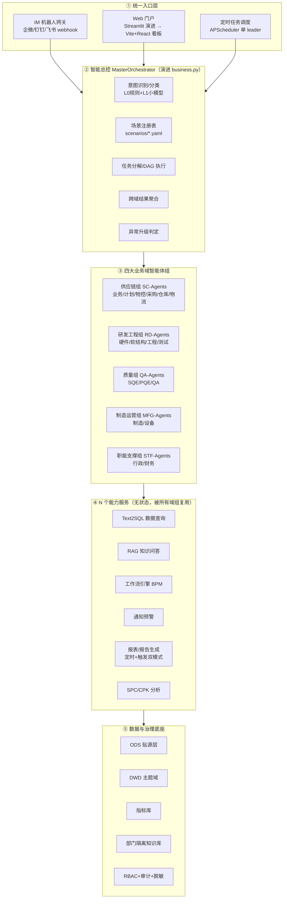
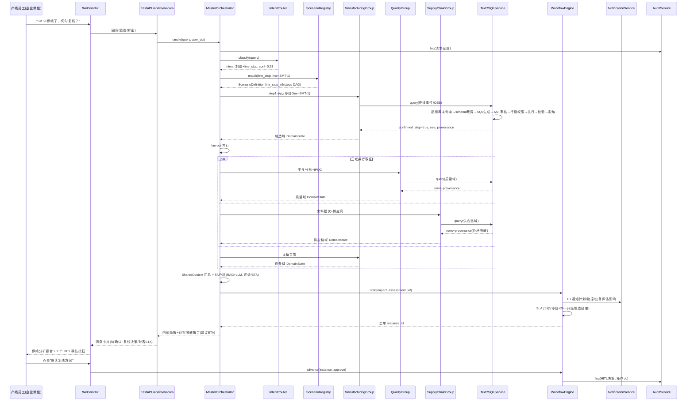
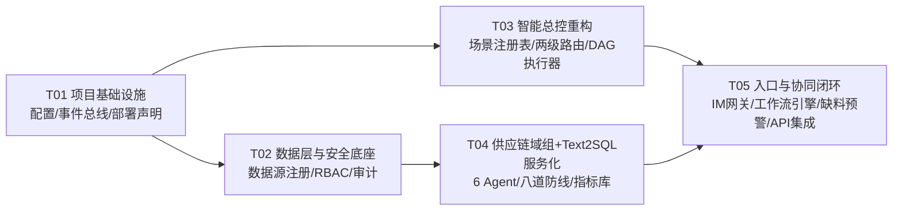

# 制造业多智能体协同办公平台 · 演进架构设计 V2

> **文档定位**：本文是 V1 原型（`docs/ARCHITECTURE.md`）的演进目标架构，回答"如何从 5 场景硬编码原型演进到 16 部门多智能体协同平台"，并附带 Phase-1（MVP）可执行的任务分解。
>
> **输入基线**（已代码盘点，非道听途说）：
> - 编排：`src/mfg_agents/graph/builder.py` — LangGraph StateGraph，8 Agent，5 场景硬编码路由字典 + 关键词规则
> - 状态：`src/mfg_agents/graph/state.py` — 单体 `AgentState` TypedDict，所有域字段平铺
> - 入口：`src/mfg_agents/api.py` — FastAPI SSE；**注意：api.py 是手工顺序编排，并未使用 `build_graph()` 编译出的图**（图与 API 双轨，V1 技术债）
> - 路由：`src/mfg_agents/common/business.py` — `SCENE_RULES` 关键词匹配（README/ARCHITECTURE.md 声称"LLM JSON 抽取"，**文档与实现不一致**，属基线文档债）
> - 数据：`data/init.sql` 8 张模拟表；`common/sql_tools.py` 正则只读过滤 + 硬编码 SCHEMA_PROMPT（写死 SQLite/演示值）
> - 知识：`common/rag_tools.py` ChromaDB 单 collection（`failure_cases`），无权限隔离
> - 事件：`events.py` 全局单 `queue.Queue`（并发下有串话风险）
> - 部署：Docker Compose（mysql/chroma/app），Ollama 复用宿主机；UV + 阿里云镜像源
>
> **设计原则（贯穿全文，来自业务方约束）**：
> ① 确定性流程用工作流引擎，LLM 只做理解/推理/分析/生成/汇总；② 数据质量优先于智能能力；③ 所有智能体行为可审计、可评估；④ 从少数高频场景切入，不一次性铺开 16 部门；⑤ 私有化部署，数据不出厂；⑥ 关键决策人在环路（HITL）；⑦ 演进不重写，保护现有代码资产。

---

## 一、演进策略：不重写的迁移路径

### 1.1 总体判断

V1 原型最大的资产不是 8 个 Agent 代码，而是**三个经过验证的技术模式**：LangGraph fan-out/fan-in 编排、Text2SQL 只读安全模式、RAG+LLM 结构化输出。最大的债是**四个硬编码**：场景硬编码、路由硬编码、状态平铺、schema 写死。

因此演进主线是：**把"硬编码的场景知识"从代码里抽出来变成声明式配置，把"单体状态"拆成分域状态，把"手工编排的 API"收敛回 LangGraph 图，其余（安全 SQL、RAG、SSE、脱敏、LLM 工厂）保留并服务化。**

### 1.2 保留 / 重构 / 新增清单

| 处置 | 模块（现状位置） | 演进动作 | 演进后位置 |
|---|---|---|---|
| **保留** | LangGraph StateGraph（graph/builder.py） | fan-out/fan-in 模式保留，升级为"场景级 DAG 执行器" | orchestrator/executor.py |
| **保留** | Text2SQL 只读过滤（tools/sql_tools.py） | 保留正则/关键词拦截作为**第一道闸**，外层加 AST 审核、表权限、行级权限、结果校验、脱敏 | services/text2sql/ |
| **保留** | RAG（tools/rag_tools.py） | ChromaDB 保留；单 collection → 多知识库（按部门隔离）+ ACL 过滤 | services/rag/ |
| **保留** | SSE 事件流（events.py + api.py） | 全局单队列 → 每请求 context + Redis Pub/Sub 事件总线（保留事件 schema 兼容） | events.py（重写为 EventBus） |
| **保留** | 脱敏报告（agents/report.py） | Prompt 禁词表保留为兜底，主通道改为字段级脱敏策略引擎 | services/report/ + security/masking.py |
| **保留** | LLM 工厂（tools/llm_factory.py） | `get_llm()` 签名不变，扩展分级模型路由（L0 规则/L1 小模型/L2 大模型） | tools/llm_factory.py（扩展） |
| **重构** | 规则路由（agents/business.py） | 关键词规则降级为"快路径"；新增 LLM 动态路由（小模型分类）+ 场景注册表匹配 | orchestrator/router.py + scenario_registry.py |
| **重构** | 单体 AgentState（graph/state.py） | 拆为 `SharedContext`（跨域共享事实）+ 各域 `DomainState`（scoped 字段） | orchestrator/context.py |
| **重构** | 5 个硬编码场景（builder.py 路由字典） | 抽取为 YAML 声明式场景定义（DAG steps + 触发方式 + HITL 点 + 输出物） | orchestrator/scenarios/*.yaml |
| **重构** | api.py 手工编排 | 收敛为统一编排入口（IM webhook / Web / 定时任务三种触发都走同一个 MasterOrchestrator） | api.py + gateway/ |
| **新增** | — | IM 机器人入口（企业微信/钉钉/飞书） | gateway/ |
| **新增** | — | 轻量工作流引擎（状态机+审批+通知+升级，DB 持久化） | services/workflow/ |
| **新增** | — | 预警通知服务（规则引擎+分级通道） | services/notify/ + services/scheduler/ |
| **新增** | — | RBAC（部门数据隔离）+ 审计日志 | security/ |
| **新增** | — | 定时任务（APScheduler，单 leader 执行） | services/scheduler/ |
| **新增** | — | 跨域进度看板（订单交付/NPI/8D 进度聚合） | ui/ + services/report/ |
| **新增** | — | SPC/CPK 分析服务 | services/spc/ |
| **新增** | — | 数据源注册与集成适配（API/MCP/ETL/RPA） | data/sources/ |

### 1.3 技术难点与实现方法

| # | 难点 | 实现方法 |
|---|---|---|
| D1 | 16 部门意图无限膨胀，路由字典爆炸 | 两级路由：L0 规则/缓存快路径（毫秒级）→ L1 小模型分类到"域组"（5 类，闭集）→ 域组内 Agent 自选。路由目标不是 16 个部门而是 **5 个域组 + N 个能力服务**，闭集分类保证可扩展 |
| D2 | 场景组合爆炸（停线×质量×供应链×采购…） | 场景声明式化：YAML 定义 steps DAG（串行/fan-out/fan-in/workflow 节点类型），新场景 = 新 YAML + 复用现有 Agent 节点，零代码 |
| D3 | 单体状态在跨域并行下互相覆盖 | `SharedContext`（只增不改的共享事实，带 source 溯源）+ 域状态隔离；LangGraph reducer 按域合并 |
| D4 | Text2SQL 面对真实 ERP 数百张表，硬编码 SCHEMA_PROMPT 失效 | Schema 注册表（表/字段/注释/部门归属/敏感级别）+ 按用户权限与问题相关性子集注入 + Few-shot 检索增强 |
| D5 | 确定性流程被塞进 LLM 导致不可审计、不可重放 | 分层铁律：状态机/审批/通知/升级全部由工作流引擎执行（DB 持久化、可重放）；LLM 节点只产出"建议"进入 workflow 的 task 节点 |
| D6 | 全局事件队列并发串话（events.py 现状缺陷） | 事件总线：请求级 context 变量 + Redis Pub/Sub；保留现有事件 type 枚举（agent_start/tool_start/llm_start/final…）保证前端兼容 |
| D7 | 新旧行为切换风险 | 影子期：新旧路由并行跑，比对结果不一致时记录到 `route_diff` 表，人工抽检后切流 |

### 1.4 迁移路径与兼容策略

```
V1 原型 ──┬─ 阶段0：git 基线 tag v1.0-prototype ─┬─ 特性开关保留旧路径（ENABLE_LEGACY_ROUTER=true）
          │                                     ├─ 5 个现有场景全部改写为 scenarios/*.yaml（行为等价）
          │                                     ├─ 旧 AgentState 字段名保留为 DomainState 别名（读兼容）
          │                                     └─ api.py 旧 SSE 端点 /api/chat/stream 保留，内部转调新编排器
          └─ 阶段1起：新场景只走注册表；旧端点标记 deprecated（保留一个版本周期后移除）
```

**兼容策略细则**：
1. **分支**：V1 代码在 `main` 保持可运行可演示；演进在 `v2-dev` 分支，按里程碑合回。
2. **场景等价**：`scenarios/line_stop_v2.yaml` 必须通过 V1 的 5 场景回归用例（tests/test_e2e.py 现有断言不改，只扩不缩）。
3. **状态兼容**：`SharedContext.get("oee_data")` 仍能读到旧字段名——老字段作为 domain-scoped 别名保留映射表 `STATE_ALIAS`。
4. **事件兼容**：EventBus 发布的事件 `type` 枚举与 V1 前端（ui/app.py、api.py gen()）完全一致，Streamlit 前端零改动先用起来。
5. **数据兼容**：8 张模拟表保留为 `dev` fixture（`DB_PROFILE=dev`）；真实系统接入走 `DB_PROFILE=prod` + 数据源注册，Text2SQL 的 schema 注册表同时含 mock 与真实表元数据。
6. **契约测试先行**：每重构一个模块，先在 tests/ 补契约测试再动代码（尤其 sql_tools 的只读保证——这是安全边界，回归测试必须覆盖 DDL/DML 注入用例）。

---

## 二、目标业务架构

### 2.1 业务域划分：16 部门 → 5 域

划分依据：**价值流聚类**（波特价值链，制造业主线是订单交付）+ **数据亲缘**（共享同一批主数据：BOM/订单/物料/客户）+ **协同频率**（日常交互密度）。不按"部门各一个智能体"划分——那是组织架构的镜像，会导致 agent sprawl（见风险 R1）。

| 业务域 | 部门 | 核心价值流职责 | 域主数据 | 演进来源（V1） |
|---|---|---|---|---|
| **供应链域** | 业务、计划、物控、采购、仓库、物流 | 订单交付流：商机→订单→计划→采购→生产→发货→开票 | 订单、物料、库存、采购单、供应商、发货 | supply_chain、warehouse agent |
| **研发工程域** | 硬件、软结构（软件+结构）、工程、测试 | NPI 导入流 + ECN 变更流：EVT/DVT/PVT/MP | BOM、图纸、工艺文件、ECN、测试报告 | 新增 |
| **质量域** | SQE、PQE、QA | 质量流：IQC→IPQC→OQC→SCAR/8D→CAPA | 检验记录、不良、客诉、8D、CPK | quality agent（细化 3 角色） |
| **制造运营域** | 制造 | 生产执行与设备：OEE、停线、告警、参数 | 产出、停线事件、设备日志、工艺参数 | manufacturing、equipment agent |
| **职能支撑域** | 行政、财务 | 支撑流程：开票、费用、资产、审批流转 | 发票、费用、资产、审批单 | 新增 |

> **批判性说明**："制造运营域"目前只含制造 1 个部门，为什么单独成域？因为其数据实时性（秒级设备数据）、协同触发频率（停线事件是最高频跨域触发器）与其余域不同，值得独立的数据管道与升级策略。若阶段 2/3 资源紧张，可临时并入供应链域共享图编排，但**状态与数据权限必须保持独立**。

### 2.2 四条核心跨部门价值流

| 价值流 | 阶段链路 | 主导域 | 参与域 | 域间交换物 |
|---|---|---|---|---|
| **订单交付流（OTD）** | 商机→订单→计划→采购→生产→发货→开票 | 供应链 | 制造（产出）、质量（放行）、财务（开票） | 订单状态事件、ATP 结果、生产达成、质量放行单、发货确认 |
| **NPI 导入流** | EVT→DVT→PVT→MP | 研发工程 | 供应链（样料/物料）、质量（验证标准）、制造（试产） | BOM 发布、试产计划、验证报告、试产问题清单 |
| **质量流** | IQC→IPQC→OQC→SCAR/8D→CAPA | 质量 | 供应链（SQE 催供应商）、研发（根因设计侧）、制造（过程改善） | 来料不合格事件、客诉单、8D 报告、CAPA 计划 |
| **ECN 变更流** | ECR→ECN 评审→切换→验证→闭环 | 研发工程 | 供应链（在途/库存处置）、制造（切换执行）、质量（变更验证） | ECN 影响面清单（订单/库存/在制/BOM）、切换指令、验证结论 |

### 2.3 域间协同接口（事件契约）

域间不直接调用对方数据库，统一走**域事件总线**（EventBus topic）+ 能力服务。核心事件契约：

| 事件 Topic | 发布方 | 订阅方 | 载荷（关键字段） | 触发协同动作 |
|---|---|---|---|---|
| `mfg.line_stop.confirmed` | 制造运营 | 质量、供应链、研发、职能(通知) | line_code, product_model, stop_code, start_time | 停线应急场景 DAG 启动（见 §4.1） |
| `mfg.iqc.rejected` | 质量 | 供应链、计划 | batch_no, part_no, supplier, defect, qty | 来料异常协同（§4.2）：冻结/替代料/计划调整 |
| `mfg.customer.complaint.created` | 质量 | 研发、制造、供应链、业务 | complaint_no, customer, batch_no, defect_desc | 8D 闭环工作流启动（§4.3） |
| `mfg.order.delivery.risk` | 供应链 | 业务、制造、物流 | order_no, risk_level, gap_qty, eta_slip_days | 订单交付对齐（§4.4）：升级业务经理 |
| `mfg.material.shortage.predicted` | 供应链（物控） | 计划、采购、制造、业务 | part_no, shortage_qty, impact_lines, horizon_days | 缺料预警多域联动（§4.5） |
| `mfg.equipment.alarm.abnormal` | 制造运营 | 质量、研发（参数侧） | equipment_id, alarm_code, param_snapshot | 设备预警（§4.6） |
| `mfg.ecn.published` | 研发工程 | 供应链、制造、质量 | ecn_no, affected_orders, affected_inventory | ECN 协同（§4.7） |
| `mfg.quality.cpk.breach` | 质量（SPC 定时） | 制造、研发、业务(如涉客) | product_model, cpk, spec, trend | 质量报告+升级（§4.6） |

> **契约治理**：事件 schema 版本化（`schema_version` 字段），新增字段只能追加不能改语义；破坏性变更必须发 v2 topic。这是跨域解耦的生命线——**先定事件契约，再写 Agent 代码**。

---

## 三、目标应用架构："1+1+4+N"智能体拓扑

### 3.1 总体拓扑



### 3.2 智能总控（MasterOrchestrator）

由 V1 `business.py` 关键词路由演进而来，是**唯一的任务入口与出口**。职责与边界：

| 职责 | 说明 | 实现要点 |
|---|---|---|
| 意图识别 | 用户问题/事件 → 意图 + 实体（型号/线体/批次/客户） | L0 规则快路径命中即走；未命中走 L1 小模型（qwen3.5:4b）闭集分类：{供应链, 研发, 质量, 制造, 职能, 闲聊/超范围} |
| 场景匹配 | 意图 → 场景注册表中的 `ScenarioDefinition` | 先精确匹配 trigger/params，再向量相似度 top-1（阈值 0.75，低于则进"超范围人工兜底"） |
| 任务分解 | 场景定义 → steps DAG（串行/fan-out/fan-in/workflow） | LangGraph 动态构图：运行时按 YAML 生成子图，而非 V1 的静态 `add_node` |
| 跨域路由 | 决定调用哪些域组、哪些 Agent | 域组是路由闭集（5 个），组内 Agent 由域组调度器自选 |
| 进度汇总 | 各域 `DomainState` → 统一简报 + 对客脱敏输出 | SharedContext 聚合 + report 服务 |
| 异常升级 | SLA 超时/置信度低/关键决策 → 升级人工 | 升级规则下沉到工作流引擎 EscalationPolicy，总控只负责"发起" |

**总控不做的事**（边界纪律，防止其变成新的上帝对象）：不直接查数据库（必须经 Text2SQL 服务）、不直接发通知（必须经通知服务）、不做审批判断（必须经工作流引擎）、不存业务状态（只存编排上下文）。

### 3.3 四大业务域智能体组（+职能组）

每组统一契约：`DomainAgentGroup.run(task: DomainTask, ctx: SharedContext) -> DomainState`。

#### a) 供应链组（SC-Agents）——演进 supply_chain/warehouse

| 维度 | 定义 |
|---|---|
| 职责边界 | 订单→计划→采购→库存→发运的**履约决策与查询**；不判物料质量（质量域）、不排产到工序（制造域） |
| 核心能力 | 订单全链路状态查询；MRP 物料需求模拟；采购跟催清单；ATP 可用量承诺；在途/发货跟踪；缺料风险识别；供应商交期评估 |
| Agent 构成 | 业务Agent（订单/商机）、计划Agent（MRP/排产）、物控Agent（缺料/备料）、采购Agent（PO/跟催/供应商）、仓库Agent（库存，演进 V1 warehouse）、物流Agent（发运/在途，演进 V1 warehouse 的发货部分） |
| 数据权限 | 订单/物料/库存/采购单/发货单全量；**供应商价格仅采购+计划角色可见，其余角色走脱敏区间** |
| 典型交互 | 收 `mfg.iqc.rejected`→冻结+替代料评估；收 `mfg.line_stop.confirmed`→重排计划+通知业务；发 `mfg.material.shortage.predicted` |
| 升级规则 | 缺料影响>48h 或缺料金额>阈值→升级计划经理+物控经理；交期 slip>3 天→升级业务总监；ATP 承诺必须 HITL（业务确认后才能对客） |

#### b) 研发工程组（RD-Agents）

| 维度 | 定义 |
|---|---|
| 职责边界 | NPI 阶段管理、BOM/图纸/工艺文件、ECN 变更、测试验证；**不承诺交期**（供应链域）、不放行质量（质量域） |
| 核心能力 | BOM 多层展开查询；ECN 影响面分析（受影响订单/库存/在制/在途）；NPI 阶段门（EVT/DVT/PVT/MP）进度跟踪；测试报告汇总；设计知识问答（RAG） |
| Agent 构成 | 硬件Agent、软结构Agent（软件+结构合并设一个 Agent，内部按项目分会话）、工程Agent（工艺/NPI 导入）、测试Agent（验证/报告） |
| 数据权限 | PLM/BOM/图纸**按项目 ACL**（跨项目默认不可见）；客户定制项目另加客户维度隔离 |
| 典型交互 | 发 `mfg.ecn.published`→供应链处置在途/库存、制造执行切换；收质量域 8D 中"设计根因"结论→转化为 ECR |
| 升级规则 | ECN 影响订单金额>阈值或在制数量>阈值→工程部经理+供应链+制造三方会签（HITL）；NPI 阶段门逾期→研发总监 |

#### c) 质量组（QA-Agents）——细化 V1 quality

| 维度 | 定义 |
|---|---|
| 职责边界 | IQC/IPQC/OQC 检验判定、SCAR/8D、CAPA、SPC/CPK、客诉闭环；**不判供应商罚款/商务**（采购域）、不执行停线决策（制造域 HITL） |
| 核心能力 | 不良分布分析（演进 V1 quality_agent）；8D 闭环跟踪与催办；CPK/SPC 计算与判异（对接团队既有 CPK/SPC 经验——这是质量域的**信任锚点**）；客诉 PPM；质量周报/月报 |
| Agent 构成 | SQE-Agent（供应商质量/SCAR）、PQE-Agent（过程质量/IPQC/SPC）、QA-Agent（体系/客诉/OQC/8D 牵头） |
| 数据权限 | 检验/不良/客诉/8D 全量；供应商名称对 QA/SQE 可见，对制造角色脱敏为"供应商A" |
| 典型交互 | 发 `mfg.iqc.rejected`；发 `mfg.customer.complaint.created`；收制造域过程数据→SPC 判异发 `mfg.quality.cpk.breach` |
| 升级规则 | CPK<1.33 连续 3 批或客诉 24h 未响应→质量经理；判定停线建议→制造域 HITL（质量只给建议，不停产指令）；8D 超期→自动升级 + 抄送质量总监 |

#### d) 制造运营组（MFG-Agents）+ 职能支撑组（STF-Agents）

| 维度 | MFG-Agents（演进 manufacturing/equipment） | STF-Agents |
|---|---|---|
| 职责边界 | 生产执行查询（OEE/产出/停线）、设备告警、工艺参数监控；**停线/复线决策是 HITL**，Agent 只给建议 | 行政（用车/会议室/资产/办公审批流转）、财务（开票状态/费用查询/对账） |
| 核心能力 | OEE/达成率查询；停线事件确认与复线ETA建议（演进 V1 FA 逻辑）；设备参数异常检测；工艺参数比对 | 审批状态跟踪（经 OA 数据源）；发票/开票进度查询；费用报销进度 |
| Agent 构成 | 制造Agent、设备Agent（V1 直搬） | 行政Agent、财务Agent |
| 数据权限 | 产出/设备/停线全量（制造部内） | 财务数据按角色（本人/本部门/全量三级）；行政数据按申请单归属 |
| 典型交互 | 发 `mfg.line_stop.confirmed`、`mfg.equipment.alarm.abnormal`；收质量域过程改善建议 | 收订单域开票指令→财务开票；收各域审批请求→OA 工作流 |
| 升级规则 | 停线>2h 未复线或 OEE<60% 持续 1 天→制造经理+生产副总；设备告警连续 3 次→设备工程师+制造经理 | 审批超 SLA→行政/财务负责人 |

### 3.4 N 个能力服务

| # | 能力服务 | 演进来源 | 服务契约（输入→输出） | 关键设计 |
|---|---|---|---|---|
| 1 | **Text2SQL 数据查询** | V1 sql_tools.py | `query(question, user_ctx) → {sql, rows, provenance, masked}` | 指标库优先命中；明细探查才生成 SQL；AST 审核+行级权限+脱敏；见 §5.4 |
| 2 | **RAG 知识问答** | V1 rag_tools.py | `ask(question, user_ctx) → {answer, citations}` | 多知识库（部门隔离）+ ACL 过滤检索；回答必须带引用 |
| 3 | **工作流引擎 BPM** | 新增 | `start(wf_id, ctx) / advance(instance, action)` | 状态机 DB 持久化、审批节点=IM 卡片、SLA 升级；确定性流程唯一执行者 |
| 4 | **通知预警** | 新增 | `send(channel, target, msg)` / 规则扫描 | 分级（P0 电话/P1 IM/P2 邮件）；预警规则配置化 |
| 5 | **报表/报告生成** | V1 report.py | `generate(template, data, mode)` mode=scheduled/event | 双模式：定时（APScheduler）+ 事件触发（订阅 event bus）；保留 V1 脱敏 Prompt 为兜底 |
| 6 | **SPC/CPK 分析** | 新增（团队有 CPK/SPC 基础） | `cpk(data, spec) / control_chart(data)` | 控制图判异规则（Western Electric）；结果写指标库供报告复用 |

> **为什么是"N 个服务"而不是"N 个 Agent"**：能力服务无状态、可复用、可独立测试、可独立评估；Agent 数量膨胀（agent sprawl）是这类平台第一大死因（风险 R1）。域组内新增"部门角色"默认复用域组调度 + 能力服务，只有出现**新的数据域或新的决策闭环**才新增 Agent，且必须过架构评审。

### 3.5 分层原则（LLM 边界铁律）

| 层 | 执行者 | 内容 | 反模式（禁止） |
|---|---|---|---|
| 确定性流程层 | 工作流引擎/状态机 | 审批流、通知、升级计时、工单状态流转、数据管道 | ❌ 用 LLM 判断"该不该升级" |
| 语义理解层 | LLM（L1/L2） | 意图分类、实体抽取、问题理解、方案比选 | ❌ 用 LLM 做算术/统计（CPK 必须代码计算） |
| 分析推理层 | LLM（L2）+ RAG | 根因假设、影响评估、案例匹配、报告撰写 | ❌ 无溯源的数字结论 |
| 执行动作层 | 代码/工作流 | SQL 执行、通知发送、写操作（极少，且必须审批后） | ❌ LLM 直接触发写操作/停线 |

---

## 四、核心协同场景设计（V1 五场景演进版 + 两个新增）

### 4.0 场景总览与演进映射

| # | 场景 | 来源 | 触发方式 | 参与域组 | 核心输出物 | HITL 点 |
|---|---|---|---|---|---|---|
| S1 | 停线应急协同 | V1 `line_stop` 演进 | IM/事件 `mfg.line_stop.confirmed` | 制造+质量+供应链(+计划/物控/业务) | 内部简报+对客脱敏报告+影响评估工单 | 复线决策、对客ETA承诺 |
| S2 | 来料异常协同 | V1 `incoming_quality` 演进 | 事件 `mfg.iqc.rejected`/IM | 质量(SQE)+供应链(采购/计划/物控) | SCAR 单+处置方案+计划调整建议 | 退换货/特采决策 |
| S3 | 客户投诉闭环 | V1 `customer_complaint` 演进 | 事件/IM | 质量(QA牵头)+PQE+SQE+工程+业务 | 8D 报告+客诉 PPM 更新 | 8D 关闭、对客回复 |
| S4 | 订单交付进度对齐 | V1 `delivery_risk` 演进 | IM/定时 | 供应链六 Agent 聚合+制造+物流 | OTD 看板+风险订单清单+ATP 承诺 | 对客交期承诺 |
| S5 | 缺料预警 | **新增（主动型）** | 定时扫描（每 4h）+阈值事件 | 物控发起→计划/采购/制造/业务联动 | 缺料清单+联动处置工单 | 加急采购决策 |
| S6 | 设备预警与质量分析报告 | V1 `equipment_warning` 演进+新增定时报告 | 定时（日/周/月）+事件 | 制造(设备)+质量(SPC) | CPK/SPC 周报月报+设备健康摘要 | 工艺参数调整放行 |
| S7 | ECN 工程变更协同 | 可选（阶段 3） | 事件 `mfg.ecn.published` | 研发+供应链+制造+质量 | 影响面清单+切换计划+验证报告 | ECN 会签、切换指令 |

### 4.1 S1 停线应急协同（V1 `line_stop` 演进）

- **参与分工**：制造Agent 确认停线事实（演进 V1 manufacturing）→ **fan-out 并行**：质量Agent（不良分布/IPQC 记录）、供应链Agent（来料批次/供应商状态）、设备Agent（告警/参数，V1 equipment 直搬）→ 总控汇总进 SharedContext → FA 分析（V1 fa.py RAG 逻辑保留：评级/根因/复线 ETA）→ **工作流引擎**执行影响评估（通知计划/物控/业务评估，这是 V1 完全没有的确定性联动）。
- **数据流**：IM/事件 → MasterOrchestrator → 场景 YAML DAG → 三域并行 Text2SQL → SharedContext（含 SQL provenance）→ FA（RAG+LLM）→ workflow(impact_assessment) → notify（制造经理 P1 IM + 业务 P2）→ report（内部简报/对客脱敏）。
- **触发方式**：① 员工 IM 提问（V1 方式）；② **新增** MES 停线事件经 `mfg.line_stop.confirmed` 自动触发（无需人等问）。
- **输出物**：内部简报（评级/根因/ETA/证据链）、对客脱敏报告（V1 禁词表机制保留）、影响评估工单（计划调整/物料替代/对客沟通任务）。
- **异常与升级**：三域并行任一域 30s 超时→该域标记 degraded 继续；FA 置信度低（RAG 无相似案例）→ 人工分析任务升级 PQE；停线>2h→EscalationPolicy 升级制造经理+生产副总；**复线动作必须制造现场负责人 IM 卡片确认（HITL）**；对客 ETA 必须业务确认后才允许 report 服务输出对外话术。

### 4.2 S2 来料异常协同（V1 `incoming_quality` 演进）

- **参与分工**：质量域 SQE-Agent 判定不合格等级（演变 V1 supply_chain+quality 串联）→ fan-out：采购Agent（跟催/供应商沟通）、计划Agent（排产影响）、物控Agent（库存/替代料）→ 总控汇总 → 工作流引擎驱动处置（退换货/特采/挑选，**特采必须 HITL：SQE+PQE+生产三方会签**）。
- **数据流**：IQC 系统推送/人工报验 → 事件总线 → 质量域判定 → 三域并行取证 → workflow(scar_flow) → SCAR 单生成 → notify 供应商（采购通道）。
- **触发方式**：① V1 的 IM 提问（"今天锡膏批次有问题"）；② **新增** QMS 检验结论接口自动触发（主路径）。
- **输出物**：SCAR 单、处置方案（含库存冻结清单）、计划调整建议、供应商整改要求。
- **异常与升级**：供应商 24h 未回复 SCAR→升级采购经理；判定影响在制→通知制造域冻结投料；缺替代料且影响订单→触发 S5 缺料预警流程。

### 4.3 S3 客户投诉闭环（V1 `customer_complaint` 演进，8D 化）

- **参与分工**：QA-Agent 牵头 8D（V1 只有 quality→fa→report 三段，无闭环）→ PQE-Agent 过程分析（IPQC 数据/SPC）→ SQE-Agent 供应商侧分析 → 工程Agent 设计根因（研发域）→ 业务Agent 对客沟通口径 → 工作流引擎跟踪 D1-D8 各节点 SLA。
- **数据流**：CRM/OA 客诉单 → 事件 → 8D 工作流实例（每步一个 task 节点，责任人=部门角色）→ 各域 Agent 按节点产出分析 → QA 汇总 8D 报告 → CAPA 录入 → 闭环校验。
- **触发方式**：CRM 客诉单创建事件（主）；IM 查询客诉进度（辅，演进 V1 查询路径）。
- **输出物**：8D 报告（D0-D8 全链）、CAPA 计划、客诉 PPM 指标更新、对客回复（脱敏+HITL 确认）。
- **异常与升级**：任一 D 步骤超 SLA→自动升级 + IM 催办；根因跨域争议（质量 vs 研发）→ 升级质量总监+研发总监会商（HITL）；涉批量安全→P0 升级总经理。

### 4.4 S4 订单交付进度对齐（V1 `delivery_risk` 演进，OTD 全链路）

- **参与分工**：总控并行聚合供应链六 Agent：业务（订单/客户要求）、计划（排产/齐套）、物控（备料/缺料）、采购（PO/在途）、仓库（成品 ATP，演进 V1 warehouse）、制造（产出达成）→ 物流（在途/ETA）→ 汇总为订单级 OTD 状态 → 风险订单进 workflow(risk_escalation)。
- **数据流**：IM 查询/定时扫描 → 并行 Text2SQL（各自域权限）→ SharedContext 订单事实合并 → 风险规则引擎（指标库 OTD 口径）→ 看板 + 风险清单。
- **触发方式**：① IM（"A型号能发多少货"，V1 原样支持）；② **新增**每日定时 + 交付前 7 天自动巡检。
- **输出物**：OTD 看板（按客户/型号/订单）、风险订单清单（含缺口数量与建议动作）、ATP 承诺建议。
- **异常与升级**：缺口>0 或 slip>3 天→升级业务总监；**ATP/交期对客承诺必须业务 HITL 确认**；数据域缺字段（如无 PO 在途表）→ 标记数据缺口进人工兜底队列，**严禁 LLM 编造在途数量**。

### 4.5 S5 缺料预警（新增，主动型场景的样板）

- **参与分工**：物控Agent 定时扫描（安全库存/在途/在制消耗速率）→ 预测缺口 → fan-out 联动：计划Agent（可否改排）、采购Agent（催交/替代）、制造Agent（影响线体/工时）、业务Agent（影响订单/客户）→ workflow(shortage_response) 分派处置 → 跟踪闭环。
- **数据流**：APScheduler（每 4h）→ 物控扫描 SQL（经过 Text2SQL 服务的"注册查询"模式，非自由生成）→ 缺口事件 `mfg.material.shortage.predicted` → 多域并行评估 → 工单分派 → 每日 IM 播报进展。
- **触发方式**：纯定时 + 阈值事件（本场景**没有**用户提问触发——这是从"人找Agent"到"Agent找人"的关键转变）。
- **输出物**：缺料清单（料号/缺口/影响线体/影响订单/建议动作）、联动处置工单、每日缺料播报。
- **异常与升级**：影响停线风险<48h→P1 立即 IM 通知计划+采购+制造经理；加急采购金额>阈值→采购总监 HITL；误报率监控（关单时标注"未实际发生"回流优化阈值）。

### 4.6 S6 设备预警 + 质量分析报告（V1 `equipment_warning` 演进 + 定时报告）

- **设备预警演进**：V1 是"问一句查一次"；演进为设备Agent 订阅告警流 + 参数基线比对（SPC 服务），异常即推 IM；**参数调整建议必须工艺工程师 HITL 放行**。
- **质量分析报告（新增双模式）**：SPC/CPK 服务按日/周/月计算（指标库口径）→ 报告服务生成周报/月报（模板化 + LLM 撰写摘要与改进建议）→ 定时推送质量部 + 月度质量会前自动就绪。**CPK 等统计量一律代码计算，LLM 只做解读**——这是与团队既有 CPK/SPC 工作流的对接点，也是质量域采纳的信任基础。
- **输出物**：CPK/SPC 周报月报（按产品/工序/不良模式）、设备健康摘要、改进建议清单。

### 4.7 S7 ECN 工程变更协同（可选，阶段 3）

- 研发工程Agent 发布 ECN → 影响面分析服务（订单/库存/在制/在途/BOM 展开，代码计算）→ workflow(ecn_approval) 四方会签（研发/供应链/制造/质量，HITL）→ 切换指令下达制造 → 质量域变更验证 → 闭环。
- 输出物：ECN 影响面清单、切换计划、验证报告、BOM 版本记录。

### 4.8 场景声明式定义示例（新场景零代码新增）

```yaml
# orchestrator/scenarios/material_shortage.yaml
version: 1
scenario_id: material_shortage_v2
name: 缺料预警联动
intent_examples:                       # L1 小模型路由 few-shot
  - "哪些物料要断料了"
  - "XX 料还够几天"
triggers:
  - {type: schedule, cron: "0 */4 * * *"}     # 主触发：主动型
  - {type: im_message}
  - {type: event, topic: "mfg.material.shortage.predicted"}
params:
  - {name: part_no, extractor: none, required: false}   # 定时触发无参数
steps:
  - {id: scan, agent: material_control, capability: text2sql, query_id: shortage_scan_v1}
  - {id: evaluate, type: fan_out, branches: [planning, procurement, manufacturing, business], join: all}
  - {id: dispatch, type: workflow, workflow: shortage_response_wf}
  - {id: broadcast, type: notify, channel: im, level: P1, condition: "impact_hours < 48"}
outputs: [shortage_list, response_tickets]
hitl:
  - {step: urgent_po, approver_roles: [采购总监], condition: "amount > 50000"}
```

---

## 五、数据架构

### 5.1 数据源与集成方式

| 系统 | 域 | 集成方式（优先级降序） | 说明 |
|---|---|---|---|
| ERP（订单/采购/库存/财务） | 供应链/职能 | ① API ② CDC(Debezium) ③ ETL | 主数据权威源；无 API 的老 ERP 走 CDC 或 RPA |
| MES（产出/停线/工序） | 制造 | ① API ② 消息队列(Kafka/RabbitMQ) ③ MCP | 停线事件优先消息推送，保障 S1 实时性 |
| WMS（库存/发货） | 供应链 | API/CDC | ATP 计算源 |
| PLM（BOM/图纸/ECN） | 研发 | API/MCP | BOM 版本与 ECN 是 ECN 场景生命线 |
| QMS（检验/不良/客诉/8D） | 质量 | API/事件 | IQC 结论推送驱动 S2 |
| CRM（商机/客诉） | 供应链/质量 | API | 客诉单驱动 S3 |
| OA（审批/行政） | 职能 | RPA（多数 OA 无开放 API） | 兜底方案，见 §6.3 |
| 设备数采/SCADA | 制造 | MQTT→消息队列 | 参数级数据走专门管道，不进 OLTP |

> **批判性判断**：集成工作量通常占此类项目 **60%~70%**（风险 R3）。阶段 0 只打通 **1 个真实系统**（建议 MES 或 ERP 订单模块——选事件最密、痛点最直接的），其余维持 V1 模拟表开发，避免"集成泥潭"吞掉 MVP。

### 5.2 数据分层：ODS → DWD → 指标库

```
源系统(API/CDC/ETL/RPA) → ODS 贴源层(原样落库+数据质量标记)
   → DWD 主题域(清洗/标准化/关联) → 指标库(口径统一+可追溯) → 智能体/看板/报告
```

| 层 | 内容 | 关键规则 |
|---|---|---|
| ODS | 各源系统原表快照 | 只增不改；带 `sync_batch_id`/`source_system`；**入库即打质量标签**（完整率/时效/重复） |
| DWD | 九大主题域：**订单/物料/库存/质量/生产/设备/供应商/客户/财务** | 统一主数据编码（物料编码/供应商编码一物一码）；缓慢变化维（SCD2）存 BOM/客户 |
| 指标库 | 唯一口径的指标服务 | **指标定义即代码**（YAML：公式+来源表+过滤条件+负责人）；智能体优先查指标库，禁止各自写口径 |

**指标库 v1（定义 + 来源 + 口径）**：

| 指标 | 定义 | 来源域 | 计算口径 |
|---|---|---|---|
| OTD 准时交付率 | 按时交付订单占比 | 订单+发货 | 实际发货日 ≤ 客户要求日（容许 0 天）；按订单行计 |
| 缺料率 | 缺料导致停线占比 | 物料+生产 | 缺料停线时长 / 总停线时长；滚动 30 天 |
| CPK 过程能力 | 过程能力指数 | 质量(测试/检验) | Cp=(USL-LSL)/6σ；Cpk=min((USL-μ),(μ-LSL))/3σ；σ 用组内极差法 |
| FPY 一次通过率 | 首次检验通过占比 | 生产+质量 | 首次 PASS 数 / 总投入数；按工序 |
| OEE 设备综合效率 | 时间×性能×良品 | 生产+设备 | 可用率×性能开动率×良品率；按设备按班次 |
| 客诉 PPM | 百万件投诉数 | 质量+CRM | 客诉次数 / 出货数量 ×1e6；滚动 12 个月 |

> **铁律**：没有 DWD 和指标库之前，不开放对应域的 Text2SQL 自由探查（只开放注册查询）。这是"数据质量优先于智能能力"的落地。

### 5.3 知识库权限设计（部门隔离）

| 知识库 | 归属 | 内容 | ACL 规则 |
|---|---|---|---|
| kb_failure_cases | 质量（演进 V1 collection） | 历史异常/8D/停线案例 | 全司可检索，**供应商名/客户名对非质量角色脱敏** |
| kb_sop_process | 制造/工程 | SOP/工艺文件/作业指导 | 按工序+项目 ACL |
| kb_supplier | 采购 | 供应商档案/规格书/价格 | 采购+计划可见；**价格字段独立 ACL** |
| kb_policy | 职能 | 制度/流程/表单 | 全司；财务制度按角色 |
| kb_project | 研发 | 项目文档/设计资料/BOM 说明 | **按项目 ACL**（跨项目默认拒绝） |

实现：ChromaDB 多 collection（或独立实例），检索时以 `user_ctx` 的部门/角色/项目做 **metadata 预过滤**（过滤下推，而非检索后过滤——否则越权内容已进入上下文）。文档入库时由 `security/masking.py` 打密级标签。

### 5.4 Text2SQL 服务化设计（演进 V1 sql_tools.py）

```
用户问题
  │
  ├─① 指标库命中？ ──是──→ 直接计算指标（口径统一，最高置信） ─────────────┐
  │  （OTD/缺料率/CPK...）                                              │
  │                                                                      │
  └─否→ ② 注册查询命中？ ──是──→ 参数化执行预注册 SQL（ shortage_scan ）─┤
       （高频固定查询）                                                  │
       │                                                                │
       └─否→ ③ 明细探查：                                               │
            Schema 注册表（按用户数据权限裁剪可见表/字段子集）            │
            + Few-shot 示例检索（同部门同表历史正确 SQL）                │
            → LLM 生成 SQL（小模型 L1 优先，失败升级 L2）                │
            → ④ SQL 审核链：                                            │
                a. 正则拦截（V1 逻辑保留：DDL/DML 关键词）               │
                b. AST 解析校验（sqlglot）：仅 SELECT、无子查询写操作     │
                c. 表级权限（用户部门可见表白名单）                      │
                d. 行级权限（自动注入 dept_id/customer_id 过滤条件）      │
                e. 敏感字段标记（价格/客户名/供应商 → 查询即脱敏）        │
            → 执行（只读账号 + 语句超时 + 行数上限）                     │
            → ⑤ 结果校验：空结果/行数爆炸/类型异常/口径提示              │
            → ⑥ 超范围问题 → 人工兜底工单（工作流引擎）                  │
                                                                        │
                                                              统一返回 {sql, rows, provenance, masked}
```

与 V1 的差异点（必须让 Engineer 知道演进在哪）：V1 是"一个问题→一个硬编码 schema prompt→正则过滤→执行"；V2 增加**指标库优先、注册查询、schema 注册与裁剪、Few-shot、AST 审核、行级权限、结果校验、人工兜底**八道防线。**provenance（SQL + 命中行号）随结果一起返回**——这是所有下游 LLM 结论可溯源、可审计的基础。

---

## 六、技术架构

### 6.1 框架选型：LangGraph 深化 vs 引入 Dify

| 维度 | LangGraph 继续深化（**推荐**） | 引入 Dify 做低代码编排 |
|---|---|---|
| 现有资产 | graph/builder.py、8 Agent、5 场景测试可继承，演进成本低 | **全部推倒重来**，违反"演进不重写"原则 |
| 多智能体精细控制 | fan-out/fan-in、状态 reducer、检查点（checkpointer）原生支持 | Dify 强在单 Agent/工作流低代码，多智能体跨域状态共享弱 |
| 确定性流程 | 可挂接自研工作流引擎，边界清晰 | Dify 自带流程编排但与外部 BPM/审批易形成双轨 |
| 可测试/可审计 | 纯 Python，pytest 契约测试、CI 门禁天然支持 | 配置即代码能力弱，评测回归难 |
| 数据主权 | 全私有化，无外部依赖 | Dify 可私有化，但社区版功能裁剪、升级受制于其发布节奏 |
| 低代码价值 | —— | 职能域简单问答/表单流转可快速上线 |
| 团队技能 | 已掌握 | 新增学习成本 |

**决策**：**主编排继续 LangGraph 深化 + 自研声明式场景层（YAML DAG）**；Dify **不进主干**，仅在阶段 3 作为"职能域低代码试点"旁路评估（若试点成功，作为可选组件挂接，不影响主干架构）。理由：现有代码资产 + 数据敏感私有化 + 多智能体是主战场，这三点都是 LangGraph 占优；Dify 的低代码收益可以用"YAML 场景 + IM 卡片"覆盖 80%。

### 6.2 LLM 分级与场景分配

| 级别 | 用途 | 模型建议 | 部署 | 说明 |
|---|---|---|---|---|
| L0 | 意图快路径/实体正则抽取/指标计算 | 无 LLM（规则+代码） | 本地 | 能不用 LLM 就不用，<10ms |
| L1 | 意图分类（闭集 5 域）、路由、实体抽取、SQL 生成初版 | qwen3.5:4b（Ollama） | **本地 Ollama** | 高频低敏，走本地保延迟与成本 |
| L2 | 分析推理、RAG 答案、FA 评级、报告生成 | qwen3.5:9b → 32b；DeepSeek API 兜底 | **本地优先**；网络隔离或本地资源不足时 DeepSeek（仅限脱敏后非敏感场景） | 数据不出厂原则：涉 BOM/价格/客户的推理**必须本地** |
| L3 | 超范围/低置信 → 人工 | —— | 工单 | 兜底不是失败，是设计的一部分 |

`common/llm_factory.py` 扩展 `get_llm(tier="L1"|"L2")`，V1 调用点零改动；资源允许时本地升级 vLLM 托管（并发与吞吐），工厂层切换对业务透明。

### 6.3 工具集成：MCP 优先，RPA 兜底

- **MCP（Model Context Protocol）优先**：新系统对接一律封装为 MCP Server（工具描述+入参 schema），智能体通过标准协议调用，解耦"工具实现"与"智能体编排"，也为未来切换工具实现留门。
- **存量系统无 API**（典型：老 OA、封闭 ERP）：RPA（如影刀/来也/UiPath，或自研 Playwright 方案）作兜底，**RPA 动作纳入工作流引擎的任务节点**（可重放、可审计、失败重试），不让 LLM 直接驱动 RPA。
- 所有外部工具调用过 `security/audit.py` 记审计（谁/何时/什么参数/什么结果）。

### 6.4 IM 机器人接入（企业微信/钉钉/飞书）

| 平台 | 接入方式 | 关键点 |
|---|---|---|
| 企业微信 | 自建应用回调（URL+Token+AES 加解密）→ `gateway/wecom_bot.py` | 消息加解密、5s 内被动回复（异步场景先回"已受理"再推送结果）、支持消息卡片（HITL 审批按钮） |
| 钉钉 | 企业内部机器人 outgoing + Stream 模式二选一 | Stream 模式免公网回调，内网友好 |
| 飞书 | 事件订阅 + 消息卡片 | 卡片交互（审批同意/驳回回调） |

统一抽象：`IMGateway.receive(payload) / reply(user, card)`，三平台适配器实现同一接口；HITL 审批通过卡片按钮回写工作流引擎 `advance(instance, action)`。

### 6.5 部署演进：Docker Compose → K8s

| 阶段 | 形态 | 组件 | HA 考虑 |
|---|---|---|---|
| 阶段 1（MVP） | Docker Compose（演进现有 compose） | app + MySQL + Redis(事件总线) + Chroma；Ollama 宿主机 GPU | app 无状态可起 2 副本 + nginx；MySQL 单点（每日备份，接受）；定时任务单实例 leader（DB 锁） |
| 阶段 2 | K8s（Helm） | 同上容器化 + HPA + Ingress/TLS | app HPA 2-4 副本；MySQL 主从或云托管；Redis 哨兵；Chroma→评估 Qdrant/Milvus；APScheduler→K8s CronJob + 分布式锁 |
| 阶段 3 | K8s + 可观测 | + Prometheus/Grafana/Loki | LLM 推理独立节点池（GPU）；链路追踪贯穿 IM→总控→域组→工具 |

**部署红线**：LLM（Ollama/vLLM）与全部数据组件不出厂区网络；公网只暴露 IM 回调入口（或走企业内网穿透/专线）。

### 6.6 安全治理

| 项 | 设计 |
|---|---|
| RBAC | user-department-role-permission 四层；**功能权限**（能用哪个场景/Agent）+ **数据权限**（可见哪些表/行/字段）双轨；数据权限在 Text2SQL 审核链与 RAG 检索过滤两处强制执行 |
| 部门数据隔离 | 行级：查询自动注入部门/项目/客户过滤；列级：敏感字段（价格/客户/供应商）按角色脱敏为区间或代号 |
| 审计 | 每一次 LLM 调用（prompt/响应/token/模型/耗时）、每一次 SQL（原文+结果行数）、每一次审批与通知，全量入 `audit_log` 表，**只追加不可改**，保留 3 年 |
| 脱敏 | 字段级 masking 策略引擎（YAML 配置：字段×角色×脱敏方式）；V1 的 Prompt 禁词表保留为报告出口兜底 |
| 智能体评估 | 离线：每场景评测集（问题+期望要点+禁止编造项），CI 门禁跑回归；在线：用户点踩率、SQL 执行错误率、超范围兜底率、人工改写率、token 成本/请求，周报跟踪 |

---

## 七、实施路线图

### 7.0 阶段总览

| 阶段 | 周期 | 范围 | 成功指标 | 退出条件 |
|---|---|---|---|---|
| **阶段 0**<br/>筑基 | 2-4 周 | 数据与集成盘点；git 基线 tag；选定首个真实打通系统；定 3 个高频场景；建评测集与数据字典 | 集成清单+数据字典 v1；评测集 ≥50 条；基线 tag `v1.0-prototype`；首系统连通验证通过 | PRD 与架构评审签字；3 场景范围锁定（建议：订单进度查询、缺料预警、停线应急）；评测集基线分记录 |
| **阶段 1**<br/>MVP | 2-3 个月 | 总控重构（注册表+动态路由）+ 供应链域 6 Agent + 订单进度查询 + 缺料预警 + 企业微信入口 + RBAC/审计最小集 | 订单进度问答准确率 ≥85%（评测集）；缺料预警发现时效 T+0；试点 3 部门周活 ≥60%；SQL 注入攻击用例 100% 拦截 | 试点部门（业务/计划/物控）连续 4 周周活达标；零 P0 数据事故；V1 五场景回归全绿后旧端点下线 |
| **阶段 2**<br/>质量+制造 | 3-6 个月 | 质量域 3 Agent + 制造域细化 + SPC/CPK 服务 + 定时报告（周报/月报）+ 8D 工作流 + 工作流引擎完善 | CPK 周报被质量部采纳为周会输入；8D 闭环周期缩短 ≥30%；停线协同 IM 触达 <30s | 质量部/制造部验收签字；SPC 结果与人工计算比对偏差 <0.5% |
| **阶段 3**<br/>研发+职能+预测 | 6-12 个月 | 研发工程域（ECN/NPI）+ 职能域 + 预测性分析（缺料预测/交期预测）+ Web 门户升级（React 看板） | ECN 影响分析覆盖率 100%；预测模型基线准确率记录；16 部门全覆盖 | 域组全部上线；预测价值经业务方确认；进入持续运营（评测+监控周会） |

### 7.1 阶段 1 里程碑（对应附录 B 任务分解）

| 里程碑 | 内容 | 交付物 |
|---|---|---|
| M1（W1-2） | T01+T02 完成 | 事件总线、数据源注册、平台库（RBAC/审计/工作流表）、安全模块 |
| M2（W3-4） | T03 完成 | 场景注册表 + 5 个 V1 场景 YAML 等价迁移 + 动态路由（影子模式比对） |
| M3（W5-7） | T04 完成 | 供应链域 6 Agent + Text2SQL 服务化八道防线 |
| M4（W8-9） | T05 完成 | 企业微信机器人 + 缺料预警工作流 + Web 门户 |
| M5（W10-12） | 试点运营 | 评测达标、影子切流、旧 SSE 端点下线、复盘 |

---

## 八、风险清单与缓解

| # | 风险 | 概率/影响 | 缓解措施 |
|---|---|---|---|
| R1 | **Agent sprawl**：16 部门各自要 Agent，数量膨胀失控 | 高/高 | 1+1+4+N 拓扑：路由闭集是 5 域组；新"部门角色"默认复用域组调度+能力服务；新增 Agent 需过架构评审（必须有新数据域或新决策闭环的理由）；域组内 Agent 上限纪律 |
| R2 | **数据质量差**：源头脏数据使智能输出"精确的垃圾" | 高/高 | ODS 质量标记+DWD 清洗门禁；指标库唯一口径；数据质量看板周会；**无 DWD 的域不开放自由 Text2SQL**；数字结论强制 provenance |
| R3 | **集成成本占比超预期**（60-70%） | 高/高 | 阶段 0 只打通 1 个系统；MCP 标准封装；RPA 兜底但有明确边界；集成工作量单独跟踪，不允许挤占场景交付 |
| R4 | **LLM 幻觉/错误**导致错误决策（编造在途数量、错误根因） | 中/高 | 统计量代码计算；数字必须溯源 SQL 行；AST 审核+结果校验；关键决策 HITL（采购/质量放行/交期承诺）；红队测试（诱导编造用例进评测集） |
| R5 | **LLM 成本与延迟**：大模型全量调用不可持续 | 中/中 | L0/L1/L2 分级；本地小模型兜底；规则快路径；结果缓存（同问题同参数）；token 成本周报 |
| R6 | **安全合规**：数据不出厂红线被突破（调用外部 API 带敏感上下文） | 中/高 | 涉敏推理强制本地 LLM；外部 API 仅限脱敏后非敏场景；RBAC 双轨+行级过滤下推；审计全量；上线前渗透测试；脱敏策略引擎配置化评审 |
| R7 | **组织变革与采纳**：部门墙、不信任、沦为演示玩具 | 高/高 | 从 3 个高频痛点切入（不铺 16 部门）；试点部门共创（让他们命名场景）；HITL 设计给人掌控感；培训+运营指标（周活/点踩率/人工改写率）周会跟踪 |
| R8 | **缺乏评估体系**：无法证明价值，项目烂尾 | 中/高 | 阶段 0 即建评测集（≥50 条，CI 门禁）；在线监控五指标；价值度量对齐业务语言（停线时长、OTD、8D 周期）而非技术指标 |
| R9 | **供应商锁定**：LLM/IM/框架绑架 | 中/中 | LLM 工厂抽象（Ollama/vLLM/DeepSeek 可切）；IM 适配层三平台同接口；MCP 标准封装工具；场景 YAML 与编排框架解耦（可迁移到其他编排器） |
| R10 | **Text2SQL 准确率天花板**：真实 ERP 复杂语义超模型能力 | 高/中 | 指标库优先（口径统一）；注册查询覆盖高频；Text2SQL 只做明细探查；超范围人工兜底；Few-shot 持续回流（人工修正的 SQL 进示例库） |
| R11 | **自研工作流引擎边界**：复杂人工流程（会签/代理/委托）超出能力 | 中/中 | MVP 只做状态机+审批+通知+升级四类节点；每阶段评估是否引入 Camunda/Temporal；**先不引**，避免重框架绑定 |
| R12 | **基线文档债**：README/ARCHITECTURE.md 与实现不一致（如 business.py 实为规则路由），误导后续开发 | 中/低 | 阶段 0 第一周完成文档校准（本文档 §1.1 已记录事实基线）；后续文档变更随代码 PR 走 |

---

## 附录 A：详细设计（数据结构与接口）

### A.1 目标文件清单（V2，相对仓库根目录）

```
src/mfg_agents/
├── config.py                        # [改] 扩展：DB_PROFILE、EVENT_BACKEND、IM 配置、模型分级
├── events.py                        # [改] 全局队列 → EventBus（context 注入 + Redis Pub/Sub）
├── api.py                           # [改] 收敛为统一编排入口；保留 /api/chat/stream 兼容
├── orchestrator/                    # [新] 智能总控
│   ├── __init__.py
│   ├── router.py                    #   两级路由（规则快路径 + L1 分类）
│   ├── scenario_registry.py         #   场景注册表（加载/匹配/版本）
│   ├── executor.py                  #   YAML DAG → LangGraph 子图执行器
│   ├── context.py                   #   SharedContext + DomainState + STATE_ALIAS
│   └── scenarios/                   #   声明式场景（V1 五场景等价迁移 + 新场景）
│       ├── line_stop_v2.yaml
│       ├── incoming_quality_v2.yaml
│       ├── customer_complaint_v2.yaml
│       ├── delivery_status_v2.yaml
│       ├── equipment_warning_v2.yaml
│       └── material_shortage.yaml
├── agents/                          # [改] 域组化
│   ├── base.py                      #   BaseAgent 增加 domain/data_scope/escalation 契约
│   ├── supply_chain/                #   供应链组（业务/计划/物控/采购/仓库/物流）
│   ├── rd_engineering/              #   研发工程组（硬件/软结构/工程/测试）
│   ├── quality/                     #   质量组（SQE/PQE/QA）
│   ├── manufacturing/               #   制造运营组（制造/设备）
│   ├── function/                    #   职能组（行政/财务）
│   ├── fa.py                        #   [留] RAG+LLM 分析（FA 能力并入各域组调度）
│   └── report.py                    #   [改] 移交 services/report，保留脱敏 Prompt 兜底
├── services/                        # [新] N 个能力服务
│   ├── text2sql/                    #   service.py/auditor.py/schema_registry.py/
│   │                                #   fewshot.py/validator.py/masker.py
│   ├── rag/                         #   service.py/knowledge_bases.py（多库+ACL）
│   ├── workflow/                    #   engine.py/models.py/escalation.py（状态机+审批+升级）
│   ├── notify/                      #   notifier.py/channels.py（分级通道）
│   ├── scheduler/                   #   jobs.py（APScheduler + leader 锁）
│   ├── report/                      #   generator.py/templates/（定时+触发双模式）
│   └── spc/                         #   cpk.py/control_chart.py（代码计算）
├── data/                            # [新] 数据平台
│   ├── sources/                     #   registry.py/adapters/(api/mcp/etl/rpa)
│   ├── dwd/                         #   主题域物化脚本/模型
│   └── metrics/                     #   metric_registry.py + metrics/*.yaml（指标定义即代码）
├── security/                        # [新]
│   ├── rbac.py                      #   权限模型 + 数据范围裁剪
│   ├── audit.py                     # 全量审计（只追加）
│   └── masking.py                   #   字段级脱敏策略引擎
├── gateway/                         # [新] IM 入口
│   ├── im_gateway.py                #   统一抽象
│   ├── wecom_bot.py                 #   企业微信（加解密+卡片）
│   ├── dingtalk_bot.py
│   └── feishu_bot.py
├── tools/                           # [留/改]
│   ├── llm_factory.py               #   [改] 增加 get_llm(tier=...)
│   ├── sql_tools.py                 # [留] 正则拦截并入 text2sql.auditor 第一道闸
│   └── rag_tools.py                 # [留] search_cases 并入 services/rag
├── db/                              # [留/改]
│   ├── mysql_client.py              #   [改] 只读账号 + 超时 + 多数据源
│   └── platform_schema.sql          # [新] RBAC/审计/工作流/事件契约表
├── ui/                              # [改] Streamlit 保持（事件兼容）→ 阶段 3 React 看板
└── knowledge/                       # [留] seed.py 扩展为多知识库 + 密级标签
tests/                               # [扩] 契约测试 + 评测集（evaluation/）
docs/ARCHITECTURE-V2.md              # 本文档
```

### A.2 类图（核心数据结构与接口）

```mermaid
classDiagram
    class EventBus {
        +publish(topic, event)
        +subscribe(topic, handler)
    }
    class ScenarioRegistry {
        -dict scenarios
        +load(dir)
        +get(scenario_id) ScenarioDefinition
        +match(intent, params, user) ScenarioDefinition
    }
    class ScenarioDefinition {
        +str scenario_id
        +int version
        +list~Trigger~ triggers
        +list~Step~ steps
        +list~HITLPoint~ hitl
        +list~str~ outputs
    }
    class IntentRouter {
        +classify(query, user) RouteResult
    }
    class MasterOrchestrator {
        +handle(request) OrchestratorResult
        -decompose()
        -dispatch()
        -aggregate()
        -escalate()
    }
    class SharedContext {
        -dict facts
        +set(key, value, source)
        +get(key)
        +provenance(key) Source
    }
    class DomainState {
        +str domain
        +dict payload
    }
    class BaseAgent {
        +str name
        +str domain
        +run(task, ctx) DomainState
    }
    class DomainAgentGroup {
        <<abstract>>
        +str domain
        +list~BaseAgent~ agents
        +DataScope data_scope
        +EscalationPolicy escalation
        +run(task, ctx) DomainState
    }
    class SupplyChainGroup
    class RDEngineeringGroup
    class QualityGroup
    class ManufacturingGroup
    class FunctionGroup
    class Text2SQLService {
        +query(question, user) QueryResult
    }
    class SchemaRegistry {
        +visible_tables(user) list
        +fewshot(question, user) list
    }
    class SQLAuditor {
        +audit(sql, user) AuditResult
    }
    class ResultValidator {
        +validate(rows, sql) ValidationResult
    }
    class FieldMasker {
        +mask(rows, user) rows
    }
    class RAGService {
        +ask(question, user) Answer
    }
    class KnowledgeBase {
        +str kb_id
        +str owner_dept
        +list~str~ acl_roles
    }
    class WorkflowEngine {
        +start(wf_id, ctx) WorkflowInstance
        +advance(instance, action) WorkflowInstance
    }
    class WorkflowDefinition {
        +str wf_id
        +list~Node~ nodes
    }
    class WorkflowInstance {
        +str instance_id
        +str status
        +dict context
        +list~History~ history
    }
    class ApprovalNode
    class NotifyNode
    class EscalationPolicy {
        +check_sla(instance) bool
    }
    class NotificationService {
        +send(channel, target, msg)
    }
    class IMGateway {
        <<interface>>
        +receive(payload)
        +reply(user, card)
    }
    class WeComBot
    class DingTalkBot
    class FeishuBot
    class SPCService {
        +cpk(data, spec) CPKResult
        +control_chart(data) ChartResult
    }
    class ReportService {
        +generate(template, data, mode) Report
    }
    class RBACService {
        +check(user, resource, action) bool
        +data_filter(user, dataset) Condition
    }
    class AuditService {
        +log(actor, action, target, detail)
    }
    class DataSourceRegistry {
        +register(source)
        +get(source_id) DataSource
    }
    class IntegrationAdapter {
        <<interface>>
        +fetch(query) rows
    }
    class ApiAdapter
    class MCPAdapter
    class ETLAdapter
    class RPAAdapter
    class MetricRegistry {
        +get(metric_id) MetricDef
    }
    class User {
        +str user_id
        +str dept_id
        +list~str~ roles
        +list~str~ projects
    }

    MasterOrchestrator --> IntentRouter
    MasterOrchestrator --> ScenarioRegistry
    MasterOrchestrator --> DomainAgentGroup
    MasterOrchestrator --> WorkflowEngine
    MasterOrchestrator *-- SharedContext
    DomainAgentGroup <|-- SupplyChainGroup
    DomainAgentGroup <|-- RDEngineeringGroup
    DomainAgentGroup <|-- QualityGroup
    DomainAgentGroup <|-- ManufacturingGroup
    DomainAgentGroup <|-- FunctionGroup
    DomainAgentGroup o-- BaseAgent
    BaseAgent --> Text2SQLService
    BaseAgent --> RAGService
    BaseAgent --> RBACService
    BaseAgent --> AuditService
    ScenarioRegistry o-- ScenarioDefinition
    Text2SQLService --> SchemaRegistry
    Text2SQLService --> SQLAuditor
    Text2SQLService --> ResultValidator
    Text2SQLService --> FieldMasker
    RAGService o-- KnowledgeBase
    WorkflowEngine --> WorkflowDefinition
    WorkflowEngine --> WorkflowInstance
    WorkflowDefinition o-- ApprovalNode
    WorkflowDefinition o-- NotifyNode
    WorkflowEngine --> EscalationPolicy
    NotificationService --> IMGateway
    IMGateway <|-- WeComBot
    IMGateway <|-- DingTalkBot
    IMGateway <|-- FeishuBot
    SPCService --> MetricRegistry
    DataSourceRegistry o-- IntegrationAdapter
    IntegrationAdapter <|-- ApiAdapter
    IntegrationAdapter <|-- MCPAdapter
    IntegrationAdapter <|-- ETLAdapter
    IntegrationAdapter <|-- RPAAdapter
    RBACService --> User
```



### A.3 时序图 1：停线应急协同（IM 触发，S1 演进版）



### A.4 时序图 2：缺料预警（定时触发，S5 主动型）

```mermaid
sequenceDiagram
    participant SCH as SchedulerService(leader)
    participant MC as 物控Agent
    participant T2S as Text2SQLService
    participant MO as MasterOrchestrator
    participant PL as 计划Agent
    participant PO as 采购Agent
    participant MF as 制造Agent
    participant BZ as 业务Agent
    participant WF as WorkflowEngine
    participant NS as NotificationService

    SCH->>MC: cron 每4h 触发 shortage_scan
    MC->>T2S: execute(注册查询 shortage_scan_v1)
    T2S-->>MC: 缺口物料清单(缺口量/影响线体/影响订单)
    MC->>MO: 缺口事件(预测)
    MO->>MO: fan-out 四域评估
    par 并行评估
        MO->>PL: 可否改排/齐套
        PL-->>MO: 排产建议
    and
        MO->>PO: 催交/替代料/价格
        PO-->>MO: 采购建议(价格脱敏)
    and
        MO->>MF: 影响线体/工时
        MF-->>MO: 停线风险窗口
    and
        MO->>BZ: 影响订单/客户优先级
        BZ-->>MO: 客户分级
    end
    MO->>WF: start(shortage_response_wf, 缺口清单)
    WF->>NS: impact<48h → P1 IM 通知计划/采购/制造经理
    WF->>NS: 加急采购金额>5万 → HITL 卡片给采购总监
    WF-->>MO: 工单分派完成
    Note over WF,NS: 每日定时播报进展; 关单时标注"是否实际发生"回流优化阈值
```

### A.5 待明确项（Anything UNCLEAR）

| # | 待明确 | 影响 | 假设（按本设计先行） |
|---|---|---|---|
| U1 | PRD 尚未定稿（产品经理并行撰写中） | 场景优先级可能调整 | 以本设计 §4 的 7 场景 + §7 路线图为基准；PRD 产出后对齐差异 |
| U2 | 真实 ERP/MES/WMS 品牌与版本未知（SAP/用友/金蝶/自研？） | 决定 API/CDC/RPA 选型 | 假设均有数据库可读；先按只读账号+ETL 设计，API 就绪后迁移适配器 |
| U3 | IM 平台选型未定 | gateway 实现优先级 | 默认企业微信（制造业覆盖率最高）；三平台适配器同接口，可并行开发 |
| U4 | 服务器/GPU 资源未知 | L2 模型本地化可行性 | 假设单卡 24G 可跑 qwen3.5:9b int4；不足则 L2 走 DeepSeek（仅脱敏后非敏场景） |
| U5 | 审批组织矩阵（谁审批什么金额/事项） | HITL 节点配置 | 按"部门经理→总监→总经理"三级假设设计 EscalationPolicy，需行政/HR 输入校正 |
| U6 | 数据保留与合规要求年限 | 审计表容量设计 | 假设审计日志 3 年、业务快照 2 年 |
| U7 | 供应商/客户主数据编码是否统一 | DWD 一物一码规则 | 假设存在编码混乱，DWD 增加映射表 + 冲突告警 |

---

## 附录 B：Phase-1 任务分解（工程师执行版）

### B.1 依赖包清单（在 pyproject.toml 现有基础上新增）

```
- redis>=5.0: 事件总线 Pub/Sub 与缓存（替代 events.py 全局队列）
- apscheduler>=3.10: 定时任务（缺料预警/定时报告，单 leader）
- sqlglot>=25.0: SQL AST 解析审核（只读保证第二道闸）
- pyyaml>=6.0: 场景/指标/工作流声明式定义加载
- fastapi>=0.115 / uvicorn[standard]: 现有保留，新增 IM 回调路由
- wecom-crypto>=1.0: 企业微信消息加解密（按 IM 选型，可后置）
- numpy/pandas>=2.2: 现有保留，SPC/CPK 计算
- pytest>=8.0: 现有测试扩展（契约测试+评测集）
```

### B.2 任务列表（按依赖排序）

| Task ID | 任务名 | Source Files | Dependencies | Priority |
|---|---|---|---|---|
| **T01** | 项目基础设施：配置骨架 + 事件总线 + 部署声明 | `pyproject.toml`（加依赖）、`docker-compose.yml`（加 redis）、`.env.example`、`src/mfg_agents/common/config.py`（DB_PROFILE/EVENT_BACKEND/IM/模型分级）、`src/mfg_agents/common/events.py`（重写为 EventBus：context 注入 + Redis 后端 + 保留 V1 事件枚举）、`src/mfg_agents/common/llm_factory.py`（增加 tier 参数） | 无 | P0 |
| **T02** | 数据层与安全底座：数据源注册 + 平台库 + RBAC/审计 | `src/mfg_agents/data/sources/__init__.py`、`src/mfg_agents/data/sources/registry.py`（数据源注册与路由）、`src/mfg_agents/data/sources/sql_source.py`（SQL 源适配，演进 db/mysql_client.py 只读+超时）、`src/mfg_agents/common/platform_schema.sql`（RBAC/审计/工作流/事件契约表 DDL）、`src/mfg_agents/security/rbac.py`、`src/mfg_agents/security/audit.py`、`src/mfg_agents/security/masking.py` | T01 | P0 |
| **T03** | 智能总控重构：场景注册表 + 两级路由 + DAG 执行器 | `src/mfg_agents/orchestrator/__init__.py`、`src/mfg_agents/orchestrator/router.py`（L0 规则快路径+L1 小模型闭集分类）、`src/mfg_agents/orchestrator/scenario_registry.py`（加载/匹配/版本/影子比对）、`src/mfg_agents/orchestrator/executor.py`（YAML→LangGraph 子图）、`src/mfg_agents/orchestrator/context.py`（SharedContext+DomainState+STATE_ALIAS 兼容 V1 字段名）、`src/mfg_agents/orchestrator/scenarios/*.yaml`（V1 五场景等价迁移：line_stop_v2/incoming_quality_v2/customer_complaint_v2/delivery_status_v2/equipment_warning_v2）、`src/mfg_agents/common/business.py`（降级为快路径规则模块，被 router 引用） | T01 | P0 |
| **T04** | 供应链域组 + Text2SQL 服务化 | `src/mfg_agents/agents/supply_chain/__init__.py`（DomainAgentGroup 实现：业务/计划/物控/采购/仓库/物流 6 Agent，演进 V1 supply_chain/warehouse）、`src/mfg_agents/agents/supply_chain/planning.py`、`src/mfg_agents/agents/supply_chain/procurement.py`、`src/mfg_agents/agents/supply_chain/warehouse_logistics.py`、`src/mfg_agents/services/text2sql/__init__.py`、`src/mfg_agents/services/text2sql/service.py`（指标库优先→注册查询→明细探查管道）、`src/mfg_agents/services/text2sql/auditor.py`（正则+V1 sql_tools 逻辑并入 + sqlglot AST 校验 + 表/行级权限）、`src/mfg_agents/services/text2sql/schema_registry.py`（表结构注册+权限裁剪+Few-shot 检索）、`src/mfg_agents/services/text2sql/validator.py`、`src/mfg_agents/services/text2sql/masker.py`、`src/mfg_agents/data/metrics/metric_registry.py` + `src/mfg_agents/data/metrics/otd.yaml`（指标定义即代码，首个指标 OTD） | T02 | P0 |
| **T05** | 入口与协同闭环：IM 网关 + 工作流引擎 + 缺料预警 + API/门户集成 | `src/mfg_agents/gateway/__init__.py`、`src/mfg_agents/gateway/im_gateway.py`（统一抽象）、`src/mfg_agents/gateway/wecom_bot.py`（企微回调+消息卡片）、`src/mfg_agents/services/workflow/__init__.py`、`src/mfg_agents/services/workflow/models.py`（WorkflowDefinition/Instance/Node ORM）、`src/mfg_agents/services/workflow/engine.py`（状态机+持久化+重放）、`src/mfg_agents/services/workflow/escalation.py`（SLA 升级）、`src/mfg_agents/services/notify/__init__.py`、`src/mfg_agents/services/notify/notifier.py`（分级通道）、`src/mfg_agents/services/scheduler/__init__.py`、`src/mfg_agents/services/scheduler/jobs.py`（APScheduler+leader 锁，注册 shortage_scan 任务）、`src/mfg_agents/orchestrator/scenarios/material_shortage.yaml`、`src/mfg_agents/api.py`（IM 回调路由 + 统一编排入口 + 保留旧 SSE 端点）、`src/mfg_agents/ui/app.py`（事件兼容，接入新总线） | T02, T03, T04 | P0 |

### B.3 共享知识（跨任务约定，工程师必须遵守）

```
1. API 统一响应格式：{code, data, message}；SSE 事件 type 枚举与 V1 完全一致（agent_start/tool_start/tool_end/llm_start/agent_end/final/error），前端零改动。
2. 所有 LLM 调用必须经 tools/llm_factory.get_llm(tier)，禁止直接实例化 ChatOllama/ChatOpenAI；tier ∈ {L1, L2}。
3. 所有 SQL 执行必须经 services/text2sql 管道（含 V1 迁移过来的正则拦截），禁止任何模块直接 run_sql；审计由 AuditService 统一记录，禁止各模块自行 print 日志替代。
4. 部门数据隔离是硬约束：Text2SQL 的 SQLAuditor 负责行级过滤注入，RAG 的 KnowledgeBase 负责检索预过滤，两处都必须用 user_ctx（dept_id/roles/projects），不允许"查完再过滤"。
5. 场景/指标/工作流定义一律 YAML 声明式，带 version 字段；加载失败必须 fail-fast（启动即报错），不允许静默跳过。
6. 日期时间一律 ISO 8601 UTC 存储，展示层按企业时区转换；V1 模拟数据中的 '2026-10-15' 等演示值只允许存在于 DB_PROFILE=dev。
7. SharedContext 只增不改：任何域写入事实必须带 source（哪个 Agent/哪条 SQL）；下游 LLM 引用数字必须能溯源到 source，否则判为幻觉缺陷（评测集拦截）。
8. 确定性流程（审批/通知/升级/工单状态）只允许 workflow 引擎执行；LLM 节点产出只能是"建议"，进入 workflow 的 task 节点，禁止 LLM 直接触发通知或写操作。
9. HITL 白名单：复线决策、对客 ETA/ATP 承诺、特采放行、加急采购>5万、ECN 会签、8D 关闭——以上必须人工确认，IM 卡片按钮回写 workflow.advance()。
10. 测试纪律：重构模块先补契约测试（尤其 sql_tools 只读保证的 DDL/DML 注入用例）；每场景评测集问题+期望要点+禁止编造项，CI 门禁；PR 必须附带相关测试。
11. V1 兼容：STATE_ALIAS 映射旧字段名；旧端点 /api/chat/stream 保留至阶段 1 结束；5 个 V1 场景回归用例（tests/test_e2e.py）只扩不缩。
12. 分支与提交：v2-dev 分支开发，按里程碑 M1-M5 合回 main；提交信息规范 type(scope): msg；docs/ARCHITECTURE-V2.md 是架构唯一权威源，变更需架构师评审。
```

### B.4 任务依赖图



---

## 结语：三条不可妥协的架构纪律

1. **LLM 不碰确定性流程**：审批、通知、升级、状态流转永远走工作流引擎——这是可审计、可重放、可举证的前提；LLM 只出现在需要理解、推理、生成的地方，且产出必须可溯源。
2. **数据质量先于智能能力**：没有 DWD 和指标库的域，不开放自由 Text2SQL；数字结论必须带 provenance。宁可"查不到 + 人工兜底"，不可"编得出 + 没人发现"。
3. **演进不重写，场景不铺开**：5 个 V1 场景先等价迁移进注册表，3 个高频场景先进试点，16 个部门按路线图逐域推进——架构的价值在每个季度可演示的业务结果里，不在第一天的 completeness 里。
