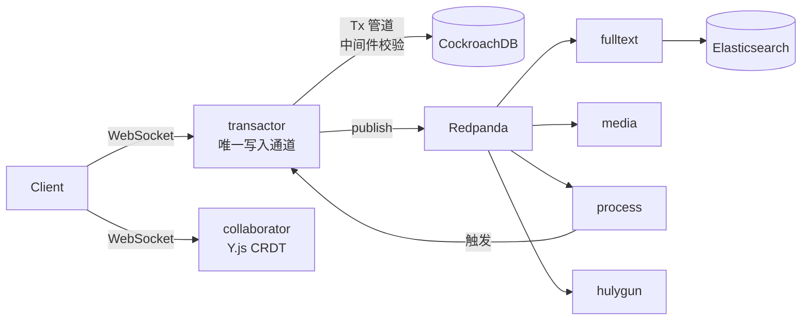
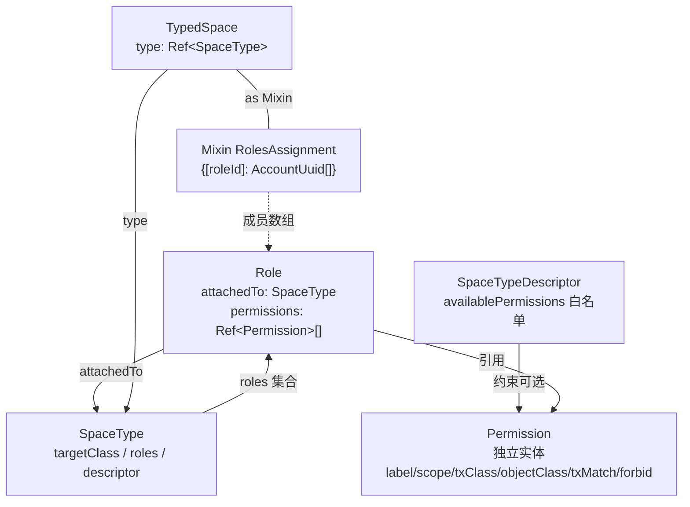

# platform-develop（Huly Platform）对标分析

| 项 | 内容 |
|---|---|
| 分析对象 | `E:/tools/Factroy_Agents/platform-develop`（Huly Platform，Hardcore Engineering，EPL-2.0） |
| 对标主体 | `mfg-agent-platform`（制造业跨部门协同平台，Python + LangGraph + FastAPI） |
| 分析目的 | 提取**产品设计与架构范式**，不迁技术栈 |
| 作者 | Alice（产品经理） |
| 日期 | 2026-10-16 |
| 证据原则 | 每条结论附 `文件路径:行号`；读不到的写"未验证"，不编造 |

> **仓库状态前置事实**：该仓库已冻结。`README.md:8-12` —— "This repository is frozen and is no longer actively maintained. Development continues in Platform-Collective/platform."；`README.md:14-21` 托管版 Huly 已关停。因此本分析的价值**不在"跟随上游演进"，而在"解读一套成熟平台化设计的完整决策链"**。

---

## 1. 一句话定位

**Huly 是一套"把企业协作应用拆成模型 + 权限 + 事件 + 空间四个正交维度、再靠声明式模型把业务组装回来"的平台框架，它证明了"平台化 = 先有治理层，后有应用"；它不是我们要照着实现的系统，因为它用 30 个微服务 + 5 套基础设施解决的是"多租户 SaaS 的横向通用性"，而我们要解决的是"单厂 16 部门的纵向业务深度"。**

三个"不是"：
- **不是我们的技术蓝图**：TypeScript/Rush monorepo + CockroachDB + Redpanda + Elasticsearch + 30 微服务，运维复杂度与我们 3 人规模不匹配。
- **不是我们的功能清单**：Chat/CRM/HRM/ATS 是通用办公域，我们的场景是停线/来料/8D/ATP/设备预警，语义不重叠。
- **不是成熟度背书**：仓库已冻结、托管版关停，说明**通用协作平台的商业化本身没有跑通**，我们不该把"平台化"当作目标本身。

---

## 2. 产品全景

### 2.1 内置应用矩阵（`README.md:24-28`）

> "The Huly Platform is a robust framework designed to accelerate the development of business applications, such as CRM systems. This repository includes several applications, such as Chat, Project Management, CRM, HRM, and ATS."

| 应用 | 模型包（`models/`） | 一句话定位 | 我们的对应物 |
|---|---|---|---|
| Chat / Chunter | `chat`、`chunter` | 频道式 IM + 消息线程 | IM 入口（`v2/contracts/im_gateway.py`） |
| Project Management | `tracker`、`task`、`board`、`view` | 问题单 + 看板 + 视图引擎 | 无（V2 用 SSE 事件流替代） |
| CRM | `contact`、`lead` | 客户/线索/商机 | 客户与客诉（场景 S3） |
| HRM | `hr`、`recruit` | 人事 + 招聘 | 无 |
| ATS | `recruit` | 招聘流程 | 无 |
| Documents（受控文档） | `controlled-documents` | **质量体系文件受控**（ISO 13485 4.2.4） | **V3 核心对标域** |
| Process（流程引擎） | `process` + `card` | 基于 Card 的状态机 + 审批 | HITL + `WorkflowEngine` |
| Inventory / Products | `inventory`、`products` | 物料与产品主数据 | MySQL 平台表 |
| Training | `training` | 培训任务与受训记录 | 无（对应"文件生效前培训"需求） |
| Test Management | `test-management` | 测试用例管理 | 无 |

**观察**：`models/` 目录下 60+ 个包（`achievement`/`activity`/`ai-assistant`/…/`workbench`），其中约一半以 `server-` 前缀成对出现（`models/server-controlled-documents`、`models/server-process` 等）。**这是"同一业务域，客户端模型与服务端扩展分离"的约定**——客户端只拿类型与权限声明，服务端专属逻辑（迁移、校验、触发器）单独成包，不泄漏到前端 bundle。

### 2.2 平台化能力（非应用的横向底座）

| 能力 | 载体 | 说明 |
|---|---|---|
| 模型驱动 | `foundations/core`、`Builder`/`@Model`/`@Prop` 装饰器 | 类定义即 schema，见 `models/core/src/security.ts:60-186` |
| 权限治理 | `models/core/src/security.ts` + `foundations/server/.../spacePermissions.ts` | Permission 独立实体 + SpaceType 挂角色 |
| 事务与事件 | `transactor`（`:3332`）+ Redpanda | 所有写操作走 Tx 管道，事件异步扇出（`ARCHITECTURE_OVERVIEW.md:12,89-97`） |
| 全文检索 | `fulltext`（`:4702`）+ `rekoni`（`:4004`） | 消费事件建 ES 索引；rekoni 做 PDF/DOC 文本抽取（`ARCHITECTURE_OVERVIEW.md:26-30`） |
| 实时协作 | `collaborator`（`:3078`）+ `hulypulse`（`:8099`） | Y.js CRDT 共编 + WebSocket 推送（`ARCHITECTURE_OVERVIEW.md:33-38`） |
| 文档输出/签名 | `print`（`:4005`）+ `sign`（`:4006`） | 受控文档的 PDF 化与证书签名 |
| 备份 | `backup` + `backup-api`（`:4039`） | 工作空间级快照 |

---

## 3. 架构范式 6 图

### 图 1：服务分层逻辑（**关注分层理由，不是端口**）

| 层 | 职责 | 判据 | 代表 |
|---|---|---|---|
| **L0 身份层** | 我是谁、属于哪个工作空间 | 不依赖任何业务模型 | `account`（`ARCHITECTURE_OVERVIEW.md:11`） |
| **L1 事务层** | 唯一的写入通道 + 事件发布 | **所有业务写操作必须经过它** | `transactor`（`:12`） |
| **L2 存储层** | 结构化 / KV / Blob 三种形态分工 | 按访问模式切分，不按业务切分 | CockroachDB / `hulykvs` / `datalake`+MinIO（`:20-23,76-78`） |
| **L3 派生层** | 从事件流重建的只读视图 | **可从事件重放重建，不是数据源** | `fulltext`+ES、`rekoni`（`:26-30`） |
| **L4 实时层** | 长连接与协同状态 | 有状态、需粘性会话 | `collaborator`、`hulypulse`（`:33-38`） |
| **L5 特性层** | 无状态、可横向扩的原子能力 | 输入→输出，不持有业务状态 | `print`、`sign`、`analytics`、`process`（`:48-58`） |
| **L6 保障层** | 数据可恢复 | 与主链路解耦 | `backup`、`backup-api`（`:61-64`） |

**提炼出的判据**：**分层不是按"业务模块"切，而是按"状态持久性与可重建性"切**。L3 层的所有数据都能从 L1 的事件流重建——这是它们能独立成微服务的前提。我们的 V2 架构里，SSE 事件流（`v2/core/events.py`）其实已经是潜在的事件源，但报告/看板数据没有被设计成"可重放派生视图"。

### 图 2：事件流（写路径与读路径分离）



- 依据：`ARCHITECTURE_OVERVIEW.md:89-97`
- **关键设计**：事件是**扇出到多个消费者**，而不是串行 RPC。`process`（流程引擎）是事件的消费者，但它要改数据时必须**再回到 transactor**（不直写 DB）——这保证了权限中间件对**所有**写入都生效。
- 对我们的映射：`v2/core/orchestrator.py` 是同步 handler 直调，审批完成后直接改 SQLite（`services/workflow.py:159-177`）。**没有唯一的写通道**，所以权限只能散落在各 handler 里判断。

### 图 3：权限模型（三层解耦：Permission / Role / SpaceType）



- Permission 定义：`models/core/src/security.ts:164-174`；接口含 `txMatch`：`foundations/core/packages/core/src/classes.ts:570-579`
- Role：`models/core/src/security.ts:139-162`（`attachedTo: Ref<SpaceType>`，`collection: 'roles'`）
- SpaceTypeDescriptor 白名单：`models/core/src/security.ts:103-111`（`availablePermissions!: Ref<Permission>[]`）
- **角色成员存放在哪里？** 不在 Role 上，而在**空间文档自身的一个 mixin 上**：`models/core/src/security.ts:188-191`
  ```ts
  export class TSpacesTypeData extends TSpace implements RolesAssignment {
    [key: Ref<Role>]: AccountUuid[]
  }
  ```
  即"空间 X 的 QARA 角色 = [张三, 李四]"是空间文档的属性，而不是 Role 的属性。**这是让"同一角色在不同空间有不同人"零成本的根因。**
- 解析链（客户端）：`foundations/core/packages/core/src/utils.ts:588-614` —— `space` → `space.type` → `$lookup.roles` → 筛出"mixin 上成员数组包含我"的角色 → 权限并集 → `has(permission)`。

### 图 4：模型驱动（声明式 schema → 可迁移数据库）

| 声明 | 语法 | 产物 |
|---|---|---|
| 类 | `@Model(documents.class.Document, core.class.Doc, DOMAIN_DOCUMENTS)` | 表 + 继承关系（`models/controlled-documents/src/types.ts:221`） |
| 属性 | `@Prop(TypeString(), documents.string.Title)` | 列 + 类型 + 标签 |
| 索引 | `@Index(IndexKind.FullText)` / `@Index(IndexKind.Indexed)` | 索引声明（`types.ts:234-235,238-239`） |
| 只读 | `@ReadOnly()` | 服务端拒绝更新 |
| 隐藏 | `@Hidden()` | 不进入通用 UI |
| 混入 | `@Mixin(documents.mixin.DocumentTemplate, documents.class.Document)` | 可选能力叠加（`types.ts:309-319`） |
| 展示 | `@UX(label, icon)` | 导航/DX 元数据 |

**这是与我们的场景 YAML 同源的思想**：`v2/scenarios/*.yaml` 是"声明 DAG + 节点 + 错误策略"，Huly 的 `@Model` 是"声明实体 + 属性 + 索引 + 权限"。差别在**声明之后谁消费它**：Huly 有 `migration.ts`（`models/controlled-documents/src/migration.ts`，561 行版本化迁移）和 transactor 的 schema 校验；我们的 YAML 由 `v2/core/yaml_dag.py` 直接解释执行，没有版本迁移层。

### 图 5：插件三件套（`plugins/X` / `X-assets` / `X-resources`）

| 包 | 内容 | 为什么必须分开 |
|---|---|---|
| `plugins/controlled-documents` | 领域类型 + 纯逻辑 + **资源引用声明**（`plugin.ts:1-50` 只 import 类型与 `Asset/Resource/IntlString`） | 服务端可 import，**不含 UI 代码** |
| `plugins/controlled-documents-assets` | `lang/`（i18n JSON）+ `assets/`（SVG）+ `config/` | 可被 CDN 独立缓存，**改文案不用重编译逻辑** |
| `plugins/controlled-documents-resources` | `components/`（Svelte 实现）、`stores/`、`styles/` | 只在浏览器加载，**改 UI 不影响服务端** |

**判据**：一个包能否被服务端 import，决定它属于 `X` 还是 `X-resources`。这与我们 Python 现状的差距：我们现在只有目录划分（`v2/contracts/` vs `v2/demo/ui/`），没有"引用声明层"——所以 `contracts/permissions.py` 里既有类型定义又有加载逻辑，UI 想展示"权限目录"只能自己再拼一遍。

### 图 6：多租户 / 工作空间

| 维度 | Huly | 我们 |
|---|---|---|
| 租户隔离 | `workspace` 服务 + 每工作空间独立的 DB schema（`ARCHITECTURE_OVERVIEW.md:13`） | 单库，`platform_schema.py` 里没有 tenant 列 |
| 空间隔离 | `TypedSpace` + `restricted` 标志（`spacePermissions.ts:125-129,201-203`） | 无空间概念，靠部门字符串过滤 |
| 身份域 | `account` 服务 + `primarySocialId`（`spacePermissions.ts:174`） | 请求体 `user_ctx`（前端可伪造） |

---

## 4. 十个可借鉴设计

> 每条固定四段：**它怎么做**（附文件:行号）→ **我们现状**（附我们路径）→ **采纳建议** → **成本/风险**

### 借鉴 1：Permission 独立实体 + Role 集合 + scope

**它怎么做**
- `Permission` 是一等公民文档，字段为 `label / scope / txClass / objectClass / txMatch / forbid / description`（`models/core/src/security.ts:164-174`；接口 `foundations/core/packages/core/src/classes.ts:570-579`）。
- `scope: 'space' | 'workspace'` 明确"这条权限作用于空间级还是全局"（`security.ts:171`）。
- 受控文档域声明 9 条权限，**全部 `scope: 'space'`**（`models/controlled-documents/src/permissions.ts:9-108`）。
- `Role` 只是 `permissions: Ref<Permission>[]` 的命名集合（`security.ts:160-161`）；实际角色定义见 `models/controlled-documents/src/roles.ts:9-49`——`QARA` 比 `Manager` 多 `ArchiveDocument` + `UpdateDocumentOwner`（`roles.ts:41-42`），**角色差异是被权限差集表达出来的，不是靠 if-else**。

**我们现状**
- **已具备（且已对标）**：`src/mfg_agents/v2/data/permissions.yaml` 21 条 `hitl.<slot>.<verb>` 权限（scope: hitl）+ 15 个角色；`src/mfg_agents/v2/contracts/permissions.py` 的 `Permission`（:49-75）与 `RoleDef`（:78-94）就是这两个实体的 Python 版；`PermissionRegistry` 已实现 fail-closed（未知角色 → 空权限集）。
- **差距**：我们的 `Permission` 没有 `txClass/objectClass/txMatch` 三个维度——即**只能表达"某人能不能做某个业务动作"，不能表达"某人能不能改某类对象的某个字段"**。

**采纳建议**
1. 保持 `permissions.yaml` 结构不变（已对标，不要重构）。
2. V3 给 `Permission` 增加两个可选字段：`resource`（作用对象类型，如 `report` / `hitl_task` / `doc`）与 `attribute_scope`（字段白名单），对应 Huly 的 `objectClass` / `AttributePermission`。先只用于**报告导出与字段脱敏**，不铺开到全部场景。

**成本/风险**
- 成本：低（YAML 加字段 + Registry 加 2 个查询方法，约 60 行）。
- 风险：若一开始就要求所有权限声明 `objectClass`，会变成"配置地狱"——现有 21 条权限都是动作型，强行加对象维度只会写出一堆 `null`。**必须先有对象型资源（受控文档/报告）再引入。**

---

### 借鉴 2：多人分角色审批（四组独立角色 vs 我们单签）

**它怎么做**
- `ControlledDocument` 有**四组互不重叠的角色字段**：
  ```ts
  reviewers!: Ref<Employee>[]          // 审阅人
  approvers!: Ref<Employee>[]          // 批准人
  externalApprovers!: Ref<Employee>[]  // 外部（客户/监管）批准人
  coAuthors!: Ref<Employee>[]          // 共同作者
  ```
  依据：`models/controlled-documents/src/types.ts:381-391`；接口同义：`plugins/controlled-documents/src/types.ts:206-217`。
- 审批实例不是文档上的字段，而是**独立的 Request 实体**：`DocumentRequest` → `DocumentReviewRequest` / `DocumentApprovalRequest`（`models/controlled-documents/src/types.ts:465-475`），挂在 `requests` 集合上（`types.ts:377-379`）。
- `Request` 用**计数**表达"要几个人批"：
  ```ts
  requested!: Ref<Person>[]
  approved!: Ref<Person>[]
  approvedDates?: Timestamp[]
  requiredApprovesCount!: number
  status!: RequestStatus   // Active/Completed/Rejected/Cancelled
  tx!: Tx                  // 审批通过后要执行的那笔事务
  ```
  依据：`models/request/src/index.ts:52-80`；状态枚举 `plugins/request/src/index.ts:46-51`。
- **关键机制——"审批通过 = 执行那笔被挂起的事务"**：`tx!: Tx` 把"批准这个动作"和"真正写数据"绑定成一个原子操作。通过时把 `request.tx` 重新提交（`server-plugins/request-resources/src/index.ts:81-83`）；驳回时用 `rejectedTx` 回滚（`models/request/src/index.ts:72`）。
- 多签是"计数够即通过"，且允许多种模式：`requiredApprovesCount: areAllApprovesRequired ? users.length : 1`（`plugins/controlled-documents-resources/src/utils.ts:415`）——**"全签"与"任一人签"是同一个数据结构的两种参数，不是两套代码路径**。
- 完成判定：`request.approved.length === request.requiredApprovesCount` → `status = Completed`（`server-plugins/request-resources/src/index.ts:64-84`）。
- 审批项落在用户待办里：`ApproveRequest extends ProcessToDo extends TToDo`（`models/process/src/index.ts:211-238`）——**审批不是弹出框，是待办任务**。

**我们现状**
- `src/mfg_agents/v2/agents/hitl.py:16-50`：`make_hitl_handler` 创建 `waiting_hitl` 工单 + 广播 IM 卡片，`approver_roles` 是角色名数组，但**没有区分"审阅/批准/会签"语义**。
- `src/mfg_agents/v2/services/workflow.py:159-177`：`approve(task_uid, approver, ...)` 是**单签**——一人 approve 即流转，第二人再批会被 `_transition` 的状态机拒绝。
- `permissions.yaml` 已定义 `cosign`（会签）动词，但引擎**没有实现"收集 N 个 cosign 才放行"的逻辑**——权限只是"能不能批"，不是"还差几票"。

**采纳建议**
1. **给 WorkflowTask 加签名账本**，而不是加字段：新表 `wf_signoff(task_uid, role_key, actor, action, comment, created_at)`，`WorkflowEngine` 增加 `signoff()` 与 `tally()`。
2. **会签规则声明在场景 YAML 的 hitl 节点上**（不改引擎）：
   ```yaml
   hitl:
     - step: hitl_disposition
       required_signoffs:
         cosign:  [SQE, procurement]     # 缺一不可
         approve: [quality_director]     # 终批
       mode: all                          # all | any（对应 Huly requiredApprovesCount）
   ```
3. **"审批即执行"用领域事件表达**：Huly 用 `request.tx` 存待执行事务；我们执行的是 Python handler，等价做法是把 `action` 记在 signoff 上，**只在终批那一刻调用一次** `node_registry` 的落地动作，且动作必须幂等（用 `task_uid + action` 做幂等键）。
4. 复用 `user_ctx.roles` + `PermissionRegistry.slot_permission()` 校验"此人是否有该槽位的 cosign 权限"，不新增权限判断代码。

**成本/风险**
- 成本：中。`WorkflowEngine` 加 1 表 2 方法（~80 行）+ 场景 YAML 加 1 段（5 个场景各 ~8 行）+ hitl handler 改为"广播给全部会签人，等 tally 齐"（~40 行）。
- 风险：① **会签可能永久卡死**——必须同时实现 `escalate`（已有，`workflow.py:184`）与超时自动退回，否则现场会绕过系统用微信。② `approvedDates` 这类"数组与主体同步 push"在 Huly 里是靠服务端触发器成对写入的（`server-plugins/request-resources/src/index.ts:88-97`），我们若手写容易漏——必须用事务或单一 `signoff` 表推导，**不要用两个并行数组**。

---

### 借鉴 3：Space / SpaceType 作为权限与数据隔离载体

**它怎么做**
- `TypedSpace` = `Space` + `type: Ref<SpaceType>`（`models/core/src/security.ts:96-101`）。
- `SpaceType` 定义"这类空间有哪些角色、绑哪个 mixin 存成员"（`security.ts:113-137`）。
- `SpaceTypeDescriptor` 提供 `availablePermissions` **白名单**——建空间时只能勾这些权限（`security.ts:103-111`）。
- 受控文档域把这个机制用满：`spaceType.ts:24-35` 声明 10 条白名单 → `spaceType.ts:46-57` 建 descriptor → `spaceType.ts:63-74` 建 SpaceType（`projects: false`）→ `spaceType.ts:76-89` 循环把 3 个 Role `attachedTo` 该 SpaceType。
- 空间有 `restricted` 开关：`restricted === true` 时，**没有匹配权限的任何写入都会被拒绝**（`spacePermissions.ts:125-129` + `:201-232`）——即"默认拒绝"而不是"默认允许"。
- 业务上用了两种 Space 子类：`OrgSpace`（内部文档）/`ExternalSpace`（外部文档），见 `models/controlled-documents/src/types.ts:125-129`；导航里分别叫"General Documentation"/"Technical Documentation"（`models/controlled-documents/src/index.ts:256-285`）。

**我们现状**
- **完全没有空间概念**。部门隔离靠 `user_ctx.roles` 里的 dept 字段（`permissions.yaml:65` 等 `dept:`），数据隔离靠 SQL 里的 `department = ?`。
- 后果：① "同一角色在不同部门有不同人"要改代码；② 无法表达"这条停线记录属于 3 号线，只有 3 号线的人能看"。

**采纳建议**
1. 引入轻量的 `scope` 概念（**不叫 Space，避免与 Huly 的完整机制混淆**）：
   - `scope_type`：`dept`（部门）/ `line`（产线）/ `customer`（客户）/ `project`（NPI 项目）
   - `scope_id`：具体实例（`dept:quality`、`line:SMT-3`）
2. 权限校验函数增加 `scope` 参数：`PermissionRegistry.has_any(roles, required, scope=None)`；`scope=None` 时退化为当前行为（**保证 318 个测试不破**）。
3. 审计与报告查询强制带 `scope` 过滤条件（比 Huly 更严格：我们的场景几乎全是"部门内可见"）。
4. 只对**三个东西**上 scope：HITL 工单、报告、受控文档。不要给 Agent、SKU、BOM 等主数据加 scope（它们本来就该全局）。

**成本/风险**
- 成本：中高。SQLite 表加 2 列 + 索引；所有查询入口加过滤；前端要能切部门/产线。
- 风险：**这是本项目最容易做歪的一块**。Huly 能做 Space 是因为它从第一行代码就在"空间"内写数据；我们是补丁式加，一旦有遗漏查询（尤其是 Text2SQL 生成的 SQL），就会出现越权读取。**必须先做"Text2SQL 自动注入 scope 过滤"这一道防线，再开 scope 功能**（见 PRD-V3 风险 R3）。

---

### 借鉴 4：受控文档的版本 + 状态机（对我们 SOP/检验标准/图纸）

**它怎么做**
- 状态是**两个枚举**，不是一个：
  - `DocumentState`：`draft / effective / archived / deleted / obsolete`（`plugins/controlled-documents/src/types.ts:193-199`）——文档的**生命周期**
  - `ControlledDocumentState`：`inReview / reviewed / inApproval / approved / rejected / toReview`（`types.ts:236-243`）——**审批进度**
  - 两者正交：一份文档可以 `state=draft` 且 `controlledState=inReview`。
- 版本是**两个数字**：`major!: number` / `minor!: number`（`models/controlled-documents/src/types.ts:249-253`）；编号是 `code + prefix + seqNumber`（`types.ts:237-247`）。
- 生效是**两个日期**：`plannedEffectiveDate`（计划生效）与 `effectiveDate`（实际生效）（`types.ts:399-404`）——**规划态与事实态分离**。
- 复评机制：`reviewInterval?: number`（月）（`types.ts:393-394`）+ 待办 `todos?: CollectionSize<ToDo>`（`types.ts:410-411`）→ 到期自动生成复评任务。
- 变更控制是**独立实体**，不是字段：`ChangeControl { description, reason, impact, impactedDocuments: Ref<Document>[] }`（`types.ts:414-430`）——**一次变更能说清"影响了哪几份文件"**，这是 ECN 的原型。
- 版本快照不可变：`DocumentSnapshot` 存 `content: MarkupBlobRef` + `state`（`types.ts:432-444`），受控版本额外存 `controlledState`（`types.ts:446-451`）。
- UI 层用 `query` 谓词做**状态守卫**：删除动作 `query: { state: DocumentState.Draft }`（`models/controlled-documents/src/index.ts:1013-1025`）；作废动作 `query: { state: DocumentState.Effective }`（`index.ts:1040-1063`）——**不是 if 判断，是声明"什么状态下这个动作才存在"**。
- 生效前要培训：`DocumentTraining { enabled, training, roles, trainees, maxAttempts, dueDays }`（`plugins/controlled-documents/src/types.ts:280-287`）。

**我们现状**
- **零**。没有文档实体、没有版本、没有状态机。质量文件流程（SOP 发放、检验标准换版）完全在微信 + 共享盘里。
- 我们有的相近资产：`v2/scenarios/*.yaml` 的 5 个场景能产出 8D 报告（`customer_complaint_v2.yaml`），但报告是**一次性产物**，不进版本库、不登记、不受控。

**采纳建议**
1. 建 `controlled_document` 表：`doc_code / title / category / major / minor / state / lifecycle_state / effective_date / planned_effective_date / review_interval_months / owner_role / content_ref`。
2. 建 `document_version` 表（不可变）：`doc_id / major / minor / content_ref / state / approved_at / approved_by[]`。
3. 建 `change_control` 表：`doc_id / reason / impact / impacted_doc_ids[]`（直接照 Huly 的 `ChangeControl` 语义）。
4. 状态机**写成 Python 常量表**（不引状态机库）：
   ```python
   DOC_TRANSITIONS = {
     ("draft", "inReview"): "submit_review",
     ("inReview", "reviewed"): "review_pass",
     ...
   }
   ```
5. 复用**已有**的 HITL 会签（借鉴 2）做"审阅/批准"，不要另写审批流——`hitl.doc_approve` 只是第 8 个槽位。

**成本/风险**
- 成本：高（3 张表 + 状态机 + 发放/回收 + PDF 生成接线，估 8-10 人日）。
- 风险：① **"受控"意味着不能删、不能改、错了只能发新版**——业务方第一反应一定是"我改个字也要走流程？"，必须提供"有期限的临时偏离（deviation）"旁路，否则系统会被绕开。② PDF 生成（Huly 用 `print` 服务，`ARCHITECTURE_OVERVIEW.md:51`）我们没有等价能力，需评估 wkhtmltopdf/WeasyPrint。

---

### 借鉴 5：模型驱动（声明式类定义 + 权限 + 索引）

**它怎么做**
- 见上文图 4。关键在**声明之后的三个消费者**：
  1. **迁移生成**：`models/controlled-documents/src/migration.ts`（561 行）——版本号驱动的数据迁移，`migration.ts:559-563` 注册迁移函数。
  2. **服务端校验**：transactor 的 Tx 管道按类/属性元数据做校验与权限匹配（`spacePermissions.ts:485-491` 的 `isTxClassMatched`）。
  3. **UI 自动生成**：`@UX` + `builder.createDoc(view.class.Viewlet, ...)`（`models/controlled-documents/src/index.ts:298-355`）声明一张表格的列，UI 自动渲染。
- 权限也是声明出来的：`builder.createDoc(core.class.Permission, core.space.Model, {...})`（`permissions.ts:10-19`）——**权限定义本身也是"文档"**，可被查询、可被 UI 展示、可被迁移。

**我们现状**
- `v2/scenarios/*.yaml` 已是声明式的（节点、fan_out、condition、on_error、timeout_s）；`v2/core/yaml_dag.py` 解释执行。
- `v2/data/permissions.yaml` 也是声明式的。
- **差距**：没有 schema 版本与迁移；YAML 改字段后老数据没有升级路径。

**采纳建议**
1. 给场景 YAML 加 `version:` 字段（现在只有 `version: 1` 一个静态值），并写一个 `SCHEMA_MIGRATIONS` 表记录"场景 X 从 v1 到 v2 时补了哪个字段"。
2. 把"权限 / 场景 / 指标 / 查询模板"四类 YAML 的加载统一到一个 `ConfigRegistry`，启动时全量校验（现在 `PermissionRegistry` 会校验，其余不会）。

**成本/风险**
- 成本：低（1 张表 + 1 个启动校验函数，~100 行）。
- 风险：过度设计。我们只有 5 个场景，可能一辈子用不上第 2 次迁移。**建议只做"启动校验 + 版本记录"，不做通用迁移框架。**

---

### 借鉴 6：事件驱动解耦（vs 我们的 SSE + 同步 handler）

**它怎么做**
- 写入必须走 transactor（`ARCHITECTURE_OVERVIEW.md:12`），它同时做两件事：**在 Tx 管道里跑中间件**（权限、校验）→ 落库 → **发布事件**。见 `spacePermissions.ts:420-431` 的 `tx()`：先 `checkPermissions`，再 `provideTx`，再对广播出去的事务 `processPermissionsUpdatesFromTx`。
- 事件扇出到 `fulltext`（建索引）、`media`（转码）、`process`（触发流程）、`hulygun`（推送）（`:92`）。
- **幂等与顺序**：所有消费者都是"从事件重建状态"，而非"事件修改状态"。这是 `fulltext` 能随时重建 ES 索引的原因。

**我们现状**
- `v2/core/events.py` 提供 SSE 事件流给前端；`v2/core/orchestrator.py`（231 行）同步调用各节点 handler；审批通过后直接改 SQLite。
- **问题**：报告生成、通知、审计三件事都耦合在 handler 里（`v2/services/notification.py` 被 orchestrator 与 hitl 直接调用，见 `hitl.py:44-45`）。加一个"8D 关闭后自动归档到知识库"就要改 orchestrator。

**采纳建议**
1. **不引入消息队列**（Redpanda/Kafka 对我们无意义）。改为进程内**同步事件总线 + 持久化事件表**：
   - 表 `domain_event(event_id, run_id, type, payload, created_at, consumed_by)`。
   - `emit(type, payload)` 写表 + 同步调用已注册订阅者（保持现有同步语义，测试不用改）。
   - 订阅者失败不回滚主流程（Huly 的消费者失败也不回滚，因为主链路已完成）。
2. 把现有的通知、审计、报告落库改成订阅者。这样"8D 关闭 → 写知识库"就是新增一个订阅者（~30 行），而不是改 orchestrator。

**成本/风险**
- 成本：低到中（1 表 + 1 个 `EventBus` 类 + 迁移 3 个调用点，~150 行）。
- 风险：同步订阅者会让主流程变慢。必须给订阅者加 `timeout_s` 与"失败仅记日志"策略——**空难现场不能因为审计写库超时而卡住停线处置**。

---

### 借鉴 7：fulltext + rekoni（全文检索与文档解析）

**它怎么做**
- `fulltext`（`:4702`）**消费事件**抽取内容、维护 ES 索引（`ARCHITECTURE_OVERVIEW.md:28`）。
- `rekoni`（`:4004`）是独立的文档智能服务，从 PDF/DOC/DOCX/RTF/HTML 抽文本与结构化字段，甚至能解析 HeadHunter/LinkedIn/通用简历（`:29`）。
- **两者是"服务"而不是"库"**：因为解析是 CPU 密集、需水平扩容、可独立失败。

**我们现状**
- `v2/contracts/vector_store.py` + `src/mfg_agents/tools/rag_tools.py`：只有 ChromaDB 向量检索。
- **缺全文检索**：ChromaDB 无法回答"哪份文件里出现过 `锡膏 TH-882`"这类字面匹配需求；而且我们的 RAG 目前只覆盖历史案例（`knowledge/seed.py`）。

**采纳建议**
1. **不引入 Elasticsearch**。SQLite 已内置 FTS5（`CREATE VIRTUAL TABLE ... USING fts5`），零新增依赖即可做中文/英文全文检索（中文需配 trigram 或 jieba 分词）。
2. 文档解析单独成 `services/doc_parser.py`（PDF → 文本），失败不阻塞主流程，解析结果写 `doc_text` 表供 FTS 索引。
3. **保留 ChromaDB 做语义召回，FTS5 做精确召回**，两路结果用 RRF 融合——这比"再上一个向量库"更符合我们数据量（<10 万条）。

**成本/风险**
- 成本：低（FTS5 建表 + 同步触发器 ~80 行；PDF 解析用 `pypdf`）。
- 风险：中文分词质量差会导致召回率低。**必须先做 30 条真实查询的召回测试再上线**，可用我们现有的 SOP 抽样。

---

### 借鉴 8：实时协作（CRDT 共编）对多部门共编报告的意义

**它怎么做**
- `collaborator`（`:3078`）用 **Y.js CRDT** 做文档同步（`ARCHITECTURE_OVERVIEW.md:35`）。
- 文档内容存为 `content!: MarkupBlobRef`（`models/controlled-documents/src/types.ts:267-268`）——**内容是一个 blob 引用，不是行内字段**。这是 CRDT 能工作的前提：内容与元数据分离。
- 评论挂在内容节点上：`DocumentComment { nodeId?, resolved?, index? }`（`plugins/controlled-documents/src/types.ts:269-273`，模型 `models/.../types.ts:453-463`）——**行内评论可以定位到某一段**。
- QMS 定制加深了这一点：`plugins/text-editor-resources/src/components/extension/qms/qmsInlineComment.ts` + `qmsInlineCommentMark.ts`（引用见 `plugins/text-editor-resources/src/index.ts:97-104`）——给批注加了 `nodeUuid` mark。

**我们现状**
- 报告是**生成后只读**的（Markdown/文本），多人协同靠"复制到 Word 里改"。
- 8D 报告的 D4/D5（根因/对策）本质上是**必须跨部门共同编写**的。

**采纳建议**
1. **不要上 CRDT**。CRDT 需要长连接、状态同步、离线合并，成本远超收益。
2. 改为**分段认领 + 段落级评论**（`doc_section(doc_id, section_key, owner_role, content, updated_at)` + `doc_comment(section_key, author, content, resolved)`）——解决 80% 的冲突（各部门写自己的段），剩余冲突由"终批人合并"处理。
3. 但**必须采纳**它的两个设计：① 内容与元数据分离（已自然满足）；② **批注可 resolve**（`resolved?: boolean`）——这是评审可追溯的最低要求。

**成本/风险**
- 成本：低（2 张表 + 简单的段落编辑 UI）。
- 风险：段落粒度定太细会变成"填表"，太粗又退化成冲突。建议按 8D 的 D1-D8 + 受控文档的章节，**由模板决定段落数**，不给用户自由切分。

---

### 借鉴 9：AI Assistant 的产品化入口形态

**它怎么做**
- **AI 在这套平台里几乎没有"模型"**：
  - `models/ai-assistant/src/index.ts:26-44`：整个模型只有一条 `setting.class.IntegrationType` 记录（连接配置），**没有任何业务实体**。
  - `models/ai-bot/src/index.ts:24`：`export function createModel (builder: Builder): void {}` —— **空函数**。
- 它存在于两处，都是"服务"：
  1. **基于 Chat 的 Bot**：`services/ai-bot/pod-ai-bot/src/controller.ts:61` 的 `AIControl`，能力是 `translate`（`:221`）、`summarizeMessages`（`:234`）、工具调用（`utils/tools.ts:1-17` 用 OpenAI `RunnableTools`）。工具能"创建文档"、"PDF 转 Markdown"（`utils/tools.ts:34-80` 调 datalab.to）、写文档到 workspace。
  2. **Love agent**（音视频房间里的实时 Agent）：`services/ai-bot/love-agent/`（STT + OpenAI）。
- **入口形态结论**：AI 是**一个被邀请进频道的成员**（有账号、有 billing `controller.ts:1` 引 `./billing`），不是"一个悬浮球"；它的权限与普通用户一样走 Space/Role 体系，所以**它不能读你看不到的东西**。

**我们现状**
- AI 是**主角**：8 个 Agent + LangGraph 编排 + 5 个场景。入口是 IM（`v2/contracts/im_gateway.py`）+ 前端（`v2/demo/ui/`）。
- 与 Huly 的镜像差异：Huly 是"协作平台 + 一个 AI 助手"，我们是"AI 编排 + 协作外壳"。**我们的 AI 能力远比 Huly 深，但治理远比它浅**。

**采纳建议**
1. 保持我们的"AI 为主"定位不变（这是我们的差异化，不是缺陷）。
2. **照抄它的一件事**：AI 的执行结果必须走**和人类一样的事务管道**——即 Agent 写入数据库的动作也要受 `PermissionRegistry` 与 audit 约束，并且"Agent 以什么身份写"必须显式（建议引入 `actor_type: human|agent` 字段，Agent 用 `system_agent` 身份 + 场景声明的 `agent_role`）。
3. 不抄"AI 助手悬浮入口"，因为我们的用户是车间/质量工程师，IM 才是入口。

**成本/风险**
- 成本：低（`actor_type` 字段 + 审计日志字段）。
- 风险：如果 Agent 以 `system` 身份绕过权限（Huly 里 `spacePermissions.ts:174` 就是 `primarySocialId === core.account.System` 直接放行），**等于治理层对我们最活跃的写入方失效**。这是我们必须避免的坑。

---

### 借鉴 10：工程规范（changelog / CI / 文档）

**它怎么做**
- **声明式 changelog**：`cliff.toml`（配置 git-cliff）+ `changelog.md`（510 KB 产出物）。开启 `conventional_commits = true`（`cliff.toml:41-44`），把 commit message 直接编译成发布说明。
- **双版本号策略**：`v*` 生产版 / `s*` 开发版（`README.md:53-65`），CI 按 tag 前缀走不同流水线（`.github/workflows/main.yml:16-20`）。
- **CI 结构**：`main.yml`（986 行）——concurrency 取消同 ref 的旧构建（`main.yml:7-9`）、PR 目标分支 `develop/staging/staging-new/main`（`:21-22`）、`workflow_dispatch` 里带 `skip_publish` 开关便于测试发布流程（`:27-34`）。
- **文档体系**：`docs/` 下只有 `disableFeatures.md` + `guides/backup-restore.en.md`——**文档其实很薄**。真正的"文档"是 `ARCHITECTURE_OVERVIEW.md`（19213 字节）与 `AGENTS.md`。

**我们现状**
- 无 changelog 生成；`docs/` 有 15 篇（PRD、ARCHITECTURE-V2 987 行、多份 QA 报告）——**文档厚度反而超过 Huly**。
- 无 CI 流水线（318 tests 靠本地跑）。

**采纳建议**
1. 引入 **commit 规范 + 自动 changelog**（`git-cliff` 或 `commitizen`+`cz-conventional-changelog`），成本极低收益明确。
2. 引入**最小 CI**：`pytest -q` + `ruff` + 权限 YAML 校验（`PermissionRegistry.from_yaml()` 失败即 fail），一个 GitHub Actions 文件即可。
3. **不抄它的"文档薄"**——我们的 PRD/架构文档是给客户看的交付物，保持厚度。

**成本/风险**
- 成本：极低（半天）。
- 风险：conventional commits 需要团队纪律，前期会有大量不合规 commit 被 `filter_unconventional = true`（`cliff.toml:43`）丢弃导致 changelog 缺漏。建议 `filter_unconventional = false` 起步。

---

## 5. 明确不照搬的 6 项

| # | 不照搬项 | Huly 的用法 | 我们的规模 | 不照搬理由 | 替代方案 |
|---|---|---|---|---|---|
| 1 | **TypeScript + Rush monorepo** | `rush.json`（86 KB）管理 60+ 模型包 + 90+ 插件包；三件套分离 | 79 个 Python 文件 | 语言生态完全不重叠（团队是 Python）；Rush 的增量构建/版本锁为"多包发布到 npm"服务，我们不分发 npm 包；引入后**唯一收益是目录整洁，代价是整条工具链重学** | 保持 Python；用 `src/mfg_agents/v2/{contracts,core,agents,services}` 的现有分层；只借鉴"引用声明与实现分离"的思想 |
| 2 | **CockroachDB** | 主库（`ARCHITECTURE_OVERVIEW.md:76`），为"多区域强一致 + 每工作空间独立 schema" | 单厂、单库、<100 万行 | 分布式 SQL 的运维（节点、副本、时钟偏移）需要专职 DBA；我们的数据量与并发用 SQLite/MySQL 完全够；**它的价值是跨地域多租户，我们不存在这个约束** | SQLite（开发/单机）+ MySQL（生产）；需要时升 PostgreSQL |
| 3 | **Redpanda / Kafka** | 事件总线（`:79`），连接 30 个服务 | 单体进程 | 消息队列解决的是"跨进程、跨语言、可重放"；我们单进程内用同步函数调用即可；引入后要处理"消费者挂了怎么办""消息积压""顺序性"，**复杂度全在运维不在功能** | 进程内 `EventBus` + `domain_event` 持久化表（借鉴 6） |
| 4 | **30+ 微服务** | 每个能力一个服务（搜索/解析/预览/转码/签名/打印…） | 1 个 FastAPI 进程 | 微服务的收益是"独立扩容 + 独立部署 + 故障隔离"，前提是**有 SRE 团队**；我们 3 人规模下，30 个服务意味着 30 份配置/日志/健康检查，**故障率上升而可用性下降** | 单进程 + 清晰模块边界（`services/` 目录）；CPU 密集的文档解析可拆独立 worker |
| 5 | **Svelte 前端 + 三件套插件体系** | `X` / `X-assets` / `X-resources` 三包分离 | 原生 JS（`v2/demo/ui/`） | 三件套分离的价值是"i18n 与静态资源可 CDN 独立发版"；我们单语言、单部署，**分离只会带来 3 倍的包管理成本** | 保持原生 JS；只借鉴"资源引用声明层"思想（把 21 条权限的中文名统一从 YAML 出，不在 JS 里硬编码） |
| 6 | **Y.js CRDT 实时共编** | `collaborator` 服务（`:35`） | 无实时协作需求 | CRDT 要长连接 + 状态同步 + 离线合并 + 冲突可视化的完整栈；我们的核心冲突是"谁写哪一段"而不是"同一字符同时被改"；**投入产出比极低** | 段落认领 + 段落级评论 + 终批人合并（借鉴 8） |

---

## 6. 制造场景改造映射表

| Huly 概念 | 我们的制造业语义 | 落地形态（表/YAML） | 优先级 |
|---|---|---|---|
| `Space` / `TypedSpace` | **部门 / 产线 / 客户 / NPI 项目** | `scope_type` + `scope_id` 列（不是独立实体） | P1（V3 阶段二） |
| `SpaceType` + `Role` | **部门角色矩阵 + 该场景可选角色** | `permissions.yaml` 的 `roles` + `slots`（已有） | P0（已有） |
| `Permission(scope:'space')` | `hitl.<slot>.<verb>`（已有 21 条） | `permissions.yaml` `permissions`（已有） | P0（已有） |
| `availablePermissions` 白名单 | **每个 HITL 槽位允许的动作白名单** | `permissions.yaml` `slots[].available_permissions`（**字段已支持但未填**） | P0（补齐） |
| `Permission.txMatch` / `objectClass` | "谁能改报告的哪一段" / "谁能导出含成本的数据" | Permission 增 `resource` / `attribute_scope`（可选） | P2 |
| `ControlledDocument` | **受控质量文件**（SOP / 检验标准 / 图纸 / 作业指导书） | `controlled_document` + `document_version` | P0（V3 阶段一） |
| `DocumentState`（5 态） | 受控文件的**生命周期**：草稿/生效/归档/作废/已删 | `lifecycle_state` 列 | P0 |
| `ControlledDocumentState`（6 态） | 受控文件的**审批进度**：审阅中/已审阅/批准中/已批准/已驳回/待复评 | `review_state` 列 | P0 |
| `reviewers/approvers/externalApprovers/coAuthors` | **审阅人/批准人/客户或监管批准人/共同编制人** | `document_role(doc_id, role_kind, role_key)` | P0 |
| `ChangeControl` | **ECN 工程变更单**（原因/影响分析/受影响文件） | `change_control` + `impacted_doc_ids` | P0 |
| `reviewInterval` + `todos` | **复评周期 + 到期复评任务** | `review_interval_months` + 定时生成 HITL 任务 | P1 |
| `DocumentTraining` | **文件生效前培训与考核** | `doc_training(doc_id, role_key, due_days, passed_at)` | P2 |
| `Request(requiredApprovesCount)` | **会签票数（全签 N / 任一人 1）** | `wf_signoff` 表 + `mode: all\|any` | P0（V3 阶段一） |
| `Process` + `Card` + `Transition` | **ECN / 变更流程 / 8D 闭环的状态机** | 场景 YAML 的 `steps` + `hitl`（已有雏形） | P1 |
| `ApproveRequest extends ToDo` | **审批 = 待办任务**（不是弹窗） | `workflow_task(hitl=True)`（已有） | P0（已有） |
| `CRM`（`contact`/`lead`） | **客户主数据 + 客诉来源** | `customer` + `complaint` 表 | P1 |
| `Project`（受控文档内） | **NPI 项目 / 机型项目** | `project` 表 + `doc_project` 关联 | P2 |
| `ActivityMessage` 审计 | **谁在什么时候改了状态/签了字** | `audit_log(actor, actor_type, action, target, at)` | P0 |
| `sign` 服务（PDF 证书签名） | **受控文件发放的电子签章** | 外部签章服务或 PDF 水印（先做水印） | P2 |
| `fulltext` + `rekoni` | **SOP/图纸全文检索 + 8D 案例检索** | SQLite FTS5 + `pypdf` | P1 |
| `print` 服务 | **受控文件 / ECN / 8D 报告 PDF 导出** | `@media print` + Playwright `page.pdf()`（裁定 3，不用 WeasyPrint） | P1 |
| `hulypulse` WebSocket 推送 | **IM 卡片与待办实时推送** | 现有 SSE + 企微适配器 | P0（已有） |

---

## 7. 三条最有价值的"反直觉"结论

### 结论 1：它的价值不在功能，而在权限模型的**数据形状**

大多数人看 Huly 会关注"它有多少应用"，但真正的资产是这三个相互解耦的实体：

```
Permission（能做什么，独立实体，可被查询/展示/迁移）
Role（一组 Permission 的命名）
RolesAssignment（空间 × Role → 人员数组，挂在空间 mixin 上）
```

（`models/core/src/security.ts:139-191`）

**为什么反直觉**：绝大多数企业系统的权限是"角色 → 权限"的二级结构，角色里写死枚举。Huly 把 `Permission` 提升为**文档实体**，于是：权限可以有 `label`（UI 直接展示）、可以 `scope`（空间级/全局）、可以 `txMatch`（按事务内容匹配）、可以 `forbid`（黑名单优先）、可以被迁移脚本批量改。**权限从"代码里的常量"变成了"可运营的数据"**。

对产品的直接含义：**我们 V3 的治理层如果 Permission 还是 Python 里的字符串常量，就不叫治理层，只是加了几个 if。** 我们 `permissions.yaml` 的方向是对的（`v2/data/permissions.yaml`），必须坚持到底——所有权限的中文名、作用域、谁能批，都从 YAML 出，代码里只留 `PermissionRegistry` 查询。

### 结论 2：它证明了"平台化"必须先有治理层，功能层是可替换的

注意一个时间线事实：`models/controlled-documents` 这个模块的权限文件（`permissions.ts`）里定义的都是**业务动作权限**（Review/Approve/Archive/CoAuthor），而强制它们生效的中间件 (`spacePermissions.ts`) 在 `foundations/server` 层——**治理在底座，业务在顶上**。

再看 `models/process`：流程引擎绑定的是 `card.class.Card`（`models/process/src/index.ts:97-98,172-173,194-196`），而 `Card` 是一个**通用容器**（"带 masterTag 的卡片"）。也就是说：**质量流程、招聘流程、变更流程用的是同一个引擎，差别只在 Card 的 tag 与 Process 的 State 配置**。

**为什么反直觉**：我们通常认为"先做场景，场景多了自然会抽出平台"。Huly 走的是反路径——**先做权限/空间/流程/事件四个正交底座，再往上装配 Chat/CRM/QMS**。这解释了为什么 `qms-desktop-package` 能只靠配置就交付一个 QMS 产品（见结论 3）。

对我们的含义：**V3 必须先在治理层（权限 + 会签 + 审计 + 空间）投入，场景扩张放在治理层完成之后。** 如果反过来先堆 10 个场景再回头补权限，每个场景都要改一遍，且必然漏。

### 结论 3：QMS 定制只是"壳 + 配置 + 测试"，不代表业务模型可复用

这是本次调研最值得写下来的一条。我们把 `qms` 关键字在**全部源码**里搜了一遍：

| 位置 | 内容 | 是业务模型定制吗 |
|---|---|---|
| `qms-desktop-package/package.json:41-45` | `productName: "TraceX Desktop"`、`appId: "app.huly.TraceX"` | ❌ 打包品牌 |
| `qms-desktop-package/package.json:70-118` | 三平台发布到 `dist.huly.io`，channel `qms-latest` | ❌ 分发渠道 |
| `qms-desktop-package/src/config/config.json:2-3` | `server: https://app.tracex.co` | ❌ 配置指向自有后端 |
| `qms-desktop-package/readme.md:1-9` | 自动更新产物地址 | ❌ 运维说明 |
| `qms-tests/sanity-ws-qms/000001/*.snp.gz` | 工作空间**数据快照**（documents/request/training/space/tx 等 20 余个域） | ❌ 数据，不是代码 |
| `qms-tests/sanity/tests/documents/*.spec.ts` | 全部以 **"ISO 13485, 4.2.4 Control of documents"** 命名（`REQ-03.spec.ts:23`、`REQ-05.spec.ts:12`、`REQ-10.spec.ts:24`、`ES-40.spec.ts:21`、`REQ-14.spec.ts:22` 等） | ❌ 测试，验证的是**通用** `controlled-documents` 模型 |
| `grep -rli qms models/` | **0 命中** | — |
| `plugins/controlled-documents/src/docutils.ts:216,399` | `client.apply('create-qms-document')` | ❌ 只是一笔事务的**名字** |
| `plugins/text-editor-resources/src/components/extension/qms/qmsInlineComment.ts` | 行内批注扩展（`nodeUuid` mark） | ⚠️ 唯一真实的功能级定制（很小） |
| `rush.json:2255-2257` | `@hcengineering/qms-doc-import-tool` → `dev/doc-import-tool` | ⚠️ 文档批量导入工具 |

**结论**：TraceX（QMS 产品）**没有写一行新的业务模型代码**。它做的是：
1. 用 Electron 打一个自有品牌的桌面壳（`qms-desktop-package`）；
2. 指向自己的后端（`app.tracex.co`）；
3. 用一个预配置好的工作空间快照作为演示/测试环境；
4. 写一套按 **ISO 13485 条款编号**组织的 E2E 测试，证明"通用受控文档模块满足法规要求"。

**为什么这条最重要**：它证明了**"通用模型 + 权限 + 流程"三件套的组合，可以低成本覆盖一个垂直行业的合规需求**。代价是那个垂直行业**必须能被 ISO 条款这类外部标准归一化**。ISO 13485 的 4.2.4 是"文件控制"——它规定了"受控、发放、版本、作废"，但不规定"你公司具体怎么审"。这正是通用模型的甜点区。

对我们的含义（**双向**）：
- **好消息**：我们的 **SOP / 检验标准 / 图纸受控流程与 ECN 变更流程**，如果抽象成"受控对象 + 状态机 + 会签"的通用模型，可以一个新场景都不用写就覆盖多个垂直需求（质量体系、客户审核、供应商档案）。**注意边界（主理人裁定 2）**：8D 是过程记录不是受控文件，走"知识资产"路径而非受控文档——用受控的容器装过程记录是两个概念错配。
- **坏消息**：如果我们的场景里有**无法被外部标准归一化的部分**（比如"我们的锡膏回温时长是 4 小时，业内是 2 小时"），那部分**必须留在场景 YAML 里，不要试图塞进通用模型**。Huly 的做法是把这类差异全部放给客户配置（`Project`、`DocumentCategory`、`Role` 可自由建），而不是写进代码。

---

## 8. 验证清单（实际读过的文件）

> 下表为本分析的全部证据来源。行号范围为实际阅读范围（未全读的文件标注了读取区间）。

| # | 文件路径 | 读取范围 | 用途 |
|---|---|---|---|
| 1 | `README.md` | 1-120 | 定位、冻结状态（8-12）、内置应用（24-28）、双版本号（53-65） |
| 2 | `ARCHITECTURE_OVERVIEW.md` | 1-180 | 30+ 服务分层（5,9-64）、通信模式（89-97）、架构图（101-180） |
| 3 | `models/`（目录列举） | 全量 | 60+ 域包清单 |
| 4 | `plugins/`（目录列举，前 60 项） | 全量 | 三件套命名规律 |
| 5 | `pods/`、`foundations/`、`services/`（目录列举） | 全量 | 基础层与服务清单 |
| 6 | `models/core/src/security.ts` | 40-230 | TSpace/TTypedSpace/TSpaceTypeDescriptor/TSpaceType/TRole/TPermission/TSpacesTypeData/TModulePermissionGroup |
| 7 | `foundations/core/packages/core/src/classes.ts` | 570-610 | Permission 接口（含 txMatch）、AccountRole |
| 8 | `foundations/core/packages/core/src/utils.ts` | 545-625 | checkPermission / hasPermission 解析链 |
| 9 | `foundations/server/packages/middleware/src/spacePermissions.ts` | 1-496（全读） | 服务端事务级权限强制 |
| 10 | `models/controlled-documents/src/permissions.ts` | 1-108（全读） | 9 条 Permission 定义 |
| 11 | `models/controlled-documents/src/roles.ts` | 1-49（全读） | 3 个角色权限集合 |
| 12 | `models/controlled-documents/src/spaceType.ts` | 1-90（全读） | availablePermissions 白名单 + SpaceType + Role 挂载 |
| 13 | `models/controlled-documents/src/types.ts` | 60-503 | TDocument/TControlledDocument/TChangeControl/TDocumentSnapshot/TDocumentRequest/DocumentSpace |
| 14 | `models/controlled-documents/src/index.ts` | 150-450、990-1075 | 导航空间（256-285）、表格 viewlet（298-355）、动作状态守卫（1013-1063） |
| 15 | `models/controlled-documents/src/migration.ts` | 24-30、150-160、420-460、555-565 | 版本化迁移机制 |
| 16 | `plugins/controlled-documents/src/types.ts` | 150-288 | DocumentState（193-199）、ControlledDocument（206-217）、ChangeControl（224-229）、ControlledDocumentState（236-243）、DocumentTraining（280-287） |
| 17 | `plugins/controlled-documents/src/plugin.ts` | 1-50 | 资源引用声明层（只 import 类型） |
| 18 | `plugins/controlled-documents/src/docutils.ts` | 函数清单 + 216/399 | 受控文档创建流程、`create-qms-document` 事务名 |
| 19 | `models/request/src/index.ts` | 50-90 | TRequest（requested/approved/approvedDates/requiredApprovesCount/status/tx/rejectedTx） |
| 20 | `plugins/request/src/index.ts` | 46-51 | RequestStatus 枚举 |
| 21 | `server-plugins/request-resources/src/index.ts` | 50-100 | 多签完成判定 + approvedDates 成对写入 |
| 22 | `plugins/controlled-documents-resources/src/utils.ts` | 52-66、405-420、575-615 | requiredApprovesCount 策略、checkPermission 做 visibilityTester |
| 23 | `plugins/controlled-documents-resources/src/components/`（列举） | 全量 | 组件清单（含 SignatureDialog） |
| 24 | `models/process/src/index.ts` | 1-210 | Process/Trigger/Transition/ExecutionLog/Execution/ProcessToDo/ApproveRequest/Method/State |
| 25 | `services/sign/pod-sign/src/sign.ts` | 1-40 | PDF 证书签名（pdf-lib + P12Signer） |
| 26 | `services/sign/pod-sign/src/signController.ts` | 1-30 | 签名服务控制器 |
| 27 | `models/ai-assistant/src/index.ts` | 1-44（全读） | 唯一 IntegrationType，无业务模型 |
| 28 | `models/ai-bot/src/index.ts` | 1-24（全读） | createModel 空函数 |
| 29 | `services/ai-bot/pod-ai-bot/src/controller.ts` | 16-60、61、221、234 | AIControl / translate / summarizeMessages |
| 30 | `services/ai-bot/pod-ai-bot/src/utils/tools.ts` | 1-80 | OpenAI RunnableTools + pdfToMarkdown(datalab.to) |
| 31 | `pods/embeddings/model.py` | 1-60 | Python + transformers，Mean Pooling |
| 32 | `pods/embeddings/server.py` | 1-50 | 标准库 HTTPServer，/embeddings /completion /compare |
| 33 | `pods/embeddings/readme.md` | 全读 | "demo server"，`--embeddings true` 开启 |
| 34 | `qms-desktop-package/package.json` | 1-132（全读） | TraceX 品牌、appId、发布渠道 |
| 35 | `qms-desktop-package/src/config/config.json` | 全读 | server = app.tracex.co |
| 36 | `qms-desktop-package/readme.md` | 全读 | 自动更新产物 |
| 37 | `qms-tests/sanity-ws-qms/`（目录列举） | 全量 | 仅 .snp.gz 数据快照 |
| 38 | `qms-tests/sanity/tests/documents/*.spec.ts` | describe 行（12/17/21/23/26）+ REQ-05 前 70 行 | ISO 13485 4.2.4 条款映射 |
| 39 | `changelog.md` | 大小确认（510093 字节） | 声明式 changelog 产出 |
| 40 | `cliff.toml` | 1-50 | git-cliff + conventional commits |
| 41 | `.github/workflows/main.yml` | 1-40（总 986 行） | CI 触发与 concurrency |
| 42 | `docs/`、`docs/guides/`（列举） | 全量 | 文档体系实际很薄 |
| 43 | `rush.json` | 1269-1270、2125-2126、2255-2257 | qms 相关项目注册 |
| 44 | `grep -rli qms models/ plugins/` | 全量 | QMS 源码痕迹（10 个文件，均为间接） |

### 未验证项（明确声明，不编造）

| 项 | 为什么未验证 | 对结论的影响 |
|---|---|---|
| `collaborator`（Y.js CRDT）的具体实现 | 只读了 `ARCHITECTURE_OVERVIEW.md:35` 的描述，未读 `server/collaborator/src` | 借鉴 8 的建议基于"CRDT 需要长连接+状态同步"的通用认知，具体实现细节不影响"我们不上 CRDT"的结论 |
| `fulltext` / `rekoni` 的服务实现 | 只读了架构文档描述（`:28-29`），未读 `services/rekoni`、`pods/fulltext` 源码 | 借鉴 7 只采纳"分工模式"（服务化解析 + 派生索引），不涉及接口细节 |
| `transactor` 的 Tx 管道完整顺序 | 只读了 `spacePermissions.ts:420-431` 这一个中间件的挂载点 | 图 2 的事件流依据 `ARCHITECTURE_OVERVIEW.md:89-97` 的文档描述 + 此中间件的调用时序，属"文档级 + 局部代码级"双重印证 |
| 受控文档 review→approve 的完整服务端实现 | `plugins/controlled-documents/src/docutils.ts` 只有创建类函数；流转逻辑疑似在 Svelte 组件与 `server-controlled-documents`，后者仅 92 行未细读 | 借鉴 2/4 的"四组角色"与"双枚举状态"均来自**类型定义**（可直接追溯），流转细节不影响设计结论 |
| 5 个内置应用的实际用户量/留存 | 仓库无运营数据；托管版已关停（`README.md:14-21`） | 结论 2 只断言"平台化路径"，不断言"商业成功" |

---

## 附：三句话总结

1. **抄它的免疫系统，不抄它的器官**——Permission/Role/SpaceType/RolesAssignment 四个实体的解耦方式，是我们治理层唯一值得整段照搬的东西。
2. **抄它的"待办即审批"**——审批不是弹窗，是落在某个人待办列表里的任务（`ApproveRequest extends ToDo`）；这一条直接决定了 HITL 会不会被现场用起来。
3. **别抄它的"通用平台"野心**——一个 30 微服务的平台最后冻结了；我们的竞争力在 16 个部门的业务深度，不在横向通用性。
