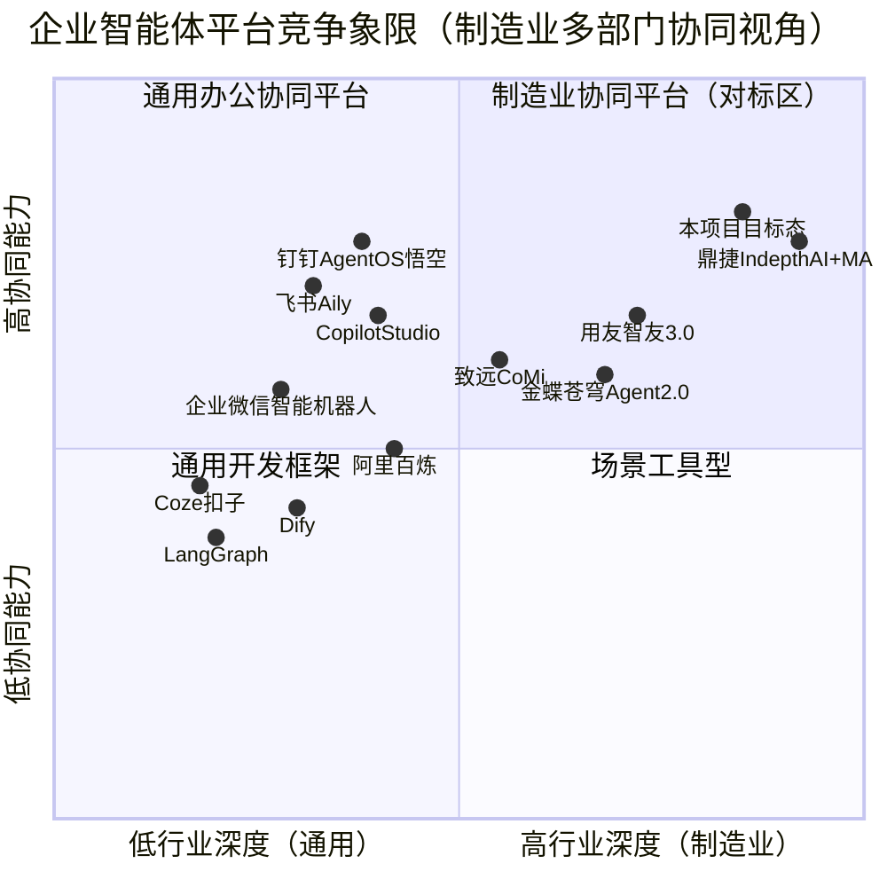

# 制造业多智能体协同办公平台（mfg_agent_platform）产品需求文档（PRD）

| 项 | 内容 |
|---|---|
| 文档版本 | V1.0（评审稿） |
| 作者 | Alice（产品经理） |
| 日期 | 2026-10-15 |
| 语言 | 简体中文 |
| 技术栈（延续现有基线） | Python 3.11+ · LangGraph · LangChain · FastAPI(SSE) · Streamlit · SQLite/MySQL · ChromaDB · Ollama(qwen3.5:9b)/DeepSeek · Docker Compose |
| 项目代号 | `mfg_agent_platform`（延续，snake_case） |
| 状态 | 待评审（需业务/IT/安全三方会签） |

---

## 1. 产品定义

### 1.1 背景与问题

客户为中型电子类产品制造企业，共 16 个部门：采购、业务、物控、计划、硬件、软结构（软件+结构）、测试、SQE、PQE、QA、仓库、物流、行政、财务、工程、制造。团队已掌握 CPK/SPC 质量分析方法。

核心业务痛点：

1. **进度不透明**：订单交付、异常处理进度分散在各部门系统与微信群中，对齐靠会议和人工催办，跨部门状态从天级延迟到周级不等。
2. **数据获取难**：一线与中层查数据依赖"问人/导 Excel/写 SQL"，历史异常处理经验（尤其 SPC/CPK 分析经验）无法复用。
3. **异常响应慢**：停线、缺料、客诉等异常跨部门取证靠电话，根因定位与闭环时间长。

### 1.2 现有基线（已可运行原型，非从零开始）

| 维度 | 现状 |
|---|---|
| 编排 | LangGraph，8 个 Agent：Business（规则路由）、Manufacturing(MES)、Quality(QMS)、SupplyChain(SCM)、Equipment(EAM)、Warehouse(WMS/TMS)、FA(RAG+LLM 评级)、Report（对客脱敏） |
| 场景 | 5 个：停线应急、来料异常、客户投诉、出货风险、设备预警（fan-out/fan-in 并行取证） |
| 数据 | 8 张模拟表（production_output/line_stop_event/quality_defect/material_batch/equipment_log/inventory/shipment/customer_complaint），SQLite 本地 / MySQL Docker |
| 知识 | ChromaDB 历史案例 RAG |
| 技术 | Streamlit UI + FastAPI（SSE 事件流）、本地 Ollama qwen3.5:9b 或 DeepSeek API、Docker Compose；git 尚无提交 |
| 定位 | **事中应急查询型**：用户提问 → 路由 → 并行取证 → 报告 |
| 缺失 | IM 入口、主动预警、工作流引擎、审批、用户权限、定时报告、跨部门进度看板 |

### 1.3 产品定位与演进

**一句话定位**：以"多智能体协同取证 + 跨部门进度对齐"为核心的企业级制造协同平台，从"应急查询工具"演进为"制造企业的协同操作系统（数据面 + 协同面 + 预警面）"。

**产品目标（3 个，正交）**：

1. **G1 进度透明**：任一订单/异常的全链路状态可实时查询，跨部门进度对齐从天级降到分钟级。
2. **G2 数据自助**：16 部门人员用自然语言完成 80% 的常规数据查询与分析（含 CPK/SPC），无需 IT 排期。
3. **G3 异常快处**：5 大异常场景（停线/来料/客诉/出货/设备）从"事后查询"升级为"事中协同处置 + 事前主动预警"，闭环时长下降 ≥40%。

**用户故事（5 个）**：

- As a 制造部经理，I want 停线时自动并行拉起品质/供应链/设备取证并给出复线 ETA 与受影响订单清单，so that 不用逐个部门打电话。
- As a 物控专员，I want 齐套检查不通过时系统自动分派追料任务给采购并评估交期影响，so that 缺料响应从天级降到小时级。
- As a PQE 工程师，I want SPC 控制图异常时自动推送预警并推荐历史相似案例与原因假设，so that 不用等批量不良发生才发现问题。
- As a 业务经理，I want 一屏查看所有订单的履约状态与风险订单，so that 对客户交期承诺有依据。
- As a 总经理，I want 每周一自动收到经营异常摘要与部门协同效率报表，so that 不开会也能掌握全局。

---

## 2. 市场调研（任务一）

> 调研方式：WebSearch/WebFetch 真实检索（2026-10-15），共 12 组关键词，覆盖通用框架、办公协同、制造业厂商、协议标准、落地案例五个方向。关键结论均附来源 URL。

### 2.1 市场格局总览（按阵营分类）

| 阵营 | 代表产品 | 2025-2026 关键动作 | 对本项目的关系 |
|---|---|---|---|
| **通用多智能体开发框架/平台** | LangGraph、AutoGen、CrewAI、Dify、FastGPT、Coze(扣子)、阿里百炼、腾讯元器/ADP、百度文心智能体、华为 Versatile-AI | Dify/Coze 开源化、低代码普及；百炼接入 200+ 模型与 200+ MCP 接口；ADP 单季上线近 600 新功能 | **技术选型池**：编排与 RAG 能力来源 |
| **互联网办公协同平台（Agent 化）** | 飞书 Aily（2025.7.9 发布）、钉钉 Agent OS/悟空（2025.12.23）、企业微信智能机器人（2025.2 接入 DeepSeek）、Microsoft Copilot Studio、致远互联 CoMi（2025.3 发布，2025.9 升级 2.0） | 全面 Agent 化：通用 Agent（悟空）+ 垂直 Agent + MCP 广场；入口即 IM | **入口与协同范式对标**：证明"IM 即入口"是主流答案 |
| **制造业/ERP 数字化厂商** | 鼎捷（IndepthAI + MACP + Commander 2.0）、用友（智友 3.0）、金蝶（苍穹 Agent 2.0）、美擎"智能体工厂"、浪潮云洲、卡奥斯 | 鼎捷 2025.4 发布制造业首个多智能体协作协议 MACP；用友/金蝶 2025.5 跟进，金蝶基于 MCP/A2A | **场景与协议对标**：制造业协同的行业语义与协议分层 |
| **协议/标准层** | MCP（Anthropic 2024.11）、A2A（Google 2025.4，Linux 基金会治理，IBM ACP 2025.9 并入）、中国 AIP（2025.10.27 首版代码，8 项国标指导性技术文件、50 家企业试点）、鼎捷 MACP、信通院 ATH | 形成"MCP 管工具连接、A2A 管智能体协作、AIP 管治理与互联"的分层栈 | **接口规范依据**：内部工具描述对齐 MCP 风格 |

### 2.2 代表产品对比表

| 产品 | 定位 | 核心能力 | 部署方式 | 优势 | 劣势 | 对本项目的启示 |
|---|---|---|---|---|---|---|
| **LangGraph** | 代码优先的多智能体编排框架 | 图状态机、fan-out/fan-in、持久化、人工介入 | 开源私有化 | 流程控制精确，已被本项目验证 | 无 UI/无权限体系，需自建大量企业能力 | 继续作为编排内核，在其上补齐协同层 |
| **Dify** | 开源 LLMOps/低代码平台 | 可视化编排、RAG 管道、多模型、评测 | 开源私有化 | 生态成熟、功能均衡，Apache 2.0 | 深度定制受限，多 Agent 细粒度控制弱于 LangGraph | 可作为 RAG/评测组件或低代码补充，不替换 LangGraph |
| **Coze(扣子)** | 低代码 Bot 平台 | 拖拽工作流、插件市场、字节生态分发 | 云端为主 | 门槛极低、迭代快 | 私有化与数据安全弱，C 端基因 | 仅适合快速验证 idea，不作为生产底座 |
| **飞书 Aily** | 企业级 Agent 开发平台 | Multi-Agent 架构、RAG、沙箱执行、MCP（2026.3 升级）、与飞书套件深度集成 | SaaS | 案例实证强：公牛客服接待能力 ×30、培训周期 3 个月→1 周；安克战略分析 7 天→1 天 | 数据在飞书云，制造业核心数据敏感场景受限 | "统一入口 + 技能库 + 效果调优"产品形态值得照搬 |
| **钉钉 Agent OS / 悟空** | 工作智能操作系统 | 通用 Agent（悟空）+ 垂直 Agent + DEAP + AI 搜问 + 硬件；Real Entity/Data/Time 三真实；过程监控+紧急"拔电" | SaaS + 私有化 | "从问答到干活"的任务闭环；制造业共创案例：订单处理 1.4h→1min、质量漏检率 12%→1.2% | 生态锁定阿里系；深度行业 know-how 需伙伴补 | "通用调度 + 垂直专家"架构与本项目 Business 路由 + 域 Agent 同构；"拔电"机制是安全设计范本 |
| **企业微信智能机器人** | IM 原生 AI 助手 | 免开发创建机器人、知识集、API 打通业务系统、可拉群 | SaaS | 零门槛、连接 1200 万企业、已接入 DeepSeek | 能力浅，无复杂编排与流程 | **IM 入口首选对标**：低成本实现"群里 @机器人 问数" |
| **Microsoft Copilot Studio** | 企业 Agent 构建平台 | 连接 Graph/Office 生态、低代码编排、治理 | SaaS（Azure） | 与 M365 集成深、企业治理完善 | 国内合规与网络、成本、制造业系统连接弱 | 治理与审计设计参考 |
| **致远互联 CoMi** | 协同运营 AI-COP 智能体家族 | 四层结构（入口/Agents/Builder/领域模型）、角色化智能体、知识与权限一体化、GBI、流程效能分析、信创全栈适配 | 私有化 | 权限与流程一体化（"知识与权限精准匹配"），2024 年 Agent 关联合同约 2500 万 | 行业深度偏办公/政企，制造业业务域弱 | **权限一体化设计直接借鉴**；CoMi 的"问数+流程"分层印证本平台"确定性走流程、智能走 Agent" |
| **鼎捷 IndepthAI + MACP + Commander 2.0** | 制造业多智能体平台 | MACP 多智能体通信协议；指挥官/专家/数字分身三类智能体；AIoT 联动；案例：储能制造商月度经营计划 1 周→智能体协同 | 私有化/云 | 制造业语义最懂：跨系统跨部门任务拆解；签约国标《人工智能 智能体互联》、申领 AIP 身份码 | 绑定鼎捷 ERP 体系，开放性待验证 | **协议分层与角色划分直接借鉴**：本项目 8 Agent 可重映射为指挥官(Business)/专家(域 Agent)/分身(定时任务) |
| **用友 智友 3.0** | 企业数智团队 | 3 分钟组建数智团队、自然语言全域调度、MCP 引擎、YonGPT+DeepSeek；BIP 已有 4000+ 智能体 | 云/私有化 | "一句话闭环"体验、场景覆盖广 | 通用场景为主，制造深度场景渐进 | 数智团队组织化形态对标 |
| **金蝶 苍穹 Agent 2.0** | 企业管理智能体平台 | 基于 MCP/A2A 的"USB-C"底座、金钥财报（10 分钟财报分析）、ChatBI、大模型网信办备案 | 云/私有化 | 协议开放、数据权限/内容审查/操作审计体系完整 | 聚焦财务/HR，制造生产域弱 | ChatBI 四大技术难点（SQL 语义鸿沟、指标语义匹配、私有知识图谱、归因预测）是问数引擎的验收清单 |

### 2.3 关键趋势判断（6 条，附来源）

1. **多智能体协同成为企业 AI 主战场，协议层一年内完成"分层收敛"**：MCP（工具连接）+ A2A（智能体协作，IBM ACP 已并入并由 Linux 基金会治理）+ AIP（治理/身份/审计，兼容 MCP/A2A）形成分层栈；中国 8 项智能体互联国标指导性技术文件已发布、50 家企业试点。多智能体协作难点已从"能不能发消息"转向身份认证、能力描述、发现匹配、交互对齐、审计治理五个治理问题。
   来源：https://baike.baidu.com/item/%E6%99%BA%E8%83%BD%E4%BD%93%E5%8D%8F%E8%AE%AE/67694554 ；https://it.sohu.com/a/1043531171_222256

2. **办公协同平台全面 Agent 化，"IM 即入口"成为事实标准**：飞书 Aily（2025.7）、钉钉 Agent OS/悟空（2025.12）、企业微信智能机器人（2025.2 接入 DeepSeek）均以 IM 机器人为第一入口，用"通用 Agent + 垂直 Agent"架构承接复杂任务，并配套过程监控、权限内数据访问（Real Data）、紧急停止机制。制造业厂商亦同：钉钉与伙伴共创"订单 Agent/质量 Agent"。
   来源：https://m.chinanews.com/wap/detail/cht/zw/10539511.shtml ；https://www.cet.com.cn/itpd/hlw/10298121.shtml ；https://www.cnr.cn/tech/techgd/20250711/t20250711_527256772.shtml

3. **制造业厂商以"行业协议 + 场景 Agent"差异化切入，且被纳入国家协议体系**：鼎捷 2025.4 发布制造业首个多智能体协议 MACP 及 Commander 2.0，划分指挥官/专家/数字分身三类角色，并将 MACP know-how 注入国标 AIP 生态、申领智能体身份码。用友智友 3.0（3 分钟组建数智团队）、金蝶苍穹 Agent 2.0（MCP/A2A 底座）跟随。政策端，八部门《"人工智能+制造"专项行动实施意见》明确到 2027 年推出 1000 个高水平工业智能体、推广 500 个典型场景。
   来源：https://m.tech.china.com/articles/20250618/202506181687391.html ；https://m.10jqka.com.cn/20260902/c679534986.shtml ；https://www.news.cn/info/20260108/47aa0f624a7c4f6fa7490d58be2fd692/c.html

4. **制造业多智能体 ROI 已被实证，但集中在"辅助决策 + 人机协同"而非无人化**：BMW 维护 Agent 非计划停机 -18%、Bosch 自适应质量周期 -25%、Tesla 跨工厂动态分配交付 -20%、Samsung AI 采购替代供应商物料成本 -7%；国内长虹智能排产 6h→5min（准确率 90%+）、采购审批 3 天→10 分钟、库存周转 +30%、AI 视觉漏检率降至 0.01%。共同点是"AI 建议 + 人一键批准"。
   来源：https://www.hfsresearch.com/?p=192744/ ；https://gzw.sc.gov.cn/scsgzw/CU230204/2025/11/19/0775eed6f4eb452682d05be7754b83d6.shtml ；https://striveonlab.com/?p=2097/

5. **从试点到规模化的失败率极高，数据与集成是两大死因**：约 95% 的企业 AI 试点未进入生产（麦肯锡/MIT 口径：仅约 1% 企业 AI 战略成熟）；数据质量差导致高达 85% 的 AI 项目失败；World Quality Report 2025 显示规模化的前三大障碍为集成复杂度（64%）、数据隐私（67%）、幻觉担忧（60%），42% 企业需接入 8 个以上数据源才能部署 Agent。智能体链式调用中微小错误会被放大（信通院）。
   来源：https://www.aiva.build/blog/blog-post-title-one-5frb8 ；https://przc.re/reports/AI/ai-underperformance-przc.html ；https://www.hubbl.com/resource/heres-why-89-are-trying-genai-but-only-15-are-scaling-it ；http://dz.jjckb.cn/www/pages/webpage2009/html/2025-07/21/content_108709.htm

6. **确定性流程与智能体边界日益清晰，"工作流引擎 + Agent"混合架构成为工程共识**：CoMi 将"问数智能引擎/流程引擎/知识中台"分层，钉钉对 Agent 执行设"过程监控 + 拔电"，业界复盘明确要求"Deterministic-like orchestration + Human-in-the-loop + scoped governed data"。这直接验证本平台将确定性流程（审批、过账、计算）与概率性能力（问数、归因、报告）分离的架构决策。
   来源：https://www.seeyon.com/News/desc/id/7885/typeid/1.html ；https://www.cet.com.cn/itpd/hlw/10298121.shtml ；https://www.aiva.build/blog/blog-post-title-one-5frb8

### 2.4 竞争象限图

**象限解读**：右上象限（制造业 + 高协同）目前只有鼎捷等重资产 ERP 厂商，且绑定自家生态——中型电子制造企业**买不到现成的、开放的、深度定制的 16 部门协同平台**，这正是本项目自建的空间；左上象限（通用办公协同）提供入口与交互范式但行业深度不足；左下框架提供技术底座。本项目策略：**用左下的技术（LangGraph），抄左上的入口与体验（IM + 看板），打右上的差异化（电子制造 16 部门协同语义 + CPK/SPC）**。

### 2.5 Build vs Buy 结论

| 类别 | 决策 | 具体内容 | 理由 |
|---|---|---|---|
| 编排框架 | **复用（已选型）** | LangGraph 继续作为内核；Dify 作为 RAG 管道/低代码/评测的可选补充 | 已被原型验证；Dify 补 UI 与评测短板，但不替换编排 |
| IM 入口 | **买/复用** | 复用企业现有 IM（企业微信/钉钉/飞书）机器人 SDK 与 Webhook，不自建 IM | 入口是网络效应生意，自建无胜算；钉钉/企微机器人已被验证可打通业务系统 API |
| 工作流引擎 | **买/复用开源** | 确定性流程（审批、ECN、工单状态机）采用成熟开源工作流引擎或轻量自研状态机，**不用 LLM** | 趋势 6 的工程共识；避免用概率模型做确定性事务 |
| RAG/向量库 | **复用 + 增强** | 延续 ChromaDB + LangChain；引入分域知识库与引用溯源 | 已运行；重点补"分部门权限"而非重建 |
| 大模型 | **本地优先** | Ollama qwen3.5:9b 为主、DeepSeek API 为备；模型可插拔（llm_factory 已支持） | 制造业数据不出内网；本地推理成本可控 |
| 协议规范 | **对齐不自建** | 工具描述对齐 MCP 风格（标准化 Tool Schema）；持续跟踪 AIP 国标与身份码机制，预留 Agent 身份注册位 | 避免成为协议孤岛；国标 50 家试点表明合规红利期 |
| **16 部门协同语义层** | **自建** | 部门-数据-场景-权限的领域模型、跨部门任务分派协议、SLA 规则 | 无现货产品；这是本项目核心资产与壁垒 |
| **CPK/SPC 分析 Agent** | **自建** | 控制图判异、过程能力指数计算与解释、异常假设生成 | 团队既有核心能力，市面产品（金蝶 ChatBI 等）未覆盖制造过程质量深度 |
| **场景编排与路由** | **自建** | 基于组织结构的场景路由、并行取证编排、对客脱敏策略 | 与客户组织强耦合，通用平台无法适配 |
| **数据权限与脱敏** | **自建** | 行级/列级权限、对客报告脱敏策略引擎、审计日志 | 借鉴 CoMi"知识与权限一体化"理念，但必须自有实现以满足合规 |

**总结论**：底座（框架/IM/工作流/RAG/模型）全部买或复用开源，**把钱和人投在"制造业协同语义 + 质量分析 + 权限脱敏"三件自建资产上**。理由：① 制造业定制深，通用平台只能解决 30% 问题；② 数据敏感，核心系统数据不能出内网，SaaS 办公平台只能做入口不能做数据面；③ 集成复杂，ERP/MES 私有接口决定必须自有数据适配层。

---

## 3. 需求分析（任务二）

### 3.1 现状差距分析（六维度）

| 维度 | 现有原型 | 差距 | 目标态 |
|---|---|---|---|
| **域覆盖** | 8 Agent 覆盖 MES/QMS/SCM/EAM/WMS/TMS/FA/Report | 缺：计划（APS/MPS）、硬件研发、软件/结构、测试、SQE/PQE 细分动作、QA 体系、财务成本、工程 NPI、行政、业务的客户侧深度 | 以"域 Agent + 技能插件"覆盖 16 部门核心域；每域先覆盖 3-5 个高频技能 |
| **协同机制** | 单场景内 fan-out/fan-in 并行取证，无任务分派 | 缺：跨部门任务分派/会签/审批/SLA 跟踪/升级机制；无"人-Agent 混合编队" | 引入工作流引擎 + 任务中心：Agent 取证结果自动生成待办并分派到人 |
| **入口** | Streamlit + FastAPI(SSE)，仅桌面浏览器 | 缺：IM 机器人、移动端、订阅推送、群内协同 | IM 机器人为主入口（问数/预警/ @查询），Web 看板为辅，移动端自适应 |
| **数据** | 8 张模拟表，SQLite/MySQL | 缺：主数据（物料/BOM/供应商/客户/组织）、ERP/MES/PLM 真实对接、实时采集、数据质量治理、指标口径字典 | 建立只读数仓 + 指标字典 + 数据质量评分；模拟表仅留作演示与测试 |
| **安全** | 无用户体系，正则过滤 SQL，Prompt 脱敏 | 缺：RBAC、部门数据隔离（行级）、审计日志、提示注入防护、脱敏策略化 | 统一认证 + 行列级权限 + 全链路审计 + 策略化脱敏 |
| **运营** | 无定时任务、无看板、无评估、无反馈闭环 | 缺：定时报告、跨部门看板、Agent 评测集、用户反馈通道 | 报告中心 + 看板中心 + 评测/反馈体系，按周运营 |

### 3.2 部门职责与数据需求矩阵（16 部门）

| 部门 | 核心职责 | 关键数据 | 关联系统 | 主要协同对象 |
|---|---|---|---|---|
| 采购 | 供应商开发、询比价、下单、跟单 | 供应商档案、PO、来料合格率、单价、交期 | SRM/ERP | SQE、物控、财务、仓库 |
| 业务 | 客户订单、交期承诺、客诉接口、销量预测 | 订单、预测、客户档案、出货、应收账款 | CRM/ERP | 计划、物控、制造、QA、物流 |
| 物控 | 物料计划、齐套检查、欠料管理 | BOM、库存、在途、MRP 运算结果 | ERP/MRP | 采购、计划、仓库 |
| 计划 | 主生产计划、排产、产能协调 | MPS、产能、订单优先级、达成率 | APS/MES | 制造、物控、业务、工程 |
| 硬件 | 硬件设计、BOM 维护、ECN 发起 | 设计文档、BOM、ECN、元器件库、生命周期 | PLM | 工程、制造、SQE、测试 |
| 软结构 | 嵌入式软件、结构设计、DFM | 软件版本、图纸、DFM 问题清单 | PLM/Git | 硬件、测试、制造、工程 |
| 测试 | 测试方案/用例、执行、报告 | 测试结果、良率、CPK、缺陷分布 | 测试管理系统/LIMS | 质量、硬件、软结构、SQE |
| SQE | 供应商质量、IQC 标准、供应商辅导 | IQC 数据、SCAR、供应商 scorecard、来料批次 | QMS | 采购、PQE、物控 |
| PQE | 制程质量、良率提升、SPC 监控 | 制程不良、CPK、SPC 控制图、直通率、分层数据 | QMS/MES | 制造、测试、QA、工程 |
| QA | 质量体系、客诉处理、审核、可靠性 | 客户投诉、8D 报告、审核记录、RMA、质量成本 | QMS | 业务、PQE、测试、制造 |
| 仓库 | 出入库、库存准确性、FIFO、盘点 | 库存、出入库单、库位、周转天数、呆滞料 | WMS | 物控、物流、采购、财务 |
| 物流 | 发货、运输、关务、在途跟踪 | 出货单、在途状态、运费、签收、报关 | TMS | 业务、仓库、客户、财务 |
| 行政 | 后勤、资产、会议、制度发布 | 资产台账、后勤工单、制度文件 | OA | 全部门 |
| 财务 | 成本核算、应收应付、报价支持、预算 | 成本、应收、发票、预算、质量成本 | ERP 财务 | 业务、采购、仓库、管理层 |
| 工程 | 工艺设计、NPI 导入、ECN 执行、治具 | 工艺文件、SOP、NPI 进度、ECN 执行状态、试产数据 | PLM/MES | 制造、硬件、软结构、PQE |
| 制造 | 生产执行、人员/设备管理、现场异常 | 产出、OEE、停线事件、直通率、人员技能、设备状态 | MES | 计划、工程、PQE、物控、设备 |

### 3.3 跨部门协同场景清单（13 个，含 5 个原型场景演进版）

| # | 场景 | 描述 | 参与部门 | 触发条件 | 期望输出 | 优先级 | 优先级理由 |
|---|---|---|---|---|---|---|---|
| S1 | **停线协同**（原停线应急演进） | 停线时并行取证并联动排产补救 | 制造+计划+物控+业务+设备 | MES 停线事件/设备报警/人工上报 | 根因假设、复线 ETA、受影响订单清单、补救排产建议、对客沟通口径（脱敏） | **P0** | 单次损失最大；已验证并行编排可行，增量只在任务分派与补救建议 |
| S2 | **来料异常联动**（原来料异常演进） | IQC 异常自动锁定批次并联动物料替代 | SQE+采购+物控+PQE+计划 | IQC 不合格/供应商来料预警 | 批次锁定与在库处置、替代料方案、SCAR 自动生成、供应商评级更新 | **P0** | 电子制造来料问题高发；SQE-PQE 数据链完整 |
| S3 | **客户投诉闭环**（原客户投诉演进） | 客诉自动围堵+责任分派+8D 跟踪 | QA+业务+PQE+测试+工程 | 客诉录入/RMA 到货 | 围堵措施（在库/在途/在线）、责任部门分派与 SLA、8D 草稿、对客报告（脱敏）、改善验证提醒 | **P0** | 对客体验直接相关；报告 Agent 已具雏形 |
| S4 | **出货风险协同**（原出货风险演进） | 订单交付风险实时计算与协商 | 业务+仓库+物控+制造+物流 | 订单临期/库存低于安全线/排产变更 | ATP 可承诺量、分批出货方案、风险订单清单、客户协商口径 | **P0** | 直接支撑 G1；数据面已具备 |
| S5 | **质量异常主动预警**（新增，差异化） | SPC/CPK 越限主动预警与处置派单 | PQE+制造+QA+工程 | CPK<1.33 或控制图判异/不良率超阈值 | 异常工单、停产评估建议、原因假设、历史相似案例（RAG）、复判验证 | **P0** | 团队核心能力；实现"查询→主动"质变；数据已在 prototype 域内 |
| S6 | **订单履约全景看板**（新增，平台核心） | 全订单链路状态一屏可视 | 业务+计划+制造+物控+仓库+物流 | 每日定时/订单变更事件 | 订单履约状态、瓶颈环节、延期风险排序、部门待办汇总 | **P0** | 平台目标①的直接载体；16 部门协同的"面" |
| S7 | **缺料协同会签**（新增） | 齐套不通过自动追料与交期评估 | 物控+采购+计划+业务 | MRP 齐套检查不通过 | 追料任务分派（采购）、替代料评估（工程/SQE）、交期影响（计划/业务）、会签结论 | **P0** | 缺料响应时长降 50% 的核心抓手 |
| S8 | **设备预警与维护协同**（原设备预警演进） | 设备异常联动维保与排产调整 | 制造+工程+计划+（采购备件） | 设备参数异常/预测性维护信号 | 维保工单、换产/停机窗口建议、备件需求（对接采购） | **P1** | 无传感器实时数据前，先用日志规则预警；预测性维护待数据成熟 |
| S9 | **新品导入 NPI 协同**（新增） | NPI 节点与试产问题跨部门跟踪 | 工程+硬件+软结构+测试+制造+SQE | NPI 节点变更/试产不良 | 问题清单（含责任部门/期限）、试产良率趋势、导入就绪度评估 | **P1** | 电子制造 NPI 频繁，但依赖 PLM 数据接入，排二期 |
| S10 | **ECN 变更协同**（新增） | 工程变更跨部门执行与旧料消化 | 工程+硬件+制造+仓库+SQE | ECN 发布生效 | 切换计划、旧料消化方案（仓库）、验证清单（SQE/测试）、执行跟踪 | **P1** | 变更管理是电子制造刚需；流程属性强，需工作流引擎支撑后排期 |
| S11 | **经营分析例会材料自动生成**（新增） | 周/月报自动汇总与异常摘要 | 全部门+管理层 | 定时（周一 8:00/月初） | 部门 KPI 汇总、异常事件摘要、改进建议、协同效率报表 | **P1** | 报表工时降 80% 的载体；依赖各部门数据就绪度 |
| S12 | **企业知识问答**（新增） | 制度/SOP/历史案例/质量判据问答 | 全部门 | 用户提问（IM/Web） | 答案 + 来源引用 + 置信度提示 | **P1** | 复用 FA Agent 的 RAG 能力；低风险高感知，适合培养用户习惯 |
| S13 | **行政/财务审批流**（新增） | 报销、请假、采购申请的流程自动化 | 全部门+财务+行政 | 表单提交 | 审批流转、超时提醒、归档 | **P2** | **纯确定性流程，用工作流引擎实现，不用 Agent**；放在这是为避免被"智能化"带偏 |

### 3.4 用户画像与核心痛点

| 层级 | 画像 | 核心痛点 | 核心诉求 | 首选入口 |
|---|---|---|---|---|
| **管理层**（总经理/副总/总监） | 关注全局经营与风险，不看系统看结论 | 数据分散在各系统、报告滞后（天级）、会议多、异常后知后觉 | 一屏看全（订单/质量/交付/设备四态）、异常主动推送、周报自动到手机 | 移动端 + IM 推送 |
| **中层**（部门经理/主管） | 对本部门 KPI 与跨部门协同负责 | 追进度靠群聊与电话、跨部门扯皮、数据口径不一致、背锅风险 | 部门待办自动汇总、SLA 追踪、跨部门任务可追溯、口径统一 | Web 看板 + IM |
| **执行层**（工程师/专员/班组长） | 处理具体异常与日常查询 | 系统多（ERP/MES/QMS/WMS 各查一遍）、查数靠问人、历史经验难复用、SPC 分析手工 | 对话式问数（一句话出数）、异常案例推荐、处置 SOP 指引、手机上能办 | IM 机器人 |

### 3.5 功能性需求清单（P0/P1/P2）

> 分类：A 进度协同 / B 数据查询 / C 分析报表 / D 知识问答 / E 流程审批 / F 预警通知 / G 报告生成

| ID | 分类 | 需求 | 优先级 | 验收要点 |
|---|---|---|---|---|
| F-A1 | A 进度协同 | 订单履约全景看板（16 部门状态聚合、风险排序） | P0 | 任一订单可下钻到部门级状态；延迟 ≤5min |
| F-A2 | A 进度协同 | 跨部门任务中心：Agent 取证结果自动生成待办并分派到人 | P0 | 停线场景下 3 个部门待办 1 分钟内自动创建 |
| F-A3 | A 进度协同 | 部门协同 SLA 计时与超时升级 | P1 | 客诉/缺料场景 SLA 可配置、超时自动升级到上级 |
| F-B1 | B 数据查询 | 自然语言问数（Text-to-SQL，白名单+只读+结果校验） | P0 | Top100 评测集准确率 ≥90%；P95 响应 ≤5s |
| F-B2 | B 数据查询 | CPK/SPC 分析（控制图、过程能力指数、判异解释） | P0 | 与团队手工算法一致；支持按批次/产线/时间段分层 |
| F-B3 | B 数据查询 | 指标口径字典与语义层（统一指标定义，避免各说各话） | P0 | 覆盖率：先覆盖质量/产出/交付三类共 50 个指标 |
| F-C1 | C 分析报表 | 质量异常分析（缺陷分布/主导缺陷/趋势/柏拉图） | P0 | 支持按天/周/月、按产线/型号下钻 |
| F-C2 | C 分析报表 | 定时报告中心（日报/周报/月报，按角色订阅） | P1 | 周一 8:00 前自动生成并推送；失败重试与告警 |
| F-C3 | C 分析报表 | ChatBI 式归因与预测（指标异常自动归因假设） | P1 | 对质量/交付指标给出可解释假设（引用数据佐证） |
| F-D1 | D 知识问答 | 分域知识库问答（制度/SOP/历史案例，答案带来源引用） | P1 | 引用可点击溯源；无答案时明确说"不知道" |
| F-D2 | D 知识问答 | 历史案例推荐（异常场景自动匹配相似案例与处置动作） | P0 | 停线/来料场景自动推荐 Top3 案例 |
| F-E1 | E 流程审批 | 工作流引擎（表单+状态机+会签+代理），确定性流程不走 LLM | P1 | ECN/SCAR/客诉升级三类流程上线 |
| F-E2 | E 流程审批 | Agent 结果驱动审批（如对客报告发出前主管审批） | P1 | 报告发出 100% 经审批或白名单自动 |
| F-F1 | F 预警通知 | 预警规则引擎（阈值/规则/趋势三类规则，可配置） | P0 | SPC 越限、库存低于安全线、订单临期三类规则上线 |
| F-F2 | F 预警通知 | IM 推送与升级（@相关人、未读升级、免打扰策略） | P0 | 预警到 IM 触达 ≤1min |
| F-F3 | F 预警通知 | 预警闭环跟踪（已读/处置中/已闭环） | P1 | 预警闭环率可统计 |
| F-G1 | G 报告生成 | 对客脱敏报告（策略化脱敏+审批+版本留痕） | P0 | 脱敏漏出率 0（抽检 50 份）；人工审批可覆盖 |
| F-G2 | G 报告生成 | 内部简报（同源数据，详版） | P0 | 与对客报告同源生成，不重复录入 |
| F-G3 | G 报告生成 | 经营分析材料（周会/月会） | P1 | 编制工时下降 ≥80% |

### 3.6 非功能性需求

| 类别 | 要求 | 量化指标 |
|---|---|---|
| **私有化部署** | 全栈本地化：应用、数据库、向量库、LLM（Ollama）均部署在内网；禁止生产数据出内网；DeepSeek API 仅用于脱敏后的非敏感场景（默认关闭） | 断网可运行核心场景（问数/看板/预警） |
| **数据隔离** | 部门数据隔离：按部门/角色的行级权限（如业务看不到成本价）；知识库分域；IM 机器人按群成员鉴权 | 越权访问测试用例 100% 通过；渗透测试无高危 |
| **性能** | 问数响应 P95 ≤5s（含 LLM）；看板首屏 ≤3s；并行取证场景（3 Agent）端到端 ≤30s；支持 100 并发用户 | 压测报告达标 |
| **可审计** | 全链路日志：谁、何时、问什么、Agent 答什么、调了哪些工具/SQL、报告版本；SQL 只读审计 | 任一结论可回溯到数据与 prompt 版本 |
| **可评估** | 评测集：问数准确率、路由准确率、报告采纳率、脱敏漏出率；用户侧"有用/没用"一键反馈 | 每周产出评估报告；核心指标入看板 |
| **可靠性** | LLM 服务降级：不可用时切换备选模型或规则兜底（缓存结果+提示）；预警引擎与 LLM 解耦 | 核心预警不依赖 LLM 可用性 |
| **安全** | 提示注入防护（外部内容隔离）、SQL 白名单（仅 SELECT+正则过滤，延续现有设计并加固）、脱敏策略引擎 | 安全评审通过 |

### 3.7 成功指标（可量化 + 基线测量建议）

| # | 指标 | 目标值 | 基线测量建议（上线前 2 周完成） |
|---|---|---|---|
| M1 | 跨部门进度查询响应时长 | 天级 → **分钟级**（P95 ≤10min） | 记录当前一次"订单状态对齐"从发起到结论的耗时（取 10 个样本均值） |
| M2 | 缺料响应时长（欠料发现→采购动作下达） | **下降 50%** | 物控导出近 3 个月欠料记录，统计发现到 PO/催料时间差 |
| M3 | 报表编制工时（周报/月报/对客报告） | **下降 80%** | 各部门自报编制人时（如 QA 周报 6h/次 × 部门数） |
| M4 | 质量异常闭环时长（发现→结案） | **下降 40%** | QMS 导出近 6 个月异常单，统计发现到结案时长分布 |
| M5 | 问数准确率（Top100 评测集） | **≥90%** | 无基线，上线即建评测集并持续运营 |
| M6 | 预警提前量（异常发生前可干预时间） | 平均 **≥2h**（SPC 类） | 用历史数据回放验证 |
| M7 | 用户采纳率 | 目标部门周活 **≥60%**；报告采纳率 ≥70% | 上线后按周统计 |

---

## 4. 批判性分析（任务三）

### 4.1 不应使用多智能体/LLM 的需求清单（走确定性工作流/规则引擎）

> 原则：**凡输入输出可枚举、规则可枚举、错误成本高的环节，一律不用 LLM。** LLM 只做：意图理解、语义检索、归因假设、报告撰写、异常解释。

| 需求 | 为什么不该用 LLM/多智能体 | 正确实现 |
|---|---|---|
| 报销/请假/采购申请审批流（S13） | 规则完全确定（金额阈值、组织架构、余额校验） | 工作流引擎 + RBAC |
| ECN/BOM 变更流转（S10 的流程部分） | 状态机 + 权限矩阵确定 | 工作流引擎；Agent 仅做影响分析建议 |
| 库存扣减/出入库过账 | 强一致事务，错一次就是账实不符 | 事务型业务系统（WMS/ERP） |
| CPK/SPC 数值计算与控制图判异 | 确定性统计算法（8 大判异准则），LLM 算数不可靠 | Python 统计库计算；LLM 只解释"这意味着什么" |
| SQL 执行与结果集返回 | 执行层必须确定性 | 白名单校验后由引擎执行；LLM 只生成 SQL 草稿 |
| 权限校验与数据隔离 | 安全边界不能概率化 | RBAC 中间件，Agent 无特权 |
| 定时任务触发、报告分发、消息通知 | 调度与投递是确定性基础设施 | 调度器 + 消息通道 |
| 供应商评级/记分卡 | 评分公式公开可审计 | 规则引擎/公式计算 |
| 排产（APS）优化 | 约束求解问题，LLM 不擅长精确优化 | APS 算法；Agent 做参数解释、异常上报、方案对比说明 |
| 停机/停产等物理动作执行 | 安全关键，必须人确认 | 人工审批 + 系统指令 |

### 4.2 需求风险与关键假设

| 风险 | 影响 | 概率 | 缓解措施 |
|---|---|---|---|
| **数据质量**（口径不一、字段缺失、模拟表≠真实数据） | 问数与预警结果不可信，平台被弃用 | **高** | 数据治理先行（M1 优先做指标字典 + 数据质量评分）；先接只读数仓/离线导入；每个指标标注口径与更新频率 |
| **组织抵触**（部门视为监控、权限博弈、一线怕担责） | 采纳率低，数据不开放 | **高** | 管理层发文定调"辅助定位"；从查询类（无痛）切入再进协同类；采纳指标不与个人绩效强绑定；让每个部门有"数据接口人"参与共建 |
| **集成复杂度**（ERP/MES/PLM 私有接口、无开放 API） | 数据接入周期失控 | **高** | 分级接入：① 数据库只读副本 ② 中间表/文件导入 ③ API；先跑通质量/交付两类数据；集成工作量单独立项评估 |
| **LLM 幻觉**（问数错误、错误归因） | 错误决策、信任崩塌 | 中 | SQL 白名单+结果校验（行数/量级/口径）+ 置信度提示 + 关键结论强制人工确认；评测集持续回归 |
| **成本**（GPU/推理/Token/运维人力） | 规模化受阻 | 中 | 本地模型优先；上下文压缩与缓存；小模型做路由/分类，大模型只做难任务；分级模型策略 |
| **范围蔓延**（16 部门一次全上） | 交付烂尾 | **高** | 严格按 P0 分批（M1-M4），每批有可演示价值；每批结束做 Go/No-Go 评审 |
| **安全合规**（数据出内网、提示注入、报告泄露） | 合规事故 | 中 | 全栈私有化；脱敏策略引擎 + 双人抽检；外部内容（来料邮件/客诉原文）隔离处理；渗透测试 |

**关键假设（需客户确认，不成立则计划需调整）**：

1. 客户同意开放 ERP/MES/QMS 等核心系统的**只读**数据（最悲观情况：先离线导入）。
2. 企业已有 IM 平台（企业微信/钉钉/飞书之一）且允许配置机器人与 Webhook。
3. 每个部门指定 1 名数据接口人 + 1 名业务验收人。
4. 可提供本地推理算力（至少 1 台 GPU 服务器或复用现有 Ollama 宿主机）或接受 DeepSeek 私有 API。
5. 量测数据（CPK/SPC 所需的原始量测值）可获取，而非只有汇总报表。
6. 质量/交付两类数据的信息化程度足以支撑 M2 里程碑。

### 4.3 伪需求/低价值场景识别

| 候选需求 | 判定 | 理由与处置 |
|---|---|---|
| "全自动无人处置"（自动停产、自动改排产、自动处罚供应商） | **伪需求（现阶段）** | 责任主体不清、错误成本极高；定位为"Agent 建议 + 人一键批准"，M4 后再评估窄场景自动闭环 |
| "企业万事通"大而全知识助手 | **低价值** | 无场景约束的问答使用率快速衰减；应绑定场景（S12 只做质量/制度/案例三类域） |
| 自然语言直接生成财务凭证/过账 | **伪需求** | 财务合规不允许概率性生成；用表单+规则，Agent 只做辅助填写 |
| 数字人/虚拟形象/语音炫技 | **低价值** | 与两大目标无关，验收时明确不做 |
| 全量设备预测性维护（AI 模型） | **暂缓** | 传感器实时数据不具备；先用日志规则预警（S8），数据就绪后再上模型 |
| "一句话生成任意复杂报表"的完全自由 BI | **低价值（过度承诺）** | 自由问数准确率随复杂度指数下降；做"受控问数"：限定指标域 + 模板化 + 置信度提示 |
| 用多智能体做简单单表查询 | **过度设计** | 单表确定性查询走模板/规则直查更快更准，多 Agent 只用于跨域并行取证 |
| 跨供应商/跨客户的产业互联网协同 | **范围外** | 先解决企业内部 16 部门协同；对客只到"脱敏报告"为止 |

---

## 5. 实施路线图（建议）

| 里程碑 | 周期 | 内容 | 出口准则 |
|---|---|---|---|
| **M1 数据与地基** | 4 周 | 用户体系+RBAC、IM 入口（机器人可问数）、指标字典 v1、只读数据接入（质量/交付两类）、问数评测集 | 3 个部门试用问数，准确率 ≥80% |
| **M2 协同场景** | 6 周 | S1-S4、S6、S7 上线（任务中心+SLA）、对客脱敏报告审批流、订单看板 | 5 个场景真实数据跑通；M1/M2/M3/M4 基线可测 |
| **M3 主动预警** | 4 周 | S5 质量主动预警（SPC/CPK）、预警规则引擎、IM 推送升级 | 预警提前量 ≥2h（历史回放验证） |
| **M4 运营与推广** | 4 周 | S11 定时报告、S12 知识问答分域、评估与反馈体系、运营周报 | 周活 ≥60%；报告采纳率 ≥70%；进入常态化运营 |

## 6. 附录

### 6.1 主要信息来源

1. AI 框架对比（LangChain/LangGraph/AutoGen/Dify/FastGPT/Coze）：https://juejin.cn/post/7644934311103512616
2. AI Agent 智能体技术发展报告（框架对比表、市场规模）：https://www.cdut.edu.cn/__local/5/AE/C5/0377C246CAF98ECDDA37D2CC45D_02F41924_1C61917.pdf
3. 飞书 Aily（2025.7.9 发布、案例、2026.3 MCP 升级）：https://pages.baidu.com/show?id=bf4f9960dbb9fb74f708cb92 ；https://static.nfnews.com/content/202507/09/c11489959.html
4. 钉钉 Agent OS/悟空（2025.12.23、制造业 Agent 案例）：https://m.chinanews.com/wap/detail/cht/zw/10539511.shtml ；https://www.cet.com.cn/itpd/hlw/10298121.shtml
5. 企业微信智能机器人（2025.2 接入 DeepSeek、2025.7 升级）：https://www.cnr.cn/tech/techgd/20250711/t20250711_527256772.shtml
6. 致远互联 CoMi（2025.3 发布、2.0 升级、权限一体化）：https://wap.seeyon.com/News/desc/id/7072/typeid/desc.html ；https://www.seeyon.com/News/desc/id/7885/typeid/1.html
7. 鼎捷 MACP/Commander 2.0/IndepthAI（制造业首个多智能体协议）：https://m.tech.china.com/articles/20250618/202506181687391.html ；https://www.toutiao.com/a7667265279319081524 ；https://m.10jqka.com.cn/20260902/c679534986.shtml
8. 用友智友 3.0：https://www.yonyou.com/news/3980 ；金蝶苍穹 Agent 2.0：https://www.kingdee.com/article/1937082257521065986.html
9. 智能体协议（MCP/A2A/AIP/ATH/国标 50 家试点）：https://baike.baidu.com/item/%E6%99%BA%E8%83%BD%E4%BD%93%E5%8D%8F%E8%AE%AE/67694554 ；https://it.sohu.com/a/1043531171_222256
10. 阿里百炼/智谱/腾讯元器格局：http://51ima.com/news/12094.html ；https://app.myzaker.com/news/article.php?pk=6ac8c95cb15ec07c3f08886d
11. 制造业多智能体案例（BMW/Bosch/Tesla/长虹/Striveonlab）：https://www.hfsresearch.com/?p=192744/ ；https://gzw.sc.gov.cn/scsgzw/CU230204/2025/11/19/0775eed6f4eb452682d05be7754b83d6.shtml ；https://striveonlab.com/?p=2097/
12. 政策（八部门"人工智能+制造"、2027 年 1000 个工业智能体）：https://www.news.cn/info/20260108/47aa0f624a7c4f6fa7490d58be2fd692/c.html ；https://www.miit.gov.cn/ztzl/rdzt/xxgyhqk/tjyd/zjlt/art/2026/art_dc2e9a92877e4bca83b9f0f1539d1523.html
13. 落地挑战（95% 试点失败、数据质量 85%、集成/隐私/幻觉障碍）：https://www.aiva.build/blog/blog-post-title-one-5frb8 ；https://przc.re/reports/AI/ai-underperformance-przc.html ；https://www.hubbl.com/resource/heres-why-89-are-trying-genai-but-only-15-are-scaling-it ；http://dz.jjckb.cn/www/pages/webpage2009/html/2025-07/21/content_108709.htm

### 6.2 Open Questions（需业务/IT 澄清）

1. 客户现有 IM 平台是哪一家（企业微信/钉钉/飞书）？是否有开放平台权限？
2. ERP/MES/QMS/PLM 的品牌与版本？是否提供只读账号或数据库副本？
3. 量测原始数据（SPC 用）的粒度与获取方式？
4. 对客报告的客户范围与脱敏标准的责任部门（QA or 业务）？
5. 本地推理算力现状（是否已有 GPU 服务器/Ollama 宿主机规格）？
6. 16 部门中哪些部门一期必须覆盖、哪些可二期（建议业务/计划/制造/物控/质量先行）？
7. 部门数据隔离的粒度需求：行级（按产线/区域）还是表级即可？

---

*本文档基于真实市场调研（2026-10-15）与现有代码基线撰写；所有市场数据均标注来源，未采用记忆性数据。*
