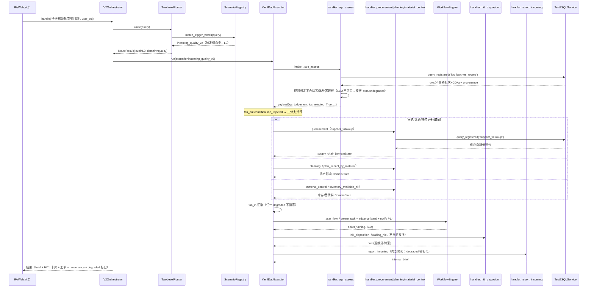
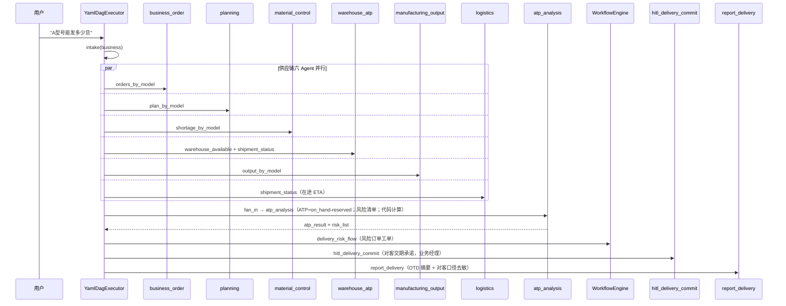
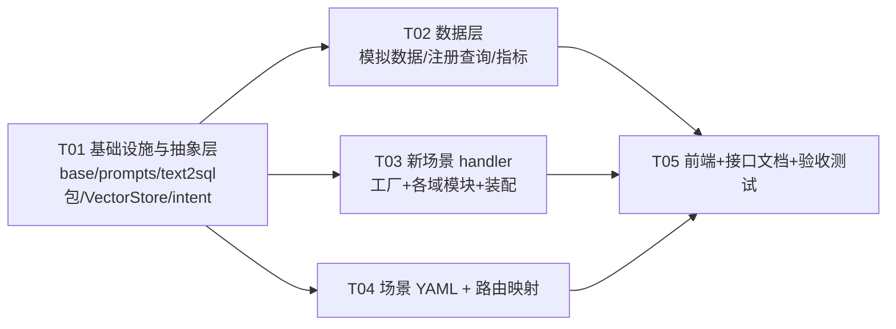

# mfg-agent-platform · V2 增量架构设计（4 场景补齐 + 脚手架对齐 + 扩展位）

> **文档定位**：本文是 `docs/ARCHITECTURE-V2.md` 的**增量设计**（不重写总架构），
> 落地三件事：① 补齐全 5 个演示场景；② 按 Itcast 参考项目做**脚手架对齐**（抽象与分层，不引入其技术栈）；
> ③ 为"后续增加意图 + RAG 向量库"预留**可落地扩展位**（本次不实现）。
>
> **作者**：架构师 高见远（Gao） · **输入基线**：已代码盘点（见 §0）。
> **硬约束**：V1 零破坏 / V2 现有行为零破坏（line_stop + 282 个测试为回归基线）；
> 不新增重依赖（VectorStore ABC 用标准库 `abc`，**禁止**本次引入 milvus/pymilvus）；
> degraded（本机 Ollama 离线）必须完整可演示；声明式优先。

---

## 0. 现状盘点与关键约束（先读，避免踩坑）

### 0.1 V2 现有实现（已读代码）

| 模块 | 现状 | 与本次的关系 |
|---|---|---|
| `v2/scenarios/line_stop_v2.yaml` | **唯一**已注册场景，9 个 step（agent/fan_out/fan_in/workflow/hitl 五种节点范例） | 本次**零改动**（回归基线） |
| `v2/core/node_registry.py` | `build_handlers(runtime)` 工厂，注册 10 个 handler：`business/manufacturing/quality/supply_chain/equipment/fa/impact_assessment/hitl_restart/hitl_eta/report` + 模板 `_fa_template/_customer_report_template/_apply_forbidden_words` | 在**不改变现有 handler 行为**前提下**新增** handler |
| `v2/core/yaml_dag.py` | YAML→LangGraph 执行器；节点类型 `agent/fan_out/fan_in/workflow/hitl`；`timeout_s` + `on_error: degrade|abort`；`fan_out` 支持 `condition`+`else` | 本次新场景**只需写 YAML**，不改执行器 |
| `v2/core/router.py` | 两级路由：L0 场景触发词/V1 `SCENE_RULES` → L1 LLM 闭集（5 域组+out_of_scope）→ 降级模糊匹配；`V1_SCENE_TO_V2` 目前 4 个场景映射为 `None` | **必需改动**：`V1_SCENE_TO_V2` 指向新场景 key |
| `v2/services/text2sql.py` | 八道防线；`Text2SQLService`（指标库→注册查询→明细探查）+ `SQLAuditor/FieldMasker/ResultValidator/MetricLibrary/QueryLibrary/TABLE_ACL/SENSITIVE_COLUMNS` | 新增查询与（如有）表→登记 `TABLE_ACL`；本次拟**包化**为 `services/text2sql/` |
| `v2/data/queries.yaml` | 7 个注册查询（`mfg_oee/mfg_stop_ongoing/quality_defect_dist/supply_batches_today/equip_alarms/warehouse_available/shipment_status`） | 追加新查询（不改旧条目） |
| `v2/data/metrics/otd.yaml` | 指标库 v1（仅 `otd_rate`） | 追加指标（不改旧条目） |
| `data/init.sql` + `src/mfg_agents/db/init_db.py` | 演示库 8 表 + `SQLiteDataSource(只读)`；**唯一**真正建库脚本是 `init_db.py`（SQLite demo），`init.sql` 是 MySQL DDL 镜像 | 两处同步追加模拟数据 |
| `v2/demo/ui/{screens.js,demo-data.js}` | 六屏前端；问数屏 `QUICK_QUESTIONS`/`NODE_LABELS`/`PARALLEL_NODES` 为硬编码 | 追加新场景 chip/节点名/并行集合 |

### 0.2 回归基线中的"雷区"（**必须遵守**，否则破坏 282 测试）

1. **`supply_batches_today` 只在 `date(arrival_time)='2026-10-15'` 时全 `pass`** ——
   `tests/v2/test_e2e_v2.py` 断言 line_stop 简报 `"无来料异常"`，`test_text2sql.py` 断言
   `supply_batches_today` 的 `rows[0]["supplier"]=="千住金属"`。
   ➜ **禁止向 `material_batch` 增加任何 `arrival_time` 落在 `2026-10-15` 且 `incoming_result='fail'` 的行**；
   来料异常演示数据放到 **`2026-10-14`**（按 batch 详情/最近不合格查询取用）。
2. **line_stop 场景与 handler 必须逐字节等价** ——
   `test_e2e_v2::test_full_pipeline_stop_scenario`（HITL=2/工单 assignees/`route.level=="L0"`/`scenario_key=="line_stop_v2"`/provenance≥5）、
   `test_no_stop_path_skips_fanout`、`test_v1_equivalence_domain_conclusions`（设备告警行数=3、品质主导=锡膏偏移）、
   `test_qa_hitl_workflow::TestNoStopBranch`（未停线不得查 `supply_batches_today/quality_defect_dist/equip_alarms`）。
   ➜ 现有 10 个 handler + `line_stop_v2.yaml` + `FORBIDDEN_WORDS` + 3 个模板**一律不动**。
3. **路由 L0 顺序**：`_route_l0` 先 `scenario_registry.match_trigger_words(query)`（按 key 字典序返回首个命中），
   再回退 V1 `SCENE_RULES`。新场景触发词**不得含 `停线/复线/何时复`**，否则 `test_router.py::test_l0_hit_by_scenario_trigger_words`
   与 `test_scenario_registry.py::test_match_trigger_words("SMT-1停线了")=="line_stop_v2"` 会失败。
4. **唯一"预期内"断言翻转**：`tests/v2/test_router.py::test_l0_hit_by_v1_scene_rules`
   （`"华为投诉BATCH-A-1008，不良率超标"` 现断言 `scenario_key is None`）——该断言编码的是
   "场景**尚未迁移**"的过渡态；迁移 S3 后应变为 `scenario_key == "customer_complaint_v2"`。
   ➜ 这是**唯一**需要同步更新的既有断言（详见 §8.3），其余 281 个测试保持全绿。

---

## 第一部分 · 系统设计

### 1. 实现方案（难点与框架选型）

#### 1.1 核心难点

| # | 难点 | 本设计对策 |
|---|---|---|
| R1 | **零破坏补齐 4 场景**：既要有新能力，又不能动 line_stop 与 282 测试 | 现有 10 个 handler **冻结**；新能力全部走**新增 handler + 新 YAML**；数据只增"避开 10-15"的行；路由只**追加**映射 |
| R2 | **handler 爆炸**：4 场景若一节点一 handler，将新增 20+ 个近重复函数 | 引入 **3 个 handler 工厂**（注册查询型 / 判定型 / 工作流）+ 复用 `_make_hitl_handler`，把"新增 handler"压缩为"注册行" |
| R3 | **degraded 可演示**：离线（无 Ollama）下新场景必须跑完整 DAG | 所有"判定/分析/报告"节点沿用 line_stop 先例：**规则/模板化结论 + `status=degraded` 标记 + provenance**，绝不编造数字 |
| R4 | **脚手架对齐但不动现有 import** | `services/text2sql.py` → `services/text2sql/` 包（`__init__` 重导出，import 路径不变）；prompts 抽取为 `v2/prompts/`（字符串逐字节复制 + 金标准测试） |
| R5 | **是否为向量库抽象引入依赖** | 用**标准库 `abc`** 定义 `VectorStore` ABC，只包装现有 ChromaDB 为适配器（行为不变）；Milvus 仅留 README 接入位（零依赖） |

#### 1.2 框架与库

- **沿用**：LangGraph（DAG 执行）、PyYAML（声明式）、FastAPI（demo 入口）、SQLite（demo 数据）、sqlglot（已用于 SQL 审核）。
- **本次新增依赖**：**无**。`VectorStore` ABC 用标准库 `abc`；prompts/意图模块为纯 Python；`RRFRanker` 仅文档化（不引 `pymilvus`）。
- **架构模式**：声明式场景层（YAML DAG）+ 分层服务（contracts / core / agents / services / prompts / intent）+ 契约驱动适配器（VectorStore / DataSource / IMGateway）。

---

### 2. 文件清单（相对仓库根，`[增]/[改]/[不动]`）

```
src/mfg_agents/v2/
├── base/                              # [增] 基础设施层（对齐 Itcast base/）
│   ├── __init__.py
│   └── logger.py                      #   统一 get_logger(name)（薄封装，不替换现有 logging 行为）
├── prompts/                           # [增] 提示词集中管理（对齐 Itcast prompts.py 思路）
│   ├── __init__.py                    #   重导出全部 prompt 常量（向后兼容）
│   ├── routing.py                     #   L1 路由分类 prompt（从 router.py 抽取，逐字节一致）
│   ├── fa.py                          #   FA 提示词（从 node_registry.py 抽取）
│   ├── report.py                      #   报告提示词 + FORBIDDEN_WORDS + 3 个模板函数
│   └── text2sql.py                    #   明细探查注释（复用 V1 SCHEMA_PROMPT 的定位说明）
├── contracts/
│   ├── vector_store.py                # [增] VectorStore ABC + VectorHit + ChromaVectorStore 适配器
│   └── adapters/milvus.py            # [留位] 仅 README 标注接入位（本次不建文件）
├── intent/                            # [增] 意图识别演进位（对齐 query_classifier + strategy_selector 分离）
│   ├── __init__.py
│   ├── classifier.py                  #   IntentClassifier ABC + RuleLLMClassifier（包装现 TwoLevelRouter L1）
│   └── strategy.py                    #   StrategySelector ABC + DefaultStrategySelector（现注册表匹配）
├── core/
│   ├── router.py                      # [改] V1_SCENE_TO_V2 映射指向新场景；L1 prompt 改从 prompts.routing 取
│   ├── node_registry.py               # [改] 新增 handler 工厂 + 装配（现有 10 handler 不变）
│   └── (yaml_dag/orchestrator/...)    # [不动]
├── agents/                            # [增] 业务域模块化（各域独立文件，内部按角色分层）
│   ├── __init__.py
│   ├── quality.py                     #   SQE 判定 / QA 8D 牵头 / PQE 过程 / SQE 供应商
│   ├── supply_chain.py                #   计划 / 物控 / 采购 / 仓库ATP / 物流 / 业务订单
│   ├── manufacturing.py               #   产出达成 / 维保
│   ├── engineering.py                 #   工程（设计根因/参数）——degrade 模板
│   ├── workflow_nodes.py              #   通用工作流节点工厂
│   ├── hitl.py                        #   HITL kinds 工厂（disposition/d8_close/...）
│   └── report.py                      #   通用报告 handler 工厂（按场景选模板）
├── services/
│   ├── text2sql/                      # [改] text2sql.py → 包化（import 路径不变）
│   │   ├── __init__.py                #   重导出 Text2SQLService/QueryResult/SQLAuditor/...（既有符号不变）
│   │   ├── auditor.py                 #   SQLAuditor + extract_tables + _FORBIDDEN_SQL
│   │   ├── masker.py                  #   FieldMasker + SENSITIVE_COLUMNS
│   │   ├── libraries.py               #   MetricLibrary + QueryLibrary + TABLE_ACL
│   │   └── service.py                 #   Text2SQLService
│   ├── rag/                           # [留位] 仅文档：检索层演进（本次不建实现）
│   └── (notification/workflow)        # [不动]
├── scenarios/
│   ├── line_stop_v2.yaml              # [不动]
│   ├── incoming_quality_v2.yaml       # [增] S2
│   ├── customer_complaint_v2.yaml     # [增] S3
│   ├── delivery_status_v2.yaml        # [增] S4
│   └── equipment_warning_v2.yaml      # [增] S8
├── data/
│   ├── queries.yaml                   # [改] 追加注册查询（不改旧 7 条）
│   └── metrics/                       # [增] iqc.yaml / complaint.yaml（不改 otd.yaml）
└── demo/ui/{screens.js,demo-data.js}  # [改] 新场景 chip + 节点名 + 并行集合 + 演示回放

data/init.sql                          # [改] 追加模拟数据（MySQL DDL 镜像）
src/mfg_agents/db/init_db.py           # [改] 追加 SEED_DATA（SQLite demo，唯一建库脚本）

docs/V2-INCREMENT-DESIGN.md            # [本文]
docs/V2-接口文档.md                     # [增] 本次交付（§7）
docs/class-diagram.mermaid             # [增] 新抽象类图（§3）
docs/sequence-diagram.mermaid          # [增] 新场景时序（§4）

tests/v2/test_scenarios_v2.py         # [增] 4 场景离线端到端 + degrade + HITL + provenance
tests/v2/test_prompts_golden.py       # [增] prompt 抽取"字节一致性"金标准（护 prompts 迁移不变量）
tests/v2/test_router.py               # [改] 唯一需同步的既有断言（§8.3）
```

---

### 3. 数据结构与接口（类图）

```mermaid
classDiagram
    %% ---------- 既有（本次不动，仅列出被复用关系） ----------
    class ScenarioMeta {
        +str key
        +str name
        +int version
        +list~str~ domains
        +list~dict~ steps
        +list~dict~ hitl
        +list~str~ triggers
        +trigger_words() list
        +step_ids() list
    }
    class ScenarioRegistry {
        +load() dict
        +get(key) ScenarioMeta
        +list() list
        +match_trigger_words(query) str
    }
    class YamlDagExecutor {
        +build()
        +run(query, user_ctx, entities) DagRunResult
    }
    class SharedContext {
        +merge(domain, payload, source)
        +get(key)
        +snapshot() dict
    }
    class WorkflowEngine {
        +create_task(wf_id, title, context, assignees, priority, sla_hours, hitl, hitl_prompt) WorkflowTask
        +advance(task_uid, action, actor, comment) WorkflowTask
        +pending_hitl() list
    }
    class NotificationService {
        +send(level, targets, title, body)
        +broadcast_hitl(task, targets)
    }
    class Text2SQLService {
        +query_metric(id, params, user_ctx) QueryResult
        +query_registered(name, params, user_ctx) QueryResult
        +query_detail(question, user_ctx) QueryResult
    }
    class QueryResult {
        +str channel
        +str sql
        +list rows
        +dict provenance
        +bool masked
        +float confidence
        +str fallback
        +to_dict() dict
    }

    %% ---------- 新增：handler 工厂（agents/ + core/node_registry) ----------
    class HandlerFactories {
        <<module core.node_registry>>
        +_make_registered_query_agent(domain, query_id, param_map, summary_fn, payload_keys) NodeHandler
        +_make_assessment_agent(domain, query_id, output_keys, template_fn) NodeHandler
        +_make_workflow_handler() NodeHandler
        +_make_hitl_handler(kind) NodeHandler
        +_make_report_handler(scenario_key) NodeHandler
    }
    class NodeHandler {
        <<callable (task, ctx, sink) -> dict>>
    }

    %% ---------- 新增：脚手架抽象 ----------
    class VectorStore {
        <<abstract>>
        +str name
        +upsert(collection, ids, documents, metadatas, embeddings)
        +query(collection, query_text, k, where) list~VectorHit~
        +delete(collection, ids)
        +health() dict
    }
    class VectorHit {
        +str id
        +str text
        +dict metadata
        +float score
    }
    class ChromaVectorStore {
        +upsert(...)
        +query(...)
        +delete(...)
        +health() dict
    }

    class IntentClassifier {
        <<abstract>>
        +classify(query, user_ctx) IntentResult
    }
    class RuleLLMClassifier {
        +classify(query, user_ctx) IntentResult
    }
    class StrategySelector {
        <<abstract>>
        +select(intent, user_ctx) Strategy
    }
    class DefaultStrategySelector {
        +select(intent, user_ctx) Strategy
    }
    class IntentResult {
        +str domain
        +str scenario_key
        +float confidence
        +str level
        +dict entities
        +bool low_confidence
        +to_dict() dict
    }
    class Strategy {
        +str scenario_key
        +str reason
    }

    %% ---------- 关系 ----------
    ScenarioRegistry o-- ScenarioMeta
    YamlDagExecutor --> ScenarioRegistry
    YamlDagExecutor --> SharedContext
    NodeHandler --> SharedContext
    NodeHandler --> Text2SQLService
    NodeHandler --> WorkflowEngine
    NodeHandler --> NotificationService
    HandlerFactories ..> NodeHandler : creates
    Text2SQLService --> QueryResult
    ChromaVectorStore --|> VectorStore
    VectorStore ..> VectorHit : returns
    RuleLLMClassifier --|> IntentClassifier
    DefaultStrategySelector --|> StrategySelector
    IntentClassifier ..> IntentResult : returns
    StrategySelector ..> Strategy : returns
    RuleLLMClassifier ..> RouteResult : wraps current L1
    DefaultStrategySelector ..> ScenarioRegistry
    Note for VectorStore "本次仅 ABC + Chroma 适配器\nMilvusVectorStore 留位（零依赖）"
    Note for IntentClassifier "本次仅骨架：Router 保持现状\nRouter L1 未来委托给此类"
```

> 完整类图另存：`docs/class-diagram.mermaid`（含既有 core 契约，供 Engineer 对照）。

**关键接口签名（新 handler，沿用 `(task, ctx, sink) -> dict` 约定）**

```python
# agents/*.py 内实现，core/node_registry.build_handlers 装配时注册
NodeHandler = Callable[[NodeTask, SharedContext, EventSink], dict]
#   task:  NodeTask（step_id/agent/params/entities/query/user_ctx）
#   ctx:   SharedContext（只增不改 + source 溯源）
#   sink:  EventSink（emit 事件；可为 _NullSink）
# 返回:  {"domain": str, "status": "ok"|"degraded", "payload": {...}, "summary": str}
#   payload 必须含 "provenance": [QueryResult.to_dict(), ...] 或 [{"channel": ...}]

# VectorStore 抽象（contracts/vector_store.py）
class VectorStore(ABC):
    name: str = "abstract"
    @abstractmethod
    def upsert(self, collection: str, ids: list[str], documents: list[str],
               metadatas: list[dict] | None = None,
               embeddings: list[list[float]] | None = None) -> int: ...
    @abstractmethod
    def query(self, collection: str, query_text: str, k: int = 5,
              where: dict | None = None) -> list["VectorHit"]: ...
    @abstractmethod
    def delete(self, collection: str, ids: list[str]) -> int: ...
    @abstractmethod
    def health(self) -> dict[str, Any]: ...   # {"backend","ok","collection_count"}

# 意图演进位（intent/classifier.py · intent/strategy.py）——本次仅骨架
class IntentClassifier(ABC):
    @abstractmethod
    def classify(self, query: str, user_ctx: dict | None = None) -> "IntentResult": ...
class StrategySelector(ABC):
    @abstractmethod
    def select(self, intent: "IntentResult", user_ctx: dict | None = None) -> "Strategy": ...
```

---

### 4. 程序调用流程（时序图）

#### 4.1 新场景通用时序（以 S2 来料异常为例，degraded 离线）



#### 4.2 S4 出货风险（无 condition，纯 fan-out 六域并行 + ATP 计算）



> S3（客诉 8D）与 S8（设备预警）时序另存 `docs/sequence-diagram.mermaid`，节点模式同上（intake → 牵头域判定 → fan_out 多域 → fan_in → workflow → hitl → report）。

---

## 第二部分 · 场景设计（需求 A）

> 统一范式：`entry(business)` → `牵头域判定` → `fan_out(condition=关键前置, else=report)` → `fan_in` → `workflow(...)` → `hitl(...)` → `report`。
> 所有节点 `timeout_s` 与 `on_error: degrade`（确定性流程节点超时也 degrade，保证整链可跑）。
> **degraded 行为统一**：判定/分析/报告节点在 `not llm_available()` 时输出**规则/模板化结论**并置
> `status="degraded"`，payload 写入 `*_degraded=True`，`provenance` 照常记录（SQL 原文+命中行），**绝不编造数字**。

### 4.1 S2 来料异常联动 `incoming_quality_v2.yaml`

- **触发**：keyword（`来料/IQC/锡膏/批次有问题/COA/不合格`）+ im_message + event `mfg.iqc.rejected`
- **参与域组**：`[quality, supply_chain]`（SQE + 采购/计划/物控）
- **节点序列**：
  1. `intake`(agent=business, timeout 10, degrade) —— 复用 V1 意图抽取
  2. `sqe_assess`(agent=sqe_assess, timeout 30, degrade) —— SQE 不合格判定
  3. `fanout`(fan_out, `condition: iqc_rejected`, `else: report`, join=all)
     - `procurement`(agent=procurement, 30, degrade)
     - `planning`(agent=planning, 30, degrade)
     - `material_control`(agent=material_control, 30, degrade)
  4. `fanin`(fan_in)
  5. `scar_wf`(workflow=scar_flow, title=来料异常处置/SCAR, assignees=[采购,计划,物控], notify_level=P1, sla_hours=4)
  6. `hitl_disposition`(hitl=hitl_disposition, prompt=退换货/特采决策, approver_roles=[SQE,PQE,生产], actions=[退货/换货/特采/挑选])
  7. `report_incoming`(agent=report_incoming, 60, degrade)
- **HITL 点**：退换货/特采决策（特采=三方会签，白名单）
- **输出**：`iqc_judgement / scar_ticket / disposition_card / internal_brief`
- **degraded**：`sqe_assess` 无 LLM 时按 `incoming_result='fail'` + 缺陷程度规则给「不合格/降级/特采建议」；`report_incoming` 模板化。

### 4.2 S3 客户投诉闭环 8D `customer_complaint_v2.yaml`

- **触发**：keyword（`投诉/客诉/8D/客户/不良率/华为/围堵`）+ im_message + event `mfg.customer.complaint.created`
  （**注意**：触发词会命中 `"华为投诉..."`，故 §8.3 需同步 1 个既有断言）
- **参与域组**：`[quality, rd_engineering, supply_chain]`（QA 牵头 + PQE + SQE + 工程 + 业务）
- **节点序列**：
  1. `intake`(business)
  2. `qa_lead`(agent=qa_lead, 30, degrade) —— 分析 complaint_detail + quality_defect_by_batch，生成 **8D 骨架(D1-D8)**
  3. `fanout`(condition: complaint_found, else: report)
     - `pqe_process`(agent=pqe_process) —— 过程分析（缺陷分布）
     - `sqe_supplier`(agent=sqe_supplier) —— 供应商侧（批号→供应商）
     - `engineering`(agent=engineering) —— 设计根因（**无 BOM 数据 → 模板 degraded**）
     - `business_sales`(agent=business_sales) —— 对客口径（订单/交期）
  4. `fanin`
  5. `capa_flow`(workflow=complaint_8d_flow, assignees=[QA,PQE,SQE,工程,业务], notify_level=P1, sla_hours=72)
  6. `hitl_d8_close`(hitl, approver_roles=[质量总监,QA经理], prompt=8D 报告关闭确认)
  7. `hitl_complaint_reply`(hitl, approver_roles=[业务经理], prompt=对客回复确认（脱敏后）)
  8. `report_complaint`(agent=report_complaint) —— 8D 报告 + 对客脱敏报告
- **HITL 点**：8D 关闭、对客回复（白名单）
- **输出**：`d8_report / capa_ticket / customer_reply(去敏) / complaint_summary`
- **degraded**：8D 骨架由**规则模板**（D1 团队=质量牵头、D2 问题=`defect_desc`、D3 围堵=在库/在途冻结、D4 根因假设=参 缺陷类型、D5-D7 措施清单、D8 关闭待 HITL）生成。

### 4.3 S4 出货风险协同 `delivery_status_v2.yaml`

- **触发**：keyword（`能发/发货/交期/库存/在途/ATP/出货`）+ im_message + event `mfg.order.delivery.risk`
- **参与域组**：`[supply_chain, manufacturing]`（业务+仓库+物控+制造+物流）
- **节点序列**：
  1. `intake`(business)
  2. `fanout`(fan_out, join=all，**无 condition**——查询类场景始终推进)
     - `business_order`(orders_by_model) / `planning`(plan_by_model) / `material_control`(shortage_by_model)
       / `warehouse_atp`(warehouse_available+shipment_status) / `manufacturing_output`(output_by_model) / `logistics`(shipment_status)
  3. `fanin`
  4. `atp_analysis`(agent=atp_analysis, 30, degrade) —— **代码计算** ATP 可承诺量与缺口（LLM 仅生成建议文本）
  5. `delivery_risk_flow`(workflow, assignees=[计划,物控,业务,物流], P1, sla_hours=8)
  6. `hitl_delivery_commit`(hitl, approver_roles=[业务经理], prompt=对客交期承诺确认)
  7. `report_delivery`(agent=report_delivery)
- **HITL 点**：对客交期承诺（白名单）
- **输出**：`atp_result / risk_list / delivery_ticket / internal_brief`
- **degraded**：ATP 用 SQL 结果**代码算**（`on_hand-reserved`、缺口=订单量-可用量），建议话术模板化；**数据缺口（如无在途）不得编造，标 `data_gap`**。

### 4.4 S8 设备预警与维护协同 `equipment_warning_v2.yaml`

- **触发**：keyword（`设备/参数/预警/维护/告警/维保`）+ im_message + event `mfg.equipment.alarm.abnormal`
- **参与域组**：`[manufacturing, supply_chain, rd_engineering]`（设备+工程+计划+采购备件）
- **节点序列**：
  1. `intake`(business)
  2. `equipment`(agent=equipment, **复用现有 handler**) —— 设备告警取证
  3. `fanout`(condition: has_alarm, else: report)
     - `maintenance`(agent=maintenance) —— 维保工单建议
     - `planning_window`(agent=planning_window) —— 换产/停机窗口（`plan_by_model`）
     - `engineering_param`(agent=engineering_param) —— 参数/工艺建议（模板降级）
     - `spare_parts`(agent=spare_parts) —— 备件需求（模板降级，标 `data_gap`）
  4. `fanin`
  5. `maintenance_flow`(workflow, title=维保工单, assignees=[设备,工程,计划], P1, sla_hours=4)
  6. `hitl_maintenance_window`(hitl, approver_roles=[制造现场负责人], prompt=停机窗口确认, `condition: window_required`) —— **如适用**
  7. `report_equipment`(agent=report_equipment)
- **HITL 点**：停机窗口确认（如适用）
- **输出**：`maintenance_ticket / window_suggestion / equipment_summary / internal_brief`
- **degraded**：维保/参数建议模板化（按 `alarm_code`/`param_name` 规则），设备取证仍走真实 SQL。

> **`condition` 表达式白名单**（`yaml_dag.safe_eval_condition` 仅允许属性/比较/布尔/常量，禁函数/下标）：
> 新场景 condition 只用形如 `iqc_rejected`、`complaint_found`、`has_alarm`、`window_required` 的
> **顶层布尔键**（由前置 handler 写入 SharedContext），与 line_stop 的 `confirmed_stop` 同构。

---

## 第三部分 · handler 清单（需求 A 实现契约）

> 命名与现有风格一致：`domain` 取域组名（`quality/supply_chain/manufacturing/equipment/rd_engineering/orchestration/workflow/hitl/report`）；
> payload 里域结果键沿用现有 `*_summary` + `provenance` 约定；布尔前置键用动词过去式/状态式。

### 3.1 复用的现有 handler（**零改动**）

| key | 复用于 | 说明 |
|---|---|---|
| `business` | 全部 4 新场景入口 `intake` | 复用 V1 `business_agent` 意图/实体抽取 |
| `equipment` | S8 | 设备告警取证（`equip_alarms`） |
| `_make_hitl_handler(kind)` | 新 HITL 节点 | 工厂扩展 kind，不改原 two kinds 行为 |

### 3.2 新增 handler 工厂（`core/node_registry.py` + `agents/*.py`）

| 工厂 | 签名 | 职责 | 复用点 |
|---|---|---|---|
| `_make_registered_query_agent` | `(domain, query_id, *, param_map=None, summary_fn=None, payload_keys=None) -> NodeHandler` | 通用「注册查询型域 Agent」：按 `param_map`（entity→query param）调 `t2s.query_registered`；`summary_fn(rows)` 生成摘要；写 `payload_keys` + `provenance` | S2/S4/S8 全部取证节点 |
| `_make_assessment_agent` | `(domain, query_id, *, output_keys, template_fn) -> NodeHandler` | 通用「判定型 Agent」：查询 + `template_fn`（degrade 规则结论）产出结构化判定 | S2 SQE、S3 QA、S4 ATP |
| `_make_workflow_handler` | `() -> NodeHandler` | 通用工作流节点：从 `task.params` 读 `workflow/title/assignees/notify_level/sla_hours`，`ctx` 组装标准 context，`create_task`+`advance("start")`+`notifier.send` | S2/S3/S4/S8 工单 |
| `_make_hitl_handler` | `(kind) -> NodeHandler` | 既有工厂，扩展 kind | 新 HITL |
| `_make_report_handler` | `(scenario_key) -> NodeHandler` | 通用报告：按场景从 `ctx.snapshot()` 聚合 brief；degraded 时选场景模板 | S2/S3/S4/S8 |

### 3.3 新增 handler 注册清单（key → 域 → 依赖查询 → payload 键）

| key | domain | 依赖注册查询/指标 | 写入 payload 键 | 场景 |
|---|---|---|---|---|
| `sqe_assess` | quality | `iqc_batches_recent`、`batch_supplier_by_no` | `iqc_judgement`, `iqc_rejected`, `defect_grade`, `disposition_suggestion`, `quality_summary`, `input_degraded?`, `provenance` | S2 |
| `procurement` | supply_chain | `supplier_followup` | `supplier_actions`, `procurement_summary`, `provenance` | S2 |
| `planning` | supply_chain | `plan_impact_by_material`（可 `query_id` 覆盖）| `affected_plans`, `planning_summary`, `provenance` | S2/S4 |
| `material_control` | supply_chain | `inventory_available_all`（可覆盖为 `shortage_by_model`）| `material_summary`, `alternatives`, `frozen_stock`, `provenance` | S2/S4 |
| `scar_flow` | workflow | — | `ticket`, `notified`, `notice`, `provenance` | S2 |
| `hitl_disposition` | hitl | — | `step`,`kind`,`prompt`,`status`,`approver_roles`,`actions`,`task_uid`,`card`,`provenance` | S2 |
| `report_incoming` | report | — | `internal_brief`, `input_degraded`, `provenance` | S2 |
| `qa_lead` | quality | `complaint_detail`, `quality_defect_by_batch` | `complaint_found`, `d8_report`, `complaint_summary`, `provenance` | S3 |
| `pqe_process` | quality | `quality_defect_by_batch` | `process_analysis`, `quality_summary`, `provenance` | S3 |
| `sqe_supplier` | quality | `batch_supplier_by_no` | `supplier_analysis`, `supplier_summary`, `provenance` | S3 |
| `engineering` | rd_engineering | —（模板降级） | `design_root_cause`, `engineering_summary`, `data_gap`, `provenance` | S3/S8 |
| `business_sales` | supply_chain | `shipment_status` | `customer_comm`, `business_summary`, `provenance` | S3 |
| `capa_flow` | workflow | — | `ticket`, `notified`, `notice`, `provenance` | S3 |
| `hitl_d8_close` / `hitl_complaint_reply` | hitl | — | 同 HITL 结构 | S3 |
| `report_complaint` | report | — | `internal_brief`, `customer_report`, `report_degraded`, `provenance` | S3 |
| `business_order` | supply_chain | `orders_by_model` | `orders`, `business_summary`, `provenance` | S4 |
| `warehouse_atp` | supply_chain | `warehouse_available`, `shipment_status` | `atp_raw`, `warehouse_summary`, `provenance` | S4 |
| `manufacturing_output` | manufacturing | `output_by_model` | `output_data`, `production_summary`, `provenance` | S4 |
| `logistics` | supply_chain | `shipment_status` | `logistics_summary`, `in_transit`, `provenance` | S4 |
| `atp_analysis` | supply_chain | （读取 ctx 可用量，代码计算） | `atp_result`, `risk_list`, `risk_orders`, `provenance` | S4 |
| `delivery_risk_flow` | workflow | — | `ticket`, `notified`, `notice`, `provenance` | S4 |
| `hitl_delivery_commit` | hitl | — | 同 HITL 结构 | S4 |
| `report_delivery` | report | — | `internal_brief`, `customer_report`, `report_degraded`, `provenance` | S4 |
| `maintenance` | manufacturing | `equip_alarms` | `maintenance_advice`, `maintenance_summary`, `provenance` | S8 |
| `planning_window` | supply_chain | `plan_by_model` | `window_suggestion`, `planning_summary`, `provenance` | S8 |
| `engineering_param` | rd_engineering | —（模板降级） | `param_advice`, `engineering_summary`, `data_gap`, `provenance` | S8 |
| `spare_parts` | supply_chain | —（模板降级） | `spare_parts`, `spare_summary`, `data_gap`, `provenance` | S8 |
| `maintenance_flow` | workflow | — | `ticket`, `notified`, `notice`, `provenance` | S8 |
| `hitl_maintenance_window` | hitl | — | 同 HITL 结构 | S8 |
| `report_equipment` | report | — | `internal_brief`, `report_degraded`, `provenance` | S8 |

> **handler 数**：净新增 **~26 个注册项**，但由 **5 个工厂**承载（真实新增代码 ≈ 5 工厂 + 6 个 `template_fn`/`summary_fn` 规则），避免函数爆炸。

---

## 第四部分 · 数据层变更（需求 A 支撑）

> 原则：**优先复用现有 8 表；不新增表、不改表结构**（MVP 不引入 DDL 变更，降低对 QA 的影响）。
> `TABLE_ACL`/`SENSITIVE_COLUMNS` **无需改动**（新查询只访问已登记的表）。

### 4.1 新增注册查询（`v2/data/queries.yaml`，**追加**，不改旧 7 条）

```yaml
  # ---- S2 来料异常 ----
  iqc_batches_recent:
    desc: "QMS：最近不合格来料批次（含 COA，供 SQE 判定）"
    tables: [material_batch]
    keywords: [来料, IQC, 不合格, 批次, COA]
    sql: "SELECT batch_no, part_no, part_name, supplier, incoming_result, coa_url, arrival_time FROM material_batch WHERE incoming_result = 'fail' ORDER BY arrival_time DESC LIMIT 5"

  batch_supplier_by_no:
    desc: "QMS：按批号查供应商与检验结论"
    tables: [material_batch]
    keywords: [批号, 供应商, 检验]
    sql: "SELECT batch_no, part_no, part_name, supplier, incoming_result FROM material_batch WHERE batch_no = :batch_no"

  supplier_followup:
    desc: "SRM：供应商到货/不合格统计（跟催与评级）"
    tables: [material_batch]
    keywords: [供应商, 跟催, 评级, 整改]
    sql: "SELECT supplier, part_no, part_name, COUNT(*) AS batch_cnt, SUM(CASE WHEN incoming_result='fail' THEN 1 ELSE 0 END) AS fail_cnt FROM material_batch GROUP BY supplier, part_no"

  inventory_available_all:
    desc: "WMS：库存可用量（on_hand - reserved，替代料/冻结评估）"
    tables: [inventory]
    keywords: [库存, 可用, 替代料, 冻结]
    sql: "SELECT product_model, warehouse, on_hand_qty, reserved_qty, (on_hand_qty - reserved_qty) AS available_qty FROM inventory"

  # ---- S3 客户投诉 ----
  complaint_detail:
    desc: "CRM/QMS：客诉单明细（8D D2 问题界定）"
    tables: [customer_complaint]
    keywords: [客诉, 投诉, 华为, 8D]
    sql: "SELECT complaint_no, customer, product_model, batch_no, defect_desc, status, created_at FROM customer_complaint WHERE status = 'open' ORDER BY created_at DESC LIMIT 5"

  quality_defect_by_batch:
    desc: "QMS：按批号的不良分布（8D D4 过程分析）"
    tables: [quality_defect]
    keywords: [不良, 缺陷, 批号, 分布]
    sql: "SELECT defect_type, SUM(defect_qty) AS total_qty FROM quality_defect WHERE batch_no = :batch_no GROUP BY defect_type"

  # ---- S4 出货风险 ----
  orders_by_model:
    desc: "TMS：型号订单/发货单与交期（ATP 前置）"
    tables: [shipment]
    keywords: [订单, 交期, 发货, 能发]
    sql: "SELECT order_no, product_model, qty, ship_status, eta FROM shipment WHERE product_model = :model"

  shortage_by_model:
    desc: "WMS+TMS：型号库存与订单量（缺料/缺口推算）"
    tables: [inventory, shipment]
    keywords: [缺料, 齐套, 缺口, 备料]
    sql: "SELECT i.product_model, i.on_hand_qty, i.reserved_qty, s.qty AS ordered_qty FROM inventory i JOIN shipment s ON i.product_model = s.product_model"

  plan_by_model:
    desc: "MES：型号排产与产出（计划影响/窗口评估）"
    tables: [production_output]
    keywords: [排产, 计划, 产出]
    sql: "SELECT record_date, line_code, product_model, planned_qty, actual_qty FROM production_output WHERE product_model = :model"

  output_by_model:
    desc: "MES：型号产出达成与平均 OEE"
    tables: [production_output]
    keywords: [产出, 达成, OEE]
    sql: "SELECT product_model, SUM(actual_qty) AS actual_qty, AVG(oee) AS oee FROM production_output WHERE product_model = :model GROUP BY product_model"

  plan_impact_by_material:
    desc: "MES：来料异常影响的排产（按型号）"
    tables: [production_output]
    keywords: [排产影响, 计划调整]
    sql: "SELECT record_date, line_code, product_model, planned_qty, actual_qty FROM production_output WHERE product_model = :model"
```

### 4.2 新增指标（`v2/data/metrics/`，**新增文件**，不改 `otd.yaml`）

```yaml
# metrics/iqc.yaml
metrics:
  - id: iqc_pass_rate
    name: 来料检验合格率
    owner: 质量域
    desc: "IQC 合格批次数占比（演示口径：material_batch.incoming_result）。"
    tables: [material_batch]
    keywords: [来料合格率, IQC 合格率, 来料不良率]
    sql: "SELECT ROUND(100.0 * SUM(CASE WHEN incoming_result='pass' THEN 1 ELSE 0 END) / COUNT(*), 1) AS iqc_pass_rate_pct, COUNT(*) AS total_batches FROM material_batch"
    unit: "%"
    higher_is_better: true

# metrics/complaint.yaml
metrics:
  - id: complaint_open_cnt
    name: 未闭环客诉数
    owner: 质量域
    desc: "status=open 的客诉单数量（演示口径）。"
    tables: [customer_complaint]
    keywords: [客诉, 投诉, 未闭环]
    sql: "SELECT COUNT(*) AS open_complaints FROM customer_complaint WHERE status = 'open'"
    unit: "件"
    higher_is_better: false
```

### 4.3 新增模拟数据（`src/mfg_agents/db/init_db.py` **与** `data/init.sql` 同步追加）

```sql
-- material_batch：来料异常演示批次（**arrival_time 必须避开 2026-10-15**，否则破坏 line_stop 断言）
INSERT INTO material_batch VALUES
 (4,'MAT-SP-1014','SP-001','无铅锡膏SAC305','千住金属','fail','http://coa.example.com/sp1014.pdf','2026-10-14 08:00:00');
-- 来料供应商：追加同供应商历史不合格，用于 S2 评级/跟催故事
INSERT INTO material_batch VALUES
 (5,'MAT-IC-1011','IC-100','主控芯片','STMicroelectronics','fail','http://coa.example.com/ic1011.pdf','2026-10-11 11:00:00');

-- inventory：为 S4 风险订单留低库存故事（A 型号另一仓）
INSERT INTO inventory VALUES (3,'A型号','上海成品仓',300,300);

-- shipment：为 S4 追加一单逾期风险订单（不改既有 2 单的 id 顺序）
INSERT INTO shipment VALUES (3,'SO-20261010-03','A型号',1500,'待发货','2026-10-14 10:00:00');
```

- **`customer_complaint` 无需新增行**：现有 1 条华为客诉（`CS-20261012-01 / 华为终端 / A型号 / BATCH-A-1008 / 缺陷描述 / open`）已具备
  D2（问题）、批号（D4 溯源）、客户（D3/对客）要素；**D1/D5-D8 由 `qa_lead` 规则模板确定性合成**（degraded 也齐全）。
- **`equipment_log` 无需新增**：现有 SMT-1 三条 abnormal 已满足 S8。
- **验证点**：执行 `uv run python -m mfg_agents.db.init_db` 重建 `data/mfg_agent.db` 后，
  `tests/v2/test_e2e_v2.py::test_full_pipeline_stop_scenario` 与
  `tests/v2/test_text2sql.py::test_registered_query_masking_end_to_end` 必须仍绿（`supply_batches_today` 仍只返回 10-15 的 1 条 pass 行）。

---

## 第五部分 · 脚手架对齐方案（需求 B）

### 5.1 目标目录结构（**增量演进**，非重写）

```
v2/
├── base/          [增] 基础设施层        ← Itcast base/{config,logger}
├── contracts/     [增 vector_store]      ← 接入契约层（Data Source 同层）
├── prompts/       [增] 提示词集中        ← Itcast rag_qa/core/prompts.py
├── intent/        [增] 意图/策略分离骨架 ← Itcast query_classifier + strategy_selector
├── agents/        [增] 业务域模块化      ← Itcast 各域独立目录 + 内部分层
├── services/
│   ├── text2sql/  [改] 包化分层          ← Itcast mysql_qa/{db,retrieval,cache,utils}
│   └── rag/       [留位] 检索层演进      ← Itcast rag_qa/core/{vector_store,RRFRanker}
├── core/          [改] router/node_registry
├── scenarios/     [增 4 YAML]
├── data/          [改] queries + metrics
└── demo/ui/       [改] 前端
```

### 5.2 与 Itcast 模式的对应关系表

| Itcast 模式 | 借鉴点 | mfg 落地（增量） | 明确**不**做 |
|---|---|---|---|
| `base/{config,logger}` | 集中配置 + 统一 logger | `v2/base/logger.py` 提供 `get_logger(name)`（薄封装，**不替换现有 `logging.getLogger`**）；`config.py` 保持并扩展 | 不迁移现有 logging 调用点（零破坏） |
| 业务域模块化 | 各域独立目录、内部再分层 | `v2/agents/{quality,supply_chain,manufacturing,engineering,workflow_nodes,hitl,report}.py`，`node_registry` 变薄装配层 | 不建 `agents/<domain>/__init__.py` 多层包（过度设计） |
| `rag_qa/core/vector_store.py` | 向量库抽象、可插拔后端 | `contracts/vector_store.py`：`VectorStore` ABC + `ChromaVectorStore` 适配器（**行为不变**） | **不引入** pymilvus / Milvus / faiss / torch |
| `query_classifier.py` + `strategy_selector.py` | 意图分类与策略选择**分离** | `v2/intent/{classifier,strategy}.py` ABC 骨架；`RuleLLMClassifier` 包装现 `TwoLevelRouter` L1 | 本次**不改** Router 运行路径（仅留位） |
| `prompts.py` | 提示词集中管理 | `v2/prompts/*`（字符串**逐字节**复制 + 金标准测试）；`node_registry/router/text2sql` 改从 prompts 引用 | 不改 prompt 文案（行为等价） |
| `mysql_qa/{db,retrieval,cache,utils}` | 数据问答分层 | `text2sql.py` → `text2sql/{service,auditor,masker,libraries}.py`，`__init__` 重导出（import 路径不变） | **不加** cache 层（无 Redis；本次不做会话/缓存） |
| `RRFRanker.py` | 混合检索融合排序 | 文档化未来 `services/rag/hybrid.py`（向量+关键词+RRF） | **不实现**（无向量库） |
| `接口文档.md` | API 契约文档规范 | 交付 `docs/V2-接口文档.md`（§7） | — |
| `docker/` 基础设施分离 | 编排分离 | 文档建议（`docker/` 拆分 compose） | 本次**不动** docker-compose（避免影响 V1 部署） |

### 5.3 每个新增抽象的文件与职责（详见 §6 扩展位）

| 文件 | 职责 | 行为影响 |
|---|---|---|
| `v2/base/logger.py` | `get_logger(name)`；`configure(level)` | 新增；不改变现有日志 |
| `v2/prompts/{routing,fa,report,text2sql}.py` | 存放全部 prompt/模板/`FORBIDDEN_WORDS` | 文本逐字节一致；仅"搬家" |
| `v2/contracts/vector_store.py` | VectorStore ABC + VectorHit + ChromaVectorStore | 新增；Chroma 行为不变 |
| `v2/intent/{classifier,strategy}.py` | 意图/策略分离骨架 | 新增；Router 暂不委托 |
| `v2/agents/*` | 新场景 handler | 新增；现有 handler 不动 |
| `v2/services/text2sql/*` | 包化分层 | import 路径不变 |

---

## 第六部分 · 扩展位设计（需求 C，本次只做抽象与结构，不实现）

### 6.1 向量库抽象（`contracts/vector_store.py`）

```python
from abc import ABC, abstractmethod
from dataclasses import dataclass, field
from typing import Any, Optional

@dataclass
class VectorHit:
    id: str
    text: str
    metadata: dict[str, Any] = field(default_factory=dict)
    score: float = 0.0

class VectorStore(ABC):
    """向量库抽象（可插拔后端）。本次仅定义契约 + Chroma 适配器。"""
    name: str = "abstract"

    @abstractmethod
    def upsert(self, collection: str, ids: list[str], documents: list[str],
               metadatas: Optional[list[dict]] = None,
               embeddings: Optional[list[list[float]]] = None) -> int: ...

    @abstractmethod
    def query(self, collection: str, query_text: str, k: int = 5,
              where: Optional[dict] = None) -> list[VectorHit]: ...

    @abstractmethod
    def delete(self, collection: str, ids: list[str]) -> int: ...

    @abstractmethod
    def health(self) -> dict[str, Any]: ...

class ChromaVectorStore(VectorStore):
    """把现有 ChromaDB 用法（tools/rag_tools.py 单 collection `failure_cases`）
    包装为适配器——**行为不变**（同 collection、同 n_results 语义、同 metadata）。"""
    name = "chroma"
    def __init__(self, collection: str = "failure_cases") -> None: ...
    # upsert/query/delete/health 内部转发到 rag_tools 的既有函数
```

- **本次动作**：定义 ABC + `ChromaVectorStore`（**不改变** `tools/rag_tools.py` 既有函数签名与返回结构；`fa` handler 与 `knowledge/seed.py` 仍可直接用旧函数，或经适配器调用）。
- **README 注明接入位**：`contracts/adapters/milvus.py::MilvusVectorStore(VectorStore)` —— 未来实现即可，**零框架改动**。
- **健康探针**：`health()` 返回 `{"backend","ok","collection_count"}`，供 `/api/v2/health` 聚合（本次可选接入）。

### 6.2 意图识别演进位（`intent/`）

**关系与迁移路径**：

```
现状：  TwoLevelRouter.route()  ── 一体化（L0 规则 + L1 LLM 分类 + 降级），返回 RouteResult
目标：  IntentClassifier.classify()  →  IntentResult（= RouteResult 的上位契约）
        StrategySelector.select(intent)  →  Strategy(scenario_key)
迁移：  ① 本次：建 ABC + RuleLLMClassifier（**内部直接调用现 TwoLevelRouter 逻辑**，行为等价）
        ② 下一步：Router 改为 `classifier.classify → selector.select`，RouteResult 收敛为 IntentResult 别名
        ③ 再下一步：分类器可替换为独立小模型/分类服务（策略选择与分类解耦，便于 A/B）
```

```python
class IntentResult:            # 与现有 RouteResult 字段一一对应（domain/scenario_key/level/confidence/entities/low_confidence/reason）
    ...
class IntentClassifier(ABC):
    @abstractmethod
    def classify(self, query: str, user_ctx: Optional[dict] = None) -> IntentResult: ...
class StrategySelector(ABC):
    @abstractmethod
    def select(self, intent: IntentResult, user_ctx: Optional[dict] = None) -> "Strategy": ...
```

**本次不实现**：Router 仍走 `TwoLevelRouter`（保证 282 测试不破）；`intent/` 仅提供接口草图与 `__all__`，供后续替换。

### 6.3 提示词集中化（`v2/prompts/`）目录与迁移步骤

| 文件 | 收敛内容 | 来源 |
|---|---|---|
| `prompts/routing.py` | L1 闭集分类 prompt（`DOMAIN_GROUPS` + 模板串） | `core/router.py::_route_l1` |
| `prompts/fa.py` | FA 提示词（评级/根因/ETA JSON 约束） | `core/node_registry.py::fa` |
| `prompts/report.py` | 对客报告提示词 + `FORBIDDEN_WORDS` + `_apply_forbidden_words` + `_customer_report_template` + `_fa_template` | `core/node_registry.py` |
| `prompts/text2sql.py` | 明细探查说明（复用 V1 `SCHEMA_PROMPT` 定位） | `services/text2sql.py::query_detail` |

**迁移步骤（保证行为不变）**：
1. **逐字节复制** prompt 字符串到 `prompts/*`（不重写、不"顺手优化"措辞）。
2. `node_registry/router/text2sql` 改为 `from ..prompts.xxx import NAME`；**保留** `node_registry.FORBIDDEN_WORDS` 等同名符号为 `prompts` 的再导出（对外可见符号不变）。
3. 新增 `tests/v2/test_prompts_golden.py`：断言关键 prompt 字符串与迁移前**完全相等**（金标准护不变量）；
   以及 `node_registry.FORBIDDEN_WORDS == prompts.report.FORBIDDEN_WORDS`。
4. **demo 资产保护**：`FORBIDDEN_WORDS` 与 3 个模板函数是 demo 资产，迁移后调用路径/输出**必须逐字节一致**（由金标准测试守护）。

### 6.4 混合检索演进路径（**文档，不实现**）

未来 RAG 增强落点：`services/rag/hybrid.py`
- 输入：`query`、候选集（向量 `VectorStore.query` + 关键词 BM25）→ **RRF 融合**（`rrf_score = Σ 1/(k + rank_i)`，k 默认 60）→ 交叉重排（可选）。
- 依赖 `VectorStore` ABC（多后端）；**本次仅写设计**，不引 `pymilvus`/`rank_bm25`。
- 与 `fa`/`S12 知识问答` 的集成点：`RAGService.ask(query, user_ctx) -> {answer, citations}`（引用必须带来源，架构纪律）。

---

## 第七部分 · 任务分解与依赖

### 7.1 需要新增的依赖包

**无。** 本次不引入任何第三方新依赖（`VectorStore` 用标准库 `abc`；prompts/intent 纯 Python；测试用现有 pytest）。

> 明确**禁止**：`pymilvus`/`milvus`/`faiss`/`redis`/`sentence-transformers` 等（Milvus/混合检索仅留文档位）。

### 7.2 任务列表（**5 个任务**，按依赖排序；每个任务 ≥3 文件）

| Task ID | 任务名 | Source Files | Dependencies | Priority |
|---|---|---|---|---|
| **T01** | 脚手架基础设施与抽象层（base + prompts 集中 + text2sql 包化 + VectorStore ABC + intent 骨架） | `src/mfg_agents/v2/base/{__init__,logger}.py`、`src/mfg_agents/v2/prompts/{__init__,routing,fa,report,text2sql}.py`、`src/mfg_agents/v2/services/text2sql/{__init__,service,auditor,masker,libraries}.py`（由 `text2sql.py` 包化，符号重导出）、`src/mfg_agents/v2/contracts/vector_store.py`、`src/mfg_agents/v2/intent/{__init__,classifier,strategy}.py`、`tests/v2/test_prompts_golden.py` | 无 | P0 |
| **T02** | 数据层：4 场景模拟数据 + 注册查询 + 指标 + 权限登记 | `src/mfg_agents/db/init_db.py`、`data/init.sql`、`src/mfg_agents/v2/data/queries.yaml`、`src/mfg_agents/v2/data/metrics/{iqc,complaint}.yaml` | T01（`TABLE_ACL`/`SENSITIVE_COLUMNS` 位于包化后的 `services/text2sql/libraries.py`、`masker.py`） | P0 |
| **T03** | 新场景 handler：工厂 + 各域模块 + node_registry 装配 | `src/mfg_agents/v2/agents/{__init__,quality,supply_chain,manufacturing,engineering,workflow_nodes,hitl,report}.py`、`src/mfg_agents/v2/core/node_registry.py` | T01 | P0 |
| **T04** | 4 个场景 YAML + 路由映射 | `src/mfg_agents/v2/scenarios/{incoming_quality_v2,customer_complaint_v2,delivery_status_v2,equipment_warning_v2}.yaml`、`src/mfg_agents/v2/core/router.py`（`V1_SCENE_TO_V2` 映射；prompt 改从 `prompts.routing` 取） | T01 | P0 |
| **T05** | 前端 + 接口文档 + 回归对齐与验收测试 | `src/mfg_agents/v2/demo/ui/demo-data.js`、`src/mfg_agents/v2/demo/ui/screens.js`、`docs/V2-接口文档.md`、`tests/v2/test_scenarios_v2.py`、`tests/v2/test_router.py`（唯一断言同步，§8.3） | T02, T03, T04 | P0/P1 |

**并行性**：**T02 / T03 / T04 均仅依赖 T01，可并行开工**（数据、handler、YAML/路由三条正交线）；T05 收口集成。避免长线性链。

### 7.3 任务依赖图



### 7.4 共享知识（跨任务约定）

```
1. handler 契约不变：handler(task, ctx, sink) -> {"domain","status","payload","summary"}；
   payload 必带 provenance（QueryResult.to_dict() 或 {"channel":...}）。status ∈ {ok, degraded}。
2. 现有 10 个 handler + line_stop_v2.yaml + FORBIDDEN_WORDS + 3 个模板一律不改（回归红线）。
3. 数据红线：material_batch 新增行 arrival_time 不得落在 '2026-10-15' 且不得为 fail；
   supply_batches_today 结果（行数/rows[0] 供应商）必须保持不变。
4. degraded 铁律：新场景在 llm_available()==False 时全链可跑（判定用规则、报告用模板、RAG 无案例按空处理），
   结论标 status="degraded" 且 payload 带 *_degraded=True；数字必须来自 SQL（provenance），不得编造。
5. 路由：新场景触发词不得含 line_stop 词（停线/复线/何时复）；V1_SCENE_TO_V2 追加映射
   incoming_quality→incoming_quality_v2 / customer_complaint→customer_complaint_v2 /
   delivery_risk→delivery_status_v2 / equipment_warning→equipment_warning_v2。
6. 条件表达式仅用顶层布尔键（iqc_rejected/complaint_found/has_alarm/window_required），
   禁函数/下标（yaml_dag.safe_eval_condition 白名单约束）。
7. prompts 迁移：字符串逐字节复制；node_registry 对外符号（FORBIDDEN_WORDS 等）保持可导入；
   由 tests/v2/test_prompts_golden.py 守护。
8. text2sql 包化：services.text2sql 的既有符号（Text2SQLService/QueryResult/SQLAuditor/
   SQLAuditError/ResultValidator/FieldMasker/MetricLibrary/QueryLibrary/TABLE_ACL/SENSITIVE_COLUMNS）
   必须仍可从原路径导入（__init__ 重导出）。
9. 事件兼容：新增节点 emit 的事件 type 仍 ∈ {agent_start,agent_end,tool_start,tool_end,llm_start,fan_in,error}，
   前端零破坏（新场景仅需补 QUICK 问题 chip / NODE_LABELS / PARALLEL_NODES）。
10. HITL 白名单：退换货/特采决策、8D 关闭、对客回复、对客交期承诺、停机窗口——仍走 _make_hitl_handler，
    一律 waiting_hitl，绝不自动放行。
11. 时间为演示口径：SQL 查询中含 '2026-10-15' 沿用现有约定；不对旧查询改口径。
12. 测试纪律：新场景每场景至少 1 条离线端到端（degraded）+ 1 条 HITL 断言 + provenance 断言；
    动 router.py 必须同步 test_router 的唯一断言（§8.3）并说明理由。
```

---

## 第八部分 · 接口文档要求 + 风险与待明确

### 8.1 `docs/V2-接口文档.md`（本次交付，参考 Itcast 规范）

参考 Itcast `接口文档.md` 结构（概述/基础信息/目录/端点/请求/响应/字段说明/错误码/示例）。**覆盖现有全部 V2 端点 + 本次增量**：

| 端点 | 方法 | 说明 | 来源 |
|---|---|---|---|
| `/api/v2/health` | GET | 健康检查（可选聚合 VectorStore.health） | 现有 |
| `/api/v2/query` | POST | 统一入口；请求 `{query,user_ctx?,request_id?}`；响应 `{code,data,message}`，`data` 为 `OrchestratorResult.to_dict()` | 现有 |
| `/api/v2/events` | GET | SSE 事件流（`request_id` 订阅，`type` 枚举见 §7.4 第 9 条） | 现有 |
| `/api/v2/events/open` | POST | 预开事件队列（消时序竞态） | 现有 |
| `/api/v2/workflow/pending` | GET | HITL 待办队列 | 现有 |
| `/api/v2/workflow/{task_id}/approve` | POST | 审批通过（`{approver,comment,final}`） | 现有 |
| `/api/v2/workflow/{task_id}/reject` | POST | 审批驳回 | 现有 |
| `/api/v2/im/wecom/callback` | GET/POST | 企业微信回调（验签/解密/回复卡片） | 现有 |

**增量字段**：`OrchestratorResult.to_dict()` 对新场景新增 `internal_brief` 内容与 `workflow_tasks`/`hitl` 内容（结构不变）；
新增场景 key：`incoming_quality_v2/customer_complaint_v2/delivery_status_v2/equipment_warning_v2`（写入文档"场景枚举"表）。
**错误码**：沿用 `{code,data,message}` 与 HTTP（200/403/404/409/500），文档需列全（含 HITL 状态机 409 非法迁移）。

### 8.2 风险与权衡

| # | 风险/权衡 | 影响 | 缓解 |
|---|---|---|---|
| RA | **新增 handler 与复用边界**：工厂化虽省代码，但过度抽象会降低可读性 | 中/中 | 工厂仅 5 个（注册查询/判定/工作流/HITL/报告）；`summary_fn`/`template_fn` 用显式命名函数，不嵌套 lambda |
| RB | **新场景 YAML 撑破路由**：触发词撞 line_stop → 破坏既有断言 | 高/高 | §7.4 第 5 条强约束；T05 用 `test_scenarios_v2` 覆盖 5 场景路由矩阵（含 line_stop 回归） |
| RC | **数据行引入破坏 line_stop**（10-15 fail 批次） | 高/高 | §0.2 红线 + §4.3 明确 10-14 日期；T05 重建库后跑全量回归 |
| RD | **text2sql 包化** 改动 import 契约 | 中/高 | `__init__` 重导出全部符号；`test_text2sql/test_qa_security` 立即回归 |
| RE | **prompts 迁移** 改文案致 FA/报告输出漂移 | 中/高 | 逐字节复制 + `test_prompts_golden` 金标准 |
| RF | **VectorStore/intent 骨架** 若被误接主线 → 半成品风险 | 低/中 | 本次**不接线**：Router 仍用 TwoLevelRouter；fa 仍用 rag_tools；骨架仅接口 + 文档 |
| RG | **8D/ATP "要素齐全"** 依赖数据，现库字段有限 | 中/中 | 8D/ATP 用**规则模板确定性合成** + `data_gap` 标记；不新增表；未来接真实 QMS/ERP 再升级 |
| RH | degraded 下 **ATP/缺口** 计算须来自 SQL，不得编造 | 中/高 | ATP 用 `on_hand-reserved` 代码算；数据缺口标 `data_gap` 进人工兜底，禁 LLM 造数（架构纪律 2） |

### 8.3 唯一需同步的既有断言（**预期内、最小改动**）

- **文件**：`tests/v2/test_router.py::test_l0_hit_by_v1_scene_rules`
- **查询**：`"华为投诉BATCH-A-1008，不良率超标"`
- **改动**：`assert result.scenario_key is None` → `assert result.scenario_key == "customer_complaint_v2"`（`level=="L0"`、`domain=="quality"` 不变）
- **理由**：该断言编码"场景**尚未迁移**"的过渡态；本次迁移 S3 后按设计应命中 `customer_complaint_v2`。
  **其余 281 个测试保持全绿**（含 line_stop 全链路、V1 等价、SQL 安全、HITL、DAG）。
- **验收**：`uv run pytest tests/ -q` 期望 `282 passed`（不改数量）；T05 的新测试**新增**用例数，故最终 `> 282`。

### 8.4 待明确（Anything UNCLEAR）

| # | 待明确 | 影响的取舍 | 本次假设（按此先行） |
|---|---|---|---|
| U1 | 8D 是否需要**独立表**持久化 D1-D8 进度（而非模板合成） | 决定是否新增 DDL | 假设 MVP **不建表**，8D 由 `capa_flow` 工单 context 承载 + 模板合成；真实 QMS 接入后再建表 |
| U2 | 备件/BOM/在途是否需要**新数据源** | S3 工程/S8 备件深度 | 假设暂无数据 → `engineering/spare_parts` 走 **degrade 模板 + data_gap**，不编造 |
| U3 | 意图 `intent/` 模块切换 Router 的**时间点** | 迁移节奏 | 本次仅骨架；切换列为**后续独立需求**（避免与 4 场景同批风险耦合） |
| U4 | VectorStore 默认后端是否恒为 Chroma | 适配器默认实现 | 假设恒为 Chroma（行为不变）；Milvus 仅 README 留位 |
| U5 | 前端是否需要为新场景补**完整演示回放**（离线 file:// 模式） | 前端工作量 | 假设仅补 chip + 节点名 + 并行集合；离线回放优先保证"在线真实链路"（本机 Ollama 离线但仍可跑真实链路） |
| U6 | `/api/v2/health` 是否聚合 VectorStore/DataSource 健康 | 端点契约 | 假设**可选**（P2），不阻塞本次 |

---

## 结语 · 三条增量纪律

1. **红线不动**：现有 10 handler、`line_stop_v2.yaml`、`FORBIDDEN_WORDS`、3 个模板、旧 7 查询/1 指标——逐字节冻结；数据只增"避开 10-15"的行。
2. **声明式优先 + 工厂收敛**：4 场景 = 4 个 YAML + 5 个 handler 工厂 + 6 个模板/摘要规则；不写 20+ 重复 handler。
3. **抽象只留位、不接线**：VectorStore ABC / intent 骨架 / prompts 集中化 / RRF 路径——本次只定义契约与结构，**零新依赖、零行为变更**，把"后续增加意图 + RAG 向量库"的成本降到"实现适配器即可"。
