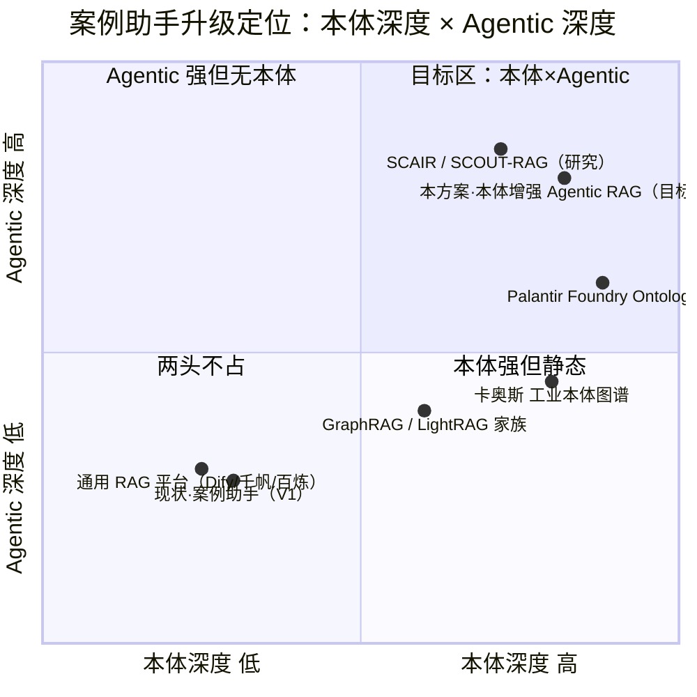
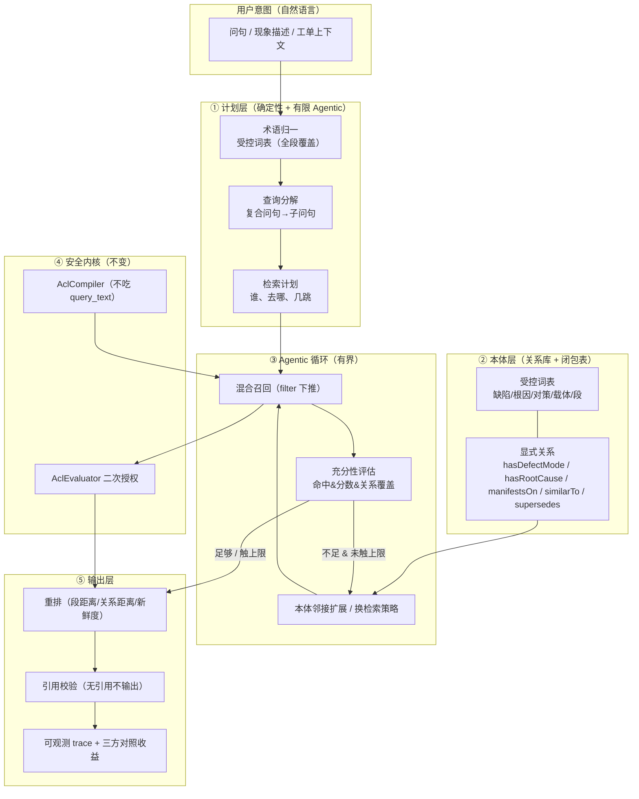

# 制造案例检索 · 本体增强 Agentic RAG 升级方案

| 项 | 内容 |
|---|---|
| 文档版本 | V1.0（竞品调研 + 现状实证 + 目标方案 + 案例扩充输入） |
| 前置文档 | `docs/case-assistant-product-research-prd.md`（增量 PRD V1.0）、`docs/case-assistant-ontology-vector-auth-architecture.md`（架构裁定稿 V1.0）、`docs/case-assistant-demo-readme.md`（演示骨架） |
| 作者 | 许清楚（产品经理） |
| 日期 | 2026-10-19 |
| 范围 | **只讨论"检索与问答"的产品形态与数据覆盖**；权限/脱敏/审计三条地基**沿用既有裁定，本文不推翻** |
| 实施状态 | **§7 的段案例与本体词表已随文落地**：`data/case_seed.json` 99→**180** 例（插件/pack/整机各 +10、多职能域 +21、电芯组包/测试/老化/整机组装/包装各 +6），本体词表 53→**226** 条；**§5 的多跳与 Agentic 循环仍为方案（待开发）** |
| 数据纪律 | 竞品与文献效果数字**均为公开资料汇总，标注"待 POC 验证"**，不得写入本项目承诺指标 |
| 语言 | 简体中文 |

> **一句话**：现有案例助手已经做完了"**安全**"（权限前置 + 脱敏分层 + 审计），本文要补的是"**聪明**"——把当前"单跳同义改写 + 固定管道"升级为"**本体增强的 Agentic RAG**"，并补上 **插件段 / pack 段 / 整机段** 的案例覆盖，让"本体增强"这件事**看得见、测得准**。

---

## 1. 一页式结论

### 1.1 结论：**升级立项（Go），但先补数据的"本体覆盖率"**

技术地基（权限前置检索、知识层/证据层分离、哈希链审计）已落地且经 936 条回归钉住，**不重做**。
真正卡住"效果"的是三件事，且都可量化：

1. **本体与语料已经脱节——这是最硬的一条实证**。语料 99 例里，缺陷模式码 85 个中 **70 个未注册本体（82%）**，根因码 93 个中 **82 个未注册（88%）**；受控词表停在 53 条、且 24 个缺陷码全部集中在 SMT。**结果：现网"本体增强"只对 SMT 子集生效，其余段（插件/整机/材料/设计）走的是纯字面检索。** 详见 §2.2。
2. **检索是"单跳"的，不是"Agentic"的**。现状只有"缺陷模式 / 根因"两个词表的同义词扩展（`_normalize_query` 只用 2 个词表），没有关系遍历、没有多步检索、没有"检索结果够不够"的自检与再检索。所谓"Agentic"目前是一条**固定管道**（`case_qa.py` 的 5 步 trace 是过程说明，不是决策闭环）。
3. **段覆盖严重偏斜，且缺一整段**。SMT 段 41 例、整机/装配段 26 例、插件段 17 例、注塑段 9 例、机加段 5 例、来料段 1 例，**pack（组包/包装）段 = 0 例**。跨段关联类问题（"同一不良在 SMT 与整机段都出现过吗"）**当前无解**。

### 1.2 五条关键判断

| # | 判断 | 依据 |
|---|---|---|
| **K1** | 升级的**第一优先级不是换模型，是补本体覆盖率** | 82% 的缺陷码本体不认，换再强的 LLM 也改不了"术语归一落空" |
| **K2** | 差异化必须押在**"关系级多跳"**上，而不是"更强的向量" | 竞品（Glean/M365 Copilot/通用 RAG 平台）都强在向量与连接器；"缺陷模式↔根因↔对策↔载体↔段"的**结构关系遍历**是制造语境独有资产（§4.3） |
| **K3** | "Agentic"要**确定性优先**，不能把权限 filter 交给 LLM | 沿用架构裁定 **A10**：`AclCompiler.compile()` 签名不接受 `query_text`。Agentic 只允许驱动"**检索计划与再检索**"，绝不允许生成权限过滤条件 |
| **K4** | 效果要"看得出来"，靠的是**可观测 trace + 三方对照实验**，不是一句宣传语 | 现状 `ontology_gain` 已做"原文 vs 归一化"的真实统计，升级后扩成**三组对照**（无本体 / 单跳本体 / 本体增强 Agentic），见 §6 |
| **K5** | 补案例要**按段成族地补**，并**同步注册本体码**，否则是在扩大 §2.2 的错位 | 见 §7 |

### 1.3 明确不做（承接前序文档 N1–N6，另加 3 条）

| # | 不做 | 为什么 |
|---|---|---|
| **N7** | **不做自动本体抽取 / 自动关系发现** | 沿裁定 A7/N5：语料不足时自动产出的是噪声图；本方案的关系仍**人工维护、显式声明** |
| **N8** | **不上图数据库作为前置条件** | 沿 ADR-002；多跳深度先做 ≤3 跳，用关系库 + 闭包表实现，图库仍走 §5.4 的四道门槛 |
| **N9** | **不做"让 LLM 生成权限过滤条件"的 Agentic** | 沿用 A10；Agentic 的自由度只给"改写 query_text 与决定下一步检索"，不给"改可见范围" |

---

## 2. 现状盘点（实证）

### 2.1 现有能力清单

| 能力 | 现状 | 位置 |
|---|---|---|
| 权限前置检索（召回前过滤 + 返回前二次授权） | ✅ 已落地 | `v2/services/case_search.py`（16 步，`_second_stage` 独立代码路径） |
| 知识层 / 证据层物理分离 | ✅ 已落地 | `case_index.py`；`_assert_knowledge_layer` 运行期断言 |
| 受控词表（本体） | ⚠️ 53 条（缺陷 24 / 根因 16 / 对策 13），加载期 fail-fast | `v2/contracts/ontology.py`、`v2/data/ontology/*.yaml` |
| 查询改写（本体同义扩展） | ⚠️ 仅 `defect_mode` + `root_cause` 两个词表，单跳 | `case_qa.py::_normalize_query` |
| 带引用问答（无引用不输出） | ✅ 已落地 | `case_qa.py`（引用校验到 `content_version` + `text_hash`） |
| 本体增强量化收益 | ⚠️ 仅"原文 vs 归一化"两组数字 | `case_qa.py::_ontology_gain` |
| 处理轨迹（trace） | ⚠️ 5 步，**过程说明**，非决策闭环 | `case_qa.py::_build_trace` |

### 2.2 本体 ↔ 语料错位（**本文核心实证**）

在项目内实机复核（加载 `OntologyRegistry.from_dir` 后逐条比对 `data/case_seed.json`）：

| 指标 | 实测 | 含义 |
|---|---|---|
| 受控词表规模 | **53 条**（defect_mode 24 / root_cause 16 / countermeasure 13） | 自 15 例时代起基本未随语料扩张 |
| 语料缺陷模式码 | 去重 **85** 个，其中 **70 个未注册（82%）** | 术语归一**对 82% 的缺陷码直接落空**（`normalize` 返回 `None`） |
| 语料根因码 | 去重 **93** 个，其中 **82 个未注册（88%）** | 根因侧同理 |
| 未注册码样例 | `DM-DIP-041..047`、`DM-TST-071..074`、`DM-PLS-002/004/011/020`、`DM-DES-081..087`、`DM-MAT-002/005/043..058`、`DM-MCH-002/006`、`DM-EQP-003/005/008` … | 覆盖插件、测试、贴装、设计、材料、机加、设备多段 |
| 落空后果 | `case_index.plan_chunks` 里 `_term_name()` 返回空串 → chunk 文本**不带"缺陷模式：X。"前缀** | 召回既失去本体归一，也失去"关键差异"比对的锚点 |

> **一句话结论**：**"本体增强"目前只在 SMT 子集成立。** 其余段的检索与"普通关键词 RAG"无本质差别——这解释了为什么现场会觉得"换个词就搜不到"。

### 2.3 段覆盖矩阵（按 `line_code` 实测）

| 工艺段 | 代表产线 | 案例数 | 本体（缺陷码）覆盖率 | 备注 |
|---|---|---:|---:|---|
| **SMT 段** | SMT-1/2/4 | **41** | 部分（词表主体在此） | 唯一本体覆盖较好的段 |
| **整机/装配段** | ASSY-1、ASM-1/2、装配-1/2/3、TEST-1 | **26** | ≈0（`DM-ASM-*`/`DM-TST-*` 全部未注册） | 含整机功能测试、老化 |
| **插件段** | DIP-1、THT-1/2/3 | **17** | ≈0（`DM-DIP-*` 全部未注册） | 含波峰焊、助焊剂、压深 |
| **注塑段** | 注塑-1..4、INJ-1 | **9** | ≈0（`DM-PLS-*` 未注册） | 缩水、色差、熔指 |
| **机加段** | 机加-1/2、MCH-1 | **5** | ≈0（`DM-MCH-002/006` 未注册） | 孔位、刀具寿命 |
| **来料段** | 来料-1 | **1** | ≈0 | 仅 1 例，孤例 |
| **pack（组包/包装）段** | — | **0** | — | **整段缺失** |

> 段口径参照 MES 工段数据（`data/seed_station_detail.sql` 的 `SMT段` / `DIP段` 与 `data/seed_v3.sql` 的`插件`/`包装`/`整机功能全测`工序）。

---

## 3. 用户体验与功能局限

> 每条给"现象 / 证据 / 影响"，证据均指向代码或实测，不写主观感受。

### 3.1 用户体验（UX）层面

| # | 局限 | 现象 / 证据 | 影响 |
|---|---|---|---|
| **U1** | **"本体增强"看不见** | 结果卡只给 title/score/status/密级；`trace` 需切到"问答"tab 才见，且是文字过程说明 | 用户无法感知"系统懂制造术语"，卖点不可见 |
| **U2** | **没有"跨段/跨案例的关联视图"** | 命中按案例折叠，无"相邻关系"面板（同类缺陷的其他段案例、同根因的其他案例） | "这个不良别的地方也出过吗"无从回答 |
| **U3** | **没有多跳入口** | 检索模型只有 `query/action/k`（`SearchRequest` 刻意无 filter 字段），无"沿关系下钻"的交互 | 复杂问句只能拆成多次人工检索 |
| **U4** | **"关键差异"未落地为字段** | 产品文档 §9 要求结果卡显示"关键差异"（如刮刀压力 vs 钢网张力），现状按 `defect_mode_code` 平铺，无差异维度 | 两条相似案例用户不知道信哪条 |
| **U5** | **段维度不可见、不可筛** | 前端检索区只有"分类下拉"，无"工艺段/产线"筛选；`line_code` 仅在卡片小字展示 | 现场按"我这条线"找案例要先搜再肉眼过滤 |
| **U6** | **问答的"不服气"无处申诉** | 拒答只给分数与阈值文字（`reason` 原样展示），无"给出更接近的问法建议" | 拒答体验像"系统不会"，而非"换个说法就行" |
| **U7** | **空结果解释不足** | 候选不足如实返回 + `notice`，但没有"你可能想搜的相邻概念"引导 | 用户以为"没有案例"，实为"本体没归一到" |
| **U8** | **跨段问题零命中** | §2.3：pack 段 0 例，段间无关联 | "整机段发现的问题能追溯到插件段吗"直接答不了 |

### 3.2 检索质量层面

| # | 局限 | 证据 | 影响 |
|---|---|---|---|
| **Q1** | **召回靠字面，语义靠 LLM 补不了本体的缺** | demo 后端为字符重合度；本体只剩 SMT 子集 | 非 SMT 段召回不稳 |
| **Q2** | **单跳改写，覆盖面窄** | `_normalize_query` 只遍历 `("defect_mode","root_cause")`，`countermeasure` 词表未参与扩展 | "怎么修"类问句享受不到本体增强 |
| **Q3** | **无"载体维度"检索** | 元数据有 `line_code/plant`，但 `FILTERABLE_FIELDS` 不含载体维度用于**查询意图**（只用于权限） | 无法表达"机加段的尺寸超差" |
| **Q4** | **无多跳/关系推理** | 本体只有 `parent`（≤2 跳），无 `similarTo/supersedes/载体↔缺陷` 关系参与检索 | 复杂根因问句无解 |
| **Q5** | **无结果自检/再检索** | `case_qa.answer` 检索一次即定生死 | 首轮召回差就直接拒答 |
| **Q6** | **重排信号单一** | 确定性加权（状态/新鲜度/验证）固定 | 无法按"段距离/关系距离"重排 |

### 3.3 本体层面

| # | 局限 | 证据 | 影响 |
|---|---|---|---|
| **O1** | **覆盖率 18%/12%**（缺陷/根因） | §2.2 实测 | 本体增强基本失效 |
| **O2** | **编码体系两套并存** | 词表用 `DM-SMT-012`，语料并存 `DM-MAT-002` 与 `DM-MAT-041` 等**不同序列**；同一概念可能两码 | 归一与统计都对不齐 |
| **O3** | **无"载体/段"实体** | 本体只有缺陷/根因/对策三词表 | 段无法成为检索与推理的一等公民 |
| **O4** | **关系仅 `parent`** | `OntologyTerm` 只有 `parent`，无显式关系表 | 多跳没数据可走 |
| **O5** | **对策词表未参与召回** | §Q2 | "对策复用"是产品核心（D2），却没接上 |

### 3.4 Agentic 层面

| # | 局限 | 证据 | 影响 |
|---|---|---|---|
| **A1** | **是固定管道，不是闭环** | `answer()` 线性执行：归一→检索→闸门→组文→校验→输出 | 无"检索失败→换策略再检索" |
| **A2** | **无查询分解** | 复合问句按整句检索 | "整机异响 + 装配干涉"这类复合问题召回被稀释 |
| **A3** | **无工具编排** | 只有向量检索一条路 | 无法"先查本体再查案例再查工单" |
| **A4** | **trace 不可作为证据链** | 5 步是说明文字，不含"决策了哪一步、为什么" | 无法对外讲清"Agentic 到底做了什么" |
| **A5** | **无贪心/终止条件** | 无最大跳数、无收益阈值、无预算控制 | 直接做 Agentic 会失控（成本/时延） |

### 3.5 数据覆盖层面

| # | 局限 | 证据 | 影响 |
|---|---|---|---|
| **D1** | **pack 段 0 例** | §2.3 | 整段不可演示 |
| **D2** | **插件段/整机段案例偏少且本体未注册** | 17 例 / 26 例，本体 ≈0 | 段内检索退化为关键词 |
| **D3** | **来料段孤例** | 1 例 | 供应商维度无法演示 |
| **D4** | **段间无关联案例** | 无 supersedes / 跨段 similarTo | 跨段追溯演示不了 |

---

## 4. 竞品与 SOTA 对比

### 4.1 分层（面向"本体增强 / Agentic"的新视角）

#### 第一层：工业本体 / 数字孪生平台（本体是一等公民）

| 竞品 | 做法 | 可借鉴点 | 边界 |
|---|---|---|---|
| **Palantir Foundry Ontology** | 以 object type / link type / action type 为底座，把"决策与动作"也建模；Agent Studio 在其上做 agent | **"本体不只是数据模型，是行动层"**；关系（link）是检索与推理的载体 | 重实施、重集成；制造业质量语境仍需自建 |
| **卡奥斯 COSMOPlat（工业本体图谱）** | 把行业知识沉淀为工业本体图谱，作为大模型"知识锚点"；缺陷判定对应到明确知识条目与标准 | **"每个判定可回溯到知识条目"**——与我们的"无引用不输出"同源 | 厂商披露方向，落地深度待验证 |
| **SAP 制造业历史问题检索（Discovery Bot）** | 从手册与历史问题报告中检索，强调 KG 表示"零件-症状-失效模式-工艺-供应商-纠正措施"之间的关系 | 关系集合与我们本体 §12.3 高度重合 | 厂商披露 |

#### 第二层：图增强 RAG / Agentic Graph-RAG（SOTA 方法）

| 方法 | 核心 | 可借鉴点 | 边界 |
|---|---|---|---|
| **Microsoft GraphRAG / LightRAG / HippoRAG 2** | 索引期建实体-关系图，查询期做 local/global 或双层检索 | 双层检索（局部实体深挖 + 全局关系广度）适合"段内 + 跨段" | 索引成本高；大规模评测显示收益因任务而异 |
| **SCAIR（Schema-Conditioned Agentic Iterative Reasoning，2026）** | 注入 **schema 条件**的结构先验，约束多跳遍历，控制话题实体传播 | **"用 schema 约束 agent 的多跳"**——正是"本体增强 Agentic"的正解 | 研究阶段，工程化成本待评估 |
| **SCOUT-RAG（2026）** | 4 个协作 agent：判域相关性 / 决定是否扩域 / 自适应遍历深度 / 综合 | **"何时扩检索、遍历多深"**给了终止条件的设计参考 | 分布式场景，简化后适用 |
| **OGPAL（Ontology-Guided Process-Aware FMEA Graph, 2026）** | 本体引导 + 工艺感知的 FMEA 图学习，做产线故障根因识别 | **"工艺流依赖"进图**——对应我们的"段/工序"维度 | 需 FMEA 数据，我方为 P2 |
| **TUM 制造业问题求解（FMEA-BN + 混合 RAG）** | 异常检测 → FMEA 贝叶斯网络推根因 → 混合 RAG 检索相似处置 | **"结构化根因推理 + RAG"组合**，与我们要的"多跳根因"一致 | 需实时过程数据 |

#### 第三层：制造业 RAG 产品/实践

| 竞品 | 做法 | 边界 |
|---|---|---|
| **Morale AI** | 连接 MES/ERP/SCADA + RAG 索引文档 + agent 跨时序/文本推理 | 偏实时运维；质量案例复用深度待验证 |
| **IEO 自演化故障恢复（2026）** | 分层知识图谱 + 语义检索，生成恢复建议，自演化 | 聚焦设备故障恢复，非全工艺段 |
| **Dify / 千帆 / 百炼 等平台** | 提供 RAG 底座，**权限与行业语义需自建** | 通用平台陷阱（前序 PRD §3.2 已述） |

### 4.2 定位象限

> 坐标为产品经理基于公开资料的**主观定位**，仅说明相对位置，不作选型依据。

### 4.3 竞品共性缺陷 → 我方对策

| # | 共性缺陷 | 表现 | 我方对策 | 难度 |
|---|---|---|---|---|
| **CD1** | **本体覆盖依赖人工/AI 抽取，长期腐化** | 图 RAG 索引期成本高；工业本体维护无人 | **受控词表 + 覆盖率看板**：把"未注册码占比"做成可观测指标（§6） | 中 |
| **CD2** | **Agentic 自由度越大，越可能越过权限** | 让 LLM 生成 Cypher/filter | **A10 铁律**：权限 filter 由 `AclCompiler` 独占，Agentic 只管检索计划 | 低（已落地） |
| **CD3** | **多跳没有终止条件 → 成本失控** | 无限扩检索 | **跳数上限（≤3）+ 收益阈值 + 预算**（借鉴 SCOUT-RAG） | 中 |
| **CD4** | **效果不可复现、不可解释** | 只报"提升 X%" | **三方对照实验 + 可观测 trace + 引用可溯源** | 低 |
| **CD5** | **段/工序维度缺失** | 通用 KG 无"工艺段"概念 | **把"段"做成本体一等实体**（§5.2） | 中 |
| **CD6** | **跨段追溯断裂** | 各段独立 | **跨段 `similarTo` / 载体链**（§5.5） | 中 |

### 4.4 数据边界声明（沿用前序 §3.7）

> 所有竞品/文献数字（"70% 提升"等）均为公开资料，**不得写入本项目承诺指标**；本项目所有 KPI 必须来自我方 POC 实测（§6.2）。

---

## 5. 目标形态：本体增强 Agentic RAG

### 5.1 总体架构

### 5.2 本体层升级

| 升级项 | 现状 | 目标 |
|---|---|---|
| **词表覆盖** | 53 条，缺陷覆盖 18% | **回填全部未注册码**（缺陷 70 + 根因 82）+ 新增段码 |
| **新增词表：载体/段** | 无 | `carrier` 词表：`段`（SMT/插件/组包/整机/注塑/机加/来料）× `工位/工序` |
| **关系表** | 仅 `parent`（≤2 跳） | 显式关系：`hasDefectMode` / `hasRootCause` / `hasCountermeasure` / `manifestsOn`（缺陷↔段/工位）/ `similarTo`（跨段同因）/ `supersedes` |
| **多跳** | ≤2 | **≤3 跳**（如 缺陷→根因→对策 ；缺陷→段→同段其他案例） |
| **存储** | YAML 词表 | 词表 YAML + **关系库关系表/闭包表**（不上图库，ADR-002 不变） |

> **段是第一类实体**：把"MES 的段/工序"映射为 `carrier` 词条，案例通过 `manifestsOn` 挂到段上，使"按段检索 / 跨段追溯"成为本体能力，而不是字段筛选。

### 5.3 Agentic 检索循环（有界、确定性优先）

| 步 | 动作 | 确定性/Agentic | 约束 |
|---|---|---|---|
| 1 | 术语归一（全词表） | 确定性 | 只影响 query_text |
| 2 | 查询分解（复合问句→子问句） | Agentic（LLM 可参与） | 输出只允许是 query_text 片段；**不得含 FILTERABLE_FIELDS** |
| 3 | 生成检索计划（动作、k、是否多跳） | Agentic | 计划里**没有 filter 字段**（沿用 A10） |
| 4 | 混合召回（filter 由 AclCompiler 下推） | 确定性 | BR-01 前半 |
| 5 | 充分性评估（命中数/分数/关系覆盖） | 确定性规则 + 可选 LLM 打分 | **必须给终止判据** |
| 6 | 本体邻接扩展 / 换策略再检索 | Agentic | 跳数 ≤3；总预算上限；无收益即停 |
| 7 | 重排（含段距离、关系距离） | 确定性 | 权重可配 |
| 8 | 二次授权 | 确定性 | BR-01 后半（独立代码路径） |
| 9 | 引用校验 + 输出 | 确定性 | BR-05 |
| 10 | 落审计 | 确定性 | 只记哈希 |

**终止条件（A5 的落地）**：`跳数 ≥ 3` 或 `相对收益 < 阈值` 或 `预算耗尽` → 停止，如实返回当前结果（**绝不放宽权限过滤**）。

### 5.4 与现状差异对照

| 维度 | 现状（V1） | 目标（V2） |
|---|---|---|
| 本体覆盖 | 18% / 12% | **≥ 95%**（回填 + 段码） |
| 词表 | 3 个 | 5 个（+载体/段、+对策参与召回） |
| 检索 | 单跳、单轮 | **多跳（≤3）、有界多轮** |
| 查询处理 | 同义扩展 + 单次检索 | **分解 + 计划 + 自检 + 再检索** |
| 关系推理 | 无 | 显式关系遍历（段间/根因/对策） |
| 段维度 | 仅展示字段 | **本体一等实体 + 可筛可推理** |
| 效果呈现 | 两组数字 | **三方对照 + 可观测 trace** |
| 权限 | 前置 + 二次校验 | **不变**（红线） |

### 5.5 目标多跳问句（示例，验收用）

| # | 问句 | 需要的能力 | 现状 |
|---|---|---|---|
| **M1** | "整机段发现的异响，能不能追到插件段的波峰焊？" | 缺陷→段→跨段 similarTo | ❌ |
| **M2** | "和这个案例同根因、但在别的段发生的案例有哪些？" | hasRootCause + manifestsOn | ❌ |
| **M3** | "这批料的氧化，历史上还在哪些段引发过不良？" | 材料→段链 | ❌ |
| **M4** | "上次这类问题的对策，这次该怎么用？" | 缺陷→对策词表参与召回 | ⚠️ 部分 |
| **M5** | "这个不良在 SMT 段和整机段同时出现，prior 怎么排？" | 多子句分解 + 段距离重排 | ❌ |

---

## 6. 效果如何被"看出来"

### 6.1 可观测 trace 升级（从"说明"到"证据链"）

现状 trace 是 5 步说明文字。升级为**结构化的决策证据链**，每步含 `{step, 决策类型, 输入摘要, 命中/未命中, 关键数字, 终止原因}`，其中必须能看到：

- 术语归一命中了哪些**受控码**（含段）；
- 是否触发**再检索**、因为什么（分数？关系覆盖？）；
- **本体跳数**与每一跳走的关系；
- 最终引用的 `(case_id, chunk_id, content_version)`；
- **三方对照数字**（见下）。

### 6.2 三方对照实验（效果的"硬证据"）

同一问句、同一身份，跑三组，指标并列展示：

| 组 | 配置 | 用途 |
|---|---|---|
| **A 无本体** | 直接原文检索（不归一、无关系） | 基线 |
| **B 单跳本体** | 现状能力（同义扩展） | 现状对照 |
| **C 本体增强 Agentic** | 全词表归一 + 多跳 + 有界再检索 | 目标 |

指标（全部可自动化算，禁止编造）：

| 指标 | 定义 | 判据（待 POC 校准） |
|---|---|---|
| **本体覆盖率** | 语料中 `defect_mode_code/root_cause_code` 能在词表命中的比例 | **≥ 0.95** |
| **跨段召回率** | M1–M5 类跨段问句中，目标案例进入 Top-N 的比例 | 相对 B 提升且可解释 |
| **多跳命中率** | 需要 ≥2 跳的问句，正确链路节点被命中的比例 | **≥ 0.80** |
| **引用可溯源率** | 引用能定位到 `(case_id, chunk_id, content_version)` 且内容一致 | **100%**（硬性，现状已达成） |
| **拒答准确率** | 无关问句拒答 / 相关问句作答 | 沿用现状阈值守护用例 |

> **诚实声明**：C 组相对 B 组"命中更多"不等于"质量更高"（字面命中更宽会带噪声，现状 `_ontology_gain` 已诚实并列两数）。因此**跨段召回/多跳命中必须配人工相关集**，不唯数量论。

---

## 7. 案例补充方案（插件段 / pack 段 / 整机段）

### 7.1 段定义与命名规范

| 段 | 段码（载体） | 代表产线 | 典型工序 | 命名前缀 |
|---|---|---|---|---|
| **插件段** | `SEG-DIP` | DIP-1/2、THT-1..4 | 插件、波峰焊、清洗、压深 | `QC-DIP-2026-####`（制程）/ `QC-THT-2026-####`（插件专项） |
| **pack（组包/包装）段** | `SEG-PACK` | PKG-1、Pack-1 | 组装包装、贴标、称重、装箱、静电防护 | `QC-PKG-2026-####` |
| **整机段** | `SEG-ASSY` | ASSY-1/2、TEST-1/2 | 整机装配、功能测试、老化、EOL | `QC-ASSY-2026-####`（装配）/ `QC-EOL-2026-####`（测试） |

> 段码沿用本体 `carrier` 词表命名（`SEG-*`），与产线 `line_code` 分离：段是**工艺概念**，产线是**物理资源**。

### 7.2 词表新增清单（每段一组）

**缺陷模式（新增父级 + 子项）**

| 段 | 父级码 | 新增子项（示例） |
|---|---|---|
| 插件段 | `DM-DIP-100`（插件/波峰焊类缺陷） | `DM-DIP-101` 插件脚变形、`DM-DIP-102` 漏插/错插、`DM-DIP-103` 元件反向、`DM-DIP-104` 波峰焊拉尖/锡桥、`DM-DIP-105` 助焊剂残留超标、`DM-DIP-106` 压深不足 |
| pack 段 | `DM-PACK-200`（组包装配类缺陷） | `DM-PACK-201` 标签错印/漏印、`DM-PACK-202` 附件漏装、`DM-PACK-203` 装箱数量错、`DM-PACK-204` 包装破损、`DM-PACK-205` 静电袋密封不良、`DM-PACK-206` 条码不可读 |
| 整机段 | `DM-ASSY-300`（整机装配类缺陷） | `DM-ASSY-301` 整机异响、`DM-ASSY-302` 螺钉滑牙、`DM-ASSY-303` 接地不良、`DM-ASSY-304` 外观划伤、`DM-ASSY-305` 整机气密性不足、`DM-ASSY-306` 功能测试 FAIL/误判 |

**根因（对应新增）**：插件段 `RC-DIP-*`（压深限位偏移/波峰参数/助焊剂喷嘴…）；pack 段 `RC-PACK-*`（打印模板/附件清单版本/包材强度/封口温度…）；整机段 `RC-ASSY-*`（扭力衰减/紧固顺序/接地工艺/测试阈值…）。

**对策（对应新增）**：`CM-DIP-*` / `CM-PACK-*` / `CM-ASSY-*`。

### 7.3 新增案例清单（30 条，10/段）

| 段 | 案例 ID（示例） | 标题（示例） | 缺陷码 | 根因码 |
|---|---|---|---|---|
| 插件段 | `QC-DIP-2026-0301` | 插件脚变形导致波峰焊虚焊 | `DM-DIP-101` | `RC-DIP-002` |
| 插件段 | `QC-DIP-2026-0302` | 漏插元件导致整机功能测试 FAIL | `DM-DIP-102` | `RC-PROC-SUP-003` |
| 插件段 | `QC-DIP-2026-0303` | 电解电容反向装配 | `DM-DIP-103` | `RC-PROC-SOP-004` |
| 插件段 | `QC-DIP-2026-0304` | 波峰焊锡桥/拉尖 | `DM-DIP-104` | `RC-DIP-005` |
| 插件段 | `QC-DIP-2026-0305` | 助焊剂残留超标腐蚀风险 | `DM-DIP-105` | `RC-DIP-006` |
| 插件段 | `QC-DIP-2026-0306` | 压深不足致插拔力偏高 | `DM-DIP-106` | `RC-DIP-007` |
| 插件段 | `QC-DIP-2026-0307` | 波峰预热不足致爬锡不良 | `DM-DIP-104` | `RC-DIP-008` |
| 插件段 | `QC-DIP-2026-0308` | 插件工位静电击穿 | `DM-DIP-102` | `RC-PROC-ESD-009` |
| 插件段 | `QC-THT-2026-0309` | THT 异形件共面度超差 | `DM-DIP-101` | `RC-MAT-COPLANAR-010` |
| 插件段 | `QC-THT-2026-0310` | THT 波峰焊冷焊 | `DM-DIP-104` | `RC-DIP-011` |
| pack 段 | `QC-PKG-2026-0321` | 包装箱批次标签错印 | `DM-PACK-201` | `RC-PACK-021` |
| pack 段 | `QC-PKG-2026-0322` | 附件漏装（说明书/螺丝包） | `DM-PACK-202` | `RC-PACK-022` |
| pack 段 | `QC-PKG-2026-0323` | 装箱数量错（多装/少装） | `DM-PACK-203` | `RC-PACK-023` |
| pack 段 | `QC-PKG-2026-0324` | 包装箱堆码破损 | `DM-PACK-204` | `RC-PACK-024` |
| pack 段 | `QC-PKG-2026-0325` | 静电袋密封不良致器件受潮 | `DM-PACK-205` | `RC-PACK-025` |
| pack 段 | `QC-PKG-2026-0326` | 条码不可读致出库停滞 | `DM-PACK-206` | `RC-PACK-026` |
| pack 段 | `QC-PKG-2026-0327` | 称重超差（错装箱） | `DM-PACK-203` | `RC-PACK-027` |
| pack 段 | `QC-PKG-2026-0328` | 缓冲填充不足致运输磕碰 | `DM-PACK-204` | `RC-PACK-028` |
| pack 段 | `QC-PKG-2026-0329` | 封口温度漂移致封边开裂 | `DM-PACK-205` | `RC-PACK-029` |
| pack 段 | `QC-PKG-2026-0330` | 混料装箱（A/B 型号混装） | `DM-PACK-203` | `RC-PACK-030` |
| 整机段 | `QC-ASSY-2026-0341` | 整机装配干涉异响 | `DM-ASSY-301` | `RC-ASSY-041` |
| 整机段 | `QC-ASSY-2026-0342` | 自动扭力枪滑牙 | `DM-ASSY-302` | `RC-ASSY-042` |
| 整机段 | `QC-ASSY-2026-0343` | 接地电阻超标 | `DM-ASSY-303` | `RC-ASSY-043` |
| 整机段 | `QC-ASSY-2026-0344` | 整机外观划伤 | `DM-ASSY-304` | `RC-ASSY-044` |
| 整机段 | `QC-ASSY-2026-0345` | 整机气密性不足 | `DM-ASSY-305` | `RC-ASSY-045` |
| 整机段 | `QC-EOL-2026-0346` | EOL 功能测试误判率高 | `DM-ASSY-306` | `RC-ASSY-046` |
| 整机段 | `QC-EOL-2026-0347` | 老化房温度不均致漏检 | `DM-ASSY-306` | `RC-ASSY-047` |
| 整机段 | `QC-ASSY-2026-0348` | 螺钉漏拧/顺序错 | `DM-ASSY-302` | `RC-ASSY-048` |
| 整机段 | `QC-ASSY-2026-0349` | 线束干涉磨损 | `DM-ASSY-301` | `RC-ASSY-049` |
| 整机段 | `QC-EOL-2026-0350` | 老化房夹具接触不良误判 | `DM-ASSY-306` | `RC-ASSY-050` |

> 其中跨段关联案例（`QC-PKG-2026-0322` ↔ 插件段漏插、`QC-ASSY-2026-0341` ↔ 插件段波峰焊）**显式建 `similarTo`/载体链**，用于 §5.5 的 M1/M2 演示。

### 7.4 本体回填计划（把 82% 的错位补掉）

| 任务 | 内容 | 责任方 | 阻塞 |
|---|---|---|---|
| **M-ONTO-1** | 回填语料中 **70 个未注册缺陷码 + 82 个未注册根因码**（补 name + 归组 + 去重同义词） | 质量体系 + 工艺 | 阻塞"本体覆盖率 ≥95%" |
| **M-ONTO-2** | 统一编码体系（消除 `DM-MAT-002` 与 `DM-MAT-041` 双序列并存） | 质量体系 | 阻塞统计口径 |
| **M-ONTO-3** | 新增 `carrier`（段/工位）词表与 `manifestsOn` 关系表 | 工艺 + IT | 阻塞跨段检索 |
| **M-ONTO-4** | 关系回填（`similarTo` 跨段、`supersedes`） | 质量体系 | 阻塞多跳 |

---

## 8. 落地路线

| 阶段 | 目标 | 关键交付 | 出口条件 |
|---|---|---|---|
| **P0 · 本体补齐** | 覆盖率 18%→≥95% | M-ONTO-1/2；词表 fail-fast 回归；覆盖率看板 | 覆盖率指标达标；既有 936 测试不变 |
| **P0 · 段案例** | 插件/pack/整机三段可演示 | §7.3 的 30 条案例 + §7.2 词表 | 三段各有 ≥10 例；本体码 100% 注册 |
| **P1 · 多跳本体** | 段/工位成实体；关系表 + ≤3 跳 | M-ONTO-3/4；关系库闭包表 | M1/M2 问句可答 |
| **P1 · Agentic 循环** | 分解 + 计划 + 自检 + 有界再检索 | 计划层 + 充分性评估 + 终止条件 | 成本可控（跳数/预算）；权限红线不变 |
| **P2 · 效果呈现** | 三方对照 + 可观测 trace | §6 的对照实验与看板 | C 组可解释地优于 B 组（配人工相关集） |

**贯穿红线（不变）**：权限前置 + 二次授权（BR-01）、A10（filter 不由 LLM 生成）、知识层/证据层分离（BR-08）、无引用不输出（BR-05）。

---

## 9. 风险与验收

| # | 风险 | 等级 | 应对 |
|---|---|---|---|
| R1 | 回填词表引入同义冲突/父级非法 → 加载失败 | 🟠 中 | 词表加载 fail-fast 已内建；回填走审批 + 单测 |
| R2 | 段实体与 `line_code` 概念混淆 | 🟠 中 | 明确"段=工艺概念 / 产线=物理资源"，二者用 `manifestsOn` 关联 |
| R3 | Agentic 再检索上限失控 | 🔴 高 | 硬上限跳数 ≤3 + 预算 + 收益阈值；超限如实返回 |
| R4 | 效果被"数量论"误导 | 🟠 中 | 三方对照必须配人工相关集；沿用"少而准"的诚实口径 |
| R5 | 新增案例与既有测试冲突 | 🟠 中 | 新案例走 add-only、不改变既有 case_id 语义；回归全跑 |
| R6 | 跨段关系缺失 → M1/M2 演示失败 | 🟠 中 | P0 先建§7.3 中的显式跨段链 |

**验收判据**

| 判据 | 标准 |
|---|---|
| 本体覆盖率 | **≥ 95%**（缺陷/根因分别计） |
| 段覆盖 | 插件/pack/整机各 **≥10 例**，本体码 **100% 注册** |
| 多跳命中率 | **≥ 0.80**（M1–M5 类，配人工相关集） |
| 引用可溯源率 | **100%**（硬性） |
| 权限红线 | 越权漏放 **= 0**（沿用 K5，红队用例全过） |
| 既有回归 | **936 条不回归** |

---

## 10. 附：信息来源与置信度

| 类别 | 来源 | 置信度 | 用法 |
|---|---|---|---|
| Palantir Foundry Ontology / Agent Studio | 厂商公开页 | 中高 | 能力对标 |
| 卡奥斯 COSMOPlat 工业本体图谱（WAIC 2026） | 媒体披露 | 中（厂商披露方向） | 方向参考 |
| GraphRAG / LightRAG / HippoRAG 2、SCAIR、SCOUT-RAG、OGPAL、TUM FMEA-BN+RAG | 论文/预印本 | 中 | 方法参考，效果数字不作指标 |
| SAP Discovery Bot / Morale AI / IEO 故障恢复 | 论文/厂商 | 中低 | 方向参考 |
| 本项目现状（§2、§3） | **代码 + 实机实测** | **高** | 直接作为需求依据 |

> **文档结束**。本文只做产品分析与方案设计；权限/脱敏/审计三地基沿用既有裁定，未推翻。
