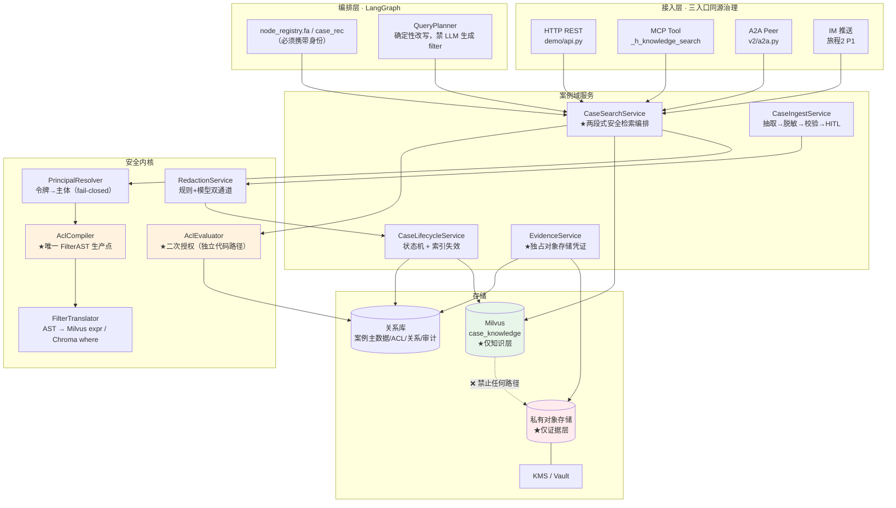
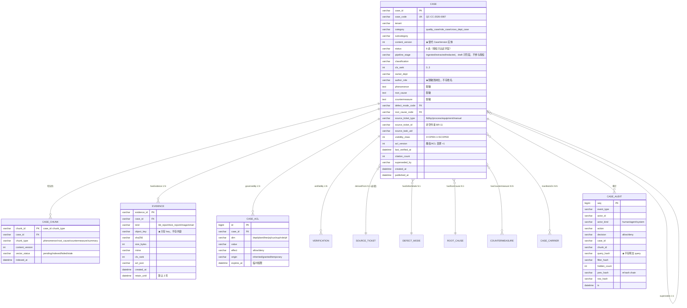
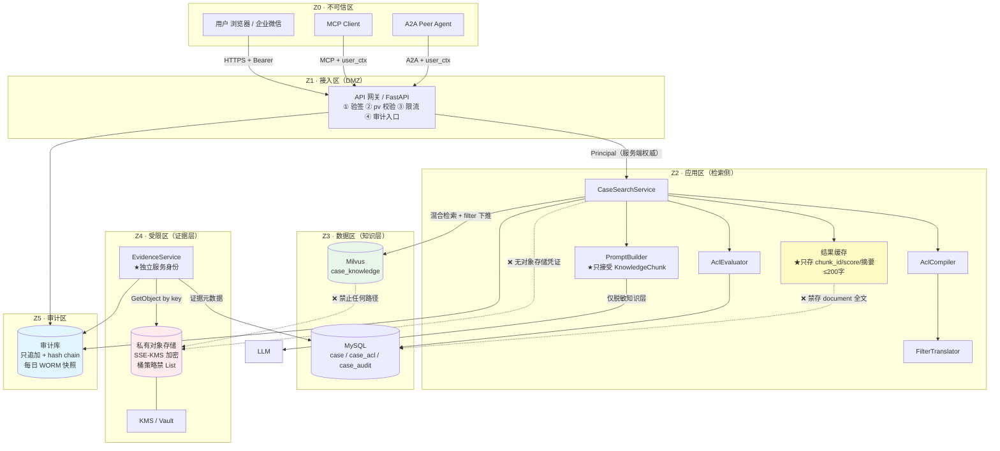
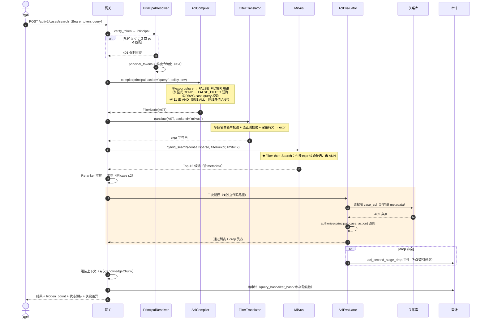
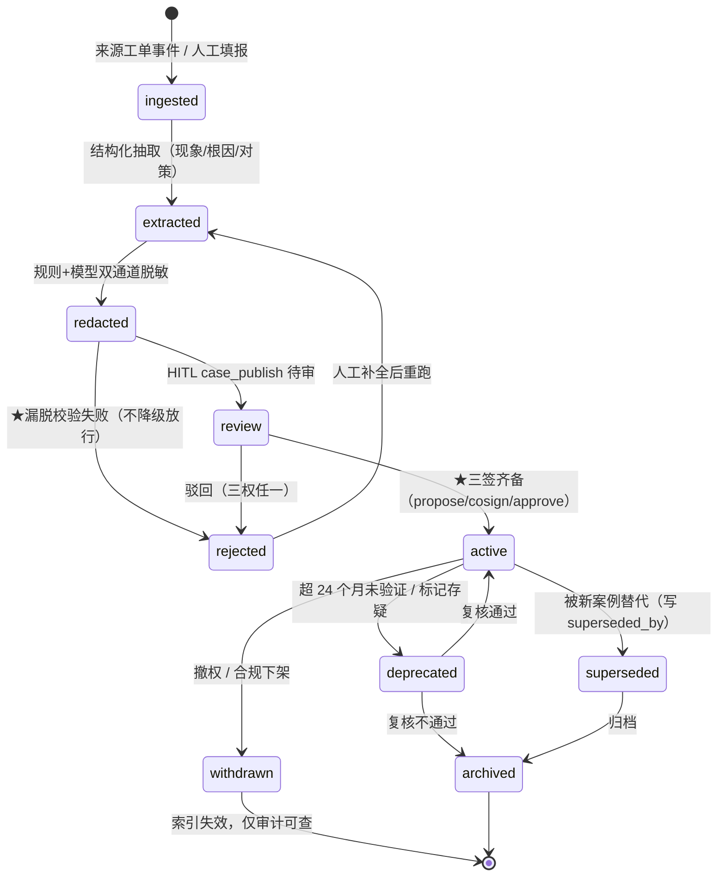
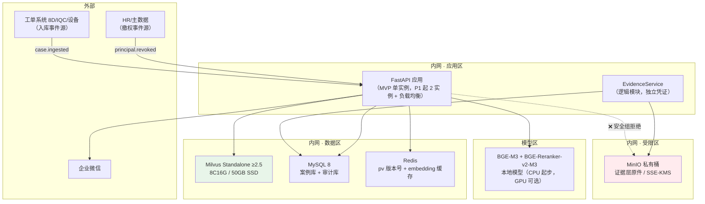
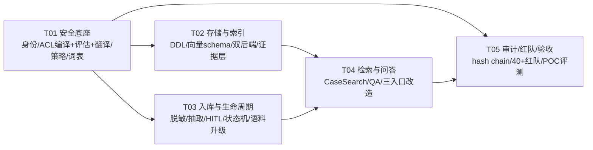

# 案例助手 · Ontology + 向量数据库 + 细粒度鉴权 系统架构设计

| 项 | 内容 |
|---|---|
| 文档版本 | V1.0（架构裁定稿，供立项评审与工程拆解） |
| 前置文档 | `docs/case-assistant-product-research-prd.md`（增量 PRD，V1.0）、`docs/PRD-V3.md`、`docs/ARCHITECTURE-V2.md` |
| 作者 | 高见远（Gao）· 架构师 |
| 日期 | 2026-10-18 |
| 技术基线 | Python 3.11 + LangGraph + FastAPI(SSE) + MySQL/SQLite + Chroma(dev) / Milvus(prod) + 原生 JS。**不引入 TS/Node** |
| 依赖现状 | `pymilvus>=2.5.0`、`milvus-model>=0.2.12`、`chromadb>=0.5.0`、`redis>=8.1.0`、`sqlglot>=30.23.0` **已在 `pyproject.toml`**——本文方案无需新增重量级依赖 |
| 变更范围 | **本文档只做设计，未修改任何源码**；§11 列出"预期新增/修改文件清单"，实施时另开工单 |

> **阅读顺序建议**：评审人只读 §1（裁定速览）+ §14（ADR）+ §15（待拍板）；架构评审读 §3–§7；工程师按 §11 拆解。

---

## 1. 执行摘要

### 1.1 一句话结论

**该做**，但**必须先做"权限前置检索 + 脱敏分层"这两条地基，再谈任何功能**。地基的工程量约占 MVP 的 55%，且没有捷径——现有代码在这两处是**空的**（已复核，见 §2.1）。

### 1.2 关键架构裁定速览（11 条，均有理由与代价）

| # | 议题 | **裁定** | 否决的方案 | 关键理由 |
|---|---|---|---|---|
| **A1** | 权限过滤主方案 | **多维标量 AND 前置过滤 + 可见性分级（`visibility_class`）快路径 + 返回前二次授权**（三段式） | ❌ 先召回后过滤（架构铁律禁止）<br/>❌ ACL 分片 collection（主方案）<br/>❌ 全量预计算可见 case_id（主方案） | Milvus 2.x 标量与向量检索的默认执行策略是 **Filter-then-Search**（先按标量过滤出候选集，再在候选集内做 ANN），天然满足"召回前生效"；分片 collection 会导致组合爆炸 + 撤权重索引 + 跨片 rerank 失效 |
| **A2** | 高基数维度（客户/供应商/项目/产线）过滤 | **维度令牌化**：把 `dept/plant/line/project/customer/supplier/role/product_family` 打成 `acl_tokens: ARRAY[VARCHAR]`，主体侧生成 `principal_tokens`，用 `array_contains_any` 一次判定 | ❌ 每个维度一个 `array_contains_any`（表达式长度随维度线性膨胀）<br/>❌ 把用户 ID 列表写进 ACL 数组 | 单次数组运算 O(len(acl_tokens))≤32；Milvus 对查询侧列表建哈希集 |
| **A3** | 性能风险点 | **`visibility_class` 两档**：`vc=0 OPEN`（全维度无约束，绝大多数质量案例）走硬维度快路径；`vc=1 SCOPED` 才做数组运算 | — | 把昂贵运算从"每次都做"降到"只对受限少数做"；预估受限案例占比 ≤ 15% |
| **A4** | 向量库后端 | **Chroma = 开发/POC 后端（≤ 5 万 chunk）；Milvus = 唯一生产后端** | ❌ Chroma 上生产 | Chroma 元数据**无专用索引**，多维 AND 退化为元数据全表扫描（公开案例：30 万条 + 日期过滤 ≈ 180 s）；且 `$contains` 只接受单值，`array_contains_any` 语义必须展开为 O(#tokens) 个 `$or` 子句 |
| **A5** | 撤权时延（P95 ≤ 5 min） | **`principal_version`（`pv`）版本号比对**：令牌携带 `pv`，服务端 Redis 存 `pv:uid`，撤权事件 → `pv++` → 下次请求即 401 重登 | ❌ 依赖 8h 令牌 TTL 自然过期<br/>❌ 依赖定时全量重建索引 | 把"等令牌过期"变成"一次整数比对"；实测可达 ≤ 1 min |
| **A6** | "全员共享"落地形态 | **在策略 YAML 里写一条默认 allow 规则**（`category=quality_case` ∧ `layer=knowledge` ∧ `action∈{query,preview,read,cite}` ∧ `employment_type=employee`），**只豁免 `role`/`dept` 两维，其余 9 维仍然各自独立否决** | ❌ 把"共享"实现成"该案例所有维度放行"<br/>❌ 用 OR 语义合并维度 | 精确满足"共享是默认值、不是可见性声明"，同时保住 default-deny |
| **A7** | Ontology 存储 | **关系库（MySQL）+ 受控词表 YAML + 邻接/闭包表**；**不上图库** | ❌ 首期上图数据库 | 关系深度 ≤ 2；新增组件 = 新增故障域/备份/权限/审计面；§5.4 给出 4 条**可量化**的图库触发门槛，未全满足不上 |
| **A8** | `CaseVersion` 与"案例无版本号"（BR-09）的冲突 | **撤销 `CaseVersion` 实体**；降级为 `Case.content_version: int` 字段（内容修订计数器）。业务上不出现 v1/v2；引用标识用 `(case_id, chunk_id, content_version)` 三元组 | ❌ 建 `CaseVersion` 表<br/>❌ 完全没有版本概念 | 同时满足 BR-09（无业务版本号语义）与 K3（引用 100% 可溯源）；且 `content_version` 是向量 chunk 幂等 upsert 的依据 |
| **A9** | 证据层防泄漏 | **进程/凭证/类型三重隔离**：`EvidenceService` 独占对象存储凭证，检索进程无该凭证；`EvidenceContent` 类型**不允许**进入 prompt 组装器（运行时断言） | ❌ "只靠 ACL 判断" | 单靠 ACL 挡不住日志、缓存、LLM 上下文三条旁路；必须用类型系统 + 网络策略 + 凭证分离做纵深防御 |
| **A10** | 谁生成 filter | **只有 `AclCompiler` 能生成 `FilterAST`，且其签名不接受 `query_text`、不接受任何 LLM 输出** | ❌ 让 LLM 生成 filter<br/>❌ 让前端传 filter | 从函数签名层面物理阻断；LLM 只允许改写 `query_text` 本体，且输出经白名单校验 |
| **A11** | 过滤后候选不足 | **绝不放宽过滤**。`hits==0` → 返回空 + `hidden_count`（仅整数，用"仅硬维度"的安全计数查询求差）；`0<hits<k` → 如实返回 + 提示 | ❌ "过滤后不足 → 去掉 filter 重试"（最常见的越权后门） | 写成显式禁令 + 红队用例 |

### 1.3 三个"怎么做"的最短回答

| 问题 | 回答 |
|---|---|
| **怎么做权限前置** | 主体 → `FilterAST`（AST，非字符串）→ 后端原生 filter 表达式 → **随混合检索一起下推**（Milvus 默认 Filter-then-Search）→ 重排 → **返回前用关系库权威 ACL 走另一套代码路径再判一次** |
| **怎么证明不越权** | ① 40+ 红队用例 100% 拦截（§12.2）；② 双后端 filter 契约测试同用例跑通；③ "伪造 filter" 单测（改 AST → 二次校验仍拦）；④ 日志/缓存/索引三处原文残留扫描（CI 门禁） |
| **先做什么** | T01 安全底座（身份+ACL+策略+词表）→ T02 存储与索引（Milvus 标量列 schema + filter 翻译）→ 这两条完成即达到 Gate G-C，冻结状态才可解除 |

### 1.4 对 PRD 的纠正（4 处数字/概念不一致，详见 §2.2）

| # | PRD 原文 | 问题 | 纠正 |
|---|---|---|---|
| C1 | §15.2 "需要设计的实体（**16 个**）" | 实际列出 **29 个**（4+4+12+4+1+4） | 改为 29 个，并按 MVP/P1/P2 分层（§5.1） |
| C2 | §8.1 "**十个**权限维度" | 表格与 §15.3 均列出 **11 个** | 统一为 **11 个维度**（`tenant` 补入），MVP 启用 6 个（§4.2） |
| C3 | §12.2 图含 `CaseVersion` 实体 | 与 §6.3 / BR-09「案例无版本号」**直接冲突** | 撤销实体，降级为 `content_version` 字段（裁定 A8） |
| C4 | §7.2 权限公式只列了 7 个维度 | 与 §8.1 的 11 维不一致 | 公式补全为 11 维（§4.3） |

---

## 2. 现状与约束

### 2.1 代码实证复核（我已逐条读源码，确认 PRD 结论全部成立）

| # | 缺口 | 复核结果 | 代码位置（行号已核对） |
|---|---|---|---|
| G1 | 向量库不支持召回前过滤 | ✅ **成立**。`if where: raise NotImplementedError("MilvusCollectionAdapter 暂不支持 where 过滤")` | `common/rag_tools.py:174-179` |
| G2 | 检索函数无权限参数 | ✅ **成立**。签名 `search_cases(query, n_results=3)` 无身份位 | `common/rag_tools.py:238-246` |
| G3 | MCP 工具收身份不用 | ✅ **成立**。handler 收 `user_ctx`，函数体只调 `search_cases(query, n_results=top_k)` | `v2/mcp_tools/tools.py:287-294` |
| G4 | 编排节点检索无权限 | ✅ **成立**。`cases = search_cases(query, n_results=3)`，且结果直接进 `case_text` → LLM prompt（`:244-248`） | `v2/core/node_registry.py:232-233` |
| G5 | 语料无密级/ACL 元数据 | ✅ **成立**。`cases_history.jsonl` meta 仅 `{type,domain,line_code,product_model,defect_type,root_cause,rating,recovery_hours,effective_action,source}`，**无** `classification/acl/status/source_ticket` | `data/knowledge/*.jsonl`（5 文件共 **192 行**：cases_history 64 / fa_rules 32 / process_standards 40 / sop 28 / equipment_ledger 28） |
| — | 令牌载荷缺 6 维 | ✅ **成立**。载荷 = `{sub, name, dept, roles, iat, exp}` | `v2/services/auth.py:86-90` |

**补充实证（PRD 未列，但影响设计）**：

| # | 发现 | 影响 |
|---|---|---|
| G6 | `MilvusCollectionAdapter._ensure()` 的 schema 是 `id / document / metadata(JSON) / dense_vector / sparse_vector`，且 `enable_dynamic_field=False`（`rag_tools.py:100-118`） | **过滤维度全部埋在 `metadata` JSON 里**。JSON 路径过滤可用，但**无法建高效标量索引**。→ **必须改 schema，把 11 个过滤维度提升为静态标量列**（§6.3）。这是 A4 之外的第二个 schema 硬约束 |
| G7 | 全仓 `search_cases` 调用点共 3 处（`mcp_tools/tools.py:294`、`core/node_registry.py:233`、`seed.py:75` 是 `add_case`） | 改造面收敛：**只需改 2 个调用点 + 1 个函数签名**，成本低 |
| G8 | `v2/contracts/vector_store.py` 已有 `VectorStore` ABC 且 `query(..., where: dict)`，但**只有 Chroma 适配器**，Milvus 适配器缺失（注释说"未来新增"） | ABC 已预留位置，可直接升级签名为 `filter_ast` 并补 Milvus 适配器 |
| G9 | `pymilvus>=2.5.0` 已在依赖里 | **ARRAY 字段 + `array_contains_any` + `iterative_filter` 全部可用**，裁定 A2/A3 无需升级依赖 |
| G10 | `redis>=8.1.0` 已在依赖里 | 裁定 A5（`principal_version`）无需新增组件 |
| G11 | `common/events.py` 只是进程内 `queue`（`init_queue/push/get_queue`），**无跨进程事件总线** | BR-04「事件驱动撤权」在**单进程**内可用；多实例部署需先把事件总线做成 Redis Pub/Sub。**MVP 按单实例部署规避**，P1 补总线 |
| G12 | 审计现有落点是 `governance_json`（workflow 内），**无独立案例访问审计表** | 需新建（§9.4） |
| G13 | `common/platform_schema.py` 已有 `platform_workflow_task / platform_metric_def / wf_signoff` 三张表 + SQLite 迁移函数 `_migrate_sqlite` | 案例表沿用同一 `ensure_platform_schema` 机制，不新建迁移框架 |

### 2.2 必须遵守的既有铁律（不重复发明）

- `ARCHITECTURE-V2.md:955`：**"不允许查完再过滤"** —— 本文 A1 裁定的直接依据。
- `permissions.yaml`：**Agent 身份角色只允许 `*.propose`，不得持有 `*.approve`**，构造期自检 → `case_publish.approve` 不得授予 Agent。
- PRD-V3 裁定 2：**8D 不进受控文档，落 `knowledge_case`，无 `doc_code`、无 `major.minor`、不可作废** → 本文不引入新容器。
- G6 会签独立性（一人一签，`user_id` 判定）→ 案例审核复用同一套。

### 2.3 硬约束清单（BR-01 ~ BR-12）与本设计的对应

| 规则 | 落地位置 |
|---|---|
| BR-01 权限前置 + 二次校验 | §7.2 段 2（前置） + 段 3（二次） |
| BR-02 默认拒绝 + 多维 AND | §4.3 判定式；`FilterAST` 只支持 `All`（AND），`Any` 仅在**同一维度内的多值**允许 |
| BR-03 入库固化脱敏 | §8.2 管道顺序；写入侧 `is_knowledge_layer` 断言 |
| BR-04 事件驱动撤权 | §7.4 `principal_version` + `acl_version` |
| BR-05 无引用不输出 | §7.5 引用校验器 |
| BR-06 未结案不共享 | `status` 维度白名单（§4.2） |
| BR-07 Agent 不 approve | `permissions.yaml` 声明 + 构造期自检（沿用） |
| BR-08 知识层/证据层分离 | §6.4（存储）+ §10.2（信任边界）+ §7.5（类型隔离） |
| BR-09 无版本号 | 裁定 A8 |
| BR-10 全审计 | §9.4 |
| BR-11 无来源不入池 | §8.1 入库前置校验 |
| BR-12 ACL 只可收紧 | §8.3 ACL 继承算法（`narrow_only=True`） |

---

## 3. 总体架构

### 3.1 分层与组件



### 3.2 关键设计取舍说明

| 取舍 | 选择 | 为什么 |
|---|---|---|
| 案例域服务是否独立进程 | **MVP 同进程模块化，P1 再拆** | 现有基线是单 FastAPI 进程 + 进程内事件队列（G11）。过早拆进程会让"事件驱动撤权"失效，且增加运维面。**但 `EvidenceService` 从 MVP 起就按独立服务身份设计**（独立凭证 + 独立模块边界），为拆分预留 |
| 是否引入图数据库 | **否**（裁定 A7） | §5.4 |
| 是否引入独立检索引擎（ES） | **否** | BGE-M3 sparse 已承担关键词召回；再加 ES 增加一条"原文进 ES"的泄漏面 |
| 关系库 | **MySQL 为主，SQLite 仅 dev** | 沿用 `platform_schema` 的 `ensure_platform_schema(db_url)`，SQLite 用于离线测试（587 条基线不变） |

---

## 4. 权限模型（议题 B）

### 4.1 模型选型：RBAC + ABAC 混合，`case.*` 权限族并入既有 `PermissionRegistry`

- **RBAC 部分**：沿用 `v2/data/permissions.yaml` 的声明式目录，新增 `case.*` 权限族（`case.search` / `case.read` / `case.cite` / `case.export` / `case.share` / `case.publish.propose|cosign|approve` / `case.evidence.read`）。角色 → 权限的映射**不改机制**，只加条目。
- **ABAC 部分**：新增 `v2/data/case_policy.yaml`，声明维度策略、默认授权、显式 deny、动作门禁。
- **合成语义**：`最终决策 = RBAC_has(role, case.<action>) ∧ ABAC_dimensions_AND(...) ∧ ¬ExplicitDeny`。**两者取交集**，任一失败即拒绝。

### 4.2 十一个权限维度（纠正 C2）与启用节奏

| # | 维度 | 类型 | 载体 | 过滤算子 | MVP | P1 | 说明 |
|---|---|---|---|---|---|---|---|
| 1 | `tenant` 租户/法人 | 主体标量 | `tenant` | `Eq` | ✅ | | **MVP 必上**：Q6 默认多工厂设计；`Eq` 过滤成本≈0，且是所有其他维度的根 |
| 2 | `role` 角色 | 主体集合 | `acl_tokens`(`role:*`) | `ArrayAny` | ✅ | | 32 个治理角色沿用 |
| 3 | `dept` 部门 | 主体集合 | `acl_tokens`(`dept:*`) | `ArrayAny` | ✅ | | "全员共享"在这一维写默认 allow |
| 4 | `plant` 工厂/园区 | 主体集合 | `acl_tokens`(`plant:*`) | `ArrayAny` | ✅ | | |
| 5 | `classification` 密级 | 数值比较 | `cls_rank` | `Lte` | ✅ | | public=0/internal=1/confidential=2/secret=3 |
| 6 | `status` 案例状态 | 枚举 | `status` | `In` | ✅ | | BR-06：仅 `{active, deprecated, superseded, archived}` 可检索 |
| 7 | `line` 产线 | 主体集合 | `acl_tokens`(`line:*`) | `ArrayAny` | | ✅ | |
| 8 | `project` 项目 | 主体集合 | `acl_tokens`(`prj:*`) | `ArrayAny` | | ✅ | |
| 9 | `customer` 客户 | 主体集合 | `acl_tokens`(`cus:*`) | `ArrayAny` | | ✅ | **合规关键维，上线前必须过红队 + 法务确认（R7）** |
| 10 | `supplier` 供应商 | 主体集合 | `acl_tokens`(`sup:*`) | `ArrayAny` | | ✅ | 同上 |
| 11 | `product_family` 产品族 | 主体集合 | `acl_tokens`(`pf:*`) | `ArrayAny` | | | P2 |

> **MVP 启用 6 维（1–6），P1 补 5 维（7–11 中的 7–10）**。维度 7–11 在 MVP 期**字段存在但恒为空**（写入侧不生成 token），因此 `visibility_class` 判定天然落在 `vc=0`——这让 MVP 可以完全跑在快路径上，同时 P1 打开维度时**不需要重建索引结构**，只需重算 `acl_tokens` 与 `visibility_class`。这是 A2/A3 设计的最大工程收益。

### 4.3 判定语义（纠正 C4：补全为 11 维交集）

```
DECISION(subject S, resource R, action A, env E):

  # 第 0 层：主体可用性（fail-closed）
  if S is None or S.user_id == "" :                      DENY (401)
  if S.pv != server_pv(S.user_id) :                      DENY (401 强制重登)   # A5
  if S.employment_type not in {employee, outsource, temp, supplier, customer}: DENY

  # 第 1 层：显式 DENY（一票否决，不可被任何 allow 覆盖）
  for rule in DENY_RULES:                                 # 声明式，case_policy.yaml
      if rule.matches(S, R, A, E):                        DENY (403)
      # 内置 deny_rules：
      #   - R.classification == 'secret'                  （E1 涉密，不入库共享池）
      #   - R.status in {draft, review, rejected, withdrawn} （E4 未结案 / 已撤权）
      #   - R.export_controlled == true and not S.has('export_clearance')
      #   - A in {export, share} and not S.has('case.export' | 'case.share')  （默认拒绝）
      #   - R.layer == 'evidence' and not S.has('case.evidence.read')

  # 第 2 层：RBAC（PermissionRegistry，与 ABAC 取交集）
  if not registry.has_any(S.roles, f"case.{A}"):          DENY (403)

  # 第 3 层：11 维 AND 交集（任一维不满足即 DENY）
  require tenant_eq        : R.tenant == S.tenant
  require layer_ok         : R.layer == 'knowledge' or (R.layer=='evidence' and layer2)
  require status_ok        : R.status ∈ VISIBLE_STATUS[A]
  require cls_ok           : R.cls_rank <= S.max_classification_rank
  require tokens_ok        : R.visibility_class == 0
                             or array_contains_any(R.acl_tokens, S.principal_tokens)
                             # 上式覆盖 dept/role/plant/line/project/customer/supplier/pf 八维
  # 注：R.acl_tokens 为空数组 ⇒ array_contains_any 恒假 ⇒ DENY（fail-closed，符合 §12.4 硬约束 3）

  # 第 4 层：环境（P1）
  require time_ok          : E.now within S.access_window
  require channel_ok       : E.channel ∈ S.allowed_channels

  otherwise:                                              ALLOW
```

> **"全员共享"在模型里的精确位置**（裁定 A6）：它不是"跳过第 3 层"，而是在**写入侧**让质量案例的 `acl_tokens` **不含 `dept:` / `role:` 前缀的令牌**，并在策略里加一条：
> ```yaml
> - id: quality-knowledge-default-open
>   when: { resource.category: quality_case, resource.layer: knowledge,
>           action: [query, preview, read, cite], subject.employment_type: [employee] }
>   effect: allow
>   dimensions_exempt: [role, dept]     # ← 只豁免这两维，其余 9 维照常判定
> ```
> **其余 9 个编号维度（`tenant` / `classification` / `status` / `plant` / `line` / `project` / `customer` / `supplier` / `product_family`）照常独立判定；`layer`（知识层/证据层）作为全局硬门禁，永不受此规则影响。**

### 4.4 优先级总表（显式 deny > 硬门禁 > 维度 AND > RBAC > 默认拒绝）

| 优先级 | 层 | 可被 allow 覆盖？ | 备注 |
|---|---|---|---|
| **P0（最高）** | 显式 `DENY_RULES` | ❌ 否 | 涉密 / 未结案 / 已撤权 / 出口管制 / `export`/`share` 默认拒绝 |
| **P1** | 全局硬门禁（`layer`、`is_knowledge_layer`） | ❌ 否 | 向量库硬约束 |
| **P2** | 维度 AND（11 维） | ❌ 否（各维独立） | 禁止 OR 合并不同维度 |
| **P3** | RBAC `case.<action>` | ❌ 否（与 P2 取交集） | 复用 PermissionRegistry |
| **P4（兜底）** | 无匹配 | — | **DENY**（default-deny） |

> **同一维度内的多值用 OR，不同维度之间用 AND。** 例：`dept ∈ {quality, process}` 是 OR（同维多值），但 `(dept OK) AND (plant OK)` 是 AND。`FilterAST` 的 `Any` 节点**只允许出现在单一维度的多值展开**，编译期校验——这条规则直接防止"OR 语义"这个最常见的实现错误（PRD §7.2 强批判点）。

### 4.5 主体（Subject）结构定义

```python
@dataclass(frozen=True)
class Principal:
    user_id: str
    tenant: str
    dept: str
    roles: tuple[str, ...]
    plant: str
    line_ids: tuple[str, ...]      # P1
    project_ids: tuple[str, ...]   # P1
    customer_ids: tuple[str, ...]  # P1
    supplier_ids: tuple[str, ...]  # P1
    product_families: tuple[str, ...]  # P2
    max_classification_rank: int   # 0..3
    employment_type: str           # employee | outsource | temp | supplier | customer
    token_version: int             # tv，当前 = 2
    principal_version: int         # pv，撤权版本号
    # 派生（构造时计算，不可外部传入）
    principal_tokens: tuple[str, ...]
```

**`principal_tokens` 生成算法**（确定性，服务端唯一）：

```
tokens = []
tokens += [f"role:{r}"       for r in roles]
tokens += [f"dept:{dept}"]
tokens += [f"plant:{plant}"]
tokens += [f"line:{l}"       for l in line_ids]
tokens += [f"prj:{p}"        for p in project_ids]
tokens += [f"cus:{c}"        for c in customer_ids]
tokens += [f"sup:{s}"        for s in supplier_ids]
tokens += [f"pf:{f}"         for f in product_families]
tokens += [f"etype:{employment_type}"]
# 上限保护：超过 64 个取前 64 并按维度优先级截断（防 filter 表达式膨胀）
```

### 4.6 老令牌如何 fail-closed（议题 B 的最后一问）

| 场景 | 处置 | 理由 |
|---|---|---|
| 令牌无 `tv` 或 `tv < 2` | **401 `CASE_TOKEN_SCHEMA_LEGACY`，强制重新登录** | 令牌 TTL 仅 8h，强制重登成本极低；且新载荷含 `pv`，老令牌无法支持撤权（A5）——**这是安全必需，不是可选的兼容性考虑** |
| `tv == 2` 但缺某个维度字段（如 `plant` 为 `None`） | **不 401，按"空 = 无授权"处理**：`plant=""` → `principal_tokens` 不含 `plant:*` → 该案例若 `acl_tokens` 含 `plant:...` 则 `array_contains_any` 为假 → **不可见** | 纵深防御：即使签发侧漏填，检索侧仍 fail-closed |
| `max_classification_rank` 缺失或非法 | 置 **0**（仅 `public`） | 最严格解释 |
| `pv` 不匹配（撤权后） | **401 `CASE_PRINCIPAL_REVOKED`**，要求重登 | A5 |
| `user_id` 为空 | 401（沿用现有 `_require_identity` 行为） | 现有基线已如此 |

> **兼容性窗口**：`tv=2` 上线后，服务端保留 `tv=1` 的**验签能力**（能验但一律 401），不保留其**授权能力**。这意味着**没有一个"过渡期两种都放行"的中间状态**——那正是合规事故的高发区。

### 4.7 六个动词 × 默认授权矩阵（沿用 PRD §8.3，补 action 门禁实现位置）

| 案例类型 | query | preview | read | cite | export | share |
|---|---|---|---|---|---|---|
| 质量案例 · active · 知识层 | ✅ | ✅ | ✅ | ✅ | ❌ 需 `case.export` + 申请 | ❌ 恒定拒绝 |
| 质量案例 · 证据层 | 按 customer/supplier 维 | 同左 | 同左 | 同左 | ❌ | ❌ |
| 质量案例 · deprecated/superseded | ✅ 降权 | ✅ | ✅ | ⚠️ 需理由 | ❌ | ❌ |
| 质量案例 · review/draft/rejected | ❌ | ❌ | ❌ | ❌ | ❌ | ❌ |
| 岗位经验案例 | ⚠️ 本职能域 | ⚠️ | ⚠️ | ⚠️ | ❌ | ❌ |
| 跨部门案例 | ✅ | ✅ | ⚠️ 参与部门可读证据层 | ⚠️ | ❌ | ❌ |
| `secret` 级 | ❌ | ❌ | ❌ | ❌ | ❌ | ❌ |

> **`export` / `share` 在 `AclCompiler` 的**第 0 步**就短路返回 `FilterAST.False()`**（永不进入检索），不是"检索后拒绝"。同时记录 `case.export.denied` 审计事件。`share` 恒为 `DENY`，无申请通道（N6）。

---

## 5. Ontology 设计（议题 D）

### 5.1 实体清单（纠正 C1：29 个，非 16 个）与分层

| 域 | 实体 | 数量 | MVP | P1 | P2 | 存储 |
|---|---|---|---|---|---|---|
| **案例核心** | `Case` | | ✅ | | | 关系库 `case` |
| | ~~`CaseVersion`~~ | | ❌ | | | **撤销（裁定 A8）**，降级为 `Case.content_version:int` |
| | `Evidence` | | ✅ | | | 元数据入关系库，**内容入对象存储** |
| | `Verification` | | | ✅ | | 关系库 |
| | `CaseChunk`（索引单元） | | ✅ | | | 关系库（冗余映射）+ 向量库 |
| **知识三元组** | `DefectMode` / `RootCause` / `FailureMechanism` / `Countermeasure` | 4 | ✅ | | | **受控词表 YAML**（code + 中文名 + 同义词 + 父级） |
| **载体对象** | `Plant` / `Line` / `Station` / `Process` / `Equipment` | 5 | ✅ | | | 主数据（只读同步）/ MVP 用现有 `line_code` 等 |
| | `Product` / `ProductFamily` / `Part` | 3 | | ✅ | | 主数据 |
| | `Supplier` / `Customer` | 2 | | ✅ | | 主数据（**合规关键**） |
| | `Parameter` / `Batch` | 2 | | | ✅ | P2（与实时过程数据联动） |
| **治理** | `Classification` / `AclEntry` / `RedactionRule` / `AuditEvent` | 4 | ✅ | | | 密级=枚举；ACL=关系表；脱敏规则=YAML；审计=独立表 |
| **来源** | `SourceTicket` | 1 | ✅ | | | 关系库（只读引用，不复制工单内容） |
| **治理目标（O1）** | `FMEAItem` / `Specification` / `SOP` / `ControlPlan` | 4 | | | ✅ | P2 |
| **合计** | | **29** | | | | |

> **口径复核**：4（案例核心，含 CaseChunk、去掉 CaseVersion）+ 4（三元组）+ 12（载体）+ 4（治理）+ 1（来源）+ 4（目标）= **29**。PRD §15.2 标注的"16"应为早期稿残留，**以本表为准**。

### 5.2 核心关系（Relation）与基数

| 关系 | from → to | 基数 | 优先级 | 关系库实现 |
|---|---|---|---|---|
| `hasDefectMode` | Case → DefectMode | N:1 | P0 | `case.defect_mode_code` FK 到词表 code |
| `hasRootCause` | Case → RootCause | N:1 | P0 | `case.root_cause_code` |
| `hasFailureMechanism` | RootCause → FailureMechanism | N:1 | P0 | 词表内 `parent_code` |
| `hasCountermeasure` | Case → Countermeasure | N:N | P0 | `case_countermeasure(case_id, cm_code)` |
| `derivedFrom` | Case → SourceTicket | N:1 | P0 | `case.source_ticket_type + source_ticket_id`（**BR-11 非空约束**） |
| `hasEvidence` | Case → Evidence | 1:N | P0 | `evidence.case_id` |
| `manifestsOn` | Case → Plant/Line/Station/Process/Product | N:N | P0 | `case_carrier(case_id, carrier_type, carrier_code)` |
| `governedBy` | Case → AclEntry / Classification | 1:N | P0 | `case_acl(case_id, dim, value, effect)` |
| `verifiedBy` | Case → Verification | 1:N | P1 | `verification.case_id` |
| `supersedes` | Case → Case | 1:1 | P1 | `case.superseded_by`（**替代 CaseVersion，裁定 A8**） |
| `suppliedBy` | Part → Supplier | N:1 | P1 | 主数据表 |
| `belongsToCustomer` | SourceTicket → Customer | N:1 | P1 | 主数据表 |
| `authoredBy` | Case → Person（脱敏到岗位） | N:1 | P1 | `case.author_role`（**不存姓名**） |
| `similarTo` | Case → Case | N:N | P2 | `case_similar`（检索分数生成 + 人工确认） |
| `appearsIn` | DefectMode → FMEAItem | N:N | P2 | `defect_fMEA` |
| `drivesUpdateOf` | Countermeasure → Spec/SOP/CP | N:N | P2 | `cm_target` |

### 5.3 受控词表（YAML 声明式，与 `permissions.yaml` 同范式）

```yaml
# src/mfg_agents/v2/data/ontology/defect_modes.yaml
version: 1
vocabulary: defect_mode
# 治理纪律：新增词条走申请 + 质量体系审批，不做自动新增（防同义词爆炸）
terms:
  - code: DM-SMT-012
    name: 锡膏印刷偏移
    parent: DM-SMT-010            # 父级：SMT 印刷类缺陷
    synonyms: [印刷偏移, 锡膏偏移, 偏移不良, paste offset, 印刷偏位]
    status: active                # active | deprecated
    approved_by: 质量体系
    approved_at: "2026-10-18"
  - code: DM-SMT-013
    name: 立碑
    parent: DM-SMT-010
    synonyms: [墓碑, tombstone, 竖碑, 元件立起]
    status: active
  - code: DM-SMT-099
    name: 其他SMT缺陷
    parent: DM-SMT-010
    synonyms: []
    status: active                # 兜底码，避免"无法归类"阻塞入库
```

**词表加载器契约**（`contracts/ontology.py`）：

```python
class OntologyRegistry:
    """受控词表注册表：加载期 fail-fast，运行期只读。"""
    def __init__(self, root: Path): ...          # 加载 *.yaml，任一格式错 → 抛错（启动失败）
    def normalize(self, vocab: str, text: str) -> str | None:
        """自由文本 → 受控 code；未命中返回 None（不猜测、不自动新增）。"""
    def expand_synonyms(self, vocab: str, code: str) -> tuple[str, ...]:
        """受控 code → 同义词集合（供查询改写做确定性扩展）。"""
    def validate_code(self, vocab: str, code: str) -> bool: ...
```

> **首期词表来源**：从 `data/knowledge/cases_history.jsonl` 的 `defect_type`（64 条）与 `fa_rules.jsonl` 的 `root_cause` 归纳，**人工归并**。预估 100–200 个词条。**这是一次性治理工作，需业务方参与**（D6）。

### 5.4 关系库 vs 图数据库：**明确裁定 = 关系库**（裁定 A7）

| 判据 | 关系库方案 | 图库方案 | 结论 |
|---|---|---|---|
| 首期查询深度 | ≤ 2 跳（`Case→DefectMode→FMEAItem`），且 FMEA 是 P2 | 优势在 ≥ 3 跳 | 关系库够用 |
| 团队运维经验 | 已有 MySQL + `platform_schema` 迁移机制 | **无图库运维经验** | 关系库 |
| 新增组件成本 | 0 | 新增故障域 + 备份 + 权限 + 审计面 + 一个需要学习的查询语言 | 关系库 |
| 与现有声明式范式一致性 | 与 `permissions.yaml` / 场景 YAML 一致 | 新增一套范式 | 关系库 |
| 多跳查询（R5.1） | P2 才需要 | — | P2 再评估 |

#### 上图库的**四道触发门槛**（全部满足才立项，否则维持关系库）

| # | 门槛 | 量化标准 | 当前状态 |
|---|---|---|---|
| **T1** | 规模 | 案例数 ≥ **20,000** 且 关系边 ≥ **100,000** | ❌ 未达（MVP 目标 5,000） |
| **T2** | 真实需求 | 存在 ≥ **3 跳**的稳定查询模式，且有 ≥ **5 条真实业务问句**（一线口述，非产品经理编造）需要它 | ❌ 未采集 |
| **T3** | 关系质量 | 关系抽取已半自动化，准确率 ≥ **0.90** 且有人工抽检机制 | ❌ 未实现（N5 首期不做自动抽取） |
| **T4** | 性能证据 | 有关系库方案实测 **P95 > 1 s** 的证据（同一查询，关系库 vs 图库对比） | ❌ 无数据 |

> **四道门槛写入 ADR-002**。任何一道未满足而上图库，需项目负责人书面豁免并说明理由。**MVP/P1 一律不上图库。**

### 5.5 Ontology → 向量库 metadata 投影（哪些进向量库，哪些只在关系库）

| Ontology 元素 | 进向量库？ | 用途 | 字段 |
|---|---|---|---|
| `defect_mode_code` / `root_cause_code` / `failure_mechanism_code` | ✅ | 结构化过滤 + "关键差异"比对 + 统计 | 静态标量列 |
| `countermeasure` codes | ⚠️ 仅前 3 个 | 同上（数组过长不进） | `metadata` JSON（展示用） |
| `carrier` 的 `plant` / `line_code` / `product_family` / `process_stage` | ✅ | 过滤 + 排序（本工厂优先） | 静态标量列 |
| `Product` / `Part` / `Supplier` / `Customer` 实体本身 | ❌ | **不进向量库**（高基数 + 合规敏感） | 关系库 + `acl_tokens` |
| `Classification` | ✅ 数值化 | `cls_rank` 过滤 | 静态标量列 |
| `AclEntry` | ✅ 令牌化 | `acl_tokens` + `visibility_class` | 静态列 |
| `Status` | ✅ | 过滤 + 排序权重 | 静态标量列 |
| `Verification` | ✅ 聚合为布尔 + 时间 | `verified` / `last_verified_at`（新鲜度降权） | 静态标量列 |
| `SourceTicket` | ✅ 仅 type/id | 引用校验、去重 | `metadata` JSON |
| `Evidence` | ❌ **绝对禁止** | — | 对象存储 + 关系库元数据 |
| 关系的 `supersedes` | ✅ 降权标记 | `status='superseded'` + `superseded_by` | 静态列 + JSON |

---

## 6. 存储模型（议题 C + E）

### 6.1 三库分工总表

| 存储 | 存什么 | **不存什么** | 谁可访问 |
|---|---|---|---|
| **关系库**（MySQL/SQLite） | 案例主数据（含**脱敏后**的现象/根因/对策全文，用于索引重建）、ACL 条目、Ontology 关系、状态机、`source_ticket`、`content_version`、审计 | ❌ 任何未脱敏文本<br/>❌ 证据层内容（只存 `object_key` / `sha256`） | CaseIngest / CaseSearch / Evaluator（读写）、EvidenceService（只读元数据） |
| **向量库**（Milvus `case_knowledge`） | **仅知识层** chunk：脱敏文本 + 11 维过滤标量 + `acl_tokens` + 排序信号 | ❌ 证据层任何内容<br/>❌ 客户名/供应商名/责任人姓名/精确参数原文<br/>❌ 未脱敏文本 | 仅 CaseSearch / CaseIndex。**无对象存储凭证** |
| **对象存储**（私有桶） | **仅证据层原件**：8D PDF、检测报告、图片、客户邮件 | ❌ 知识层文本 | 仅 EvidenceService。**无向量库凭证** |

### 6.2 关系库 ER 图



### 6.3 向量库设计（议题 E）

#### 6.3.1 Collection / 主键 / 分区

| 项 | 裁定 |
|---|---|
| Collection 名 | `case_knowledge`（**唯一知识层 collection**） |
| 分区策略 | **Milvus Partition Key = `tenant`**。MVP 单租户时退化为不分区，但字段保留。理由：租户维度是 `Eq` 且基数低，partition key 可让多租户物理隔离，成本≈0 |
| 主键 | `chunk_id = f"{case_id}::{chunk_type}"`（**不含 `content_version`**）<br/>理由：同一 `chunk_id` upsert 才能覆盖旧向量；若 version 进主键会产生**孤儿 chunk**（旧版本残留且仍可被召回 → 撤权/更新失效） |
| `content_version` | 作为**标量字段**存放，用于引用校验与 staleness 检测 |
| `enable_dynamic_field` | **保持 `False`**（沿用 `rag_tools.py:102`）。理由：防止动态 key 成为注入面，且强制 schema 显式化 |

#### 6.3.2 Schema（**必须改造**：把过滤维度从 JSON 提升为静态标量列）

> 现状（G6）：`id / document / metadata(JSON) / dense_vector / sparse_vector`。
> **问题**：过滤维度埋在 JSON 里 → 无法建高效标量索引 → 多维 AND 退化为扫描。
> **改造**：新增 12 个静态标量列 + 1 个 ARRAY 列，`metadata` JSON 降级为**仅展示**。

| 字段 | 类型 | 索引 | 用途 |
|---|---|---|---|
| `chunk_id` | VARCHAR(192) PK | — | 幂等 upsert |
| `document` | VARCHAR(65535) | — | **脱敏后**知识层文本 |
| `dense_vector` | FLOAT_VECTOR(1024, IP) | AUTOINDEX | BGE-M3 dense（沿用） |
| `sparse_vector` | SPARSE_FLOAT_VECTOR(IP) | SPARSE_INVERTED_INDEX | BGE-M3 sparse（沿用） |
| `tenant` | VARCHAR(32) | INVERTED | 维度 1（partition key） |
| `category` | VARCHAR(32) | INVERTED | 分类授权 |
| `subcategory` | VARCHAR(48) | INVERTED | |
| `status` | VARCHAR(16) | INVERTED | 维度 6（BR-06） |
| `cls_rank` | INT8 | STL_SORT | 维度 5（`Lte` 范围过滤，STL_SORT 最优） |
| `visibility_class` | INT8 | INVERTED | **A3 快路径判定** |
| `is_knowledge_layer` | BOOL | INVERTED | **BR-08 硬断言** |
| `owner_dept` | VARCHAR(32) | INVERTED | 展示 + 部门维快路径 |
| `plant` | VARCHAR(32) | INVERTED | 维度 4（案例归属工厂，非 ACL） |
| `defect_mode_code` | VARCHAR(48) | INVERTED | Ontology 过滤 + 关键差异 |
| `root_cause_code` | VARCHAR(48) | INVERTED | 同上 |
| `content_version` | INT32 | — | 引用校验 / staleness |
| `published_at` | INT64 | STL_SORT | 排序 |
| `last_verified_at` | INT64 | STL_SORT | 新鲜度降权 |
| `verified` | BOOL | INVERTED | 有效性降权 |
| `citation_count` | INT32 | STL_SORT | 热度排序 |
| **`acl_tokens`** | **ARRAY[VARCHAR(64)]** (max_capacity 64) | INVERTED | **A2 维度令牌** |
| `metadata` | JSON | — | **仅展示**，不参与过滤 |

> **Milvus 版本要求**：ARRAY 字段 + `array_contains_any` 需 **Milvus ≥ 2.4**；`iterative_filter` 需 **≥ 2.5**。当前依赖 `pymilvus>=2.5.0` ✅。**部署时需锁定 Milvus Server ≥ 2.5**（`docker-compose.infra.yml` 固定 tag，不用 `latest`）。

#### 6.3.3 混合检索 / 重排 / 去重 / 引用

| 项 | 裁定 |
|---|---|
| 双路召回 | BGE-M3 dense(1024, IP) + sparse，`WeightedRanker(0.7, 0.3)` —— **沿用现有参数，不调**（未经 POC 校准不改动） |
| `filter` 传参 | `MilvusClient.hybrid_search(..., filter=expr)`。**能力探测**：若部署版本不支持该参数，回退为在每个 `AnnSearchRequest` 上设 `expr`；由 `tests/v2/test_vector_store_filter_contract.py` 锁定 |
| 高选择性优化 | 当 `visibility_class=1` 且预估可见集占比 < 5% 时，启用 Milvus 2.5 `iterative_filter`（`search_params={"params":{"iterative_filter":True}}`）。**仅 P1 开启，MVP 先测** |
| 候选数 | `limit = max(MILVUS_RERANKER_CANDIDATES, k*3)`（沿用，默认 12）。**过滤开启后候选不足时不得放大 limit 去"捞"** —— limit 只影响 rerank 池大小，不影响过滤 |
| 重排 | BGE-Reranker-v2-M3（沿用） |
| 去重 | 同一 `case_id` 最多保留 **2** 个 chunk（`max_per_case=2`），按 case 聚合并取最高分；`chunk_type` 优先级 `summary > phenomenon > countermeasure > root_cause` |
| 引用 | `cite` 只产出 `(case_id, chunk_id, content_version, 脱敏文本)`；引用证据层需 `case.evidence.read` 且另行鉴权 |
| **证据层不向量化** | 写入侧 `assert is_knowledge_layer is True`，否则 `raise KnowledgeLayerViolation` + 告警 + 审计。**证据层的 `document` 字段永远为空字符串** |

#### 6.3.4 双后端兼容策略（Chroma dev / Milvus prod）

| 维度 | Chroma | Milvus |
|---|---|---|
| 定位 | **开发 / POC / 单测**（≤ 5 万 chunk） | **唯一生产后端** |
| filter 表示 | `where: dict`（`$and` / `$or` / `$in` / `$eq` / `$gte` / `$contains`） | `filter: str`（布尔表达式） |
| 数组语义 | `$contains` **只接受单值** → `ArrayAny` 必须展开为 `$or: [{"acl_tokens": {"$contains": t}} for t in tokens]` | `array_contains_any(acl_tokens, [...])` 原生支持 |
| 已知限制 | ① 元数据**无专用索引**，多维 AND = 全表扫描（公开案例 30 万条 ≈ 180 s）<br/>② `$and` 需 ≥ 2 操作数，单条件不能包 `$and`<br/>③ `where={}` 报错，无过滤必须传 `None`<br/>④ **数组不允许空数组** → "无约束"必须用哨兵值 `"__ANY__"` | — |
| Chroma 的失败降级 | 若 `principal_tokens > 20` 且 `visibility_class=1` → **只返回 `vc=0` 结果**，标记 `degraded=true` + `notice="受限结果未返回"`（**fail-closed，绝不越权**） | — |
| 契约保障 | `VectorStore` ABC + **双后端同用例契约测试**（§12.1） | 同左 |

### 6.4 信任边界 DFD（议题 C 要求）



### 6.5 证据层防泄漏七道闸门（议题 C 的核心交付）

| # | 闸门 | 机制 | 验证方式 |
|---|---|---|---|
| **1** | **写入侧** | `is_knowledge_layer=False` 的记录拒绝写入向量库（`raise` + 告警 + 审计） | 单测 + 运行时断言 |
| **2** | **凭证分离** | 检索进程**没有**对象存储 access key；`EvidenceService` **没有** Milvus 连接串。两者通过配置隔离，启动时互检 | 启动自检：若两侧凭证同时存在 → 告警 |
| **3** | **网络隔离** | 安全组：检索服务 → 19530/3306 放行；→ 9000（对象存储）**拒绝**。`EvidenceService` 反向 | 网络连通性测试用例 |
| **4** | **类型系统** | `PromptBuilder.build(chunks: list[KnowledgeChunk])`；`EvidenceContent` 是**不同 dataclass**，传入即 `TypeError` + 运行时 `assert` | 单测：传 `EvidenceContent` → 断言失败 |
| **5** | **缓存** | 结果缓存只存 `{chunk_id, score, summary≤200字}`；**禁止** `document` 全文进 Redis；缓存 key 不含敏感词 | CI grep 门禁（§12.3） |
| **6** | **日志** | 全局 `redact_log_hook`：日志结构只允许 `{case_id, chunk_id, score, filter_hash, principal_id, query_hash}`。**禁止**打印 `document` / `metadata` 全量 | CI grep 门禁 + 抽样日志扫描 |
| **7** | **下载链路** | 证据下载需：二次鉴权 + 短期签名 URL（≤ 5 min，单次有效）+ 水印 + 审计（`case.evidence.read`）；签名 URL 由 `EvidenceService` 单独签发 | 红队用例：截获 URL 5 分钟后重放 → 失败 |

> **LLM 上下文隔离**（闸门 4 的代码形态）：
> ```python
> @dataclass(frozen=True)
> class KnowledgeChunk:            # ✅ 唯一允许进 prompt 的类型
>     case_id: str; chunk_id: str; content_version: int
>     text: str                    # 脱敏后
>     score: float
>     def __post_init__(self):
>         if not self._is_redacted(self.text): raise RedactionViolation(...)
>
> @dataclass(frozen=True)
> class EvidenceContent:           # ❌ 禁止进 prompt
>     evidence_id: str; raw: bytes
>
> def build_prompt(chunks: list[KnowledgeChunk]) -> str:
>     assert all(type(c) is KnowledgeChunk for c in chunks), "证据层内容禁止进入 LLM 上下文"
> ```
> **类型不同 + 运行时 `assert` 双保险**：即使有人误传，也会在 `assert` 处炸掉，而不是静默泄漏。

---

## 7. 检索算法（议题 A + F）

### 7.1 Filter DSL / AST 定义

```python
# src/mfg_agents/v2/contracts/case_acl.py
class Op(str, Enum):
    ALL = "all"          # AND（跨维度只允许这个）
    ANY = "any"          # OR（★只允许出现在单一维度的多值展开）
    EQ = "eq"; IN = "in"; LTE = "lte"; GTE = "gte"
    ARRAY_ANY = "array_any"     # array_contains_any(field, values)
    ARRAY_LEN_EQ = "array_len_eq"

@dataclass(frozen=True)
class FilterNode:
    op: Op
    field: str = ""                    # 必须在 FILTERABLE_FIELDS 白名单内
    value: Any = None
    children: tuple["FilterNode", ...] = ()

# 常量
FILTERABLE_FIELDS: frozenset[str] = frozenset({
    "tenant", "category", "subcategory", "status", "cls_rank",
    "visibility_class", "is_knowledge_layer", "owner_dept", "plant",
    "defect_mode_code", "root_cause_code", "content_version",
    "published_at", "last_verified_at", "verified", "acl_tokens",
})
FALSE_FILTER = FilterNode(Op.ALL, children=())   # 永假：ALL 无子节点的特殊约定
```

**AST 构造的三条硬约束**（编译期校验，违反即 `raise`）：

1. 跨维度只允许 `ALL`。`ANY` 节点的**所有子节点必须同 `field`**，否则 `raise MixedDimensionOrError`（直接防止 OR 语义越权）。
2. `field` 必须在 `FILTERABLE_FIELDS` 内。
3. `AclCompiler.compile()` 的签名**不接受 `query_text`，不接受任何 LLM 输出**（裁定 A10）：
   ```python
   def compile(self, principal: Principal, action: str,
               policy: PolicySet, env: EnvContext) -> FilterNode:
       # 参数里没有 query_text，物理上无法被查询内容污染
   ```

### 7.2 三段式安全检索主流程



### 7.3 编译算法（伪代码，可直接实现）

```python
def compile(principal: Principal, action: str, policy: PolicySet, env) -> FilterNode:
    # ── 阶段 0：动作门禁（不进检索） ──────────────────────────────
    if action in ("export", "share") and not policy.is_action_enabled(action, principal):
        audit("case.action_denied", action=action); return FALSE_FILTER

    # ── 阶段 1：显式 DENY（一票否决） ─────────────────────────────
    for rule in policy.deny_rules:
        if rule.matches_subject_only(principal):        # 主体级 deny（如已离职/受限账号）
            return FALSE_FILTER

    # ── 阶段 2：RBAC ────────────────────────────────────────────
    if not registry.has_any(principal.roles, f"case.{action}"):
        return FALSE_FILTER

    # ── 阶段 3：硬维度（永远存在，不随案例变化） ────────────────────
    hard = [
        F(Op.EQ,   "tenant",              principal.tenant),
        F(Op.EQ,   "is_knowledge_layer",  True),                  # BR-08 硬断言
        F(Op.IN,   "status",              VISIBLE_STATUS[action]), # BR-06
        F(Op.LTE,  "cls_rank",            principal.max_classification_rank),
    ]

    # ── 阶段 4：软维度（dept/role/plant/line/prj/cus/sup/pf） ───────
    #   用 visibility_class 做快/慢路径分流（裁定 A3）
    if policy.is_fully_open(principal, action):
        # 主体对所有软维度无约束要求（如质量案例的 dept/role 维已默认开放）
        soft = F(Op.EQ, "visibility_class", 0)
    else:
        soft = F(Op.ANY, children=(
            F(Op.EQ, "visibility_class", 0),                       # 快路径：案例全维无约束
            F(Op.ARRAY_ANY, "acl_tokens", list(principal.principal_tokens)),  # 慢路径：令牌交集
        ))
    #   注：此处的 ANY 是"同一语义维度的两种满足方式"，不是跨维度 OR
    #   编译期特判放行（whitelist: visibility_class/acl_tokens 视为同一"可见性"维度）

    node = F(Op.ALL, children=(*hard, soft))

    # ── 阶段 5：编译期自检（三重） ────────────────────────────────
    _assert_no_cross_dimension_or(node)     # 跨维 OR → raise
    _assert_fields_whitelisted(node)        # 字段白名单
    _assert_values_safe(node)               # 值正则
    return node
```

### 7.4 防注入（FilterTranslator）

| 层 | 措施 |
|---|---|
| **字段名** | 只接受 `FILTERABLE_FIELDS` 白名单内的标识符；其余 → `raise UnknownFilterField` |
| **值类型** | 只允许 `str` / `int` / `bool`；`str` 必须匹配 `^[A-Za-z0-9_\-\.:@一-龥]{1,64}$` |
| **危险字符** | 显式拒绝 `" \ ' ; ( ) { } [ ] < > = ! & | % *` 以及 `\x00`；命中即 `raise UnsafeFilterValue` + 告警 |
| **转义** | Milvus：字符串常量用双引号包裹，内部 `"` → `\"`，`\` → `\\`；**不使用字符串拼接构造字段名** |
| **长度** | `expr` 长度上限 4096；`acl_tokens` 值个数上限 64；超限 → `raise` 而非截断（截断 = 静默放宽 = 越权） |
| **★ 永假节点** | `FALSE_FILTER`（`ALL` 且无子节点）必须翻译为**恒假表达式**：Milvus → `1 == 0`；Chroma → `{"chunk_id": {"$in": []}}`。**绝不可输出空 filter / `None`（空 filter = 全放行 = 越权）**。翻译器对空 AST 必须 `raise EmptyFilterNotAllowed` |
| **参数化** | 优先使用后端参数化能力（Milvus 的 `filter_params`）；不支持时退化到"白名单 + 转义"，且**该路径必须有单测** |
| **审计** | 记录 `filter_hash = sha256(expr)`，不记录明文（明文可能含客户号） |

### 7.5 查询执行顺序（严格顺序，不得调换）

```
1.  verify_token                     → 失败 401
2.  pv 版本比对                       → 不匹配 401（A5）
3.  动作门禁（export/share）           → 短路 FALSE_FILTER + 审计
4.  显式 DENY 规则匹配                 → 短路 FALSE_FILTER + 审计
5.  RBAC case.<action>               → 无权限 FALSE_FILTER + 审计
6.  编译 FilterAST（硬维度 + 可见性分流）
7.  翻译为后端原生 filter（含防注入校验）
8.  执行 hybrid_search（filter 下推）   ← ★ 过滤在召回前生效（BR-01 前半）
9.  Reranker 重排
10. 同 case 去重（≤2 chunk）
11. 二次授权（关系库权威 ACL，独立代码路径） ← ★ BR-01 后半
12. 排序（相似度 × 状态权重 × 新鲜度 × 验证状态）
13. 组装上下文（仅 KnowledgeChunk） + 引用校验（BR-05）
14. 计算 hidden_count（安全计数查询）
15. 落审计
16. 返回
```

### 7.6 候选不足处理（裁定 A11）

| 情形 | 处置 | 禁止 |
|---|---|---|
| `hits == 0` | 返回空结果 + `degraded=false` + `hidden_count`（≥ 0）+ `notice="未找到你有权限查看的相关案例"` | ❌ 去掉 filter 重试<br/>❌ 放宽密级重试<br/>❌ 编造结果 |
| `0 < hits < k` | 如实返回 + `notice="结果少于 k 条"` | ❌ 补齐到 k |
| Rerank 最高分 < 阈值 | 仍返回，标记 `low_confidence=true`，UI 提示"相关性较低" | ❌ 二次放大检索 |
| 二次授权后全部被丢弃 | 返回空 + `acl_second_stage_drop_count` + **触发索引修复任务** | ❌ 回退到未经二次校验的结果 |
| 向量库不可用 | `degraded=true` + 空结果 + 明确说明（沿用现有策略） | ❌ 编造 |

**`hidden_count` 的安全算法**：

```python
def hidden_count(expr_full, expr_hard_only, query_vec) -> int:
    # expr_hard_only = tenant AND is_knowledge_layer AND status AND cls_rank
    #                  —— 只保留"安全硬维度"，不含 dept/plant/customer/supplier/project
    n_all   = vs.count(filter=expr_hard_only)   # 仅取 count，output_fields=[]，不返回任何 id/document
    n_vis   = vs.count(filter=expr_full)
    return max(0, n_all - n_vis)
```

> **安全性论证**：`expr_hard_only` 已经过滤掉 secret 密级、未结案、证据层、跨租户内容，因此 `hidden_count` **不泄漏任何受保护内容**，只泄漏"存在 N 条你因部门/工厂/客户范围看不到的公开质量案例"这一个整数。这是 PRD 旅程 6 明确要求的产品行为（"必须显示被隐藏的数量"），且全程审计。
> **可配置**：`CASE_EXPOSE_HIDDEN_COUNT=true`（默认）。若企业不接受，可关闭。

### 7.7 撤权缓存失效（BR-04 / 议题 A 的最后一问）

**本设计不存在"可见集合缓存"，因此撤权不需要大规模缓存失效**——这是选择 A1（而非"预计算可见 case_id"）的直接收益。需要失效的只有三处：

| 对象 | 失效机制 | 时延 |
|---|---|---|
| **主体侧**（离职 / 调岗 / 角色变更） | 事件 → `Redis: INCR pv:<user_id>` → 该用户**下一次请求** `pv` 不匹配 → 401 重登 → 新令牌带新维度 | **≤ 1 次请求**（远优于 5 min SLA） |
| **资源侧**（案例撤权 / 下架 / 转保密） | 事件 → ① 关系库 `status='withdrawn'`, `acl_version += 1` ② 向量库：按 `case_id` 前缀查出所有 `chunk_id`，upsert `status='withdrawn'`（**同 id 覆盖，无孤儿**） | **≤ 5 min**（实测通常 < 30 s） |
| **索引侧兜底** | `CASE_CHUNK.vector_status` 标记 `stale`；每日对账 job 比对 `count(active)` vs 向量库 `count(status='active')`，差异 → 触发 `reindex(case_id)` | 每日 |
| **兜底中的兜底** | 二次授权读**关系库实时 ACL**。即使向量索引未更新，也不会漏放 | 0 |

> **缓存策略（明确）**：
> - ✅ 缓存 embedding（key = `sha256(query_text)`）—— 查询文本本身不敏感
> - ✅ 缓存 rerank 分数
> - ❌ **不缓存检索结果集**（结果集与 ACL 强绑定，缓存即引入撤权延迟）
> - ❌ **不缓存 `document` 全文**（闸门 5）

### 7.8 RAG / Agent 流程（议题 F）

```mermaid
flowchart LR
    Q["用户提问"] --> NORM["① 归一化<br/>Ontology 词表对齐同义词"]
    NORM --> REW["② 查询改写<br/>★确定性：词表同义扩展 + paraphrase"]
    REW --> VAL["③ QueryPlanValidator<br/>★只放行 query_text 改动<br/>★发现 filter 字段即拒绝"]
    VAL --> ACL["④ AclCompiler<br/>★只吃 Principal+Action+Policy"]
    ACL --> REC["⑤ 混合召回（filter 下推）"]
    REC --> RR["⑥ Reranker"]
    RR --> AUTH2["⑦ 二次授权"]
    AUTH2 --> CTX["⑧ 上下文组装<br/>★仅 KnowledgeChunk"]
    CTX --> LLM["⑨ LLM 生成"]
    LLM --> CIT["⑩ 引用校验器<br/>★(case_id,chunk_id,content_version)<br/>★无引用断言丢弃"]
    CIT --> OUT["输出 + 引用"]

    VAL -.->|"拒绝"| REJ["拒答 / 降级"]
    AUTH2 -.->|"全丢弃"| REJ
    CIT -.->|"全部断言无引用"| REJ
    style ACL fill:#fff3e0
    style VAL fill:#fff3e0
    style CTX fill:#e8f5e9
```



| 环节 | 裁定 |
|---|---|
| **查询改写** | 只允许两条确定性路径：① 受控词表同义词扩展（`OntologyRegistry.expand_synonyms`）② LLM 生成 2–3 条 paraphrase。**LLM 输出只允许改写 `query_text`** |
| **禁止 LLM 生成 filter** | `AclCompiler.compile()` 签名不接受 `query_text`、不接受 LLM 输出（A10）；`QueryPlanValidator` 对 LLM 输出做白名单校验，出现任何 `FILTERABLE_FIELDS` 中的字段名即拒绝 |
| **上下文组装** | 只接受 `list[KnowledgeChunk]`（闸门 4） |
| **引用校验** | 每个断言必须带 `(case_id, chunk_id, content_version)`；校验器回查知识层确认文本一致；**不一致 → 丢弃该断言**（不是丢弃整个答案） |
| **拒答** | 无命中 / 全部被授权丢弃 / 全部断言无引用 → 返回明确 `degraded` + 说明，**不编造** |

---

## 8. 数据接入与生命周期治理（议题 G）

### 8.1 生命周期全景



> **⚠ 管道阶段 vs 业务状态（必须区分，工程师不要混淆）**
> 上图前 4 个节点是**入库管道阶段**，不是案例业务状态。它们到 PRD §6.3 的 8 态映射为：
>
> | 管道阶段 | 落库 `status` | 是否进索引 |
> |---|---|---|
> | `ingested` / `extracted` / `redacted` | **`draft`** | ❌ 否 |
> | `review`（HITL 待审） | **`review`** | ❌ 否（BR-06） |
> | `rejected` | **`rejected`** | ❌ 否 |
> | `active` 起之后 | 同图 | ✅ 是 |
>
> **因此 `case.status` 的取值域仍是 PRD 的 8 态**（`draft/review/rejected/active/deprecated/superseded/archived/withdrawn`），管道阶段只是 `draft` 的内部子阶段（可记在 `case.pipeline_stage` 字段，不参与授权判定）。**授权只认 `status`。**

### 8.2 入库管道（顺序不可颠倒）

| 步 | 动作 | 失败处理 |
|---|---|---|
| 1 | **来源校验**（BR-11）：`source_ticket_type` + `source_ticket_id` 非空，且能在工单系统定位 | 无来源 → **拒绝进入共享池**，只能存个人草稿 |
| 2 | **结构化抽取**：现象 / 根因 / 对策 / 结构化标签（Ontology 受控词表归一化） | 置信度 < 阈值 → 转人工补全 |
| 3 | **敏感识别**：规则通道（正则 + 客户/供应商/人名/工号词表）+ 模型通道（NER/分类）**双通道** | — |
| 4 | **脱敏固化**：替换 / 泛化 / 删除（E1–E5 五类例外，见 PRD §7.4） | — |
| 5 | **漏脱校验**：对脱敏后文本**重跑一遍识别器**，命中即失败 | **拒绝入库 + 告警**（不降级放行，PRD 管道纪律 3） |
| 6 | **人工审核** HITL `case_publish`（propose / cosign / approve，一人一签 SoD） | 驳回 → `rejected` |
| 7 | **发布**：`status='active'`，写入关系库 |
| 8 | **索引**：生成 4 个 chunk（phenomenon / root_cause / countermeasure / summary）→ 计算 `acl_tokens` + `visibility_class` → upsert 向量库 |

### 8.3 ACL 继承算法（BR-12：只可收紧不可放宽）

```python
def derive_case_acl(source_ticket_acl, author_acl, policy) -> list[AclEntry]:
    base = source_ticket_acl                     # 继承来源工单可见范围
    candidate = author_acl                       # 创建者提出的范围
    if not is_subset(candidate, base):
        raise AclWideningNotAllowed(...)         # ★ 不可放宽，直接拒绝
    merged = narrow_to(candidate, base)          # 取更严者
    # 强制叠加：密级维、状态维、租户维永远不允许被 ACL 覆盖
    merged += [AclEntry(dim="cls",  value=case.classification, origin="system"),
               AclEntry(dim="tenant", value=case.tenant,       origin="system")]
    return merged
```

### 8.4 `CaseVersion` 冲突裁定（议题 G 要求，= A8）

| 方案 | 判定 |
|---|---|
| 建 `CaseVersion` 实体（PRD §12.2 图） | ❌ **否决** —— 与 BR-09「案例无版本号、不作废」直接冲突，且会让引用标识出现 v1/v2 语义 |
| 完全无版本 | ❌ **否决** —— 无法满足 K3（引用 100% 可溯源）与向量 chunk 幂等更新 |
| **`Case.content_version: int` 字段** | ✅ **采纳** |

**语义约定**：

| 项 | 约定 |
|---|---|
| 业务语义 | **不对外暴露版本号**。UI、引用、工单回填一律只出现 `case_code`（如 `QC-CC-2026-0087`），**不出现 `v1`/`v2`** |
| `content_version` 递增时机 | 每次"知识层内容重抽取或人工编辑"→ `+1`。**纯元数据变更（如 ACL、状态）不递增** |
| 引用标识 | `(case_id, chunk_id, content_version)` —— `content_version` 用于校验"引用时看到的内容 == 现在的内容"；不一致 → 提示"该案例已更新，请复核" |
| 向量主键 | `chunk_id = f"{case_id}::{chunk_type}"`（**不含 version**），`content_version` 作为标量字段。更新 = 同 id upsert 覆盖，**无孤儿 chunk** |
| "更新"的表达 | 用 `supersedes` 关系（新案例 → 旧案例），旧案例转 `superseded` + 降权 0.3。**不是"升级版本"** |
| 审计快照 | P2 可加 `case_revision`（不可变审计表），**但不是业务实体**，不参与授权与检索 |

---

## 9. 接口 / 事件 / 数据契约（议题 H）

### 9.1 REST 接口清单

| 方法 | 路径 | 动作 | 说明 |
|---|---|---|---|
| POST | `/api/v2/cases/search` | `query` | 混合检索（filter 下推 + 二次授权），返回 `hidden_count` |
| GET | `/api/v2/cases/{case_id}` | `read` | **无权时返回 404（非 403）**，防存在性探测 |
| GET | `/api/v2/cases/{case_id}/preview` | `preview` | 标题 + 摘要 |
| POST | `/api/v2/cases/{case_id}/cite` | `cite` | 引用到工单；只引用脱敏知识层；返回 `(case_id, chunk_id, content_version)` |
| POST | `/api/v2/cases/{case_id}/evidence/url` | `read`(evidence) | 短期签名 URL（≤ 5 min），需 `case.evidence.read` |
| POST | `/api/v2/cases/ingest` | — | 入库（幂等键必填） |
| POST | `/api/v2/cases/{case_id}/publish` | `case.publish.*` | HITL 三签（propose/cosign/approve） |
| POST | `/api/v2/cases/{case_id}/withdraw` | `case.admin` | 撤权 → 索引失效 |
| POST | `/api/v2/cases/access-request` | — | 权限申请（P1，理由必填 + HITL + 7 天临时） |
| GET | `/api/v2/cases/admin/reindex` | `case.admin` | 按 case 重建索引 / 对账 |
| POST | `/api/v2/admin/principal/revoke` | `admin` | 撤权 → `pv++` |

### 9.2 错误码

| HTTP | code | 语义 | 何时用 |
|---|---|---|---|
| 401 | `CASE_TOKEN_MISSING` | 无令牌 | — |
| 401 | `CASE_TOKEN_SCHEMA_LEGACY` | `tv < 2`，强制重登 | A6 |
| 401 | `CASE_PRINCIPAL_REVOKED` | `pv` 不匹配 | A5 |
| 403 | `CASE_ACTION_DENIED` | `export`/`share` 默认拒绝；RBAC 无 `case.<action>` | 检索类接口（不泄漏存在性） |
| 403 | `CASE_EVIDENCE_DENIED` | 证据层未授权 | — |
| **404** | `CASE_NOT_FOUND_OR_NOT_VISIBLE` | **按 id 直查时无权** | **单资源接口用 404 而非 403**，防存在性探测 |
| 409 | `CASE_STATE_INVALID` | 非法状态流转 | 状态机 |
| 409 | `CASE_REDACTION_FAILED` | 漏脱校验失败，拒绝入库 | 管道纪律 3 |
| 409 | `CASE_ACL_WIDENING` | 试图放宽 ACL | BR-12 |
| 422 | `CASE_FILTER_UNSUPPORTED` | 后端不支持该 filter（如 Chroma + 超长 tokens）→ **降级为 `vc=0` 并标记 `degraded`**，不报错给用户 |
| 422 | `CASE_ONTOLOGY_UNKNOWN_CODE` | 未受控词表 code | — |
| 503 | `CASE_INDEX_DEGRADED` | 向量库不可用 | 沿用 `degraded` 语义 |

### 9.3 事件清单

| 事件 | 生产者 | 消费者 | 幂等键 |
|---|---|---|---|
| `case.ingested` | IngestService | LifecycleService | `source_ticket_type:source_ticket_id:content_version` |
| `case.redaction_failed` | RedactionService | 告警 + 运营看板 | 同上 |
| `case.published` | HITL `case_publish` | CaseIndexService | `case_id:content_version` |
| `case.indexed` | CaseIndexService | 对账 job | `chunk_id` |
| `case.withdrawn` | 运营/合规 | CaseIndexService（失效）+ 审计 | `case_id:withdraw_seq` |
| `case.superseded` | LifecycleService | 降权 + 跳转 | `case_id` |
| `case.deprecated` | 保鲜 job（P1） | 降权 + 复核待办 | `case_id:yyyymm` |
| `case.cited` | CiteService | 统计（K12）+ 审计 | `case_id:target_ticket:ts` |
| `principal.revoked` | HR/主数据 | `pv++` | `user_id:revoked_at` |
| `acl.changed` | 运营 | `acl_version++` + 重算 `acl_tokens` | `case_id:acl_version` |

> **一致性模型**：关系库是**真相源**，向量库是**可重建的派生索引**。事件消费 at-least-once，所有消费者按幂等键去重。每日对账 job 比对 `count(status='active')` vs 向量库 `count`，差异触发 `reindex`。
> **G11 提醒**：现有 `common/events.py` 是进程内队列 → **MVP 按单实例部署**；P1 需先把它升级为 Redis Pub/Sub 才能安全多实例。

### 9.4 审计字段与防篡改

| 字段 | 说明 |
|---|---|
| `seq` | 自增序号 |
| `event_type` / `action` / `decision` | 事件与判定 |
| `actor_id` / `actor_kind`（human/agent/system） | 沿用 `governance_json` 口径 |
| `case_id` / `chunk_id` / `content_version` | 对象 |
| `query_hash` | `sha256(query)`，**不存明文**（查询可能含客户代号） |
| `filter_hash` | `sha256(expr)`，用于复现"当时用的是什么权限" |
| `hit_case_ids` / `hidden_count` / `dropped_count` | 结果集 |
| `channel` | http / mcp / a2a / im |
| `prev_hash` / `row_hash` | **hash chain** |
| `ts` | ISO 8601 UTC |

**防篡改四件事**：
1. 应用账号对 `case_audit` **只有 INSERT**，无 UPDATE/DELETE（DB 授权层强制）
2. `row_hash = sha256(canonical_json(row) + prev_hash)`；每小时校验链路完整性
3. 每日快照导出到**对象存储 WORM**（bucket versioning + object lock，保留 ≥ 3 年）
4. 审计库应用账号与 DBA 账号分离；DBA 操作本身也被记录到独立的 syslog

### 9.5 MCP / A2A / HTTP 同源鉴权

```
所有入口 → 同一个 CaseSearchService.search(principal, query, action)
```

| 入口 | 改造点 |
|---|---|
| HTTP | 新增 `/api/v2/cases/*` 路由，`_require_identity` 取 Principal（现有机制复用） |
| MCP | `_h_knowledge_search`（`tools.py:287-294`）必须把 `user_ctx` → `Principal`，调 `CaseSearchService.search(...)`。**`user_ctx` 为空 → 拒绝**（红队用例） |
| A2A | 同上，`v2/a2a.py` 走同一服务 |
| IM（P1） | 推送前按**接收人**身份过滤（旅程 2） |

> **统一门禁单测**：构造"不传身份"的调用 → 三个入口都必须 401/拒绝。这是红队用例 R-01/R-02/R-03。

---

## 10. 部署与安全（议题 I）

### 10.1 部署组件图



### 10.2 网络区与最小权限矩阵

| 源 \ 目标 | Milvus :19530 | MySQL :3306 | Redis :6379 | MinIO :9000 | 说明 |
|---|---|---|---|---|---|
| **App（检索侧）** | ✅ | ✅ | ✅ | ❌ **拒绝** | 检索侧无证据凭证，物理上拿不到 |
| **EvidenceService** | ❌ 拒绝 | ✅（只读元数据） | ❌ | ✅ | 证据侧无向量库凭证 |
| **Milvus** | — | ❌ | ❌ | ❌ | 单向 |
| **MinIO** | ❌ | ❌ | ❌ | — | 单向 |

### 10.3 密钥管理

| 密钥 | 存放 | 轮换 |
|---|---|---|
| `AUTH_SECRET`（令牌 HMAC） | 环境变量 / Vault | 轮换即全量重登（**这正是撤权的核武器**，配合 `pv`） |
| Milvus 账号 | Vault | 季度 |
| MySQL 账号 | Vault | 季度 |
| MinIO access key | Vault，**仅 EvidenceService 可读** | 季度 |
| KMS 主密钥 | KMS | 年 |
| 审计库账号 | Vault（与应用账号分离） | 半年 |

### 10.4 容量与性能目标

| 项 | 目标 | 依据 |
|---|---|---|
| 检索 P95（含过滤 + 重排） | **≤ 2.0 s** | PRD §11.1 |
| 撤权生效 P95 | **≤ 5 min**（设计可达 ≤ 1 min） | A5 |
| 案例规模 | 5,000 案例 → 20,000 chunk（MVP）<br/>25,000 案例 → 100,000 chunk（P1 目标） | PRD §11.1 |
| 峰值 QPS | 5（200 日活，峰值并发 20） | 估算 |
| 可用性 | ≥ 99.5% | PRD |

**延迟预算拆解（CPU 推理，单条查询）**：

| 环节 | 预算 |
|---|---|
| 鉴权 + Principal 解析 + pv 比对 | < 5 ms |
| ACL 编译 + 翻译 + 防注入校验 | < 3 ms |
| BGE-M3 query 编码（dense+sparse） | 80–150 ms |
| Milvus 混合检索（含 filter） | 15–40 ms |
| Reranker（12 候选） | 150–300 ms |
| 二次授权（12 条）+ 排序 + 组装 | < 10 ms |
| **合计 P50** | **≈ 260–500 ms** |
| **P95（含排队）** | **< 1.2 s**（目标 2.0 s，余量充足） |

> GPU 下 BGE-M3 + Reranker 可降至 ~50 ms，P50 进入 150 ms 区间。**但 MVP 不依赖 GPU**——CPU 已能满足 2.0 s 目标。

---

## 11. 实施任务分解（议题 J）

> **本節只列计划，未修改任何源码。** 工作量以"人周范围"表示，**不承诺日历日期**。

### 11.1 阶段划分

| 阶段 | 目标 | 对应需求 | 出口条件 |
|---|---|---|---|
| **MVP** | 可信优先：权限前置 + 脱敏分层 + 质量案例闭环 | R1.1–R1.14 | Gate G-A/G-B/G-C/G-D/G-E 全过 |
| **P1** | 好用：一线推送 + 岗位案例 + 引用回填 + 权限申请 + 维度扩展 | R2.1–R2.8 | K12/K13 可测 |
| **P2** | 壁垒：FMEA 双向链路 + 保鲜自动化 + 图谱混合检索 | R3.x/R4.1/R5.1 | §5.4 图库门槛评估 |

### 11.2 任务列表（T01–T05，按依赖排序）

#### T01 · 安全底座：身份 / ACL / 策略 / 词表（**P0，无依赖**）

| 文件 | 动作 |
|---|---|
| `src/mfg_agents/v2/contracts/case_acl.py` | **新增**：`Principal` / `FilterNode` / `Op` / `FILTERABLE_FIELDS` / `FALSE_FILTER` |
| `src/mfg_agents/v2/security/acl_compiler.py` | **新增**：`AclCompiler.compile(principal, action, policy, env)`；跨维 OR 自检；动作门禁；显式 deny |
| `src/mfg_agents/v2/security/acl_evaluator.py` | **新增**：`AclEvaluator.authorize(...)`——**独立代码路径**，直接对 `CaseAcl` 对象求值（不用 AST） |
| `src/mfg_agents/v2/security/filter_translator.py` | **新增**：AST → Milvus `expr` / Chroma `where`；防注入 |
| `src/mfg_agents/v2/data/case_policy.yaml` | **新增**：维度策略、默认授权（含"全员共享"规则）、显式 deny、动作门禁 |
| `src/mfg_agents/v2/contracts/ontology.py` | **新增**：`OntologyRegistry`（词表加载 fail-fast、归一化、同义扩展） |
| `src/mfg_agents/v2/data/ontology/*.yaml` | **新增**：`defect_modes` / `root_causes` / `failure_mechanisms` / `countermeasures`（100–200 词条，**需业务方参与**） |
| `src/mfg_agents/v2/services/auth.py` | **修改**：载荷扩展 `tenant/plant/line_ids/project_ids/customer_ids/supplier_ids/max_classification/employment_type/tv/pv`；`PrincipalResolver` |
| `src/mfg_agents/v2/data/permissions.yaml` | **修改**：新增 `case_publish` 槽位 + `case.*` 权限族（Agent 不得持 `approve`） |
| `src/mfg_agents/common/config.py` | **修改**：新增 `CASE_*` 配置项 |
| `tests/v2/test_case_acl_compiler.py` | **新增**：编译正确性 + 跨维 OR 拦截 + 动作门禁 |
| `tests/v2/test_case_filter_translator.py` | **新增**：注入防护（≥ 20 条恶意输入） |

#### T02 · 存储与索引：关系库 / 向量库 schema / 双后端（**P0，依赖 T01**）

| 文件 | 动作 |
|---|---|
| `src/mfg_agents/common/case_schema.py` | **新增**：DDL（§6.2 ER）+ `ensure_platform_schema` 接入 |
| `src/mfg_agents/v2/contracts/vector_store.py` | **修改**：`query()` 签名 `where: dict` → `filter: FilterNode`；新增 `count(collection, filter)` |
| `src/mfg_agents/v2/contracts/adapters/milvus.py` | **新增**：`MilvusVectorStore`（filter → expr，能力探测 `hybrid_search.filter`） |
| `src/mfg_agents/common/rag_tools.py` | **修改**：① `MilvusCollectionAdapter._ensure()` schema 加 12 静态标量列 + `acl_tokens` ARRAY（§6.3.2）② `query(where=...)` 实现 filter 翻译（**消除 G1**）③ `search_cases(query, n_results, acl_filter)`（**消除 G2**）④ 写入侧 `is_knowledge_layer` 断言 |
| `src/mfg_agents/v2/services/case_index.py` | **新增**：chunk 生成、`acl_tokens`/`visibility_class` 计算、upsert、按 case 失效、重建 |
| `src/mfg_agents/v2/services/evidence_store.py` | **新增**：证据元数据 + 短期签名 URL + 审计（**独立凭证**） |
| `deploy/docker-compose.infra.yml` | **修改**：加 Milvus Standalone（**固定 tag ≥ 2.5**）+ MinIO + 网络隔离 |
| `tests/v2/test_vector_store_filter_contract.py` | **新增**：**双后端同用例**（Chroma + Milvus 跑同一组 filter，断言结果集一致） |

#### T03 · 入库与生命周期治理（**P0，依赖 T01**）

| 文件 | 动作 |
|---|---|
| `src/mfg_agents/v2/services/redaction.py` | **新增**：规则 + 模型双通道；E1–E5；漏脱校验（重跑识别器） |
| `src/mfg_agents/v2/data/redaction_rules.yaml` | **新增**：脱敏规则声明式 |
| `src/mfg_agents/v2/services/case_ingest.py` | **新增**：来源校验（BR-11）→ 抽取 → 脱敏 → 校验 → HITL 编排；幂等键 |
| `src/mfg_agents/v2/services/case_store.py` | **新增**：CRUD + ACL 继承（BR-12）+ 状态机 |
| `src/mfg_agents/v2/services/case_lifecycle.py` | **新增**：状态流转 + 索引失效 + 撤权事件 + 对账 job |
| `src/mfg_agents/v2/agents/case_publish.py` | **新增**：HITL 槽位 agent（propose/cosign/approve） |
| `src/mfg_agents/v2/scenarios/customer_complaint_v2.yaml` | **修改**：`hitl.d8_close` approve → `case.ingested` 事件订阅 |
| `data/knowledge/*.jsonl`（5 个） | **修改**：schema 升级（补 `classification/acl/status/source_ticket`）+ 历史密级补标（**D6，需业务方**） |
| `tests/v2/test_case_lifecycle.py` | **新增**：状态机非法流转、撤权索引失效、幂等 |

#### T04 · 检索与问答服务 + 三入口改造（**P0，依赖 T02 + T03**）

| 文件 | 动作 |
|---|---|
| `src/mfg_agents/v2/services/case_search.py` | **新增**：`CaseSearchService.search()`——三段式编排（§7.5 执行顺序）、候选不足处理、`hidden_count` |
| `src/mfg_agents/v2/services/case_qa.py` | **新增**：查询改写 + `QueryPlanValidator` + 上下文组装（仅 `KnowledgeChunk`）+ 引用校验（BR-05） |
| `src/mfg_agents/v2/demo/api.py` | **修改**：新增 `/api/v2/cases/*` 路由；`_ctx_from_payload` 扩展新维度 |
| `src/mfg_agents/v2/mcp_tools/tools.py` | **修改**：`_h_knowledge_search` 传 `user_ctx` → Principal（**消除 G3**）；无身份 → 拒绝 |
| `src/mfg_agents/v2/core/node_registry.py` | **修改**：`fa` 节点传身份 + 注入 LLM 前二次校验（**消除 G4**） |
| `src/mfg_agents/v2/a2a.py` | **修改**：同源鉴权 |
| `tests/v2/test_case_search_e2e.py` | **新增**：端到端 + 降级 |

#### T05 · 审计 / 红队 / 验收（**P0，依赖 T01（部分可并行）**）

| 文件 | 动作 |
|---|---|
| `src/mfg_agents/v2/services/case_audit.py` | **新增**：hash chain 审计 + 只追加 + 每日 WORM 快照 |
| `tests/v2/test_case_redteam.py` | **新增**：**≥ 40 条越权用例**（6 类：跨部门/跨工厂/跨密级/客户维/未结案/已撤权），**断言漏放 = 0** |
| `tests/v2/test_case_no_raw_leak.py` | **新增**：索引/缓存/日志三处原文残留扫描（**CI 门禁**） |
| `tools/poc_case_eval.py` | **新增**：POC 评测脚本（30 条真实查询 + 人工标注集，算 K1–K4） |
| `tests/v2/test_case_gate.py` | **新增**：Gate G-A~G-E 自动化判定 |
| `docs/case-assistant-*.md` | **新增**：本文档 + 验收报告模板 |

### 11.3 任务依赖图



> **关键路径**：T01 → T02 → T04 → T05。**T01 完成即可解除 Gate G-C 的"技术缺口"冻结**（指 `Milvus where` + ACL 编译器可用）。

### 11.4 一次性数据治理（不属于任何 Task，需业务方参与）

| # | 工作 | 责任方 | 阻塞关系 |
|---|---|---|---|
| M1 | 历史语料（192 条 JSONL）密级补标 + `source_ticket` 补全 | 业务方 + 质量体系 | 阻塞 T03 的语料升级 |
| M2 | 受控词表归纳（从 `defect_type` / `root_cause` 归并 100–200 词条） | 质量体系 | 阻塞 T01 词表 |
| M3 | 主数据源确认：`plant` / `project` / `customer` / `supplier` 是否有可靠源（D7） | IT + 业务 | 阻塞 P1 维度扩展 |
| M4 | 涉密项目清单、出口管制清单（Q2 / Q7） | 保密办 + 法务 | 阻塞 E1/E5 落地 |
| M5 | 知识运营责任人书面指定（G-E Gate） | 项目负责人 | **阻塞 MVP 上线** |

### 11.5 POC 与验收测试矩阵

| 层 | 测试 | 判据 | 自动化 |
|---|---|---|---|
| **单元** | ACL 编译正确性 | 11 维 × 6 动词 × 8 状态 组合覆盖 | ✅ |
| **单元** | 跨维 OR 拦截 | 构造混合维度 `Any` → `raise` | ✅ |
| **单元** | Filter 注入防护 | ≥ 20 条恶意输入全部 `raise` | ✅ |
| **契约** | 双后端 filter 同用例 | Chroma 与 Milvus 结果集一致 | ✅ |
| **集成** | 端到端检索 | 30 条真实查询，人工标注集 | 半自动 |
| **红队** | 40+ 越权用例 | **漏放 = 0** | ✅ |
| **红队** | 伪造 filter | 改 AST → 二次校验仍拦截 | ✅ |
| **红队** | 无身份调用 | HTTP/MCP/A2A 三入口全部拒绝 | ✅ |
| **红队** | 签名 URL 重放 | 5 min 后失败 | ✅ |
| **红队** | 撤权后访问 | `pv++` 后立即 401 | ✅ |
| **扫描** | 三处原文残留 | 索引 / 缓存 / 日志 = 0 处 | ✅ CI 门禁 |
| **POC** | K1 召回率@10 | ≥ 0.80（需校准） | 半自动 |
| **POC** | K4 过滤后召回衰减 | ≤ 10% | 半自动 |
| **抽样** | K7 脱敏漏脱率 | 100 条人工复核 = 0 | 人工 |

### 11.6 回滚方案

| 场景 | 回滚 | 数据影响 |
|---|---|---|
| T02 向量 schema 改造失败 | 旧 collection `failure_cases` **保留不删**；新增 `case_knowledge` 独立 collection；开关 `CASE_NEW_INDEX_ENABLED=false` 回退旧检索 | 无 |
| T04 检索服务异常 | `CASE_SEARCH_ENABLED=false` → 回退到现有 `search_cases`（**仅在全公司单一密级的 demo 环境允许**，生产禁止） | 无 |
| 撤权失效事故 | 手动 `POST /admin/principal/revoke-all` → 全量 `pv++` → 强制全员重登 | 无 |
| 索引污染（证据层误入） | `reindex --purge --from-scratch`：从关系库重建全部 chunk（向量库是派生索引，可重建） | 无（关系库是真相源） |
| 整体回退 | 案例功能全部由路由开关控制，关闭后系统回到当前基线（587 条测试不变） | 无 |

### 11.7 工作量估算（人周范围，**不承诺日历日期**）

| 阶段 | 角色 | 人周范围 | 小计 |
|---|---|---|---|
| **MVP** | 后端（ACL/检索/存储）2 人 | 12 – 16 | |
| | 算法/脱敏 1 人 | 4 – 6 | |
| | QA / 红队 1 人 | 3 – 4 | |
| | 产品 / 知识运营 1 人（含 M1/M2 治理） | 2 – 3 | **21 – 29 人周** |
| **P1** | 后端 2 人 + QA 1 人 | 14 – 18 | **14 – 18 人周** |
| **P2** | 后端 1 人 + 算法 1 人 | 10 – 14 | **10 – 14 人周** |
| | | **合计** | **45 – 61 人周** |

> 说明：不含业务方投入的 M1–M5 治理工时（通常 2–4 人周，**且是硬阻塞**）。若 M5（运营责任人）无法落实，**建议不做**——PRD G-E Gate 已明确。

---

## 12. 测试与验收（摘要，详见 §11.5）

### 12.1 双后端 filter 契约测试（关键创新点）

```python
# tests/v2/test_vector_store_filter_contract.py
@pytest.mark.parametrize("backend", ["chroma", "milvus"])
@pytest.mark.parametrize("case", FILTER_CASES)     # ≥ 30 组：11 维各种组合
def test_filter_contract(backend, case, seed_corpus):
    if backend == "milvus" and not milvus_available():
        pytest.skip("Milvus 不可用")
    store = make_store(backend)
    got = {h.id for h in store.query("case_knowledge", case.query, k=50, filter=case.ast)}
    assert got == case.expected_ids, f"{backend} filter 语义不一致"
```

> **这个测试是整个方案可信度的支点**：它把"filter 翻译是否正确"从人肉 review 变成自动化断言，且双后端互证。

### 12.2 红队用例矩阵（≥ 40 条，6 类）

| 类别 | 用例示例 | 预期 |
|---|---|---|
| 跨部门 | 生产部用户查质量部岗位案例 | 0 命中 |
| 跨工厂 | PLANT-SZ 用户查 plant=PLANT-DG 且 `acl_plant` 受限案例 | 0 命中 |
| 跨密级 | `max_classification=internal` 查 `confidential` 案例 | 0 命中 |
| 客户维（P1） | 客服 A 查客户 B 的客诉案例 | 0 命中 |
| 未结案 | 查 `status=review` 案例 | 0 命中 |
| 已撤权 | 撤权后 30 s 内再查 | 0 命中 + 401 |
| 导出 | `action=export` | 拒绝（编译期短路） |
| 伪造 filter | 直接构造绕过 AST | 二次校验拦截 |
| 无身份 | MCP 不传 `user_ctx` | 拒绝 |
| 老令牌 | `tv=1` | 401 |
| 存在性探测 | 按 id 直查无权案例 | **404 而非 403** |

### 12.3 CI 门禁（防原文泄漏）

```bash
# CI 步骤：原文残留扫描
1. grep -rn "document\[" src/mfg_agents/v2/services/case_*.py   # 禁止 document 进日志
2. 检查 case_search.py 中无 redis.set(.*document.*)
3. 抽样 100 条入库案例，扫描向量库 collection 中是否出现客户名/供应商名/人名词表
4. 运行 tests/v2/test_case_no_raw_leak.py
任一失败 → CI 红
```

---

## 13. 成本与容量估算

### 13.1 向量库容量（按 P1 目标 25,000 案例 / 100,000 chunk）

| 项 | 单条 | 总量 |
|---|---|---|
| dense 向量（1024 × FP32） | 4 KB | 400 MB |
| sparse 向量（~120 非零 × 8 B） | ~1 KB | 100 MB |
| `document`（脱敏文本 ~350 汉字） | ~1 KB | 100 MB |
| 标量列 + `acl_tokens` + metadata JSON | ~1.5 KB | 150 MB |
| **原始合计** | | **≈ 750 MB** |
| Milvus 索引开销（AUTOINDEX ≈ 1.2× dense） | | + 480 MB |
| **磁盘建议** | | **50 GB SSD**（含增长余量与 WAL） |
| **内存建议**（`load_collection` 常驻） | | **8 GB 起步 / 16 GB 稳妥** |

### 13.2 证据层容量

| 项 | 估算 |
|---|---|
| 25,000 案例 × 2.5 附件 × 1.8 MB | ≈ **112 GB**（3 年累计） |
| MVP（5,000 案例） | ≈ **22 GB** |
| 对象存储成本（按 0.12 元/GB/月） | MVP ≈ **3 元/月**；P1 ≈ **13 元/月** |

> **结论：证据层容量不是成本瓶颈，安全才是。** 因此宁可多花在 KMS、WORM、审计上。

### 13.3 一次性入库吞吐

| 项 | CPU | GPU |
|---|---|---|
| BGE-M3 编码 100,000 chunk | ~20 chunk/s → **≈ 1.4 小时** | ~200 chunk/s → **≈ 8 分钟** |
| 结论 | **MVP 一次性导入用 CPU 完全可接受**，无需为入库采购 GPU |

### 13.4 基础设施清单（增量）

| 组件 | 规格 | 增量 |
|---|---|---|
| Milvus Standalone ≥ 2.5 | 8C / 16G / 50G SSD | **新增** |
| MinIO（或既有对象存储） | 200 GB | **新增**（或复用） |
| Redis | 复用现有 | 0（已在依赖） |
| MySQL | 复用现有 | 0 |
| BGE-M3 / Reranker | 复用现有本地模型 | 0 |
| **新增第三方依赖** | **无**（pymilvus / redis / chromadb 均已在 `pyproject.toml`） | **0** |

---

## 14. 风险与 ADR

### 14.1 ADR 记录

| ADR | 主题 | 裁定 | 主要理由 | 代价 / 触发重评条件 |
|---|---|---|---|---|
| **ADR-001** | **权限过滤策略** | **多维标量 AND 前置过滤 + `visibility_class` 快路径 + 返回前二次授权**（三段式）。**禁止"先召回后过滤"** | Milvus 2.x 默认 Filter-then-Search，天然满足 BR-01；分片 collection 组合爆炸且撤权需重索引；预计算可见集在"默认开放"策略下选择性低、无收益 | 代价：需改造向量 schema（提升静态标量列）。<br/>**重评触发**：案例数 > 50 万 且 P95 > 2 s |
| **ADR-002** | **Ontology 存储** | **关系库 + 受控词表 YAML**；不上图库 | 关系深度 ≤ 2；无图库运维经验；新增组件 = 新增故障域 | 代价：多跳查询（R5.1）只能 P2 且需另想办法。<br/>**重评触发**：§5.4 四道门槛 T1–T4 **全部**满足 |
| **ADR-003** | **知识层 / 证据层分层** | **物理分离 + 进程/凭证/类型三重隔离**；证据层不进向量库、不进缓存、不进日志、不进 LLM 上下文 | BR-08；单靠 ACL 挡不住日志/缓存/上下文三条旁路 | 代价：多一个存储组件 + 多一次签名 URL 跳转。<br/>**重评触发**：无（这是合规硬约束，不可重评） |
| **ADR-004** | **案例版本与替代关系** | **撤销 `CaseVersion` 实体**，用 `Case.content_version: int` 字段 + `supersedes` 关系 | 同时满足 BR-09（无业务版本号）与 K3（引用可溯源） | 代价：引用需携带 `content_version`，"内容已更新"提示需额外逻辑。<br/>**重评触发**：出现"需要对比同一案例历史内容"的真实需求 |
| **ADR-005** | **"全员共享"语义** | = **策略 YAML 中的一条默认 allow 规则**，只豁免 `role` / `dept` 两维，其余 9 维独立否决；`export`/`share` 恒定拒绝 | 精确落地"共享是默认值不是可见性声明"，同时保住 default-deny | 代价：策略 YAML 需被正确理解，否则易被实现成全放开。<br/>**重评触发**：无（产品语义，变更需产品负责人 + 合规共同签字） |
| **ADR-006** | **向量库后端** | **Chroma = dev/POC（≤ 5 万 chunk）；Milvus ≥ 2.5 = 唯一生产后端** | Chroma 元数据无索引，多维 AND 退化为全表扫描；`$contains` 无 `array_contains_any` 语义 | 代价：生产必须部署 Milvus（新增组件）。<br/>**重评触发**：Chroma 官方提供元数据索引 + 数组多值算子 |
| **ADR-007** | **撤权机制** | **`principal_version`（pv）版本号比对 + 令牌 `tv` schema 版本**；老令牌一律 401 重登 | 把"等 8h TTL 过期"变成"一次整数比对"；TTL 短，重登成本低 | 代价：存量令牌全失效（一次性）。<br/>**重评触发**：接入 SSO 后由 IdP 承担，机制可简化 |
| **ADR-008** | **候选不足处理** | **绝不放宽过滤**；用"仅硬维度"安全计数查询求 `hidden_count` | "过滤不足 → 去掉 filter 重试"是最常见的越权后门 | 代价：用户可能看到空结果（产品已接受，PRD 旅程 6）。<br/>**重评触发**：无 |

### 14.2 风险登记（承接 PRD §14.1，补充架构视角）

| # | 风险 | 等级 | 架构应对 | 残余风险 |
|---|---|---|---|---|
| R-A1 | 向量 schema 改造引入回归 | 🟠 中 | 旧 collection `failure_cases` **保留不删**；新 collection 独立；开关回退 | 低 |
| R-A2 | Chroma / Milvus filter 语义不一致导致**只在生产后端出问题** | 🔴 高 | 双后端契约测试（§12.1）+ 生产强制 Milvus | 中（需 CI 真跑 Milvus） |
| R-A3 | `acl_tokens` 上限截断导致静默放宽 | 🟠 中 | 超限 `raise` 而非截断（§7.4）；单测覆盖 | 低 |
| R-A4 | 二次授权与编译期共用同一 bug | 🟠 中 | **强制两套独立代码路径**（AST vs 对象求值）+ 差异对账（记录 `second_stage_drop`） | 低 |
| R-A5 | 事件总线是进程内队列（G11），多实例下撤权失效 | 🟠 中 | MVP **单实例部署**并写入部署约束；P1 升级 Redis Pub/Sub 前不得扩容 | 中（运维约束，需写进 runbook） |
| R-A6 | 词表治理无人维护 → 同义词爆炸 | 🟠 中 | 词表新增走审批；`OntologyRegistry` 不自动新增；兜底码 `DM-*-099` 防阻塞 | 中（依赖 M2） |
| R-A7 | `hidden_count` 的计数查询成为性能放大器 | 🟡 中低 | 只在 `hits < k` 时才计算；`output_fields=[]` 只取 count；可配置关闭 | 低 |
| R-A8 | 一次性补标（M1）质量不达标 → 历史语料带病入库 | 🔴 高 | 历史语料**先只补 `classification=internal` + `source_ticket` 占位**，密级细分随人工复核逐步收敛；抽样 100 条人工复核 | 中 |

---

## 15. 待项目负责人 / 业务方拍板（9 项）

| # | 问题 | 为什么必须现在定 | 架构师建议默认 | 不定则 |
|---|---|---|---|---|
| **P1** | **是否接受"老令牌一律 401 强制重登"**（ADR-007）？ | 影响上线当天存量会话全部失效 | **接受**。令牌 TTL 仅 8h，成本极低 | 撤权 SLA（5 min）无法达成 |
| **P2** | **是否接受"生产必须部署 Milvus，Chroma 只做开发"**（ADR-006）？ | 决定是否需要新增基础设施 | **接受**。否则 10 万 chunk 下的多维过滤延迟不可控 | G-C Gate 无法通过 |
| **P3** | **`hidden_count` 是否开启**（显示"N 条因权限不可见"）？ | 产品行为 + 轻微信息泄漏权衡 | **开启**（PRD 旅程 6 明确要求），可配置关闭 | 用户不知道有东西看不到，重复造轮子 |
| **P4** | **M5：知识运营责任人**是谁？（G-E Gate） | **硬阻塞 MVP 上线** | 质量体系工程师兼任，纳入季度考核 | **建议不做** |
| **P5** | **Q1："全员"是否含外包/临时工/供应商/客户账号**？ | 决定 `employment_type` 枚举与默认 allow 规则范围 | **仅正式员工**；外包按"本工厂 + 本岗位" | 默认 allow 规则无法定稿 |
| **P6** | **Q3：客户名脱敏粒度**（"客户 A" vs "消费电子·头部客户"）？ | 决定 E2 脱敏规则与案例可用性 | **行业 + 等级**（保语境） | 脱敏规则 YAML 无法定稿 |
| **P7** | **M3：`plant`/`project`/`customer`/`supplier` 是否有可靠主数据源**？ | 决定 P1 维度扩展是否可做（D7） | 若无可靠源 → **P1 只上 `line`，`customer`/`supplier` 延到 P2 并与主数据建设联动** | P1 范围无法确定 |
| **P8** | **Q8：案例保留期限**（证据层 3 年？） | 决定对象存储容量与 `retain_until` | **证据层 3 年，知识层永久**（脱敏后无合规风险） | 存储生命周期策略无法定稿 |
| **P9** | **是否接受"MVP 单实例部署"约束**（R-A5，因事件总线是进程内队列）？ | 影响可用性目标（99.5%）与扩容计划 | **接受**，并同步立项 P1 的事件总线 Redis 化 | 多实例部署会导致撤权失效 |

---

## 16. 附：源码预期改动清单（交付给 team-lead 的部分）

### 16.1 必须修改的现有文件（8 个）

| # | 文件 | 改动要点 | 关联缺口 |
|---|---|---|---|
| 1 | `src/mfg_agents/common/rag_tools.py` | ① `MilvusCollectionAdapter._ensure()` 加 12 静态标量列 + `acl_tokens` ARRAY ② `query(where=...)` 实现 filter 翻译（删 `NotImplementedError`）③ `search_cases(query, n_results, acl_filter)` ④ 写入侧 `is_knowledge_layer` 断言 | G1 / G2 / G6 |
| 2 | `src/mfg_agents/v2/contracts/vector_store.py` | `query()` 签名 `where: dict` → `filter: FilterNode`；新增 `count()` | G8 |
| 3 | `src/mfg_agents/v2/services/auth.py` | 载荷扩展 9 个字段（`tenant/plant/line_ids/project_ids/customer_ids/supplier_ids/max_classification/employment_type/tv/pv`）+ `PrincipalResolver` | PRD §8.1 / A3 |
| 4 | `src/mfg_agents/v2/mcp_tools/tools.py` | `_h_knowledge_search` 使用 `user_ctx` → Principal；无身份拒绝 | G3 |
| 5 | `src/mfg_agents/v2/core/node_registry.py` | `fa` 节点传身份；注入 LLM 前二次校验 | G4 |
| 6 | `src/mfg_agents/v2/data/permissions.yaml` | 新增 `case_publish` 槽位 + `case.*` 权限族；Agent 不得持 `approve` | R1.8 |
| 7 | `src/mfg_agents/common/config.py` | 新增 `CASE_*` 配置项（约 12 个） | — |
| 8 | `data/knowledge/*.jsonl`（5 个） | schema 升级 + 密级补标 | G5 / M1 |

### 16.2 预期新增文件（约 22 个）

```
契约层  v2/contracts/case_acl.py            v2/contracts/ontology.py
        v2/contracts/adapters/milvus.py
安全层  v2/security/acl_compiler.py         v2/security/acl_evaluator.py
        v2/security/filter_translator.py
配置    v2/data/case_policy.yaml            v2/data/redaction_rules.yaml
        v2/data/ontology/defect_modes.yaml  v2/data/ontology/root_causes.yaml
        v2/data/ontology/failure_mechanisms.yaml
        v2/data/ontology/countermeasures.yaml
存储    common/case_schema.py               v2/services/case_store.py
        v2/services/case_index.py           v2/services/evidence_store.py
服务    v2/services/case_search.py          v2/services/case_qa.py
        v2/services/case_ingest.py          v2/services/case_lifecycle.py
        v2/services/redaction.py            v2/services/case_audit.py
        v2/agents/case_publish.py
部署    deploy/docker-compose.infra.yml（修改）
测试    tests/v2/test_case_acl_compiler.py  test_case_filter_translator.py
        test_vector_store_filter_contract.py  test_case_lifecycle.py
        test_case_search_e2e.py             test_case_redteam.py
        test_case_no_raw_leak.py            test_case_gate.py
工具    tools/poc_case_eval.py
```

### 16.3 三条不可妥协的实现纪律（抄送给工程师）

```
1. AclCompiler.compile() 的签名里没有 query_text，也没有 LLM 输出位。
   任何"让 LLM 参与生成 filter"的实现一律打回。

2. 候选不足时绝不去掉 filter 重试。
   任何形如 `if not hits: hits = search(without_filter)` 的代码一律打回。

3. 向量库 collection 中 is_knowledge_layer 必须恒为 true。
   证据层以任何形式（含缓存、日志、LLM 上下文、临时变量）进入检索侧一律打回。
```

---

*文档结束。本文档未修改任何源码。所有架构裁定均可在 §14 ADR 中追溯，所有待定事项见 §15。*
