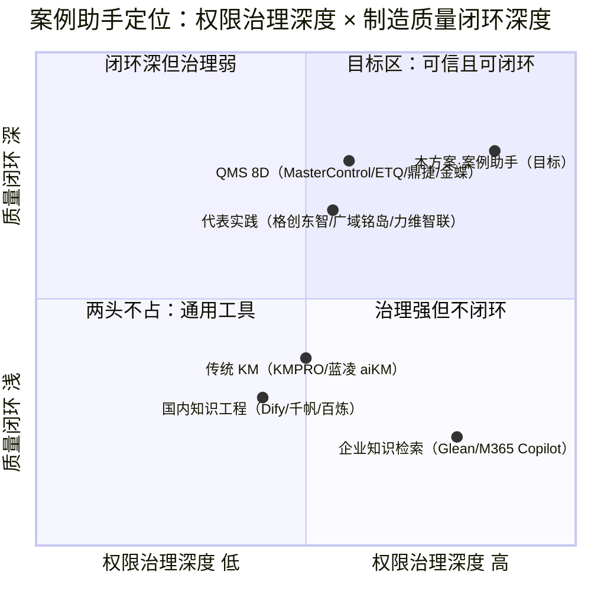
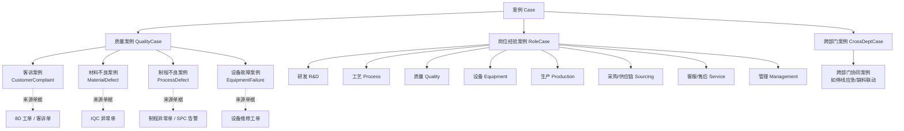
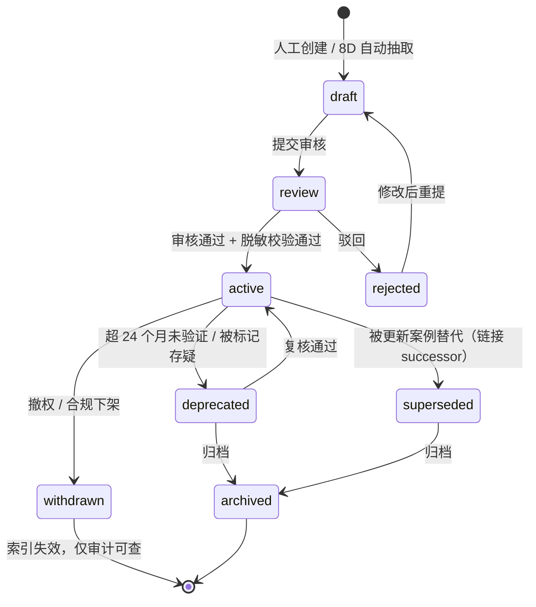
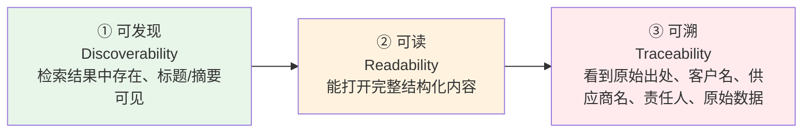
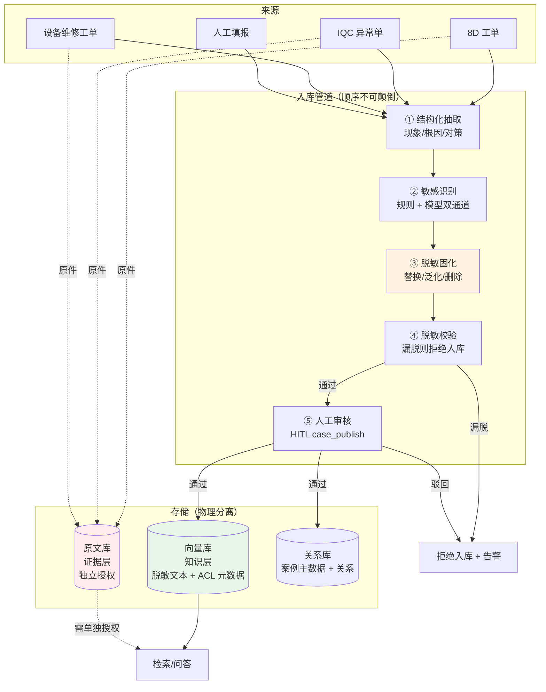
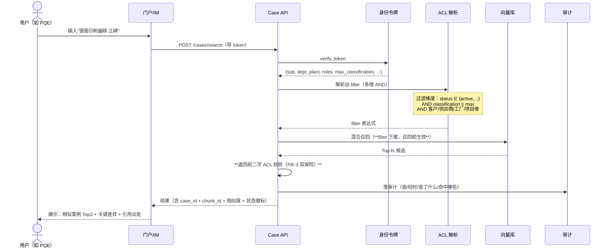
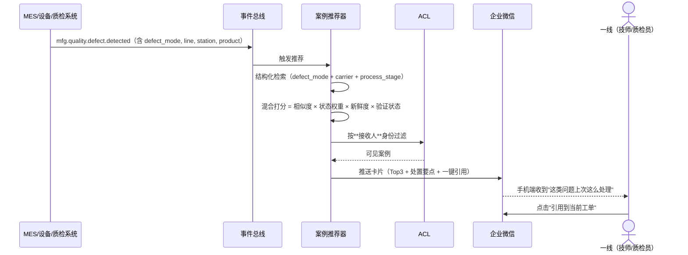
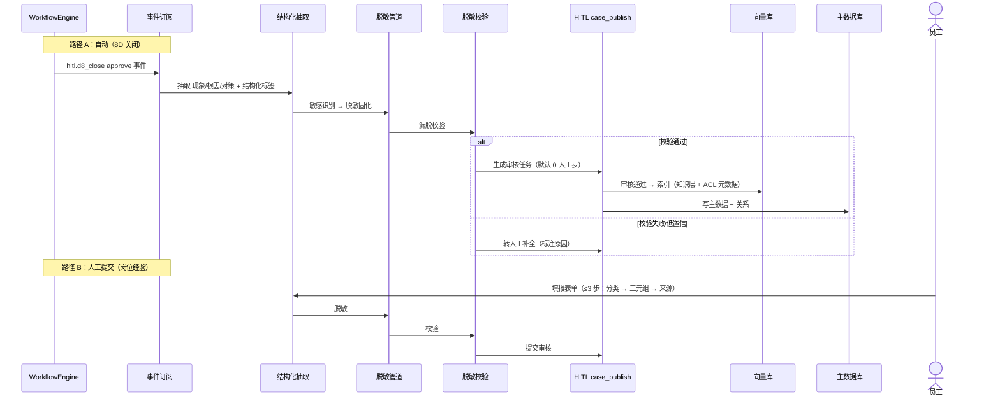
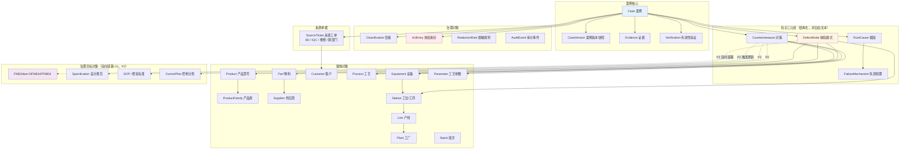

# 案例助手：竞品调研与增量 PRD

| 项 | 内容 |
|---|---|
| 文档版本 | V1.0（增量 PRD + 调研结论，**不改源码、不改** `docs/PRD.md` / `docs/PRD-V3.md`） |
| 前置文档 | `docs/PRD.md`（V1）、`docs/PRD-V3.md`（治理层与受控知识资产）、`docs/ARCHITECTURE-V2.md`（总架构） |
| 作者 | 许清楚（产品经理） |
| 日期 | 2026-10-18 |
| Language | 简体中文 |
| Programming Language | 延续现有基线：Python 3.11 + LangGraph + FastAPI(SSE) + SQLite/MySQL + ChromaDB/Milvus + 原生 JS（**不引入 TS/Node**） |
| Project Name | `mfg_agent_platform`（延续） |
| 当前基线 | 587 条离线测试通过；24 条权限 × 32 治理角色 × 8 个 HITL 槽位；5 个场景；已有 `knowledge_case` 知识资产规划（PRD-V3 §S9，P1，未实现） |
| 数据纪律 | 本文所有竞品效果数字**均为厂商披露或公开资料汇总，标注「厂商披露，待 POC 验证」**，一律不得直接作为本项目承诺指标 |

---

## 1. 一页式结论

### 1.1 是否立项：**有条件立项（Go with Gates）**

**结论**：建议立项，但**不得先做功能、后补治理**。必须先把「权限前置检索」这条技术能力补上，再谈案例助手的任何功能。

三条理由：

1. **这不是从零建知识库，而是把已有管线接上"权限 + 复用"闭环。** 平台已有：8D 结构化产出链路（`customer_complaint_v2.yaml`）、`knowledge_case` 知识资产规划（PRD-V3 §S9）、声明式权限目录（24 条权限 × 32 角色，构造期自检 fail-closed）、HITL 会签与审计留痕、A2A/MCP 双协议治理同源。**案例助手是"把 S9 的规划落地 + 加权限 + 加复用闭环"，不是新建一套 RAG。**
2. **但当前代码里"鉴权检索"是空的，必须先承认并堵上。** 代码实证（详见 §4.2）：`search_cases(query, n_results)` 签名里没有 `user_ctx`；MCP 工具 `_h_knowledge_search` 收了 `user_ctx` 却完全没用；`MilvusCollectionAdapter.query(where=...)` 直接 `raise NotImplementedError`；5 个知识 JSONL 的 metadata 里**没有任何密级/ACL 字段**。**在这四条不解决之前，本文所说的"必须鉴权、规范每个角色的可查阅范围"一句都兑现不了。**
3. **竞品的钱大多花在"连接器 + 索引"，而制造业真正的坑在"撤权 + 保鲜 + 闭环"。** 竞品公开缺陷高度集中在三处：索引失效、撤权延迟、只检索不闭环（§3.4）。这三条恰好都能被我们已有的治理层覆盖——**这是我们唯一值得下注的差异化。**

### 1.2 核心差异化（3 条，按不可替代性排序）

| # | 差异化 | 一句话 | 为什么竞品难做 |
|---|---|---|---|
| **D1** | **权限前置到向量召回之前，且是多维交集** | 不是"搜完再筛"，是"先算出你只能看哪些，再去搜" | 通用企业搜索（Glean / M365 Copilot）继承的是**文档 ACL**，只有"人-文档"一个维度。我们能在同一个 ACL 里同时使用**制造语境维度**：工厂 / 产线 / 项目 / 客户 / 供应商 / 密级 / **案例状态**。"案例状态"这一维是 QMS 侧才有、企业搜索侧没有的 |
| **D2** | **共享的是"经验"，不是"原始数据"——知识层 / 证据层分离 + 入库时固化脱敏** | 向量库只索引脱敏后的"现象-根因-对策"三元组；8D 原件、客户邮件、检测报告、供应商名称单独存、单独授权 | 绝大多数竞品是"索引原文 → 查询时打码"。查询时打码意味着**原文仍在索引里、仍在缓存里、仍在日志里**。我们要的是**脱敏在入库前固化**，检索侧拿不到原文 |
| **D3** | **案例 ↔ 治理对象双向链路** | 案例 ↔ 8D/IQC 工单 ↔ FMEA / 设计规范 / 检验标准 / SOP，双向可跳 | QMS 侧（MasterControl / ETQ / 鼎捷）有流程单据，但**没把单据转成可复用知识单元**；企业搜索侧能搜到文档，但**搜不到"上次这类问题我们怎么解决的"**。这是 §3.6 识别的最大机会空白 |

### 1.3 明确不做什么（6 条，与"做什么"同权）

| # | 不做 | 为什么不做（防误读） |
|---|---|---|
| **N1** | **不做"质量案例全员共享 = 原文全量裸奔"** | 见 §7。"全员共享"是**权限默认值**，不是**内容可见性声明**。共享的是脱敏后的"经验三元组"，不是 8D 原件、不是客户名、不是供应商名、不是责任人姓名 |
| **N2** | **不做通用企业搜索** | 不接全公司网盘/OA/邮件，不替代现有文档检索。案例助手的语料是**有来源单据的案例**，不是任意文档 |
| **N3** | **不做脱离工单的独立知识库** | 无来源单据的"案例"不允许进入共享池（只能存为个人草稿）。**没有来源 = 无法溯源 = 无法验证 = 不该被别人当经验用** |
| **N4** | **不做自动根因判定 / 自动结案** | 沿用现有铁律：Agent 只 `propose`，永不 `approve`（`PermissionRegistry` 构造期自检 + 运行期拦截 + 黑名单三重防线）。案例"生效"必须由人审核 |
| **N5** | **首期不做知识图谱自动构建与多跳推理** | Ontology 首期用**受控词表 + 显式关系 + 少量人工维护**，不做自动本体抽取、不做自动关系发现。自动构建在语料不足时产出的是噪声图，维护成本高于收益（§14 R9） |
| **N6** | **不做对外（客户 / 供应商）开放的案例门户** | 任何对外可见都涉及出口管制与客户合同约束，首期一律不开放（§7.4 E5） |

### 1.4 立项 Gate（不满足不进入开发）

| Gate | 判定标准 | 不通过的后果 |
|---|---|---|
| **G-A 数据真实性** | POC 必须用**真实历史案例文档**（≥ 200 份）与**真实查询**（≥ 30 条，来自一线口述，非产品经理编造），且由业务方标注相关集 | 不通过 → Demo 指标作废，回到需求调研 |
| **G-B 越权 0 容忍** | ≥ 40 条红队越权用例（跨部门 / 跨工厂 / 跨密级 / 客户维度 / 未结案 / 已撤权）**100% 拦截，漏放 = 0** | 不通过 → 不许上线，一票否决 |
| **G-C 权限前置** | 过滤在**召回前**生效（非召回后过滤）；且开启过滤后召回率下降幅度 ≤ 10%（相对无过滤基线） | 不通过 → 先解决 §4.2 的技术缺口，功能需求全部冻结 |
| **G-D 脱敏** | 抽样 100 条入库案例，人工复核**漏脱率 = 0**；且验证"索引 / 缓存 / 日志三处均无原文残留" | 不通过 → 不得放开全员共享，降级为部门内共享 |
| **G-E 运营责任** | 书面明确**知识运营责任人**（谁审核、谁复核新鲜度、谁处理撤权申请） | 不通过 → 案例库会在 3 个月内腐化，不如不做 |

---

## 2. 术语与口径统一（先定义，再讨论）

> **本节存在的理由**：需求原文有三个词在不同人嘴里含义完全不同。不先钉死，后面所有讨论都会跑偏。

| 术语 | 本文口径 | 常见误读（明确排除） |
|---|---|---|
| **案例（Case）** | 一次**已发生、已处置、有来源单据**的事件，经结构化抽取后形成的**可复用知识单元**。最小结构 = 现象 + 根因 + 对策 + 有效性验证 | ❌ 误读为"一份文档"。文档是证据，不是案例 |
| **Ontology（知识本体）** | 用户原文写作 "Onlonlgy"，**默认按知识本体（Ontology）解释**。指：案例域的**受控概念集合**（缺陷模式 / 根因 / 对策 / 载体对象）+ **受控关系集合**（§12）。首期是**人工维护的受控词表 + 显式关系**，不是自动构建的知识图谱 | ❌ 误读为"必须先建一个图数据库才能开始"。图库是 P2 的可选项，不是前置条件 |
| **鉴权** | 本文统一指**授权（Authorization）**："你能看哪些"。认证（Authentication，"你是谁"）沿用现有 `services/auth.py` 的 HMAC 令牌 | ❌ 混用"鉴权 = 登录" |
| **全员共享** | **权限默认值（default-open on one dimension）**：质量案例在「角色 × 部门」这两个维度上默认授予全员 | ❌ **不等于**"原文全量可见"、❌ 不等于"可下载"、❌ 不等于"可外发"、❌ 不等于"绕过密级"（§7） |
| **默认拒绝（default-deny）** | **系统级原则**：任何一个权限维度未显式授权 → 拒绝 | ❌ 与"全员共享"矛盾。二者是不同层级：default-deny 是**系统原则**，全员共享是**质量案例这一个分类在角色/部门维度上的显式授权**。最终权限 = 各维度**交集**（§8.2） |
| **脱敏** | **入库前固化**的文本变换（替换/泛化/删除），产出的文本**不再包含**原始敏感值 | ❌ 误读为"查询时打码"。查询时打码时原文仍在索引、缓存、日志中 |
| **知识层 / 证据层** | **知识层** = 脱敏后的结构化三元组 + 元数据，进向量库，默认共享；**证据层** = 8D 原件 / 检测报告 / 客户邮件 / 图片，独立存储独立授权 | ❌ 两者混存在一个索引里 |

---

## 3. 行业问题与竞品分层对比

### 3.1 问题本质：制造业的知识复用卡在哪

| 层 | 现象（一线原话） | 根因 |
|---|---|---|
| **存不下** | "上次那个问题处理完就完了，报告在共享盘里，找不到了" | 8D / 异常单是**流程单据**，关单即归档，没有转成可检索的知识单元 |
| **找不到** | "我知道以前有过，但不知道搜什么词" | 靠文件名与关键词检索，缺乏**按缺陷模式 / 根因 / 载体对象**的结构化组织 |
| **不敢信** | "搜出来三条，哪条是对的？谁写的？验证过吗？" | 无**来源溯源**、无**有效性验证**、无**新鲜度标记** |
| **不敢放** | "这个案例里有客户名和供应商名，不敢全公司开放" | 没有**知识层/证据层分离**，只能二选一：全开（合规风险）或不开放（无价值） |
| **不闭环** | "找到了案例，然后呢？还得自己写 8D" | 检索结果与**工单流**是两套系统，检索结果无法回填到当前处置 |

> **关键判断**：前四条是"知识库"问题，第五条是"工作流"问题。**只解决前四条的竞品，最终都会沦为一个没人打开的搜索框。** 这是本方案把"闭环"列为 P0 而非 P2 的原因。

### 3.2 竞品分层（3 层 20+ 家）

#### 第一层：企业知识检索 / RAG 平台（通用）

| 竞品 | 定位 | 权限感知 | 引用溯源 | 人工验证 | 主要缺陷（公开资料汇总） |
|---|---|---|---|---|---|
| **Glean** | 企业搜索 + 助手，连接器生态最全 | ✅ 核心卖点：**继承源系统 ACL**，权限感知索引 | ✅ 答案带出处链接 | ⚠️ 有 Verified/专家标注，但依赖运营 | 索引同步滞后；源系统撤权后**索引撤权存在延迟**；检索强、闭环弱 |
| **Microsoft 365 Copilot** | M365 生态内的知识助手 | ✅ 继承 SharePoint/Graph ACL | ✅ 带引用 | ❌ 无原生知识有效性验证机制 | 强绑定 M365；制造现场系统（MES/QMS）不在生态内；**只检索不闭环** |
| **Coveo** | 搜索 + 推荐，面向客服/门户场景 | ✅ 支持权限过滤与"安全搜索" | ✅ | ⚠️ | 偏对客/客服场景；制造业质量语境缺失；实施重 |
| **Guru** | 知识卡片 + 人工验证工作流 | ⚠️ 权限粒度较粗 | ✅ | ✅ **Verification 机制是核心差异**（到期强制复核） | 知识以"卡片"为中心，**不适合长流程单据（8D）转知识**；无 QMS 语境 |
| **Onyx**（原 Danswer） | 开源企业问答，可自托管 | ✅ 支持连接器级权限 | ✅ 带引用 | ❌ | 开源方案需自建治理；权限模型需自行对接；无质量域语义 |

> **第一层结论**：这一层的**共识做法是对的**——连接器 + 权限感知索引 + 引用溯源。它们解决了"搜得到且不敢越权"。**但它们都不懂"案例状态"（未结案/已作废/已撤权）、不懂"密级"、不懂"客户/供应商"，也不接工单流。**

#### 第二层：国内知识工程 / 大模型平台

| 竞品 | 定位 | 权限感知 | 引用溯源 | 主要缺陷 / 共识 |
|---|---|---|---|---|
| **深蓝海域 KMPRO** | 知识管理老牌厂商，知识资产化 | ⚠️ 有权限体系，但与向量检索的耦合需 POC 验证 | ⚠️ | 传统 KM 起家，知识运营方法论强，**AI 检索能力需实测** |
| **达观数据** | 文本智能处理 + 知识库 | ⚠️ | ⚠️ | NLP 能力强（抽取/分类），**权限治理非其核心卖点** |
| **蓝凌 aiKM** | OA 生态 + AI 知识管理 | ⚠️ 继承 OA 权限 | ⚠️ | 强在门户与流程，**弱在制造质量语义与向量检索精度** |
| **华为云（KooSearch / 盘古相关）** | 云上知识检索与 RAG 底座 | ✅ 提供 IAM 体系对接 | ✅ | 提供的是**底座能力**，行业语义与运营需自建 |
| **百度千帆 AppBuilder** | RAG 应用构建平台 | ⚠️ 需自行实现权限过滤 | ✅ | **平台不替你做权限**——这是使用方最容易踩的坑 |
| **阿里云百炼** | RAG 应用构建平台 | ⚠️ 同上 | ✅ | 同上；企业知识库权限需自行在召回前后处理 |
| **腾讯云知识引擎** | 知识问答引擎 | ⚠️ | ✅ | 同上 |
| **Dify** | 开源 LLM 应用开发平台 | ⚠️ 有基础的多租户与成员权限，**但向量检索无行级 ACL** | ✅ | **最典型的"Demo 五分钟、上线三个月"**：检索质量与权限治理全靠自己补 |

> **第二层共识（最重要，直接影响本方案 P0 排序）**：
> 1. **权限必须在向量召回前生效**——行业共识，但在大模型平台上**默认不提供**，需要自己实现；
> 2. **必须用真实文档做 POC**——用干净样本做出的效果不可信；
> 3. **知识运营与版本治理比 Demo 效果更决定成败**——上线 3 个月后案例库腐化是常态。
>
> 这三条共识直接对应本方案 §1.4 的 G-C / G-A / G-E 三个 Gate。

#### 第三层：QMS / 8D 质量管理系统

| 竞品 | 定位 | 8D/CAPA 成熟度 | 知识复用 | 主要缺陷 |
|---|---|---|---|---|
| **MasterControl** | 生命科学/制造业 QMS | ✅✅ 成熟（CAPA/变更/培训闭环） | ⚠️ 有文档关联，**非语义复用** | 流程强、检索弱；**没有"相似案例推荐"** |
| **ETQ / Octave（Hexagon）** | 企业级 QMS 平台 | ✅✅ 成熟 | ⚠️ | 同上；实施周期长、重 |
| **ComplianceQuest** | Salesforce 上的 QMS | ✅✅ 成熟 | ⚠️ | 同上 |
| **SAP QM** | ERP 内嵌质量管理 | ✅✅ | ❌ 检索能力弱 | 强在交易数据，**弱在经验知识** |
| **Siemens Teamcenter Quality** | PLM 侧质量 | ✅✅ | ⚠️ 与 PLM 数据联动是优势 | 重，且聚焦研发侧 |
| **鼎捷 sQMS** | 国内 QMS | ✅ | ⚠️ | 有"质量 RAG → 研发设计"的实践方向（见 §3.5），**落地深度待 POC** |
| **金蝶 质量 8D 智能体** | 云 ERP + AI 8D | ✅ | ⚠️ | AI 生成 8D 草稿是亮点，**案例资产化与权限治理待验证** |
| **用友 / 美云智数** | 国内制造 ERP/质量 | ✅ | ⚠️ | 同上 |

> **第三层结论**：**这一层成熟于"8D/CAPA 流程"，但普遍没有把流程单据转成可复用知识单元。** 工单关了就关了，下一条同类客诉来了，系统不会告诉你"上次怎么解决的"。**这正是我们的机会点，也解释了为什么"案例助手"应该长在已有工单流上，而不是另建门户。**

### 3.3 竞品象限图



> 坐标含义：**X = 权限治理深度**（是否有权限感知索引、是否多维、是否撤权及时）；**Y = 制造质量闭环深度**（是否接工单流、是否能回填、是否链接 FMEA/设计规范）。
> **打分说明：本文所有坐标为产品经理基于公开资料的主观定位，非实测；仅用于说明相对位置，不作为选型依据。**

### 3.4 竞品共性缺陷 → 我们的设计对策

| # | 共性缺陷（跨三层一致出现） | 表现 | 本方案对策 | 优先级 |
|---|---|---|---|---|
| **CD1** | **索引失效** | 源系统更新了，检索到的还是旧版；用户找到"已作废"的经验 | 案例有**生命周期状态**（§6.3）；撤权/作废 → **主动失效索引**而非等下次同步（§8.5 撤权时延 P95 ≤ 5 分钟） | **P0** |
| **CD2** | **撤权延迟** | 人调岗/离职后，旧权限仍在索引里生效 | ACL 变更 → 事件驱动失效（不等定时任务）；**所有检索结果返回前再校验一次 ACL**（双保险，见 BR-01） | **P0** |
| **CD3** | **只检索不闭环** | 找到案例后，用户还要切系统、手动写 8D | 检索结果**可一键回填到当前工单**（`cite` 动词）；异常处理时**主动推荐**（§9.2 旅程 2） | **P0** |
| **CD4** | **引用不可溯源** | 答案里的结论不知道来自哪份文件的哪一段 | 每个断言必须带 `(case_id, chunk_id, version)`；**无引用的断言不得输出**（§11 BR-05） | **P0** |
| **CD5** | **原文裸奔** | 为了"能搜到"把原文全量索引，合规风险高 | **知识层/证据层分离 + 入库前固化脱敏**（§7.3）。这是本方案最硬的差异化 D2 | **P0** |
| **CD6** | **知识无保鲜** | 三年前的经验还在首位推荐 | **新鲜度模型**：生效案例超 24 个月未验证 → 自动转 `deprecated` 并**降权**（§13.2 K6） | **P1** |
| **CD7** | **无有效性验证** | 案例里的对策到底管不管用？没人记录 | `Verification` 实体（§12）；**无有效性验证的案例在排序中降权，且 UI 明确标注"未验证"** | **P1** |

### 3.5 代表实践拆解（4 家，来自公开资料）

| 实践方 | 做法 | 可借鉴点 | 边界/待验证 |
|---|---|---|---|
| **鼎捷** | "质量 RAG → 研发设计"：把质量知识反哺到研发设计端 | **方向与我们 D3（案例→设计规范/FMEA 双向链路）一致**，验证了这条路有人在做 | 厂商披露方向，**双向链路的实际闭环深度待 POC 验证** |
| **力维智联** | "历史案例 + 异常知识图谱 + 实时数据"三要素组合 | 提醒我们：**案例不是孤立的**，需与实时过程数据（SPC/设备参数）联动才有现场价值 | 知识图谱的构建与维护成本需评估（对应 N5：首期不做自动图谱） |
| **格创东智** | "根因 + 置信度 + 证据链 + 8D 草稿" | **置信度与证据链是关键**——不要给一个没有证据链的"根因"。这与 §11 BR-05（引用溯源）一致 | 置信度如何计算、如何校准，需 POC 验证 |
| **广域铭岛** | "处理完 8D 自动归档入库" | **入库零人工**是复用率的前提——与 PRD-V3 §S9（`hitl.d8_close` 终批通过后自动落 `knowledge_case`）完全一致 | 自动入库的质量依赖 8D 结构化抽取质量，需抽检 |

> **四条实践的交叉结论**：**"自动入库 + 证据链 + 双向链路"三件事，是制造业案例助手的行业共识方向。本方案 D3 与之一致，且额外补上竞品普遍缺失的"权限前置 + 知识层/证据层分离"。**

### 3.6 机会空白（4 个，按价值排序）

| # | 机会空白 | 说明 | 本方案覆盖 |
|---|---|---|---|
| **O1** | **质量案例 → 设计规范 / FMEA 双向链路** | QMS 侧有流程无知识；研发侧有 FMEA 无案例反馈。**两边都不通**：发生过的缺陷没有回流到 DFMEA/PFMEA，设计规范更新不触发历史案例的"已被解决"标记 | **是（P2，见需求 R3.1）** —— 这是长期壁垒，但不是 MVP |
| **O2** | **案例保鲜机制** | 行业普遍缺失。Guru 的 Verification 是少数正面案例 | **是（P1，R4.1）** |
| **O3** | **嵌入工单流的一线推送式助手** | 一线不会主动去搜；**必须在他处理异常的那一刻把案例推到他面前** | **是（P1，R2.2）** —— 直接决定"复用率"这个 KPI |
| **O4** | **多跳根因需要知识图谱 + 向量混合检索** | "这个不良在 A 产品上出现过吗？同供应商的物料在别的产线出过类似问题吗？"——纯向量检索答不了 | **P2（R5.1）**，且**首期不做自动图谱**（N5） |

### 3.7 数据边界声明

> **所有竞品效果数字（召回率提升 X%、处理时长下降 Y%、采纳率 Z%）只能作为方向参考，不得写入本项目的承诺指标，不得用于对外材料。**
> 原因：① 多为厂商自选场景与自选样本披露；② 口径不一致（是否含人工修正、是否含历史数据）；③ 我方语料（中文制造术语、缩写、方言化表达）与披露方语料分布不同。
> **本项目的所有 KPI 必须来自我方 POC 实测，并以 §13 的"建议基线"为起点校准。**

---

## 4. 现状盘点：已有资产与代码实证缺口

> **本章是本文最重要的部分。** 它决定了"我们到底是在做增量还是在做空中楼阁"。

### 4.1 可复用的已有资产（7 项）

| # | 已有资产 | 位置 | 复用方式 |
|---|---|---|---|
| A1 | 声明式权限目录（24 条权限 × 32 角色 × 8 槽位，构造期 fail-closed 自检） | `src/mfg_agents/v2/data/permissions.yaml`、`v2/contracts/permissions.py` | 新增 `case.*` 权限族，复用同一 `PermissionRegistry` |
| A2 | HITL 会签引擎 + 一人一签 SoD（G6） | `v2/services/workflow.py` | 案例**审核发布**复用会签；新增槽位 `case_publish` |
| A3 | 身份令牌（HMAC，载荷含 `sub/name/dept/roles/iat/exp`） | `v2/services/auth.py` | 载荷**扩展** `plant / project_ids / customer_ids / max_classification` |
| A4 | 8D 结构化产出链路 | `v2/scenarios/customer_complaint_v2.yaml` | `hitl.d8_close` 终批通过 → 事件订阅 → 自动入库（PRD-V3 §S9 已规划） |
| A5 | `knowledge_case` 知识资产规划（非受控文档，不作废） | `docs/PRD-V3.md` §0.5 裁定 2 / §S9 | **直接沿用**，不重新定义容器 |
| A6 | RAG 基础设施（BGE-M3 dense+sparse 双路召回 + BGE-Reranker 重排） | `src/mfg_agents/common/rag_tools.py` | 复用；但需补 `where` 过滤（见 G1） |
| A7 | A2A / MCP 双协议，治理链与 HTTP 同源 | `v2/a2a.py`、`v2/mcp_tools/tools.py` | 案例检索对外暴露走 MCP，**且必须带 user_ctx 鉴权**（见 G2） |

### 4.2 代码实证缺口（5 条，**均为 P0 前置**）

> 以下五条是**读代码得到的实证**，不是推测。在它们解决之前，本 PRD 的所有权限承诺都无法兑现。

| # | 缺口 | 代码证据 | 影响 | 修复要求 |
|---|---|---|---|---|
| **G1** | **向量库不支持召回前过滤** | `common/rag_tools.py:174-179`：<br/>`def query(self, query_texts, n_results=3, where=None, **_)` → `if where: raise NotImplementedError("MilvusCollectionAdapter 暂不支持 where 过滤")` | **"权限前置"在 Milvus 后端下无法实现**，只能退回"召回后过滤"——违反架构铁律（`ARCHITECTURE-V2.md:955` 明确"不允许查完再过滤"） | 必须实现 `where` → Milvus `filter` 表达式翻译（Chroma 侧已有 `where` 支持需同步验证） |
| **G2** | **检索函数无权限参数** | `common/rag_tools.py:238-246`：`def search_cases(query, n_results=3)` —— 签名中**没有 `user_ctx`** | 任何调用方都无法传递身份 | 签名改为 `search_cases(query, n_results, acl_filter)` |
| **G3** | **MCP 工具收了身份却不用** | `v2/mcp_tools/tools.py:281-306`：`_h_knowledge_search` 的 handler 接收 `user_ctx`，但函数体只调用 `search_cases(query, n_results=top_k)`，**`user_ctx` 完全未使用** | **MCP 通道下的知识检索对所有人返回相同结果**——越权风险最直接的入口 | 必须把 `user_ctx` 解析为 ACL filter 并下传 |
| **G4** | **编排节点内检索无权限** | `v2/core/node_registry.py:232-233`：`cases = search_cases(query, n_results=3)` | 场景链路中召回的案例未做权限过滤，可能进入 LLM 上下文并输出给无权限用户 | 同上，且需在上下文注入前二次校验 |
| **G5** | **知识语料无任何密级/ACL 元数据** | `data/knowledge/*.jsonl`（5 个文件：`cases_history` / `fa_rules` / `process_standards` / `sop` / `equipment_ledger`）；`common/kbqa_seed.py` 注释写明 metadata 仅 `{dept, dept_cn, source, chunk_index}`；`cases_history.jsonl` 的 meta 含 `line_code / product_model / defect_type / root_cause`，**但无 `classification / acl / status / source_ticket`** | **没有权限维度可供过滤**——即使补上 G1，也无字段可过滤 | 语料 schema 升级（§12.4），并做历史语料的密级补标（一次性治理工作） |

> **补充实证**：`v2/services/auth.py` 的令牌载荷为 `sub / name / dept / roles / iat / exp`——**有 `dept`，无 `plant`、`project`、`customer`、`classification`**。因此 §8 的十维权限中，**有六个维度的信息当前在身份里根本不存在**。这是 A3 需要扩展的直接依据。

### 4.3 与 PRD-V3 的关系：不重复造轮子

| PRD-V3 已有裁定 | 本方案的处理 |
|---|---|
| 裁定 2：8D **不进受控文档**，走知识资产 `knowledge_case`（无 `doc_code`、无 `major.minor`、不可作废） | **完全沿用**。本方案不引入新的案例容器，只给 `knowledge_case` 补**分类体系、权限维度、生命周期、Ontology 关系** |
| §S9：`hitl.d8_close` 终批通过 → 自动落 `knowledge_case` | **沿用并细化**：自动入库 = MVP 的入库主路径（旅程 3），人工提交 = 补充路径 |
| 裁定 5：scope 粒度阶段二 `dept` + `line`，`customer`/`project` 放阶段三 | **本方案加速**：因用户需求明确要求"客户/供应商"维度，故将 `customer/supplier` 提到 P1（`project` 仍 P2）。**但需显式声明风险**：加速意味着要更早面对跨客户数据隔离（§14 R7） |
| G6 会签独立性（一人一签，`user_id` 判定） | 案例**审核发布**复用同一套，不做第二套审批逻辑 |

---

## 5. 目标用户、角色矩阵与 JTBD

### 5.1 用户分层

| 层 | 人群 | 规模特征 | 核心诉求 | 使用方式 |
|---|---|---|---|---|
| **L1 一线** | 产线操作工、质检员（IQC/IPQC/OQC）、设备维保技师 | 人数最多、耐心最少 | "现在这个问题，上次是怎么处理的？" | **被动接收推送**，几乎不主动搜索 |
| **L2 专业岗** | 研发 / 工艺 / 质量（SQE/PQE/QA）/ 设备工程 / 生产 / 采购供应链 / 客服售后 | 案例的主要生产者与消费者 | "找相似案例，别让我重复踩坑" | 主动搜索 + 接收推荐 |
| **L3 管理** | 质量总监、研发经理、供应链经理、项目经理、总经理 | 关注趋势与体系 | "这类问题为什么反复发生？" | 看统计与复用率，**不逐条读案例** |
| **L4 运营** | 知识运营员（新增角色，见 §14 Q5）、QA 体系工程师 | 少数但关键 | "案例库质量如何，哪些该复核了" | 审核、复核、撤权处理 |

### 5.2 角色矩阵（对齐现有 32 个治理角色）

| 职能域 | 现有角色 key | 产出案例类型 | 可查阅范围（默认） | 特殊约束 |
|---|---|---|---|---|
| **质量** | `qa` / `pqe` / `sqe` / `qa_manager` / `quality_director` | 客诉案例、材料不良案例、制程不良案例 | **全量质量案例 + 本部门岗位案例**；`quality_director` 可跨部门 | `sqe` 可见供应商名称（需供应商维度授权）；对非本客户项目，**客户名脱敏** |
| **研发** | `rd_engineering` / `me_engineer` / `test_engineer` / `rd_test_engineer` / `npi_engineer` / `rd_manager` | 研发经验案例（设计缺陷、验证失败） | 全量质量案例（知识层）+ 研发/工艺岗位案例 + **本项目相关的客诉证据层** | **非本项目的客诉证据层默认不可见** |
| **工艺** | `product_engineering` / `ie_engineer` | 工艺经验案例（参数窗口、工装治具） | 全量质量案例 + 工艺/设备案例 | 同上 |
| **设备** | `equipment` / `equipment_manager` / `maintenance_tech` | 设备经验案例（故障模式、维修诀窍） | 全量质量案例 + 设备案例 | `maintenance_tech`（一线）仅 L1 权限：可读不可导出 |
| **生产** | `manufacturing` | 生产经验案例（换型、爬坡、人为失误） | 全量质量案例 + 生产案例 | **本工厂优先排序** |
| **采购/供应链** | `procurement` / `planning` / `material_control` / `supply_chain_manager` / `procurement_manager` | 供应链案例（缺料、供应商交付、特采） | 全量质量案例（**知识层**）+ 供应链案例 | **供应商名称仅在"该采购员负责的供应商"范围内可见**（§8.3 维度 7） |
| **客服/售后** | `customer_service` / `sales` | 客诉案例（一线口径、客户沟通） | 本客户相关的客诉案例（证据层可见本客户）；其他客户案例仅知识层 | **严禁跨客户查看**（合规红线） |
| **管理** | `gm` / `project_manager` / `finance` / `finance_manager` | — | 全量（受密级约束） | `gm` 可申请临时提权，走审批留痕（§9.6 旅程 6） |
| **职能** | `admin_hr` / `ehs` / `warehouse` / `warehouse_manager` | 职能案例（EHS、仓储、人事） | 全量质量案例（知识层）+ 本职能案例 | `admin_hr` **默认不可见含个人绩效的案例**（PIPL） |

> **矩阵使用说明**：本表是**默认值**，实际权限 = §8.2 的十维交集。任何"跨部门""跨客户""跨工厂"的可见都需显式授权或走申请流程。

### 5.3 JTBD（Jobs To Be Done，8 条）

| # | 角色 | 情境（When） | 我想（I want） | 以便（So that） |
|---|---|---|---|---|
| J1 | PQE / 工艺 | 产线出现新的制程不良时 | 立刻知道历史上有没有同类不良、根因是什么 | 不用从零排查，30 分钟内给出处置方向 |
| J2 | SQE | 收到来料异常通知时 | 查这个供应商、这个物料历史上出过什么问题 | 判断是个案还是系统性问题，决定要不要升级 |
| J3 | 客服 / 销售 | 客户投诉要求 8D 时 | 找到同客户、同产品、同缺陷模式的历史 8D | 保证对客口径一致，不出现"上次不是这么说的" |
| J4 | 研发工程师 | 做新项目 DFMEA 时 | 看到历史上同类设计缺陷的案例 | 把历史教训写进 FMEA，而不是靠记忆 |
| J5 | 设备维保技师 | 设备报警时 | 手机上看这个报警代码的处置诀窍 | 不用翻纸质手册、不用打电话问师傅 |
| J6 | 质量总监 | 季度质量复盘时 | 知道哪些缺陷模式在反复发生 | 把资源投在真正高频高损的问题上 |
| J7 | 一线质检员 | 发现疑似不良但不确定时 | 看到这个不良模式的判定标准与图片示例 | 减少误判与漏判 |
| J8 | 知识运营员 | 日常 | 知道哪些案例该复核、哪些该作废、谁申请了提权 | 保证案例库不腐化 |

---

## 6. 案例分类体系与生命周期

### 6.1 顶层分类（3 大类 9 子类）



### 6.2 分类定义与默认共享策略

| 大类 | 子类 | 定义 | 来源单据（强制，N3） | 默认共享（知识层） | 证据层默认 |
|---|---|---|---|---|---|
| **质量案例** | 客诉案例 | 客户反馈的质量问题及其 8D 闭环 | 8D 工单 / 客诉单 | ✅ 全员（脱敏后） | ❌ 拒绝（按客户维度授权） |
| | 材料不良案例 | 来料/物料本身缺陷导致的异常 | IQC 异常单 / MRB 单 | ✅ 全员（脱敏后） | ❌ 拒绝（按供应商维度授权） |
| | 制程不良案例 | 制造过程参数/工装/人为导致的缺陷 | 制程异常单 / SPC 告警工单 | ✅ 全员（脱敏后） | ⚠️ 本工厂可见 |
| | 设备故障案例 | 设备故障及其处置 | 设备维修工单 | ✅ 全员（脱敏后） | ⚠️ 本工厂可见 |
| **岗位经验案例** | 研发 / 工艺 / 质量 / 设备 / 生产 / 采购供应链 / 客服售后 / 管理 | 各岗位在长期实践中沉淀的**方法论、诀窍、避坑经验**，不绑定单一事件 | 工单 或 岗位填报（需填经验来源） | ⚠️ **本职能域 + 申请可见**（非默认全员） | ⚠️ 依密级 |
| **跨部门案例** | 协同案例 | 需多部门联动处置的复合事件及其协同经验 | 跨部门工单（如停线应急） | ✅ 全员（脱敏后） | ⚠️ 参与部门可见 |

> **关键设计判断（强批判）**：**"质量案例默认全员共享"只适用于质量案例这一大类。**
> 岗位经验案例**不适用**默认全员——原因：① 岗位经验常含未经验证的个人做法，全公司扩散会放大错误经验；② 部分经验涉及供应商谈判策略、成本数据，属商业秘密；③ 横向扩散会削弱专业壁垒，降低专家贡献意愿。
> **因此：岗位经验案例的默认范围是"本职能域共享 + 跨域需申请"。这与用户"质量案例默认全员共享"的原始要求不冲突——用户说的是质量案例。**

### 6.3 生命周期（状态机）



| 状态 | 含义 | 是否进检索索引 | 排序权重 | 可被新工单引用 |
|---|---|---|---|---|
| `draft` 草稿 | 未完成/未提交 | ❌ 否 | — | ❌ |
| `review` 审核中 | 待审核发布 | ❌ 否（**未结案不共享，见 BR-06**） | — | ❌ |
| `rejected` 驳回 | 审核未通过 | ❌ 否 | — | ❌ |
| `active` 生效 | 已发布，可被共享 | ✅ 是 | 1.0（基准） | ✅ |
| `deprecated` 待复核 | 超期未验证或被存疑 | ✅ 是 | **0.4（降权）** | ⚠️ 可引用但 UI 强提示 |
| `superseded` 被替代 | 有更新版本 | ✅ 是 | **0.3（降权）** | ❌ 自动跳转 successor |
| `archived` 归档 | 长期无引用 | ✅ 是 | **0.2（降权）** | ❌ |
| `withdrawn` 撤回 | 合规下架/撤权 | ❌ **否（索引失效）** | — | ❌ |

> **沿用 PRD-V3 裁定 2**：案例**不作废、无版本号**（8D 是过程记录，不是受控文件）。因此用 `superseded` 而非"版本升级"来表达"有更新的经验"。

### 6.4 案例最小结构化字段（入库必填）

| 字段组 | 字段 | 必填 | 说明 |
|---|---|---|---|
| **标识** | `case_id` / `case_code`（如 `QC-CC-2026-0087`） | ✅ | `case_code` 自动生成，seq 不复用（沿用 SOP 编号规则） |
| **分类** | `category` / `subcategory` | ✅ | 见 §6.1 |
| **知识三元组** | `phenomenon` 现象 / `root_cause` 根因 / `countermeasure` 对策 | ✅ | **脱敏后的文本**，进向量库 |
| **结构化标签** | `defect_mode` / `failure_mechanism` / `carrier`（产品/物料/设备/工序）/ `process_stage` | ✅ | **受控词表**（§12.2），不是自由文本 |
| **有效性** | `verification` 有效性验证（有/无 + 验证方式 + 验证日期） | ⚠️ | 无验证 → 排序降权 + UI 标注"未验证" |
| **来源** | `source_ticket_type` / `source_ticket_id` / `source_task_uid` | ✅ | **强制（N3）**，无来源不允许进入共享池 |
| **治理** | `classification` 密级 / `acl` 授权条目 / `status` / `owner_dept` / `author`（脱敏到岗位） | ✅ | 见 §8 |
| **时间** | `occurred_at` / `created_at` / `published_at` / `last_verified_at` | ✅ | `last_verified_at` 驱动新鲜度（K6） |
| **证据** | `evidence_refs[]` | ⚠️ | 指向证据层对象 ID，**不内联内容** |

---

## 7. 「质量案例全员共享」的精确定义与例外

> **本章是全篇最需要被正确理解的部分。** 用户原话"质量案例默认全员共享"极易被实现成"把 8D 原文全量索引、全员可搜"——**这是一个会造成真实合规事故的理解**。

### 7.1 三条必须区分的"可见"



| 层 | 全员共享？ | 具体内容 |
|---|---|---|
| **① 可发现** | ✅ **是** | 案例标题（脱敏）、缺陷模式、发生工序、产品族、发生时间范围 |
| **② 可读** | ✅ **是，但读的是脱敏后的知识层** | 现象-根因-对策三元组（已去除客户名/供应商名/责任人姓名/精确工艺参数/商务信息） |
| **③ 可溯** | ❌ **否，默认拒绝，按需授权** | 8D 原件、客户名称、供应商名称、检测报告、图片、责任人姓名与工号、精确参数与配方、商务条款 |

> **一句话**：**共享的是"经验"，不是"原始数据"。** 一线需要知道"锡膏印刷偏移是因为刮刀压力漂移，把压力校准到 0.5MPa"——他**不需要知道**那是哪家客户的哪张订单、哪家供应商的哪批料、谁操作的。

### 7.2 权限计算：交集，不是并集

```
effective_visible(case, user) =
      分类维度授权(质量案例 → 全员 ✓)
  AND 密级维度授权(case.classification ≤ user.max_classification)
  AND 状态维度授权(case.status ∈ {active, deprecated, superseded, archived})
  AND 客户/供应商维度授权(user.customer_ids ⊇ case.customer_id  OR  case.knowledge_layer_only)
  AND 工厂/产线维度授权(user.plant ∈ case.visible_plants OR 全局可见)
  AND 项目维度授权(user.project_ids ⊇ case.project_id OR 非项目案例)
  AND 租户维度授权(user.tenant == case.tenant)
```

> **强批判**：**最常见的实现错误是把多维度做成"任一维度通过即可见"（OR）。** 那会导致：一个"全员共享"的质量案例，因为分类维度通过，就把含客户名的证据层也放给了所有人。
> **正确做法是 AND（交集）**：分类维度授予的是"知识层"，但**密级维度、客户维度、状态维度仍然各自独立否决**。
> **这不是推翻"全员共享"，而是给"共享"划边界——没有边界的共享，第一次合规审计就会出事。**

### 7.3 知识层 / 证据层分离（D2 的落地）



**管道纪律（不可妥协）**：

| # | 纪律 | 反例（明确禁止） |
|---|---|---|
| 1 | **脱敏在入库前固化**，向量库里只有脱敏后文本 | ❌ 索引原文、查询时打码 |
| 2 | **证据层物理分离存储**，独立 ACL，不进向量索引 | ❌ 把 8D 全文切片后与知识层混在同一 collection |
| 3 | **脱敏校验失败 = 拒绝入库**，不降级放行 | ❌ "先放进去，发现问题再删" |
| 4 | **缓存与日志不得残留原文** | ❌ 检索日志打印完整 document 字段 |
| 5 | **撤权即失效**，不等下次全量同步 | ❌ 依赖每日定时重建索引 |

### 7.4 五类例外（触发限制的条件）

| # | 例外类别 | 判定信号 | 处置方式（四选一） | 默认动作 |
|---|---|---|---|---|
| **E1** | **涉密**（国家秘密 / 军工 / 涉密项目） | 案例来源项目在涉密项目清单内；或密级 = `机密` | **不入库共享池**（仅存证据层 + 定密责任人审批可见） | **拒绝** |
| **E2** | **客户 / 供应商隐私与商业秘密** | 客户名称、供应商名称、产线布局、独家工艺、商务条款、价格 | **脱敏**（客户→"客户 A" / 一级行业；供应商→"供应商 S1"）；商务信息**删除** | **脱敏后共享，证据层限制** |
| **E3** | **个人信息**（PIPL） | 责任人姓名、工号、联系方式、绩效、家庭信息 | **泛化到岗位层级**（"操作员"→"SMT-1 印刷工位操作员"）；姓名**删除** | **泛化后共享** |
| **E4** | **未结案** | 状态 ∈ {`draft`, `review`, `rejected`}；或在索赔/诉讼/在办 8D 中 | **延迟公开**：不进索引，结案后自动转 `review` | **不共享** |
| **E5** | **出口管制 / 商业秘密** | 受 EAR / 实体清单约束的技术参数；配方、图纸关键尺寸、核心工艺窗口 | **限制范围 + 参数泛化**（精确值 → 区间）；必要时**不入库** | **限制 + 泛化** |

> **处置方式定义**：**脱敏**（保留结构、替换敏感值）/ **泛化**（降低精度，如精确参数→区间、姓名→岗位）/ **限制**（缩小可见范围，而非改内容）/ **不入库**（完全不进共享池）。

### 7.5 五个动词的默认值（"共享"不等于"可带走"）

| 动词 | 含义 | 质量案例（生效+脱敏）默认 | 说明 |
|---|---|---|---|
| `query` 检索命中 | 出现在检索结果中 | ✅ | 全员共享的核心 |
| `preview` 预览摘要 | 看到标题 + 摘要 | ✅ | — |
| `read` 读全文 | 打开完整知识层内容 | ✅ | 仅知识层 |
| `cite` 引用 | 引用到工单/8D 报告 | ✅ | **引用的必须是脱敏知识层**；引用证据层需额外授权 |
| `export` 导出 | 下载为文件 | ❌ **默认拒绝** | **"可看"不等于"可带走"**；导出默认走申请（§9.6） |
| `share` 外发分享 | 生成外链 / 转发到外部 | ❌ **默认拒绝** | 一律拒绝（N6），仅内部"推荐给同事"不算外发 |

> **强批判**：**"全员共享"只覆盖前 4 个动词中的 3 个（query/preview/read），`cite` 有条件，`export`/`share` 一律默认拒绝。**
> 现实中知识资产外泄的主要通道就是**导出与转发**，而不是"看到"。把"共享"理解成"可导出"，等于把案例库变成可被整包搬走的资产包。

---

## 8. 权限产品规则

### 8.1 十个权限维度

| # | 维度 | 取值 | 当前身份令牌是否支持（`auth.py`） |
|---|---|---|---|
| 1 | **角色 role** | 现有 32 个治理角色 | ✅ 支持（`roles`） |
| 2 | **部门 dept** | 部门编码 | ✅ 支持（`dept`） |
| 3 | **工厂/园区 plant** | 工厂编码 | ❌ **需扩展** |
| 4 | **产线 line** | 产线编码（`line_code`） | ❌ 需扩展 |
| 5 | **项目 project** | 项目 ID 列表 | ❌ 需扩展 |
| 6 | **产品线 product_family** | 产品族编码 | ❌ 需扩展 |
| 7 | **客户 / 供应商 customer / supplier** | 客户/供应商 ID 列表 | ❌ **需扩展（合规关键维）** |
| 8 | **密级 classification** | `公开 / 内部 / 保密 / 机密`（用户最大密级存在于令牌） | ❌ **需扩展（`max_classification`）** |
| 9 | **案例状态 status** | §6.3 八态 | ✅ 案例自带字段 |
| 10 | **租户/法人 tenant** | 租户 ID | ❌ **需扩展（多工厂多法人时必备）** |

> **因此 A3 的扩展清单**：令牌载荷从 `sub/name/dept/roles/iat/exp` 扩展为增加 `tenant / plant / line_ids / project_ids / customer_ids / supplier_ids / max_classification`。
> **兼容性要求**：老令牌缺字段时按**最严格**解释（fail-closed），不得按"空 = 全可见"处理。

### 8.2 判定规则（三条铁律）

| # | 铁律 | 说明 |
|---|---|---|
| **PR-1** | **默认拒绝（default-deny）** | 任何维度无显式授权 → 拒绝。未识别角色、缺失 `user_id`、令牌缺字段 → 一律拒绝（HTTP 403） |
| **PR-2** | **多维交集（AND）** | 见 §7.2。禁止 OR 语义 |
| **PR-3** | **权限前置 + 结果二次校验（双保险）** | ① 召回前：ACL 解析出 filter，下推向量库；② 返回前：对每条命中**再校验一次 ACL**。冗余是故意的——防止 filter 翻译错误或索引元数据过期导致的单点失效 |

### 8.3 六个动词 × 案例类型的默认授权矩阵

| 案例类型 | query | preview | read | cite | export | share |
|---|---|---|---|---|---|---|
| 质量案例 · `active` · 脱敏知识层 | ✅ 全员 | ✅ 全员 | ✅ 全员 | ✅ 全员 | ❌ 申请 | ❌ |
| 质量案例 · 证据层（客户/供应商） | ⚠️ 按客户/供应商维 | ⚠️ 同左 | ⚠️ 同左 | ⚠️ 同左 | ❌ 申请 | ❌ |
| 质量案例 · `deprecated` / `superseded` | ✅ 全员（降权） | ✅ | ✅ | ⚠️ 需理由 | ❌ | ❌ |
| 质量案例 · `review`（未结案） | ❌ | ❌ | ❌ | ❌ | ❌ | ❌ |
| 岗位经验案例 | ⚠️ 本职能域 | ⚠️ 本职能域 | ⚠️ 本职能域 | ⚠️ 本职能域 | ❌ 申请 | ❌ |
| 跨部门案例 | ✅ 全员（脱敏） | ✅ | ⚠️ 参与部门可读证据层 | ⚠️ | ❌ | ❌ |
| `机密` 级案例 | ❌ | ❌ | ❌ | ❌ | ❌ | ❌ |

### 8.4 权限继承与最小权限

- 案例的 ACL **默认继承来源工单的可见范围**，再由创建者**收紧**（不可放宽）。
- **不可放宽原则**：若来源 8D 工单限定"本项目可见"，创建者不得将案例改为"全员可见"；如需放宽，走申请审批。
- 跨部门引用：引用方只能引用**自己有权限的部分**；引用时系统记录 `(引用人, 被引用 case_id, 引用片段, 时间)`。

### 8.5 撤权与失效

| 事件 | 触发 | 生效要求（SLA） |
|---|---|---|
| 角色/部门变更 | HR / 主数据事件 | **P95 ≤ 5 分钟**使旧权限失效 |
| 案例下架/撤权 | 运营操作或合规指令 | **P95 ≤ 5 分钟**索引失效 |
| 项目结项/转保密 | 项目状态变更 | 自动收敛该项目案例可见范围 |
| 员工离职 | 主数据事件 | **立即**失效，且审计保留其历史访问记录 |

> **实现方式**：**事件驱动失效**（订阅变更事件 → 主动清除相关缓存与索引可见标记），**不依赖定时全量重建**。返回结果前的二次校验（PR-3）是兜底。

---

## 9. 核心用户旅程（7 条）

### 旅程 1：主动搜索 / 问答 / 找相似案例（P0）



**关键交互要求**：
- 结果卡片必须显示：**缺陷模式 / 根因（一句话）/ 有效性验证状态 / 新鲜度徽标（是否待复核）/ 相似度**。
- **"关键差异"比"相似度"更重要**：两个案例都是"锡膏偏移"，但一个是刮刀压力、一个是钢网张力——**必须告诉用户差在哪**，否则用户会误用。
- 无命中时**诚实返回空**，不编造（沿用现有 `degraded` 降级语义）。

### 旅程 2：异常处理中被推荐（P0，一线价值最高）



**关键要求**：
- **推送对象必须精确**（只推给该工位/该班次相关人），否则变成骚扰（§14 R8）。
- 推送内容**只含知识层脱敏内容**，不含客户/供应商信息。
- 同一事件对同一人**限频**（如 2 小时内不重复推）。

### 旅程 3：案例入库（自动 + 人工，P0）



**关键要求**：
- 自动路径目标：**0 人工步**（8D 关闭即入库，仅需审核人点一次通过）。
- 人工路径目标：**≤ 3 步**（K7 指标）。
- **无来源单据 → 不允许提交到共享池**（N3），只能存个人草稿。

### 旅程 4：审核发布（P0）

| 步骤 | 角色 | 动作 | 失败处理 |
|---|---|---|---|
| 1 | 系统 | 脱敏校验 + 敏感词扫描 | 失败 → 退回补全 |
| 2 | 案例 owner 部门负责人（如 PQE 主管） | `propose`（确认分类与标签正确） | 驳回 → 退回 `draft` |
| 3 | 质量体系工程师 / 知识运营员 | `cosign`（确认脱敏合规、来源可溯） | 驳回 → 退回 |
| 4 | 质量经理 / 质量总监 | `approve`（放行共享） | 驳回 → 退回 |

> **复用现有 HITL 槽位机制**，新增槽位 `case_publish`（`propose` / `cosign` / `approve` 三权），纳入 `permissions.yaml` 声明式目录，**一人一签 SoD（G6）自动生效**。

### 旅程 5：更新 / 作废 / 复核（P1）

- **更新**：案例**不改原文**（沿用 PRD-V3：案例不可作废、无版本）。通过 `supersedes` 关系链接新案例，旧案例转 `superseded` 并降权。
- **复核**：`active` 超 24 个月未验证 → 自动转 `deprecated` + 生成复核待办（推给 owner 部门）→ 复核通过回 `active`，否则转 `archived`。
- **撤权**：合规事件触发 → 转 `withdrawn` → **索引立即失效**。

### 旅程 6：权限申请（P1）

| 步骤 | 内容 |
|---|---|
| 1 | 用户看到"部分结果因权限被隐藏"（**必须显示被隐藏的数量**，否则用户不知道有东西看不到） |
| 2 | 点击"申请查看" → 填写**业务理由**（必填，不可空） |
| 3 | 走 HITL 审批（案例 owner 部门负责人 + 质量体系） |
| 4 | 通过后授予**临时权限**（默认 7 天，可续期），全程留痕 |
| 5 | 到期自动回收；**临时权限授予的所有访问单独打标**，可在审计中单独筛出 |

> **"显示被隐藏数量"是刻意设计**：完全隐藏会让用户以为"没有相关案例"，从而重复造轮子；显示标题又会泄漏。**显示数量 + 申请入口**是平衡点。

### 旅程 7：审计（P0）

| 审计对象 | 记录字段 |
|---|---|
| 检索 | `who / when / query / 命中 case_id 列表 / 被过滤掉的数量 / 使用的 filter` |
| 读取 | `who / when / case_id / 读的是知识层还是证据层` |
| 引用 | `who / when / 目标工单 ID / 被引用 case_id / 引用片段` |
| 导出/分享申请 | `who / 理由 / 审批链 / 结果 / 有效期` |
| 权限变更 | `操作人 / 对象 / 变更前后 / 时间` |
| 临时权限访问 | 单独打标，可独立筛查 |

> **审计落地**：沿用现有 `governance_json`（含 `role / actor / actor_kind / action / decision / ts`），**新增独立的案例访问审计表**（生产化清单项，与 PRD-V3 §M1.3 同类）。

---

## 10. 需求池（P0 / P1 / P2）

### 10.1 P0（Must Have，MVP 必须）

| ID | 需求 | 验收要点 |
|---|---|---|
| **R1.1** | **向量库召回前过滤能力** | `MilvusCollectionAdapter.query(where=...)` 实现 filter 翻译；Chroma 侧验证 `where`；单测覆盖"filter 生效"与"filter 表达式注入防护" |
| **R1.2** | **检索接口全链路携带身份** | `search_cases(query, n_results, acl_filter)`；`_h_knowledge_search` 使用 `user_ctx`；`node_registry` 调用点传入身份。**红队用例：不传身份 → 403** |
| **R1.3** | **知识层/证据层分离存储** | 向量库仅存脱敏知识层；证据层独立存储与授权；单测断言"证据层内容不出现在向量库 collection 中" |
| **R1.4** | **入库脱敏管道（规则 + 模型双通道）** | 覆盖 E1-E5 五类例外；校验失败拒绝入库；抽样 100 条漏脱率 = 0 |
| **R1.5** | **权限前置 + 返回前二次校验** | 见 PR-3；单测：伪造 filter → 仍被二次校验拦截 |
| **R1.6** | **质量案例分类与生命周期** | 4 子类 × 8 状态；状态机非法流转被拒 |
| **R1.7** | **8D 关闭自动入库（0 人工步）** | `hitl.d8_close` approve → 自动抽取 → 脱敏 → 待审核 |
| **R1.8** | **案例审核发布（HITL case_publish）** | 复用会签；一人一签 SoD 生效；Agent 不得持有 `case_publish.approve`（构造期自检） |
| **R1.9** | **主动搜索 / 问答 / 相似案例** | 结果带 `case_id + chunk_id + 相似度 + 状态徽标`；**显示"关键差异"** |
| **R1.10** | **六动词权限模型** | `query/preview/read/cite/export/share`；`export`/`share` 默认拒绝 |
| **R1.11** | **身份令牌扩展** | 增加 `tenant / plant / line_ids / project_ids / customer_ids / supplier_ids / max_classification`；老令牌缺字段 fail-closed |
| **R1.12** | **审计留痕** | 检索/读取/引用/申请/权限变更全覆盖；可按 `user_id` 与 `case_id` 双向追溯 |
| **R1.13** | **语料 schema 升级与历史补标** | 5 个 JSONL 增加 `classification / acl / status / source_ticket`；历史语料密级补标 |
| **R1.14** | **引用溯源（无引用不输出）** | 答案中每个断言必带 `(case_id, chunk_id, version)`；无引用断言不得输出 |

### 10.2 P1（Should Have）

| ID | 需求 | 说明 |
|---|---|---|
| **R2.1** | 材料不良 / 制程不良 / 设备故障案例的自动入库 | 接 IQC 异常单、制程异常单、设备维修工单 |
| **R2.2** | **一线推送式推荐**（旅程 2） | 事件驱动 + 按人过滤 + 限频；IM 卡片 + 一键引用 |
| **R2.3** | 岗位经验案例（8 个职能域） | 优先：研发 / 工艺 / 质量 / 设备 / 生产；其余次之 |
| **R2.4** | 引用回填到工单 / 8D 报告 | `cite` 动词落地；回填内容仅脱敏知识层 |
| **R2.5** | 权限申请与临时授权（旅程 6） | 理由必填 + HITL 审批 + 自动回收 + 单独打标 |
| **R2.6** | 权限维度扩展到 8 维 | 增加 `project` / `customer` / `supplier`（**含风险声明 R7**） |
| **R2.7** | MCP / A2A 对外暴露案例检索 | **必须携带 user_ctx 鉴权**；A2A 通道与 HTTP 同一套治理 |
| **R2.8** | 复用率与闭环统计看板 | 被引用次数、采纳率、重复发生率趋势 |

### 10.3 P2（Nice to Have）

| ID | 需求 | 说明 |
|---|---|---|
| **R3.1** | **质量案例 ↔ 设计规范 / FMEA / 检验标准 双向链路**（O1） | 缺陷模式 ↔ FMEA 条目；案例 → 触发设计规范更新提示 |
| **R3.2** | 跨部门协同案例 | 停线应急 / 缺料联动等复合事件 |
| **R4.1** | 案例保鲜自动化（R3 中的 CD6） | 超期自动转 `deprecated` + 复核待办 + 降权 |
| **R5.1** | 知识图谱 + 向量混合检索（O4） | 支持"同供应商物料在别的产线出过类似问题吗"这类多跳查询（**首期不做自动图谱，N5**） |
| **R6.1** | 案例质量评分与自动推荐"优质案例" | 基于引用数、验证状态、新鲜度 |

### 10.4 MVP 范围（阶段一）

```mermaid
graph LR
    subgraph MVP["MVP（阶段一）—— 可信优先"]
        direction TB
        M1["权限前置检索<br/>R1.1 R1.2 R1.5"]
        M2["脱敏与分层存储<br/>R1.3 R1.4"]
        M3["质量案例 4 子类<br/>R1.6"]
        M4["8D 自动入库 + 审核<br/>R1.7 R1.8"]
        M5["搜索/问答/相似案例<br/>R1.9 R1.14"]
        M6["六动词 + 身份扩展<br/>R1.10 R1.11"]
        M7["审计<br/>R1.12"]
        M8["语料升级<br/>R1.13"]
    end
    subgraph NEXT["阶段二"]
        N1["一线推送 R2.2"]
        N2["岗位经验案例 R2.3"]
        N3["引用回填 R2.4"]
        N4["权限申请 R2.5"]
        N5["维度扩展 R2.6"]
        N6["MCP/A2A R2.7"]
    end
    subgraph LATER["阶段三"]
        L1["FMEA 双向链路 R3.1"]
        L2["跨部门案例 R3.2"]
        L3["保鲜自动化 R4.1"]
        L4["图谱混合检索 R5.1"]
    end
    MVP --> NEXT --> LATER
```



**MVP 明确边界**：

| 做 | 不做（顺延） |
|---|---|
| 质量案例 4 子类（客诉/材料/制程/设备） | 岗位经验案例、跨部门案例 |
| 5 个权限维度（角色/部门/工厂/密级/状态） | `project` / `customer` / `supplier` / `line` / `product_family` / `tenant`（P1 补） |
| 自动入库（8D）+ 人工提交（质量案例） | 自动入库接 IQC/设备工单 |
| 主动搜索 / 问答 / 相似案例 | 一线推送、引用回填、权限申请流程 |
| 门户内检索 | MCP / A2A 对外暴露 |

> **MVP 排序逻辑**：**先可信，再好用。** 权限与脱敏不达标就做推送，等于把不合规的内容推到更多人面前。

---

## 11. 非功能需求与业务规则

### 11.1 非功能需求

| 类别 | 需求 | 建议基线（**最终以 POC 校准**） |
|---|---|---|
| **性能** | 检索响应（P95，含过滤与重排） | ≤ 2.0 s（语料 ≤ 10 万 chunk） |
| | 推送延迟（事件 → IM 卡片） | P95 ≤ 60 s |
| **容量** | 案例规模 | 首期 ≥ 5,000 条案例 / ≥ 10 万 chunk |
| **可用性** | 案例服务可用性 | ≥ 99.5% |
| | 检索降级 | 向量库不可用时返回明确 `degraded`，**不编造结果**（沿用现有策略） |
| **安全** | 越权 | **0 容忍**；红队用例 100% 拦截 |
| | 撤权生效 | P95 ≤ 5 分钟 |
| | 日志残留 | 检索日志**禁止**记录完整 document 原文 |
| **合规** | 审计可追溯 | 任意 `case_id` 可还原完整访问链；保留 ≥ 3 年 |
| | 个人信息 | 责任人泛化到岗位层级（PIPL） |
| **可维护性** | 权限与规则声明式 | 案例权限、脱敏规则、分类词表均在 YAML/配置中，**不硬编码** |

### 11.2 关键业务规则（给架构师的硬约束）

| ID | 规则 | 违反后果 |
|---|---|---|
| **BR-01** | **权限前置 + 结果二次校验（双保险）**：先算 filter 再召回；返回前逐条再校验 ACL | 单点失效 → 越权 |
| **BR-02** | **默认拒绝 + 多维交集（AND）** | OR 语义 → 含客户名内容泄露 |
| **BR-03** | **脱敏在入库时固化**，不在查询时打码 | 原文残留在索引/缓存/日志 |
| **BR-04** | **撤权事件驱动即时失效**，不等定时同步；且日志不残留原文 | 离职/调岗后仍可访问 |
| **BR-05** | **引用溯源：无引用不输出**。每个断言必带 `(case_id, chunk_id, version)` | 编造结论 |
| **BR-06** | **未结案案例不进全员共享索引** | 在办索赔信息扩散 |
| **BR-07** | **Agent 只 `propose`，永不 `approve`**（三重防线沿用现有） | 治理层破防 |
| **BR-08** | **知识层与证据层物理分离存储，独立 ACL** | 混存 → 检索侧可间接还原原文 |
| **BR-09** | **案例无版本号、不作废**，用 `supersedes` 关系表达更新（沿用 PRD-V3 裁定 2） | 与受控文档概念混淆 |
| **BR-10** | **每次检索/读取/引用落审计** | 无法追溯 |
| **BR-11** | **无来源单据的案例不得进入共享池**（N3） | 无法溯源的经验扩散 |
| **BR-12** | **案例 ACL 默认继承来源工单，只可收紧不可放宽** | 来源受限的案例被意外公开 |

---

## 12. Ontology 设计输入（用户关注点，给架构师）

> **口径重申（§2）**：首期是**受控词表 + 显式关系 + 人工维护**，**不是**自动构建的知识图谱、**不是**必须先上图数据库。图库是 P2（R5.1）的可选项。

### 12.1 为什么需要 Ontology（不做的代价）

| 问题 | 无 Ontology | 有 Ontology |
|---|---|---|
| "搜不到" | 只能语义相似匹配，"锡膏偏移"搜不到"印刷不良" | 受控词表对齐同义词，缺陷模式归一化后检索 |
| "关键差异说不清" | 两条相似案例，用户不知道该信哪条 | 按 `缺陷模式 × 根因 × 载体` 结构化比对，明确指出差异维度 |
| "多跳答不了" | "这供应商的料在别的线出过问题吗" 无解 | 关系显式化后可遍历（P2） |
| "统计做不了" | 无法回答"哪些缺陷模式在反复发生" | 缺陷模式归一化后可聚合（L3 管理层诉求 J6） |

### 12.2 核心实体（Entity）



### 12.3 核心关系（Relation）

| 关系 | from → to | 基数 | 用途 | 优先级 |
|---|---|---|---|---|
| `hasDefectMode` | Case → DefectMode | N:1 | 缺陷模式归一化，支撑检索与统计 | P0 |
| `hasRootCause` | Case → RootCause | N:1 | 根因归一化 | P0 |
| `hasFailureMechanism` | RootCause → FailureMechanism | N:1 | 机理层归类（如"参数漂移""磨损"） | P0 |
| `hasCountermeasure` | Case → Countermeasure | N:N | 对策复用 | P0 |
| `verifiedBy` | Case → Verification | 1:N | 有效性验证，驱动排序权重 | P1 |
| `derivedFrom` | Case → SourceTicket | N:1 | **强制来源（BR-11）** | P0 |
| `hasEvidence` | Case → Evidence | 1:N | 证据层，独立授权 | P0 |
| `manifestsOn` | DefectMode → Product / Part / Station / Process | N:N | 载体定位，支撑"关键差异" | P0 |
| `supersedes` | Case → Case | 1:1 | 更新替代（无版本号，BR-09） | P1 |
| `similarTo` | Case → Case | N:N | 相似关系（可由检索分数生成，需人工确认） | P2 |
| `authoredBy` | Case → Person（脱敏到岗位） | N:1 | 责任归属与激励 | P1 |
| `governedBy` | Case → AclEntry / Classification | 1:N | 权限与密级 | P0 |
| **`appearsIn`** | DefectMode → FMEAItem | N:N | **O1 双向链路（P2）** | P2 |
| **`drivesUpdateOf`** | Countermeasure → Specification / SOP / ControlPlan | N:N | **O1 反向回流（P2）** | P2 |
| `suppliedBy` | Part → Supplier | N:1 | 供应商维度追溯 | P1 |
| `belongsToCustomer` | SourceTicket → Customer | N:1 | 客户维度隔离（合规关键） | P1 |

### 12.4 向量库 metadata schema（**当前缺口 G5 的直接修补方案**）

```jsonc
{
  // ---- 标识 ----
  "case_id": "QC-CC-2026-0087",
  "chunk_id": "QC-CC-2026-0087#phenomenon",
  "chunk_type": "phenomenon | root_cause | countermeasure | summary",
  "version": 1,

  // ---- 分类（受控词表，非自由文本）----
  "category": "quality_case",
  "subcategory": "customer_complaint",
  "defect_mode_code": "DM-SMT-012",
  "root_cause_code": "RC-PARAM-DRIFT-003",
  "failure_mechanism_code": "FM-DRIFT",

  // ---- 载体（用于结构化过滤与"关键差异"比对）----
  "product_family": "PF-A",
  "product_model": "A型号",
  "part_no": "PART-XXX",
  "process_stage": "SMT-印刷",
  "line_code": "SMT-1",
  "plant": "PLANT-SZ",

  // ---- 治理（★ 当前完全缺失，G5 的核心修补项）----
  "classification": "internal",          // public | internal | confidential | secret
  "acl_dept": ["quality", "process"],
  "acl_plant": ["PLANT-SZ", "*"],
  "acl_project": ["PRJ-2026-01"],        // 空数组 = 非项目案例
  "acl_customer": [],                    // 空 = 无客户约束（知识层）
  "acl_supplier": [],
  "status": "active",                    // 见 §6.3
  "tenant": "T001",

  // ---- 质量信号（用于排序）----
  "verified": true,
  "last_verified_at": "2026-08-01",
  "citation_count": 7,
  "is_knowledge_layer": true,            // ★ 硬约束：向量库只允许 true
  "source_ticket_type": "8d",
  "source_ticket_id": "8D-2026-0087",

  // ---- 兼容现有字段 ----
  "dept": "quality",
  "dept_cn": "质量部",
  "source": "历史工单 WO-2024-1180"
}
```

**硬约束（需架构师在实现层强制）**：
1. **向量库 collection 中 `is_knowledge_layer` 必须为 `true`**——写入侧拦截，写入 `false` 直接拒绝（防止证据层混入）。
2. **过滤字段必须出现在 collection 的标量索引中**（Milvus 需建 scalar index），否则过滤退化成全表扫描，**召回延迟不可接受**。
3. **`acl_*` 数组字段的过滤语义**：空数组 = 该维度无约束；`"*"` = 全放行。禁止用 `null`（fail-closed 下 `null` 一律按"无授权"处理）。

### 12.5 受控词表治理

- `defect_mode_code` / `root_cause_code` / `failure_mechanism_code` 走**受控词表**（YAML 声明，可人工维护）。
- 词表新增走**申请 + 质量体系审批**，不做自动新增（防止同义词爆炸，如"锡膏偏移"与"印刷偏移"被建成两个码）。
- 首期词表来源：**从 `data/knowledge/cases_history.jsonl` 与 `fa_rules.jsonl` 的现有 `defect_type` / `root_cause` 字段归纳**，人工归并（一次性治理工作，约 100-200 个词条）。

---

## 13. KPI 与验收

> **所有数值为建议基线，必须在 POC 阶段用真实语料校准后写入正式验收标准。带 ⚠️ 的为方向性指标，受多因素影响，不得单独作为考核依据。**

### 13.1 检索质量

| # | KPI | 定义 | 建议基线 | 测量方式 |
|---|---|---|---|---|
| **K1** | **召回率 Recall@10** | 30 条真实查询，人工标注相关集，Top10 命中的相关案例占比 | **≥ 0.80** | POC 人工标注 |
| **K2** | **答案引用率** | 生成答案中带引用的断言数 / 总断言数 | **≥ 0.95** | 抽样 50 条问答人工判定 |
| **K3** | **引用可溯源率** | 引用能定位到 `(case_id, chunk_id)` 且内容一致的比例 | **100%**（硬性） | 自动化校验 |
| **K4** | **开启过滤后召回衰减** | (无过滤 Recall@10 − 有过滤 Recall@10) / 无过滤 | **≤ 10%** | POC 对比实验（对应 G-C） |

### 13.2 安全与合规（**一票否决**）

| # | KPI | 定义 | 建议基线 |
|---|---|---|---|
| **K5** | **越权拦截率** | 红队越权用例被拦截比例 | **100%（漏放 = 0）**；用例 ≥ 40 条，覆盖跨部门/跨工厂/跨密级/客户维/未结案/已撤权 6 类 |
| **K6** | **撤权生效时延** | 权限变更 → 检索结果中不再出现 | **P95 ≤ 5 分钟** |
| **K7** | **脱敏漏脱率** | 抽样 100 条入库案例，人工复核残留敏感信息的比例 | **0** |
| **K8** | **原文残留检测** | 检查向量库 / 缓存 / 日志三处是否存在未脱敏原文 | **0 处** |

### 13.3 知识运营

| # | KPI | 定义 | 建议基线 |
|---|---|---|---|
| **K9** | **入库人工步数** | 8D 自动入库 / 人工提交 各需几步操作 | **自动 0 步；人工 ≤ 3 步** |
| **K10** | **知识新鲜度** | 生效案例中 `last_verified_at` 在 12 个月内的占比 | **≥ 70%** |
| **K11** | **待复核率** | 状态为 `deprecated` 的案例占比 | **≤ 15%** |

### 13.4 业务价值（⚠️ 方向性）

| # | KPI | 定义 | 建议基线 | 说明 |
|---|---|---|---|---|
| **K12** | **案例复用率** | 有被引用的案例数 / 生效案例总数（月） | **≥ 20%** | 低于此值说明案例库未被使用 |
| **K13** | **一线推荐采纳率** | 推送案例被点击或引用的比例 | **≥ 30%** | P1 能力上线后测 |
| **K14** | ⚠️ **问题重复发生率** | 同 `缺陷模式 + 根因` 组合的季度复发工单数，环比变化 | **环比下降 ≥ 15%**（12 个月观察窗） | **受产量、产品结构、季节性多重影响，只能作为方向性参考，不得单独考核** |
| **K15** | ⚠️ **平均处置时长** | 同类异常从发生到关闭的平均时长 | **下降 ≥ 10%**（与历史基线比） | 同上，需排除流程变更等干扰因素 |

> **关于 K14/K15 的诚实说明**：这两个指标是项目真正的业务目标，但它们**无法在 3 个月内归因到案例助手**。行业披露的"处理时长下降 X%"多为厂商自选场景。**我方必须在 POC 阶段就与业务方约定：K14/K15 作为 12 个月观察指标，不作为项目验收的通过/不通过判据。** 验收判据是 K1-K11。

---

## 14. 风险、依赖与待确认问题

### 14.1 风险（9 条）

| # | 风险 | 等级 | 描述 | 应对 |
|---|---|---|---|---|
| **R1** | **权限前置的技术缺口未补就开工** | 🔴 高 | `Milvus where` 未实现（G1），若按"召回后过滤"实现，等于放弃 D1 | **P0 前置**，纳入 G-C Gate；不解决则冻结功能需求 |
| **R2** | **脱敏漏脱** | 🔴 高 | 规则漏、模型幻觉、缩写与代号识别不出（如客户代号） | 规则 + 模型**双通道**；入库前校验；**抽样人工复核**；建立漏脱反馈闭环 |
| **R3** | **撤权延迟导致合规事故** | 🔴 高 | 离职/调岗后旧权限仍生效 | 事件驱动失效（BR-04）+ 返回前二次校验（PR-3）+ 定期审计演练 |
| **R4** | **"全员共享"被实现成原文裸奔** | 🔴 高 | 需求被简化理解 | §7 全章 + G-D Gate + **架构评审时逐条对照 BR-01~BR-12** |
| **R5** | **知识运营无人负责 → 库腐化** | 🟠 中高 | 上线 3 个月后全是过时案例 | G-E Gate（书面指定责任人）；保鲜机制自动化（R4.1） |
| **R6** | **竞品数字误导决策** | 🟠 中 | 用厂商披露数字设定我方目标 | §3.7 数据边界声明；所有 KPI 来自我方 POC |
| **R7** | **跨客户数据隔离提前引入** | 🟠 中 | 用户需求把 `customer/supplier` 提到 P1，早于 PRD-V3 裁定 5 的阶段三 | **显式风险声明**（沿用 PRD-V3 的 R10 做法）：客户维度上线前必须完成红队测试与法务确认 |
| **R8** | **一线推送变骚扰** | 🟡 中低 | 推送不精确 → 一线关闭通知 → 能力作废 | 精确推送对象 + 限频 + **关闭/退订入口** + 采纳率监控（K13） |
| **R9** | **自动构建图谱产出噪声** | 🟡 中低 | 语料不足时自动抽取的关系错误率高，维护成本 > 收益 | **N5：首期不做自动图谱**，用受控词表 + 显式关系 |

### 14.2 依赖

| # | 依赖 | 说明 | 状态 |
|---|---|---|---|
| D1 | 治理层（权限目录 / 会签 / 审计） | PRD-V3 阶段一**已交付** | ✅ 就绪 |
| D2 | `knowledge_case` 知识资产容器规划 | PRD-V3 §S9 已定义 | ✅ 就绪（未实现） |
| D3 | `hitl.d8_close` 终批事件 | 现有场景已有 | ✅ 就绪 |
| D4 | **向量库 filter 能力** | **缺口 G1** | ❌ **待补（P0 前置）** |
| D5 | 身份令牌维度扩展 | **缺口（auth.py 载荷不足）** | ❌ 待补 |
| D6 | 语料密级补标（一次性治理） | 5 个 JSONL 历史语料 | ❌ 待补（需业务方参与） |
| D7 | 主数据源（HR/项目/客户/供应商） | 提供 `plant/project/customer/supplier` 维度 | ⚠️ 待确认是否存在可靠数据源 |
| D8 | 事件总线（MES/设备/质检事件） | 旅程 2 推送依赖 | ⚠️ 部分就绪（现有事件体系见 ARCHITECTURE-V2 §事件） |

### 14.3 待确认问题（8 条，需业务方/项目负责人裁定）

| # | 问题 | 为什么关键 | 建议默认（若未裁定） |
|---|---|---|---|
| **Q1** | "全员"的边界：是否含**外包工、临时工、供应商账号、客户账号**？ | 直接决定"全员"集合大小与出口管制适用性 | **默认仅正式员工**；外包/临时工按"本工厂 + 本岗位"授权 |
| **Q2** | **涉密项目清单**由谁维护、如何与案例系统同步？ | E1 例外落地的唯一依据 | 由保密办/体系部维护，系统只读 |
| **Q3** | **客户名称脱敏粒度**：一级客户名是否保留（如"某头部手机客户" vs "客户 A"）？ | 影响案例可用性：完全匿名会让案例失去语境 | **默认泛化为行业 + 等级**（如"消费电子·头部客户"） |
| **Q4** | **责任人是否泛化到岗位层级**？是否保留"明星员工"署名以激励贡献？ | PIPL 合规 vs 贡献激励的权衡 | **默认泛化到岗位**；署名仅在本部门内可见 |
| **Q5** | **知识运营责任人**是谁？编制与考核方式？ | G-E Gate 的前置 | 建议质量体系工程师兼任，纳入季度考核 |
| **Q6** | 是否**多工厂 / 多法人**？是否需要租户隔离？ | 决定维度 3/10 的必要性 | 默认按**多工厂**设计（成本增量小，后期改造大） |
| **Q7** | **出口管制适用性**：是否有受 EAR / 实体清单约束的客户或技术？ | E5 例外落地依据 | 默认**按最严处理**，由法务出清单 |
| **Q8** | **案例保留期限**？超期案例是否删除证据层？ | 存储成本与合规保留期的权衡 | 默认**证据层保留 3 年，知识层永久**（脱敏后无合规风险） |

---

## 15. 给架构师的输入（任务 #2 的直接输入）

### 15.1 必读的代码现状（**先看这五处，再设计**）

| # | 位置 | 现状 | 对设计的影响 |
|---|---|---|---|
| 1 | `src/mfg_agents/common/rag_tools.py:174-179` | `MilvusCollectionAdapter.query(where=...)` → `NotImplementedError` | **权限前置在 Milvus 后端无法实现**，需设计 filter 翻译层 |
| 2 | `src/mfg_agents/common/rag_tools.py:238-246` | `search_cases(query, n_results=3)` **无身份参数** | 需重新设计签名与调用链 |
| 3 | `src/mfg_agents/v2/mcp_tools/tools.py:281-306` | `_h_knowledge_search` 收 `user_ctx` 但未使用 | MCP 通道是**当前最直接的越权入口** |
| 4 | `src/mfg_agents/v2/core/node_registry.py:232-233` | `search_cases(query, n_results=3)` 无权限 | 场景链路注入 LLM 上下文前需二次校验 |
| 5 | `src/mfg_agents/v2/services/auth.py` | 令牌载荷 = `sub/name/dept/roles/iat/exp` | 缺 6 个维度，需扩展 + 老令牌 fail-closed 兼容 |

### 15.2 需要设计的实体（16 个）

```
案例域：       Case / CaseVersion / Evidence / Verification
三元组：       DefectMode / RootCause / FailureMechanism / Countermeasure
载体域：       Product / ProductFamily / Part / Supplier / Customer
              Plant / Line / Station / Process / Equipment / Parameter / Batch
治理域：       Classification / AclEntry / RedactionRule / AuditEvent
来源域：       SourceTicket
目标域（P2）： FMEAItem / Specification / SOP / ControlPlan
```

### 15.3 权限维度（10 个，见 §8.1）

`role` / `dept` / `plant` / `line` / `project` / `product_family` / `customer` / `supplier` / `classification` / `status` / `tenant`

**判定语义：AND（交集）+ default-deny。**

### 15.4 关键业务规则（12 条，见 §11.2）

BR-01 权限前置+二次校验 / BR-02 默认拒绝+多维交集 / BR-03 入库固化脱敏 / BR-04 事件驱动撤权 / BR-05 无引用不输出 / BR-06 未结案不共享 / BR-07 Agent 不 approve / BR-08 知识层证据层分离 / BR-09 案例无版本不作废 / BR-10 全审计 / BR-11 无来源不入池 / BR-12 ACL 只可收紧。

### 15.5 接口与能力依赖

| 需要新增/改造的能力 | 说明 |
|---|---|
| `VectorStore.query(where/filter)` 契约升级 | `v2/contracts/vector_store.py` 需明确定义 filter 表达式能力，Chroma 与 Milvus 双实现 |
| **ACL filter 编译器** | 把 `(user_ctx + case 元数据)` → 向量库原生 filter 表达式；需防注入 |
| **脱敏管道服务** | 规则 + 模型双通道，输出脱敏文本 + 校验报告 |
| **证据层存储与授权服务** | 独立于向量库，独立 ACL |
| **令牌载荷扩展** | `tenant / plant / line_ids / project_ids / customer_ids / supplier_ids / max_classification` |
| **事件订阅（撤权/状态变更 → 索引失效）** | 复用现有事件体系 |
| **新 HITL 槽位 `case_publish`** | 纳入 `permissions.yaml`，复用会签与 SoD |
| **MCP / A2A 案例检索工具** | **必须携带 user_ctx 鉴权**，与 HTTP 同源治理 |

### 15.6 给架构师的三个明确请求

1. **先给"权限前置检索"的技术方案与代价评估**（G1/G2/G3/G4），并回答：**在 Milvus 后端下，多维 AND 过滤 + 数组字段过滤的性能可接受吗？** 若不可接受，是否需要改为"按 ACL 分片 collection"或"预计算可见集合"等替代方案——请给出取舍结论。
2. **给出知识层/证据层的物理分离方案**（R1.3），并明确：**如何保证证据层内容不会通过任何路径（含缓存、日志、LLM 上下文）泄漏到检索侧**。
3. **评估 Ontology 的落地形态**：在"关系库 + 受控词表"与"图数据库"之间给出建议，并说明**什么时候才值得上图库**（对应 N5：首期不做自动图谱）。

---

## 16. 附录：信息来源与置信度

| 类别 | 来源性质 | 置信度 | 使用方式 |
|---|---|---|---|
| 竞品功能描述（Glean / M365 Copilot / Coveo / Guru / Onyx） | 厂商公开文档、产品页面 | 中高（功能存在性） | 用于**能力对标**，不用于效果对标 |
| 竞品效果数字（各类百分比） | **厂商披露** | **低** | **标注「厂商披露，待 POC 验证」，不得作为我方指标** |
| 国内厂商能力（KMPRO / 达观 / 蓝凌 / 华为云 / 千帆 / 百炼 / 腾讯云 / Dify） | 公开资料 + 行业共识 | 中 | 用于**识别共识与陷阱** |
| QMS 厂商（MasterControl / ETQ / ComplianceQuest / SAP QM / Teamcenter / 鼎捷 / 金蝶 / 用友 / 美云智数） | 公开资料 + 行业分析 | 中高（流程成熟度） | 用于**识别"有流程无知识"的空白** |
| 代表实践（鼎捷 / 力维智联 / 格创东智 / 广域铭岛） | 公开分享材料 | **中低（厂商披露方向）** | **仅用于方向参考，深度待 POC 验证** |
| 本项目现状（第 4 章） | **代码实证** | **高** | 直接作为需求依据 |
| 本文所有 KPI 基线（第 13 章） | 产品经理建议 | **待校准** | **必须经 POC 校准后写入验收标准** |

---

## 17. 决策摘要（供评审快速过）

| 决策 | 结论 |
|---|---|
| **是否立项** | **有条件立项**——先补权限前置能力，再谈功能（Gate G-A~G-E） |
| **容器选型** | **沿用 PRD-V3 的 `knowledge_case`**，不新建案例容器，无版本号、不作废 |
| **"全员共享"的正确解释** | 权限默认值，**共享的是脱敏后的"经验三元组"，不是 8D 原文**（§7） |
| **权限语义** | **多维 AND 交集 + default-deny**（§8.2），禁止 OR |
| **脱敏时机** | **入库前固化**，禁止查询时打码（BR-03） |
| **存储策略** | **知识层 / 证据层物理分离**，证据层不进向量库（BR-08） |
| **六个动词** | `query/preview/read/cite` 可授；**`export`/`share` 默认拒绝**（§7.5） |
| **岗位经验案例** | **不适用默认全员共享**（§6.2），范围为"本职能域 + 跨域申请" |
| **Ontology 首期形态** | **受控词表 + 显式关系 + 人工维护**；**不做自动图谱、不强制图库**（N5） |
| **MVP 边界** | 质量案例 4 子类 + 5 权限维度 + 检索/入库/审核/审计；岗位案例与推送顺延（§10.4） |
| **最大风险** | **权限前置技术缺口未补就开工**（R1）+ **"全员共享"被做成原文裸奔**（R4） |
| **一票否决项** | 越权漏放 = 0（K5）；脱敏漏脱 = 0（K7）；原文残留 = 0（K8） |
