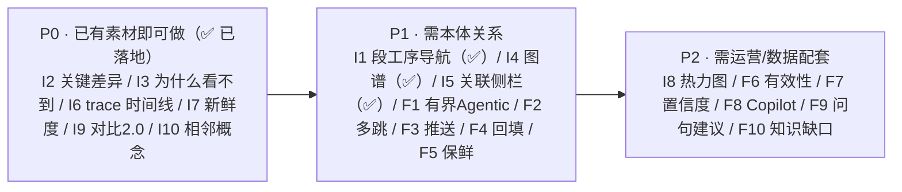

# 案例检索 · 界面与功能创新方案

| 项 | 内容 |
|---|---|
| 文档版本 | V1.0（界面/交互/功能创新探索） |
| 前置文档 | `docs/case-assistant-ontology-agentic-rag-upgrade.md`（本体增强 Agentic RAG）、`docs/platform-multi-module-agentic-rag-upgrade.md`（多模块总纲）、`docs/case-assistant-demo-readme.md` §8（现界面基线） |
| 作者 | 许清楚（产品经理） |
| 日期 | 2026-10-19 |
| 范围 | **案例检索这一屏的界面与功能创新**；三条红线（权限前置 BR-01 / filter 不由 LLM 生成 A10 / 无引用不输出 BR-05 / 知识层证据层分离 BR-08）**不被破坏** |
| 现状基线 | 身份条 → 检索区 → 结果区（按案例折叠）→ 问答 / 岗位对比 / 审计 三页签；五条展示纪律（无自定义 filter、有但看不到要说明、候选不足如实、拒答照抄后端、离线不编数据） |
| 实施状态 | **P0 六项已落地**：I2／I3／I6／I7／I9／I10 → `demo/ui/case-screen.js` + `app.css`（Playwright 自证：I2 关键差异表/高亮、I7 验证·热度·新鲜度、"加入对比"）。**P1 三项已落地**：I1 段/工序导航、I4 关系视图（SVG）、I5 跨段关联（Playwright 自证：分面「全部 20 / SMT 段 16 / 整机组装段 2 / 注塑段 2」、点分面 10→8 过滤、关系视图 SVG 圆心+1 节点+1 边、卡片"相关案例"）。**I10 触发条件已扩展**（demo 后端任何输入都返回 k 条，"0 命中"不可达 → 改为"未命中受控词条"也引导）。其余 I8 与 F 系列仍为方案 |

> **一句话**：现有界面**安全能力满格、可感知能力偏弱**——用户看不出"系统懂制造术语""为什么看不到某条""两条相似案例差在哪"。本方案给出一批**可落地、可验证**的界面与功能创新，把"本体增强 Agentic RAG"从**后端能力**变成**看得见的体验**。

---

## 1. 三条设计原则

| # | 原则 | 说明 |
|---|---|---|
| **D1** | **把"为什么"显性化** | 检索的每个决策（归一→同义扩展→本体链路→权限过滤→引用校验）都应有可见呈现；解释由**后端产出**，前端只渲染（沿用"轨迹不在前端编"的纪律） |
| **D2** | **把"差异"当主角** | 用户最需要的不是更多条结果，而是"这两条差在哪、我该信哪条"。相似度不如差异重要 |
| **D3** | **创新不越红线** | 任何新交互都不得绕过权限前置与二次授权；LLM 只允许改写 `query_text`、生成处置建议（propose），**永不允许生成 filter** |

---

## 2. 界面创新（10 项）

### 2.1 信息架构层

| # | 创新 | 做法 | 价值 | 依赖 |
|---|---|---|---|---|
| **I1** | **本体驱动的「段—工序」导航条** | 结果区顶部加一排 facet：`段`（SMT/插件/电芯组包/老化/整机/包装…）→ 工序 → 缺陷模式；点击即按本体维度收敛。facet 值来自受控词表（`/cases/meta` 已有词表投影） | 现场按"我这条线/这段"找案例，不用先搜再肉眼过滤 | 本体 `carrier` 词表（待建） |
| **I2** | **命中卡「关键差异对比」视图** | 选中 2–3 条 → 并排表：`缺陷模式 × 根因 × 对策 × 载体(段/线/物料)` 逐维度比对，**标出差异格** | 解决"两条都像，不知道信哪条"（PRD §9 要求但今日未落地） | 结构化字段（已有 `defect_mode_code/root_cause_code`） |
| **I3** | **「为什么看到 / 为什么看不到」可视化** | 把后端 `filter_explain`（已存在）渲染为**可展开的判定链**：`status ∈ … ∧ cls_rank ≤ … ∧ (visibility_class=0 ∨ 令牌命中…)`；受限清单旁挂"申请访问" | 把"黑盒过滤"变"可解释合规"；同时是合规审计的现场证据 | `filter_explain`（已存在） |
| **I4** | **本体关系图谱视图** | 结果区可切"图谱"视图：中心=当前案例/问句，辐射 `缺陷模式→根因→对策`、`同类缺陷的其他段`、`同根因的其他案例`、`supersedes` 链 | 把"多跳"从后端能力变成**看得见的一跳一跳** | 关系表（待建，见前文 §5.2） |

### 2.2 卡片与结果层

| # | 创新 | 做法 | 价值 |
|---|---|---|---|
| **I5** | **跨段 / 跨域关联侧栏** | 每张命中卡右滑出"关联"：同根因的其他段案例、同缺陷模式的其他产线、跨部门联动案例 | 直接回答"这个不良别的地方也出过吗" |
| **I6** | **决策 trace 时间线** | 把后端的本体增强轨迹（已有 5 步）升级为**可展开时间线**：术语归一命中了哪些受控码 → 是否触发再检索（因为什么）→ 本体跳了几跳 → 引用三元组 | "Agentic 到底做了什么"可被看见、可被验证 |
| **I7** | **生命周期与新鲜度可视化** | 卡片角标除了 `status` 徽标，加"新鲜度条"（距 `last_verified_at` 时长）+ "引用热度"（`citation_count`）+ "已验证/未验证" | 解决"三年前的经验还在首位"的信任问题 |
| **I8** | **命中分布热力图** | 结果区顶部一张"段 × 缺陷模式"分布图（来自 `category_dist` 类统计），并标出**你的可见范围内**的空白格 | 一眼看出"我们这段这类问题高发" |

### 2.3 交互层

| # | 创新 | 做法 | 价值 |
|---|---|---|---|
| **I9** | **岗位对比 2.0** | 现有"岗位对比"增强为**差集高亮 + 一句话归因**："设备岗看不到这 3 条，因为它们限 `dept:quality`" | 演示差异化时，观众不用问"为什么" |
| **I10** | **空结果「相邻概念」引导** | 无命中时，除现有 `notice`，追加"你可能想搜的相邻概念"（来自本体同义/父级/兄弟节点），点击即替换查询 | 把"搜不到"从死路变成下一步 |

---

## 3. 功能创新（10 项）

| # | 功能 | 说明 | 优先级 | 依赖/风险 |
|---|---|---|---|---|
| **F1** | **有界 Agentic 检索** | 查询分解 → 检索计划 → 充分性评估 → 本体邻接再检索；**终止条件**：跳数 ≤3 + 收益阈值 + 预算；超限如实返回 | P1 | 成本可控；**不生成 filter**（A10） |
| **F2** | **多跳关系推理** | "同根因在别的段/线出现过吗""这供应商的料还引发过什么"——沿关系表遍历 | P1 | 需 M-ONTO-3/4 关系回填 |
| **F3** | **异常处理中主动推送** | 事件驱动（MES/SPC/预警）→ 按**接收人权限**过滤 → 推 Top3 + 一键引用 | P1 | 精确推送 + 限频（防骚扰，PRD R8） |
| **F4** | **引用回填工单/8D** | `cite` 动词落地：把脱敏知识层片段回填到当前工单，带引用三元组 | P1 | 只回填知识层（BR-05/BR-08） |
| **F5** | **案例保鲜与复核待办** | 超 24 个月未验证自动降权 + 生成复核待办（推 owner 部门） | P1 | 沿用状态机 |
| **F6** | **案例「有效性验证」** | `Verification` 实体：对策到底管不管用；未验证案例降权 + UI 标注 | P2 | 需运营配合录入 |
| **F7** | **检索结果置信度评分** | 综合相似度 × 状态权重 × 新鲜度 × 验证状态 × **证据链强度**，给"高/中/低置信"标注 | P2 | 分数口径需 POC 校准 |
| **F8** | **Copilot 式处置建议（propose-only）** | 基于命中案例生成"建议处置动作 + 引用"，**只 propose 不 approve** | P2 | 沿用 BR-07 三重防线 |
| **F9** | **口语化问句建议** | 输入时提示本体同义词（"你说的'雪花'是不是'锡珠'？"），一键用规范术语重搜 | P2 | 只影响 query_text |
| **F10** | **本体「知识缺口」提示** | 当问题命中不到受控码时，提示"该现象尚未登记本体词条"，并给出**登记入口**（走审批） | P2 | 治"同义爆炸"的正向手段 |

---

## 4. 优先级与验收

| 判据 | 标准 |
|---|---|
| **可感知** | P0 项上线后，用户能亲眼看到"术语被归一了""为什么这条看不到""两条差在哪" |
| **不越权** | 新增交互全部经 `AclCompiler/AclEvaluator`；红队用例仍 0 漏放 |
| **不编造** | trace/解释/建议全部由后端产出；前端不编（沿用展示纪律） |
| **效果可测** | 采用前文 §6 的三方对照（无本体 / 单跳 / 本体增强 Agentic）+ 人工相关集 |

---

## 5. 与既有红线的兼容性自检

| 红线 | 本方案是否触碰 | 说明 |
|---|---|---|
| **BR-01 权限前置 + 二次校验** | ❌ 不触碰 | I3/I9 只是把已有 `filter_explain` 与判定链**可视化**，不产生新过滤 |
| **A10 filter 不由 LLM 生成** | ❌ 不触碰 | F1 的计划层**没有** filter 字段；F8/F9 只允许改 `query_text` / 出建议 |
| **BR-05 无引用不输出** | ❌ 不触碰 | I6 trace 与 F8 建议都必须携带 `(case_id, chunk_id, content_version)` |
| **BR-08 知识层/证据层分离** | ❌ 不触碰 | 所有新视图只渲染知识层字段；证据层仍不出检索侧 |
| **展示纪律（前端不编数据）** | ❌ 不触碰 | 所有解释性内容由后端组装，前端只渲染 |

---

## 6. 与本次案例扩充的衔接

本次已把案例扩到 **180 例**，段覆盖补上 **电芯组包（6）/ 测试（6）/ 老化（6）/ 整机组装（6）/ 包装（6）** 五段，使 I1（段导航）、I5（跨段关联）、I4（图谱跨段）**首次有真实数据可演示**。

| 段 | 新增案例 | 本体 |
|---|---|---|
| 电芯组包 | 6（CELL-1/2） | 新增 `DM-CELL-70x / RC-CELL-00x / CM-CELL-70x` |
| 测试 | 6（TEST-3） | 补注册 `DM-TST-07x / RC-TST-00x / CM-TST-07x` |
| 老化 | 6（AGING-1/2） | 新增 `DM-AGING-80x / RC-AGING-00x / CM-AGING-80x` |
| 整机组装 | 6（ASSY-3） | 复用 + 新增 `DM-ASSY-307/308` |
| 包装 | 6（PKG-2） | 复用 + 新增 `DM-PACK-207/208` |

---

## 8. 演示模式：检索全可见 + 查看需申请（2026-10-19 增补）

| 项 | 结论 |
|---|---|
| **为什么做** | 演示时希望"能看到全部案例"，但**读全文仍走审批**——既不丢"权限治理"的卖点，又能展示"搜得到、看要申请"。 |
| **开关** | `CASE_DEMO_OPEN_QUERY`（默认 **false**；仅演示环境置 true）。开启后 `query`/`preview` 的业务维（部门/工厂/产线/客户/供应商/项目）对**正式员工**放行；**硬维度**（租户/密级/状态/知识层）与**显式拒绝**照常独立否决。 |
| **实现** | 编译器 `acl_compiler` 阶段 4 与评估器 `acl_evaluator` 步骤 9.5 **两套实现同步改**（只改一处会导致"召回放行、二次授权整批丢弃"）。 |
| **查看需申请** | `read`/`cite` 仍按 ACL 判定 → 命中卡片可正常检索，点"看全文"返回 **404**，前端弹层给出**「发起访问申请」**入口（复用既有申请/审批链路）。 |
| **测试口径** | 测试环境 **显式关闭**（`conftest` 置 false），跨部门/跨工厂越权守护用例不受影响；全仓 1199 passed。 |
| **同时修复的 Bug** | `case_runtime.ensure_seeded` 原先只在**空库**时播种 → 持久化 `data/case.db` 是旧 15 例时，**新增案例永远进不了索引**（前端因此"看不到对应领域"）。已改为**按 case_id 幂等重导**（`seed_from_json` 本就是覆盖写）。修后 `visible_total` 10 → **173**，命中出现 **电芯组包/老化/整机/包装** 等新段。 |

---

## 9. 信息来源

| 类别 | 来源 | 置信度 |
|---|---|---|
| 现界面与展示纪律 | **代码/文档实证**（`demo/ui/case-screen.js`、`docs/case-assistant-demo-readme.md` §8） | **高** |
| 后端已有能力（`filter_explain`/`trace`/`ontology_gain`） | **代码实证**（`services/case_search.py`、`services/case_qa.py`） | **高** |
| 竞品/SOTA 参考（图谱视图、可解释检索、Copilot propose-only） | 见 `case-assistant-ontology-agentic-rag-upgrade.md` §4 | 中 |

> **文档结束**。本文只做界面与功能的设计探索，未改前端代码；三条红线保持不变。
