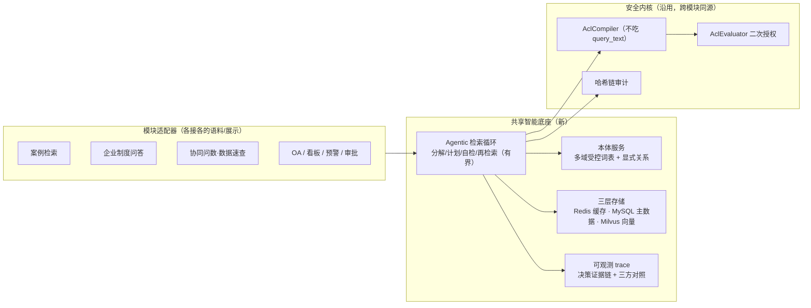

# 制造智能体平台 · 多模块优化改造方案

| 项 | 内容 |
|---|---|
| 文档版本 | V1.0（多模块改造总纲 + 内容/案例扩充矩阵） |
| 前置文档 | `docs/case-assistant-ontology-agentic-rag-upgrade.md`（本体增强 Agentic RAG 升级方案）、`docs/case-assistant-ontology-vector-auth-architecture.md`、`docs/ARCHITECTURE-V2.md` |
| 作者 | 许清楚（产品经理） |
| 日期 | 2026-10-19 |
| 范围 | **从"单模块（制造案例检索）改造"上升到"多模块统一智能底座"**；权限/脱敏/审计三地基沿用既有裁定 |
| 实施状态 | **"案例检索"模块的段/跨域案例扩充已随文落地**（`data/case_seed.json` 99→**180** 例：含插件/pack/整机、多职能域、电芯组包/测试/老化/整机组装/包装；本体 53→**226** 条）；其余模块改造为方案。界面/功能创新另见 `docs/case-retrieval-ux-innovation.md` |

> **一句话**：把上一版只在"制造案例检索"验证过的 **本体增强 Agentic RAG**，抽成**平台级共享底座**，横向接到 6 类内容型模块；同时按"模块 × 职能域"把案例/内容补厚，避免"改造了引擎、库里却没东西可搜"。

---

## 1. 一页式结论

### 1.1 结论：**底座下沉、模块复用、内容补厚**

| # | 判断 | 说明 |
|---|---|---|
| **P1** | **不要每模块各造一套 RAG** | 平台已有统一入口与治理（HTTP/MCP/A2A 同源、权限目录、HITL、审计）。改造应把"本体增强 + Agentic 检索循环 + 三层存储"做成**共享服务**，各模块只接"语料适配器 + 展示" |
| **P2** | **改造顺序按"内容价值 × 现有缺口"排** | 案例检索（已有本体骨架）→ 企业制度问答（语料最全、缺关系）→ 协同问数/数据速查（缺语义层）→ OA/看板/审批（缺知识沉淀） |
| **P3** | **"多模块更新更多案例"要先解决"案例只长在一个模块里"** | 现状 150 例案例全部挂在"制造案例检索"；采购/供应链、客服/售后、生产、管理、跨部门等**职能域案例几乎空白** |
| **P4** | **共享底座的三条红线跨模块不变** | 权限前置（BR-01）、filter 不由 LLM 生成（A10）、知识层/证据层分离（BR-08） |
| **P5** | **内容扩充必须与本体注册同步** | 否则重演"语料涨了、本体没涨"（见前文 §2.2：82% 缺陷码未注册） |

### 1.2 明确不做

| # | 不做 | 为什么 |
|---|---|---|
| N-1 | 不做跨模块的"大统一知识图谱" | 各模块本体**先各自闭环**，跨模块只做**受控对齐**（同一实体共用 code），不做自动融合 |
| N-2 | 不做"用一个 Agent 管所有模块" | 按模块域隔离 Agent 职责与权限；共享的是**底座能力**，不是**单一 Agent** |
| N-3 | 不为凑数灌内容 | 每条案例/知识必须有来源单据或明确出处，无来源不进共享池（沿用 BR-11） |

---

## 2. 模块地图（现状）

| 分组 | 模块 | 知识/数据源 | 现状成熟度 | 改造优先级 |
|---|---|---|---|---|
| **运营视图** | 工作台 · 订单履约看板 · 制造综合看板 · SPC 看板 · 预警中心 | MySQL/SQLite 指标表、SPC 内核 | 看板聚合强、**语义层缺** | P2 |
| **智能协同** | **制造案例检索** | 案例库（129→150 例）+ 本体 125 条 | 权限/脱敏/审计强，本体覆盖弱 | **P0** |
| | **企业制度问答** | `data/kbqa_corpus/<类别>/*.md` 16 类 | 语料最全、缓存/限流就绪，**无关系与多跳** | **P1** |
| | 协同问数 / 数据速查 | SQL 数据源 + 意图路由 | 路由可用、**缺制造语义层** | P1 |
| | OA 协同 | 会议室/餐厅/预订/申请 | 功能齐全、**无经验沉淀** | P3 |
| **流程治理** | 审批确认中心 | 工单 + HITL 会签 | 后置审批治理强、**前置知识推荐弱** | P2 |
| **复盘沉淀** | 报告中心 · 帮助中心 | 模板 + 静态说明 | 静态为主 | P3 |

---

## 3. 六类模块改造点

### 3.1 制造案例检索（P0，本体骨架已建）

| 项 | 现状 | 改造点 |
|---|---|---|
| 本体 | 125 条，只覆盖 SMT/插件/pack/整机四段 | **补齐采购供应链/客服售后/设计/跨部门**四域词表（见 §5） |
| 案例域 | 全员开放质量案例 + 少量岗位经验 | **补厚 5 个职能域 + 跨部门案例** |
| 检索 | 单跳 | 多跳（≤3）+ 有界 Agentic（承接前文 §5） |
| 展示 | 卡片列表 | 增"跨域/跨段关联视图" |

### 3.2 企业制度问答（P1，语料最全）

| 项 | 现状 | 改造点 |
|---|---|---|
| 语料 | 16 类别（生产/服务/仓储/NPI/销售/EHS/法务/工程/EAM/行政/供应链/HR/财务/IT/质量/政策） | 保持；**补"制度之间的引用关系"**（如《管理办法》↔《操作细则》同主题） |
| 检索 | 向量 + 关键词 + L1 匹配 | 加**本体层**：制度概念（流程/角色/时限/单据）受控词表，实现"问流程名→命中全链路条款" |
| 权限 | 已有缓存 + 限流 | 与案例域**共用权限前置**能力 |
| 案例化 | 纯问答 | 增"制度执行异常案例"（违规/退回）回流到案例域 |

### 3.3 协同问数 / 数据速查（P1，缺语义层）

| 项 | 现状 | 改造点 |
|---|---|---|
| 查询 | 意图路由 + Text2SQL | 加**业务本体**：物料/批次/库位/工单/订单的实体与关系，把自然语言稳定映射到"哪个实体" |
| 速查 | 关键词命中 | 命中后**联动案例**："这个物料以前出过什么问题" |
| 权限 | 岗位约束 | 与案例域共用 `AclCompiler`（同一套 default-deny） |

### 3.4 OA 协同（P3）

| 项 | 现状 | 改造点 |
|---|---|---|
| 交互 | 弹窗式确认（报销/补考勤/请假/会议室/订餐） | 保持"高影响先确认" |
| 沉淀 | 无 | 把"高频驳回/异常流程"沉淀为**流程经验案例**回流案例域 |

### 3.5 运营看板 / SPC / 预警中心（P2）

| 项 | 现状 | 改造点 |
|---|---|---|
| 指标 | 看板聚合完整 | 每个 KPI 卡**挂"关联案例"入口**（前文看板规范已要求"所有 KPI 集成协同问数"） |
| SPC | 双西格玛内核 | 越限时**主动推送相似案例**（承接案例域旅程 2） |
| 预警 | 多域预警 | 预警处置**带相似案例**，形成"预警→案例→工单"闭环 |

### 3.6 审批确认中心 / 报告中心（P2/P3）

| 项 | 现状 | 改造点 |
|---|---|---|
| 审批 | 三重门控校验、驳回强制理由 | 审批卡**内联相似历史案例**（"上次同类特采怎么判的"） |
| 报告 | 模板生成 | 报告引用**可溯源案例**（无引用不输出） |

---

## 4. 共享改造底座（一次性建、多模块复用）

| 底座能力 | 复用方式 | 跨模块对齐要求 |
|---|---|---|
| 本体服务 | 每模块一套受控词表，**同一实体共用 code** | 物料/供应商/客户/产线/段 跨模块统一编码 |
| Agentic 检索循环 | 同一实现，注入不同语料适配器 | 终止条件（跳数 ≤3 + 预算 + 收益阈值）统一 |
| 三层存储 | Redis 缓存 / MySQL 主数据 / Milvus 向量 | 缓存**不存正文**、不缓存结果集（防撤权延迟） |
| 可观测 trace | 统一结构，各模块渲染 | 必须含"引用三元组"，无引用不输出 |
| 权限 | 共用 `AclCompiler/AclEvaluator` | default-deny + 多维 AND，跨模块一致 |

---

## 5. 内容 / 案例扩充矩阵

> **本次已落地**：案例检索模块的跨域案例（见下"已落地"行）。其余为方案待办。

| 模块 | 扩充对象 | 扩充内容 | 状态 |
|---|---|---|---|
| **案例检索** | 质量案例 | 采购/供应链质量、设计缺陷（DFM/降额）案例 | ✅ 已落地 |
| **案例检索** | 岗位经验案例 | 采购供应链 / 客服售后 / 生产 / 管理 四职能域 | ✅ 已落地 |
| **案例检索** | 跨部门案例 | 停线应急 / 缺料联动 / 客诉+供应联动 | ✅ 已落地 |
| **案例检索** | 本体词表 | 新增 采购供应链 / 客服售后 / 设计 / 跨部门 四域缺陷·根因·对策 | ✅ 已落地 |
| **企业制度问答** | FAQ + 条款 | 每类别补 N 条高频问答 + 制度引用关系 | ⏳ 方案 |
| **数据速查** | 业务本体 | 物料/批次/库位/工单实体与关系 | ⏳ 方案 |
| **OA 协同** | 流程经验 | 高频驳回流程 → 经验案例 | ⏳ 方案 |
| **看板/SPC/预警** | KPI ↔ 案例关联 | 每 KPI 挂关联案例 | ⏳ 方案 |
| **审批/报告** | 案例引用 | 审批卡内联历史案例、报告引用溯源 | ⏳ 方案 |

### 5.1 本次落地的案例扩充明细（21 条）

| 域 | 案例（示例） | 类别 | 服务单据 |
|---|---|---|---|
| 采购/供应链 | 安全库存失守致缺料停线；供应商交期延迟；特采让步接收风险 | 岗位经验/质量 | MRP/采购单 |
| 客服/售后 | 客诉升级口径不一致；售后返修率偏高；备件供应不足 | 岗位经验/质量 | 客诉单/返修单 |
| 生产 | 换型爬坡超时；人为失误致批量返工；工位节拍瓶颈 | 岗位经验 | 生产工单 |
| 管理/项目 | 项目节点延期复盘；跨部门资源冲突 | 岗位经验 | 项目计划 |
| 跨部门 | 停线应急协同不足；缺料联动不及时；客诉与供应联动断点 | 跨部门案例 | 跨部门工单 |
| 设计缺陷 | 设计余量不足；器件降额不足；DFM 评审缺失 | 质量案例 | 设计评审/ECN |

---

## 6. 路线与验收

| 阶段 | 目标 | 交付 | 出口条件 |
|---|---|---|---|
| **S1 底座** | 把本体增强 Agentic RAG 抽成共享服务 | 本体服务 / 检索循环 / 三层存储 / trace | 案例模块先接入，回归不变 |
| **S2 案例补厚** | 案例覆盖 6 职能域 + 跨部门 | 本体 4 域 + 21 案例（**已落地**） | 新案例本体码 100% 注册 |
| **S3 制度问答** | 接底座 + 关系 | 制度本体 + 引用关系 + FAQ 补厚 | 制度问句多跳命中率达标 |
| **S4 数据速查** | 业务本体 + 联动案例 | 实体关系 + 速查联动 | 自然语言映射稳定 |
| **S5 运营/治理** | KPI/预警/审批挂案例 | 关联入口 + 推送 | 闭环可演示 |

**验收判据**

| 判据 | 标准 |
|---|---|
| 本体覆盖 | 各模块语料码注册率 **≥95%** |
| 案例覆盖 | 案例检索覆盖 **≥6 职能域 + 跨部门** |
| 多跳命中 | ≥0.80（配人工相关集） |
| 引用溯源 | 100%（硬性） |
| 越权漏放 | 0（沿用 K5） |
| 既有回归 | 不回归（案例域 + 平台域） |

---

## 7. 风险

| # | 风险 | 等级 | 应对 |
|---|---|---|---|
| R1 | 跨模块共用权限而权限语义不一致 → 越权 | 🔴 高 | 统一走 `AclCompiler`；每模块补红队用例 |
| R2 | 本体跨模块对齐成本高 → 半途而废 | 🟠 中 | 只对"共用实体"统一 code，其余各域自治 |
| R3 | 内容灌水（无来源案例） | 🟠 中 | BR-11 强制来源单据；抽样复核 |
| R4 | 各模块改造节奏不一 → 底座空转 | 🟠 中 | 先 S1+S2 打通（案例域验证），再横向复制 |
| R5 | 新增内容冲击既有阈值/测试 | 🟠 中 | 每次扩充后重跑标定与回归（前文 §6 有既定流程） |

---

## 8. 附：信息来源

| 类别 | 来源 | 置信度 |
|---|---|---|
| 模块清单与知识源 | **代码实证**（`demo/ui/app.js` NAV_ITEMS、`demo/api.py` 路由、`data/kbqa_corpus`、`data/case_seed.json`） | **高** |
| 案例/本体现状 | **实机实测**（129 例 → 150 例；词表 125 条） | **高** |
| 竞品与 SOTA | 见 `case-assistant-ontology-agentic-rag-upgrade.md` §4 | 中 |

> **文档结束**。本文给出多模块改造总纲；案例/本体扩充已落地，其余模块改造待排期。
