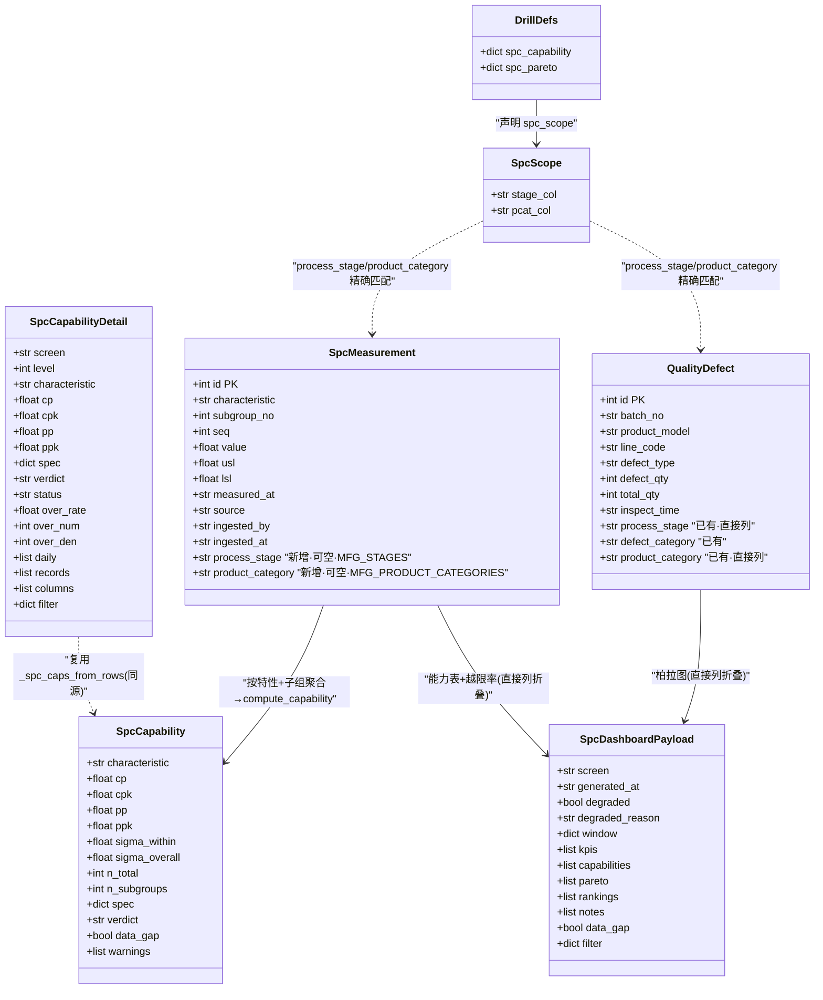
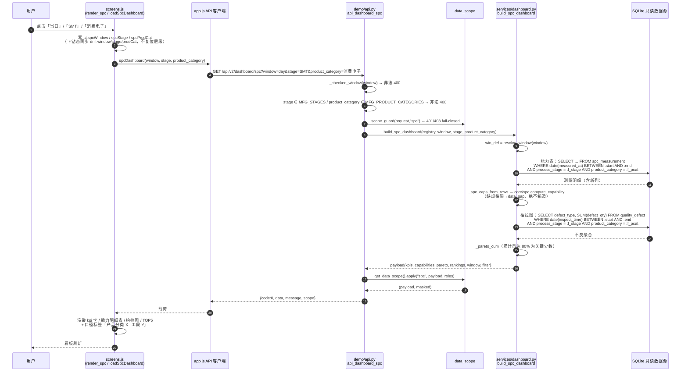
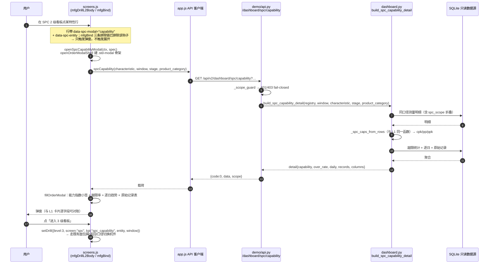
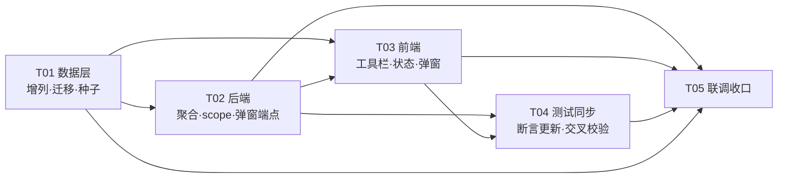

# SPC 过程能力看板增量增强 · 增量系统设计

> 状态：设计定稿（待实现） · 作者：架构师（高见远） · 事实基线：`docs/spc-dashboard-upgrade-facts.md`
> 需求来源：用户需求「SPC过程能力看板参考订单履约看板和制造看板，增加图1几个分类，补充数据，2级看板单击弹窗」
> 定位锚点纪律：全文引用代码一律用「函数名 + 锚点」，不依赖行号（`screens.js` / `app.css` 处于并发编辑窗口）。

---

## 0. 四个必须先定的裁决（速览）

| # | 裁决 | 结论 | 一句话理由 |
|---|------|------|-----------|
| ① | `spc_measurement` 增列清单 | **只增 2 列**：`process_stage`（工段）+ `product_category`（产品分类）；**不增 `product_model`** | 需求只要「工段/产品分类」两级；型号在两表词表完全不同（`A型号…` vs `CE-18650…`），加型号必打架且引入「同特性跨型号」的子组污染 |
| ② | 两表维度枚举一致性 | 统一取后端常量 **`MFG_STAGES`**（SMT/PCM/PACK/整机）与 **`MFG_PRODUCT_CATEGORIES`**（消费电子/智能电源/储能电源/车载）；`quality_defect` 侧实测已 4×4 全覆盖，**零改动**；`spc_measurement` 新增行必须严格取同一集合 | 枚举唯一事实源在 `dashboard.py`，前端 `MFG_STAGE_CHIPS`/`MFG_PCAT_OPTIONS` 已声明同源 |
| ③ | scope 形态 | **统一为「列精确匹配」一种形态**（常量列名 + 命名绑定参数）。新增 `spc_scope` 声明键，与既有 `q_scope` **共用同一份实现**（泛化 `_quality_scope` 为列精确匹配内核），两者列名各自声明 | `_drill_scope`（产线前缀 LIKE + 型号集合 IN）语义完全不同且 `spc_measurement` 无 `line_code`/`product_model`；`q_scope` 虽同为列精确匹配但列语义是「工段+缺陷类别」，复用会把「产品分类」错位成「类别」 |
| ④ | `board_qa` 问数通道 | **跟随新口径**：`board_qa._build_screen` 的 spc 分支改为传 `window` + `stage` + `prod_cat` | 否则出现「看板显示 SMT 的数、问数却给全厂的数」＝口径不一致缺陷，与事实 ⑧ 同源纪律冲突 |

---

## 1. 功能契约表

### 1.1 三类筛选的完整契约

| 项 | 统计口径 | 产品分类 | 工段 |
|---|---|---|---|
| 前端 state 变量 | `ctx.state.screenState.spcWindow` | `…spcProdCat` | `…spcStage` |
| 变量取值 | `"window"`（最近7天）/ `"day"`（当日）/ `"month"`（当月） | `""`（全部）/ `消费电子`/`智能电源`/`储能电源`/`车载` | `""`（全部）/ `SMT`/`PCM`/`PACK`/`整机` |
| 缺省值 | `"window"`（对齐 `WINDOWS` 默认键） | `""` | `""` |
| 前端 data-* 钩子 | `data-window="day\|month\|window"` | `data-pcat`（`<select>`，值为分类名或 `""`） | `data-stage=""\|SMT\|PCM\|PACK\|整机`（胶囊） |
| 钩子所在容器 | `#spc-windows` | `#spc-windows` | `#spc-windows` |
| L1 请求参数名 | `window` | `product_category` | `stage` |
| 下钻请求参数名 | `window` | `prod_category`（既有 `dashboardDrill` 已用此名，**不改**） | `stage` |
| 弹窗请求参数名 | `window` | `product_category` | `stage` |
| 后端白名单 | `WINDOWS` 键集（`window`/`day`/`month`），非法 → 400 | `MFG_PRODUCT_CATEGORIES` | `MFG_STAGES` |
| 前端选项来源 | `WINDOW_KEYS`（`render_mfgboard` 内既有常量） | `MFG_PCAT_OPTIONS`（既有） | `MFG_STAGE_CHIPS`（既有） |
| 换档后是否复位下钻层级 | **不复位**（与订单/制造一致：只改 `drill.window`） | **不复位**（改 `drill.prodCat`） | **不复位**（改 `drill.stage`） |
| 切屏时是否复位 | 是（SPC 专属 state 独立，跨屏不复用；`boardDrill` 跨屏自动复位见 `render_spc`） | 同左 | 同左 |
| 筛选不适用时 | — | 全指标适用 | 全指标适用（`spc_measurement` 与 `quality_defect` 均有该列） |

> **口径标签**：能力表 / 柏拉图 / 弹窗三处回显统一用「产品分类 X · 工段 Y」（复用 `dashboard.py::_scope_cn` 的形状），前端复用 `mfgMfgScopeCn`（既有）拼装。

### 1.2 2 级看板单击弹窗（C 需求）契约

| 项 | 值 |
|---|---|
| 触发元素 | SPC 2 级看板（`mfgDrillL2Body` 渲染的 L2 行）中的每一行 |
| 新增 data-* 钩子 | `data-spc-modal="capability"`（行主体）+ `data-spc-entity="{JSON}"`（特性名实体） |
| 弹窗标题 | 「过程能力 · 特性明细」 |
| 弹窗数据源 | `GET /api/v2/dashboard/spc/capability?characteristic=&window=&stage=&product_category=` |
| 弹窗内容 | 能力指数（cp/cpk/pp/ppk/判定/规格限）+ 越限率（分子÷分母）+ 逐日趋势 + 关联原始记录（8 列 + 工段/产品分类 2 列） |
| 弹窗内二级入口 | 「进入 3 级看板」按钮 → 走既有 `setDrill`（面包屑/返回/口径切换全部复用） |
| 403 行为 | 如实显示「当前岗位无权查看该明细」，**不降级演示明细**（对齐 `openMfgDrillModal`） |
| 离线行为 | 降级为演示数据并显式标注「离线演示数据」；无数据时显示「该特性在当前口径下暂无明细」 |
| 与 L1 卡片对账 | 弹窗 cpk / 越限率 **必须逐字段等于** L1 该特性卡片的 cpk / over_rate（同源，见 §2.3） |

### 1.3 前后端常量白名单出处（唯一事实源）

| 常量 | 出处 | 前端镜像 |
|---|---|---|
| `WINDOWS`（window/day/month） | `dashboard.py` 顶部 | `render_mfgboard` 内 `WINDOW_KEYS` + `WINDOW_CN` |
| `MFG_STAGES` | `dashboard.py` | `MFG_STAGE_CHIPS`（`screens.js`，注释已写「与后端 MFG_STAGES 同源」） |
| `MFG_PRODUCT_CATEGORIES` | `dashboard.py` | `MFG_PCAT_OPTIONS` |
| `_WINDOW_KEYS` / `_checked_window` | `demo/api.py` | — |
| `DRILL_DEFS` | `dashboard.py` | `DRILL_FILTER_SCOPE`（`screens.js`，**需新增 spc 两条**，见 §2.4） |

---

## 2. 实现方案

### 2.0 需求三要素 → 方案映射

- **A 三类筛选** → §1.1 契约 + §2.2 后端 scope 折叠 + §2.3 前端工具栏。
- **B 补充数据** → §2.1 数据层（增列 + 幂等回填 + 新种子覆盖 10-01~10-15 与 4 工段 × 4 分类）。**这是 A 的刚性前提**：当前 `spc_measurement` 仅 75 行、只覆盖 10-13/10-14，「当日」（`DEMO_TODAY=2026-10-15`）口径必然为 0 行。
- **C 2 级看板单击弹窗** → §1.2 契约 + §2.2 新聚合函数 + §2.3 弹窗组件与绑定排除链。

### 2.1 数据层

#### 2.1.1 增列清单（裁决①）

```sql
-- spc_measurement 追加两列（可空，老行为 NULL）
process_stage     TEXT,     -- 工段：SMT / PCM / PACK / 整机   ← MFG_STAGES
product_category  TEXT      -- 产品分类：消费电子/智能电源/储能电源/车载 ← MFG_PRODUCT_CATEGORIES
```

**不增 `product_model`**（理由见 §0 ①）。`spc_measurement` 是「特性级」测量表（每特性 25 个值），加型号会让「同一特性在多型号下混在一个 subgroup_no 组内」→ 组内 σ 被跨型号差异污染 → Cpk 失真且不可对账。

#### 2.1.2 三处 DDL 同步（事实 ④ 的完整落点）

| # | 落点 | 文件 | 改法 |
|---|---|---|---|
| 1 | 新建库 DDL | `data/seed_v3.sql`（`spc_measurement` 建表段） | 建表语句加两列 |
| 2 | 镜像 DDL | `src/mfg_agents/v2/services/spc_store.py::_DDL` | 与 #1 逐字一致（现状即镜像，改一处必须同步另一处） |
| 3 | **老库迁移** | `src/mfg_agents/v2/core/orchestrator.py::_ensure_columns` | PRAGMA 守卫式 `ALTER TABLE spc_measurement ADD COLUMN …`（同 `quality_defect` 现有写法）。**事实基线只提了两处 DDL，此处是第三处**——`CREATE TABLE IF NOT EXISTS` 对老库不生效，不补这一处老库永远缺列 |

#### 2.1.3 受治理写入通道兼容（事实 ④ 的另一半）

| 面 | 决策 | 理由 |
|---|---|---|
| `_INSERT_SQL`（`spc_store.py`，现硬编码 10 列） | **扩到 12 列**，新列写 `process_stage` / `product_category` | 受治理写入必须能落维度，否则新建数据永远无维度、筛选永远筛不出 |
| 老调用方 | `append_measurements` 的行构造改为 `r.get("process_stage")` / `r.get("product_category")` → **缺键即 NULL** | 老调用（`spc.ingest` 未传维度）行为逐字段不变，只是多了两个 NULL 列 |
| `core/spc.py::normalize_measurements` | 增两个**可选**入参 `process_stage` / `product_category`，输出行带这两个键（缺省 None） | 纯函数、向后兼容；非法值仍进 `rejected`，绝不编造 |
| `spc.ingest` 工具 schema（`mcp_tools/tools.py`） | 增两个**可选**属性（不在 `required`） | 工具契约向后兼容；老 Agent 调用不变 |
| 老库写入（表已存在但缺新列） | `spc_store.ensure_measurements_table` 增 PRAGMA 守卫 ALTER（与 orchestrator 同法） | 受治理写入通道是「平台唯一 SPC 写入通道」，它自己必须能自愈老库，不能只依赖 orchestrator 启动时补列 |

**向后兼容总原则**：新参数一律可选、缺省 NULL；**老数据新列为 NULL 且不参与任何筛选的「等于」匹配**（筛选语义见 §2.2 ③）。

#### 2.1.4 种子数据策略（需求 B）

| 事实 | 处置 |
|---|---|
| 既有 75 行（id 1..75；焊点高度/锡膏厚度 10-13 SMT-1；回流焊峰值温度 10-14 DIP-1 含 2 条超差） | **行数与取值一字不改**；仅**追加两列维度值**（工段按种子注释的产线映射：SMT-1→SMT、DIP-1→PCM；产品分类按确定性映射，见下） |
| 老库已有这 75 行 | `UPDATE spc_measurement SET process_stage=…, product_category=… WHERE process_stage IS NULL` 幂等回填（先例：`data/seed_quality_pareto_pcat.sql:10` 同款写法） |
| 「当日」口径 0 行 | 新种子必须覆盖 **2026-10-15** |
| 「当月」口径仅 2 天 | 新种子必须覆盖 **10-01 ~ 10-15** |
| 四工段 × 四分类筛选 | 新种子必须让 **4 工段 × 4 产品分类** 每个组合在每个口径下都有行 |

**新特性集合**：`spc_measurement` 现有 3 个特性（焊点高度 / 锡膏厚度 / 回流焊峰值温度）**只覆盖 SMT 与 PCM 两个工段、两个产品分类** → PACK / 整机 / 储能电源 / 车载 在筛选下必然空。故新增 **4 个特性（每工段 1 个）**，特性名与既有 3 个不重名、语义按工段归属（如 SMT 段：元件贴装偏移量(μm)；PCM 段：…）。

**规模与落点**：新特性数据落在 **10-10 / 10-12 / 10-15** 三天；既有 3 特性在 **10-15** 补一天（10-15 落在默认窗口 10-08~10-14 **之外** → 不影响默认口径的既有断言）。
行数估算：4 新特性 × 4 分类 × 3 天 × 5 子组 × 5 值 = 1200 行 + 既有 3 特性 10-15 的 75 行 ≈ **1275 行**，id 段 `4001+`（与 `quality_defect` 的 4001 段同号段但不同表，无冲突）。

**幂等**：`INSERT OR IGNORE` + 显式 id（沿用 `seed_v3.sql` 既有写法），老库重放不重复。

**红线条**：`tests/v2/test_scenarios_v2.py` 的数据红线只守护 `material_batch` / `supply_batches` / `quality_defect(SMT-1+A型号=5)` / 缺陷类型 10 词表，**均不涉及 `spc_measurement`** → 新增 10-15 的 SPC 行不触红线；但**不得**引入新的 `quality_defect` 行（缺陷类型词表固定 10 条）。

> **A′ 裁决修订（2026-10-20，主理人拍板）—— 上面两行的「4 个特性 / 1275 行」已被取代。**
>
> - **新特性 4 个 → 12 个**（**每工段 3 个**：合格 / 偏低 / 不合格 各一）。原因：每工段只有
>   1 个新特性时，板级筛选命中任一工段后**只剩单一判定档位**（能力看板一筛就「塌」），
>   §10 A8「三档判定在筛选后仍各自可见」在种子分布上**不可能成立**；改为每工段 3 个后
>   A8 变成可执行断言（实测 48 组 = 4 工段 × 4 分类 × 3 口径 **全部三档齐备**）。
> - **规模 1275 行 → 3675 行**（既有 3 特性 10-15 补数 75 行 + 12 新特性 × 4 分类 × 3 天
>   × 5 子组 × 5 值 = 3600 行），id 段仍为 `4001+`。
> - **σ 标定粒度**：由「整个特性一个 σ」改为「**(天 × 产品分类) 批次**」。实测：前者
>   在「当日」口径下只剩 5 个子组（σ 相对标准误约 45%）→ Cpk 在 [0.60, 2.92] 漂移、
>   48 组里 14 组掉出档位，**调 TIER_CPK 无法救回**；逐批次反标定后 48 组全部稳定。
> - **交付纪律新增**：① 演示库必须能由「`data/seed_v3.sql` 的 75 行 + 交付种子」**干净
>   重建**（旧演示库残留 8 个「僵尸特性」，且与交付种子 id 段撞号 + `INSERT OR IGNORE`
>   → 重灌被静默跳过）；② 守护测试 `tests/v2/test_spc_seed_coverage.py` 把
>   「生成器 ↔ 交付种子字节级配套 / 48 组三档齐备 / 既有 3 特性规格限与 `seed_v3.sql`
>   严格一致 / **老库重放 → 干净重建**」四条纪律钉成可执行断言。
> - **交付纪律① 的实现手段**（2026-10-20 工程师补落，A′ 落地后发现原实现不满足该纪律）：
>   交付种子必须**先删本文件拥有的行、再整批重灌**，且整个过程**原子**。
>   - 缺 DELETE 守卫会怎样（实测复现）：`INSERT OR IGNORE` 只保证「同 id 不重复插入」，
>     **不保证「同 id 不残留旧值」** → 老库残留旧版种子（id 段 4001-5275）时，新种子的同 id 行
>     被**静默跳过** → 结果 = 旧版僵尸特性残留 + 新特性少行（实测「元件贴装偏移量(μm)」
>     只有 275/300 行）。
>   - 缺显式事务会怎样（实测复现）：`executescript` **逐语句隐式提交** → DELETE 早于
>     INSERT 提交 → 重灌中途失败会留下「已删未插」的**半拉子空表**（实测失败后表里只剩
>     id=1 的旧行，id=2001 行被清空）→ **静默数据丢失**，且 `_apply_seed` 吞异常不阻断启动。
>   - 因此交付种子采用：`BEGIN IMMEDIATE;` → `DELETE FROM spc_measurement WHERE id >= 4001
>     AND (id <= <本文件末 id> OR (source='demo-seed' AND ingested_by='demo'));` → 老行回填
>     UPDATE → 整批 `INSERT OR IGNORE` → `COMMIT;`。守卫边界**只覆盖本文件拥有的行**
>     （id 段 + 旧版种子残留）→ **运行时受治理写入的行**（`ingested_by` = 用户 id）不被误删。
>   - `BEGIN IMMEDIATE`（而非 `BEGIN`）：避免 SQLite 延迟事务的**锁升级死锁** —— 读者持共享锁时，
>     写者从 `BEGIN` 升级到写锁会直接 BUSY（不等 `busy_timeout`），`IMMEDIATE` 则先取写锁。
>   - 生成器 `_self_check_rebuild()` 在临时库造「老库」（僵尸行 + 运行时行）→ 重放 → 断言
>     「僵尸清除 + 运行时数据不伤 + 幂等」，生成即自曝；守护测试
>     `test_g4_delivered_seed_rebuilds_old_library_cleanly` 走同一验收路径。
> - 当前数字与实现的**唯一事实源**：`tools/gen_spc_dimensions_seed.py` 的模块 docstring
>   与 `data/seed_spc_dimensions.sql` 的文件头注释。

#### 2.1.5 对既有测试断言的影响（必须由工程师同步更新，列为任务）

新增特性/子组落在默认窗口 10-08~10-12 内 → 以下既有断言会变（`tests/v2/test_dashboard_drill.py`）：

| 断言 | 现状 | 处置 |
|---|---|---|
| `test_spc_dashboard_shape`：`len(d["kpis"]) == 3` / `len(d["capabilities"]) == 3` | 3 | 改为「既有 3 特性在列 + 新增特性齐备」 |
| 同上：`cpks == approx([0.615, 1.146, 1.461])` | 全量 sorted 比较 | 改为对**既有 3 特性**的 cpk 子集断言（既有特性行数不变 → 其 cpk 精确值不变） |
| 同上：`k["over_den"] == 25` | 每特性 25 | 既有特性仍 25；新特性按实际 |
| `test_spc_kpi_fields_self_consistent`：`n_total == 25 and n_subgroups == 5` | 全量遍历 | 限定「既有 3 特性」才断言 25/5 |
| `test_spc_capability_l2_decomposition`：`len(rows) == 3` / `denominator == 25` | — | 限定既有 3 特性行 |
| `test_spc_capability_l3_locks_characteristic`：`numerator == 2` / `denominator == 25` | 回流焊峰值温度 | 该特性行数不变 → **可保持不变** |
| `test_spc_pareto_l2_and_l3` | 依赖 `quality_defect` | **不变**（本次不改 `quality_defect` 种子） |

> 纪律：**既有 3 个特性的 75 行取值一字不改**（新增子组只属于新特性；既有特性仅在 10-15 补一天，且 10-15 不在默认窗口内）→ 既有特性在默认口径下的 cpk / 越限率精确可对账。

### 2.2 后端

#### 2.2.1 `build_spc_dashboard` 签名（最小变更）

```python
def build_spc_dashboard(registry, window: str = "window", *,
                        stage: Optional[str] = None,
                        product_category: Optional[str] = None) -> dict:
```

- **默认 `window="window"`**：解析结果 = 10-08~10-14，与原 `DEMO_WINDOW` 起止**完全一致** → 无参调用（`digest.py:128`、`board_qa.py:71`、既有测试）的**能力表取数逐字段不变**。
- **默认 `stage=None` / `product_category=None`**：不生成任何 WHERE 片段 → 与改动前 SQL 逐字一致。
- 窗口来源改为 `resolve_window(window)`（既有 `WINDOWS` 键），`DEMO_WINDOW` 保留不动（其它模块仍引用）。
- **唯一默认行为变化（诚实标注）**：柏拉图取数从「全量无 WHERE」改为「跟随 window」。原因是现状下柏拉图与能力表**不同口径**（能力表 10-08~10-14，柏拉图全库 4587 行），这正是需求 A 要修的口径不一致。实测三个口径下 `quality_defect` 均覆盖 10 个缺陷类型 → `len(d["pareto"]) == 10` 等既有断言仍成立。
- 载荷新增 `filter` 回显（`{"stage":…, "product_category":…}`）与 `window` 随口径变化（`_envelope("spc", state, win_def)`）。

#### 2.2.2 柏拉图侧筛选折叠

柏拉图走 `quality_defect`，该表**已有** `process_stage` / `product_category` / `defect_category` 三列 → 与能力表用**同一个 scope 声明形态**（`spc_scope`，列名相同）折叠：

```
AND process_stage = :f_stage            -- stage 非空时
AND product_category = :f_pcat          -- product_category 非空时
```

`quality_defect` 侧实测 4 工段 × 4 分类全有数据 → 选任一筛选组合都非空。

#### 2.2.3 scope 形态裁决（事实 ⑦ 的正面回答）

现状两形态：

| 形态 | 键 | 语义 | 落点 |
|---|---|---|---|
| 产线前缀/型号集合 | `scope` | 工段→`line_code LIKE 'SMT-%'`、分类→型号集合 `IN (…)` | `_drill_scope` → `_mfg_scope` |
| 列精确匹配 | `q_scope` | `process_stage = :f_stage`、`defect_category = :f_category` | `_quality_scope` |

**裁决：统一为「列精确匹配」一种形态**，落地方式：

1. 把 `_quality_scope` 的内核抽成通用函数 `_exact_col_filter(col: str, param: str, value: str) -> (frag, extra)`——**常量列名 + 命名绑定参数，用户字符串绝不进 SQL**（现状已如此，抽函数不改这一点）。
2. 既有 `q_scope` 声明**一字不改**、行为**逐字段不变**（`defect_rate` / `fpy` 两指标的 `filter_echo` 仍是 `{stage, category}`）。
3. 新增 **`spc_scope`** 声明键（第三个形态键，但语义＝列精确匹配，与 `q_scope` 共用同一实现内核）：

```python
"spc_capability": {
    …,
    "spc_scope": {"stage_col": "process_stage", "pcat_col": "product_category"},
},
"spc_pareto": {
    …,
    "spc_scope": {"stage_col": "process_stage", "pcat_col": "product_category"},
},
```

4. `build_drill` 的 scope 分派改为三路：`q_scope` → `spc_scope` → `scope`；`filter_echo` 三种形状各自保持。
5. `_l2_detail` 的启用条件由 `bool(defn.get("scope"))` 扩为 `bool(defn.get("scope") or defn.get("spc_scope"))` → SPC 的 2 级看板也下发「整体汇总 / 整体逐日 / 原始记录」。
6. **为什么不用 `_drill_scope`**：`spc_measurement` 无 `line_code` / `product_model`（事实 ①），产线前缀与型号集合无从折出。
7. **为什么不能直接复用 `q_scope`**：`q_scope` 的第二列语义是「缺陷类别」`defect_category`，而 SPC 要的是「产品分类」`product_category`；复用会让下钻端点的 `category` 参数与 `prod_category` 参数语义混淆、`filter_echo` 形状不一致。**统一的是「列精确匹配」这一形态，不是「同一列」**。

#### 2.2.4 `DRILL_DEFS` 增补与前端登记（事实 ⑤ 的正面回答）

`DRILL_DEFS["spc_capability"]` / `["spc_pareto"]` 现状**无任何 scope 声明** → `drillFilterScope()` 对 spc 返回 `{}` → 下钻不吃板级筛选 → 会出现「卡片说 SMT、下钻却是全厂分解」。

**裁决**：
- 后端：两指标加 `spc_scope` 声明（§2.2.3）。
- 前端 `DRILL_FILTER_SCOPE` 增两条：

```js
"spc:spc_capability": { window: true, stage: true, product_category: true },
"spc:spc_pareto":     { window: true, stage: true, product_category: true },
```

- **必须同步** `tests/demo/test_pareto_dual_pane.py::test_drill_filter_scope_table_matches_backend_declarations`：该测试当前只比对 quality/manufacturing 两屏（断言 `{k:v for k,v in table.items() if v} == expected`）→ 登记 spc 条目而不扩测试范围，**测试必红**。改法：screen 集合扩为 `("quality","manufacturing","spc")`，`expected` 计算补 `spc_scope` 分支（`stage_col`→stage、`pcat_col`→product_category）。

#### 2.2.5 弹窗端点（事实 ⑧ 的正面回答）

**端点**：`GET /api/v2/dashboard/spc/capability`

| 参数 | 必填 | 取值 | 非法处理 |
|---|---|---|---|
| `characteristic` | 是 | 特性名 | 空 → 400「缺少特性 characteristic」 |
| `window` | 否（默认 `window`） | `window`/`day`/`month` | 非法 → 400（复用 `_checked_window`） |
| `stage` | 否 | `MFG_STAGES` | 非法 → 400 |
| `product_category` | 否 | `MFG_PRODUCT_CATEGORIES` | 非法 → 400 |

- 走既有 `_dashboard_payload(request, "spc", builder, …)` → **自动继承 `data_scope.yaml` 的 `spc:` 块**（9 角色 allow_roles）→ 403 fail-closed 天然成立，**无需**改 `data_scope.yaml`。
  （旁证：`tests/v2/test_数据范围.py::test_api_endpoints_are_all_declared` 的正则 `@app\.get\("/api/v2/dashboard/([a-z_]+)"\)` 不匹配含 `/` 的子路径 → `orders/group`、`quality/team` 等既有子路径端点同样不需登记。）
- **同源保证（事实 ⑧）**：新增 `build_spc_capability_detail(registry, window, characteristic, stage, product_category)`，内部**复用 `_spc_caps_from_rows` 与 `compute_capability`**（与 L1 同一函数、同一窗口、同一维度筛选）→ 弹窗 cpk / 越限率与 L1 卡片**逐字段一致、可对账**。绝不另写一套能力指数算法。

#### 2.2.6 问数通道跟随（裁决④）

`board_qa.py::_build_screen` 的 spc 分支：

```python
if screen == "spc":
    return dash.build_spc_dashboard(
        registry, window,
        stage=filters.get("stage") or None,
        product_category=filters.get("prod_cat") or None)
```

配套：前端 `mfgBind` 构造 `askCtx.filters` 时按屏分流 —— SPC 屏用 `spcStage` / `spcProdCat`（现有 `mfgBind` 里 filters 是固定的 `{stage: st.mfgStage||st.mfgMStage, category: st.mfgCat, prod_cat: st.mfgProdCat}`，不区分屏 → 制造/品质两个 Tab 靠 state 键区分，**SPC 必须新增分支**，否则问数拿不到 SPC 的筛选）。

### 2.3 前端

#### 2.3.1 工具栏（对齐图1 形态）

```html
<div class="chip-row mfg-windows" id="spc-windows" style="margin-bottom:14px">
  <span class="chip-row-label">统计口径</span>
  <button class="chip active" data-window="window">🕐最近7天</button>
  <button class="chip" data-window="day">🕐当日</button>
  <button class="chip" data-window="month">🕐当月</button>
  <span class="chip-row-note">· KPI / TOP5 均按所选口径</span>
  <span class="chip-row-label">产品分类</span>
  <select class="chip-select" data-pcat>
    <option value="">全部</option>
    <option value="消费电子">消费电子</option> …   <!-- MFG_PCAT_OPTIONS -->
  </select>
  <span class="chip-row-label">工段</span>
  <button class="chip active" data-stage="">全部</button>
  <button class="chip" data-stage="SMT">SMT</button> …  <!-- MFG_STAGE_CHIPS -->
</div>
```

- 复用既有 CSS：`.chip` / `.chip.active` / `.chip-row` / `.chip-row-label` / `.chip-row-note` / `.chip-select`（`app.css` 已定义，浅色主题合规）。
- 选择器全部限定在 `#spc-windows` 内（`#spc-windows [data-window]` / `[data-pcat]` / `[data-stage]`）→ **不与制造看板的 `#mfg-windows [data-pcat]` 冲突**（同名钩子、不同容器）。
- 事件绑定范式照抄 `render_mfgboard` 内的窗口/工段/分类三段：改 state → 若在下钻态则同步改 `drill.*` → `ctx.refreshScreen()`（**不复位下钻层级**）。

#### 2.3.2 SPC 专属 state

新增 `ctx.state.screenState.spcWindow` / `spcStage` / `spcProdCat`（**不复用** `mfgWindow`/`mfgMStage`/`mfgProdCat`/`mfgStage`/`mfgCat` —— 那是制造/品质两个 Tab 的，跨屏复用会让 SPC 的筛选被别的屏改掉）。

需在以下既有函数里按 `screen === "spc"` 分流取 state：

| 函数 | 现状 | 改法 |
|---|---|---|
| `mfgBind`（取 `win` 与 `askCtx.filters`） | `win = (payload.screen === "orders") ? st.ordersWindow : st.mfgWindow`；filters 固定三键 | 加 `(payload.screen === "spc") ? st.spcWindow : …`；filters 按屏取 `spcStage`/`spcProdCat` |
| `loadMfgDrill`（取 `fbWin` / `stage` / `prodCat`） | `fbWin = (drill.screen === "orders") ? ss.ordersWindow : ss.mfgWindow`；`stage` 三分支；`prodCat` 只认 manufacturing | 加 spc 分支：`fbWin`→`ss.spcWindow`；`stage`→`ss.spcStage`；`prodCat`→`ss.spcProdCat` |
| `render_spc` | 无工具栏 | 插入工具栏 + 事件绑定 + `loadSpcDashboard(ctx)` 传参 |

#### 2.3.3 2 级行 → 弹窗

- `mfgDrillL2Body`（现按 `d.screen` 分流 orders→`data-order-group`、manufacturing→`data-mfg-modal="3"`、其余→`data-drill-entity` 直下 L3）：**新增 spc 分支** → 行改为 `data-spc-modal="capability"` + `data-spc-entity="{JSON}"` + `data-kpi` / `data-screen`，**不再直下 L3**。
- 新增 `openSpcCapabilityModal(ctx, spec)`：复用 `openOrderModalShell`（`.std-modal` 骨架）+ `fillOrderModal`；正文渲染能力指数小签 + 越限率 + 逐日趋势 + 原始记录表；底部「进入 3 级看板」→ `setDrill`（level 3，entity=特性）。
- 离线降级：复用既有 `DEMO.SPC_DASHBOARD` 的对应特性切片；无数据 → 明示「暂无明细」；403 → 明示无权。

##### 2.3.3-b L1 侧 L2 入口元素定义（补 §2.3.3 · 2026-10-20 主理人裁决）

> **背景**：本节原只规定了「L2 行点开弹窗」的形态，**从未指定 SPC 的 L2 入口元素是什么**。实现方把 L2 行的钩子（`data-spc-modal="capability"`）、绑定排除链、弹窗组件、3 级看板入口**全都做对了**，却**无人提供 L2 入口** ⇒ 浏览器里 2 级看板永远进不去 ⇒ 需求 C 的弹窗在真实 UI 中点不出来，而单测全绿（现有守卫只查「代码块里有钩子」，查不出「进不去」）。本条为该盲区的兜底契约。

- **契约**：SPC 屏 L1 必须存在**恰好一个**承担「进入 2 级看板」职责的元素，它带 `data-kpi="spc_capability"` + `data-screen="spc"`，且**不得**带 `data-drill-entity`。
- **依据**：`mfgBind` 的 L2 绑定链选择器为
  `[data-kpi]:not([data-drill-entity]):not([data-drill-pareto]):not([data-order-group]):not([data-mfg-modal]):not([data-spc-modal])`
  —— **只有「带 `data-kpi` 且不带 `data-drill-entity`」的元素才会被 L2 链捕获**。
- **对照**：订单 / 制造 / 品质看板的 `mfgKpiCard(UI, k, screen)` **不传 ent** ⇒ 卡上无 `data-drill-entity` ⇒ L2 可达；SPC 因 KPI 卡传了 `k.entity`（逐特性卡）⇒ 若不另设入口，L2 永不可达。
- **落地约束（给实现方）**：
  1. 该入口元素**必须唯一**（多份入口会造成「点哪张卡都进 L2」的歧义，且与逐特性卡的 L3 语义冲突）。
  2. 该元素**不得**同时携带 `data-drill-entity` / `data-drill-pareto` / `data-order-group` / `data-mfg-modal` / `data-spc-modal`（任一存在都会被 L2 链的 `:not(...)` 排除掉 → 点了没反应）。
  3. 逐特性卡（`mfgKpiCard(UI, k, "spc", k.entity)`）与 `spcCapCard` 明细行**保持现状**（带 `data-drill-entity` → 点行直下 L3），本条不改变 L1 既有交互。
  4. 入口元素的**视觉形态由实现方决定**，本契约只约束「它是哪个元素 / 带哪些 `data-*` / 为何能被事件绑定捕获」；契约不要求它长得像卡片还是像链接。
- **设计铁律（新增，写入即生效）**：凡「点击 X → 触发 Y」的交互，契约必须同时写明「**X 是哪个元素 / X 带哪些 data-* 属性 / X 为何能被事件绑定捕获**」；只描述 Y 的渲染形态 = 会产出「Y 画得完美但进不去」的死功能。

#### 2.3.4 `mfgBind` 绑定排除链（事实 ⑥ 的正面回答）

现状三条排除选择器（都在 `mfgBind` 内，顺序即优先级）：

| 序 | 选择器 | 目标 |
|---|---|---|
| 1 | `[data-kpi]:not([data-drill-entity]):not([data-drill-pareto]):not([data-order-group]):not([data-mfg-modal])` | L2 |
| 2 | `[data-drill-step]:not([data-mfg-modal])` | L4 / L5 |
| 3 | `[data-drill-entity]:not([data-drill-step]):not([data-mfg-modal])` | L3 |

**改法**：三条**全部**追加 `:not([data-spc-modal])`，并**新增一条绑定分支**（`[data-spc-modal]` → `openSpcCapabilityModal`），且该分支**必须置于上述三条之前**（与 `[data-order-group]` / `[data-mfg-modal]` 的既有排布一致）。

> 为什么三条都要加：SPC 的 2 级行只带 `data-spc-modal`（不再带 `data-drill-entity`），但 L1 侧 `spcCapCard` 的行**仍带** `data-drill-entity`（点行直下 L3 保持不变，属 L1 行为非 2 级看板）→ 若新分支与既有分支的选择器有交集，一次点击会同时触发「展开 + 弹窗」。**排除链是防止双触发，不是可选优化**。

> 注意：事实基线写「两条排除链」，实测 `mfgBind` 内与本需求相关的排除选择器是**三条**（L2 / L4-L5 / L3）→ 本设计按**三条**全覆盖。

> **与 §2.3.3-b 的关系（2026-10-20 补）**：第 1 条（L2 链）现在**多了一个必须被它捕获的元素** —— §2.3.3-b 规定的 SPC L1 L2 入口（带 `data-kpi="spc_capability"` + `data-screen="spc"`、**不带** `data-drill-entity`）。该入口若缺失，L2 链虽然语法正确却**捕获不到任何元素** ⇒ 2 级看板进不去（死功能）。改这条排除链时，**必须同时确认 §2.3.3-b 的入口元素存在且唯一**（验收断言 B5）。

#### 2.3.5 离线演示数据（`demo-data.js`）

`SPC_DASHBOARD`（离线降级快照，窗口写死 10-08~10-14、`degraded:true`）**不重写数值**；只补一条降级说明：选中非默认口径或任一维度筛选时，参照 `loadMfgDashboard` 既有纪律，追加提示「离线演示数据不支持板级筛选」（不假装是筛选后的汇总）。

### 2.4 脱敏与数据范围（事实 ⑨ 的正面回答）

| 面 | 结论 |
|---|---|
| `data_scope.yaml` 的 `spc:` 块 | **不需改**：allow_roles 已含 9 角色（gm/manufacturing/quality_director/pqe/sqe/qa/product_engineering/test_engineer/ie_engineer），新端点走 `_dashboard_payload(request, "spc", …)` 自动继承 |
| 新增字段是否敏感 | `process_stage` / `product_category` 是组织维度标签，非个人/客户身份 → **不新增 mask 规则** |
| 403 fail-closed | 新端点与 L1 端点同一 `_scope_guard` 路径 → 匿名 401、无权 403、**绝不降级 200 空数据** |
| 守护测试 | `tests/v2/test_数据范围.py` 需确认：`test_api_endpoints_are_all_declared` 的正则不匹配子路径端点 → 无需登记；`test_dashboard_api_uses_scoped_getter` 参数化含 `spcDashboard` → 客户端方法**必须继续走 `_getScoped`**（新增参数后仍要保留补签重试） |

---

## 3. 文件清单

| # | 相对路径 | 动作 | 改什么 |
|---|---|---|---|
| 1 | `data/seed_v3.sql` | 改 | `spc_measurement` 建表加 `process_stage` / `product_category` 两列；既有 75 行 INSERT 补两列值 |
| 2 | `data/seed_spc_dimensions.sql` | **新增** | 新特性种子（4 工段 × 4 分类 × 10-10/10-12/10-15）+ 既有 3 特性 10-15 补数 + 幂等回填 UPDATE |
| 3 | `src/mfg_agents/v2/core/orchestrator.py` | 改 | `_ensure_columns` 增 `spc_measurement` 两列 PRAGMA 守卫 ALTER；`_SEED_SQLS` 追加新种子文件 |
| 4 | `src/mfg_agents/v2/services/spc_store.py` | 改 | `_DDL` 镜像加两列；`_INSERT_SQL` 扩到 12 列；`append_measurements` 行构造取 `.get()`；`ensure_measurements_table` 增 PRAGMA 守卫 ALTER |
| 5 | `src/mfg_agents/v2/core/spc.py` | 改 | `normalize_measurements` 增两个可选维度入参并在 accepted 行输出（缺省 None） |
| 6 | `src/mfg_agents/v2/mcp_tools/tools.py` | 改 | `spc.ingest` schema 增两个可选属性 + handler 透传 |
| 7 | `src/mfg_agents/v2/services/dashboard.py` | 改 | ① `build_spc_dashboard` 签名与口径/维度折叠；② `_exact_col_filter` 内核 + `_quality_scope` 泛化 + 新 `_spc_scope`；③ `build_drill` scope 三路分派 + `filter_echo` + `_l2_detail` 启用条件；④ `DRILL_DEFS` 两指标加 `spc_scope`；⑤ 新 `build_spc_capability_detail`（弹窗聚合）；⑥ `_COL_CN` 补两列中文表头 |
| 8 | `src/mfg_agents/v2/demo/api.py` | 改 | `api_dashboard_spc` 增 `window`/`stage`/`product_category`（非法 → 400）；新增 `/api/v2/dashboard/spc/capability` 端点；`_dashboard_payload` 文档串中「spc 不接口径参数」的表述更新 |
| 9 | `src/mfg_agents/v2/services/board_qa.py` | 改 | spc 分支传 window + stage + prod_cat |
| 10 | `src/mfg_agents/v2/demo/ui/app.js` | 改 | `spcDashboard(window, stage, productCategory)` 拼查询串（仍走 `_getScoped`）；新增 `spcCapability(characteristic, window, stage, productCategory)` |
| 11 | `src/mfg_agents/v2/demo/ui/screens.js` | 改 | ① `render_spc` 加工具栏 + 事件；② 新增 SPC 专属 state 读取；③ `mfgBind` 三条排除链加 `:not([data-spc-modal])` + 新增弹窗绑定分支 + askCtx 按屏分流；④ `loadMfgDrill` 的 win/stage/prodCat 加 spc 分支；⑤ `mfgDrillL2Body` 加 spc 分支（行改 `data-spc-modal`）；⑥ 新增 `openSpcCapabilityModal` + 正文渲染；⑦ `DRILL_FILTER_SCOPE` 登记 spc 两条 |
| 12 | `src/mfg_agents/v2/demo/ui/demo-data.js` | 改 | `SPC_DASHBOARD` 补「离线演示数据不支持板级筛选」说明（不改数值） |
| 13 | `src/mfg_agents/v2/data/queries.yaml` | 改（可选） | `spc_measurements_by_characteristic` 的 SELECT 补两列（`spc.capability` / `spc.report` 取数能带维度） |
| 14 | `tests/v2/test_dashboard_drill.py` | 改 | 既有 SPC 断言按 §2.1.5 更新；新增「筛选折叠」「口径切换」「弹窗同源」断言 |
| 15 | `tests/demo/test_pareto_dual_pane.py` | 改 | `test_drill_filter_scope_table_matches_backend_declarations` 比对范围扩到 spc 屏 + 认识 `spc_scope` |
| 16 | `tests/v2/test_数据范围.py` | 改（核查） | 确认新子路径端点无需登记；`spcDashboard` 仍走 `_getScoped`；新增「SPC 端点 401/403/200」断言 |
| 17 | `tests/v2/test_ask_ctx_board.py` | 改 | 新增「SPC 问数跟随新口径」断言（口径标签含工段/产品分类） |
| 18 | `src/mfg_agents/v2/data/data_scope.yaml` | **不改** | `spc:` 块已覆盖新端点（见 §2.4） |

---

## 4. 数据结构与接口

### 4.1 数据结构

> 提取件：`docs/spc-dashboard-class-diagram.mermaid`（**不写** `docs/class-diagram.mermaid` —— 该文件属并发编辑中的其他需求「生态链场景智能体化」，已被他人改动，覆盖会造成冲突）
> 时序图提取件：`docs/spc-dashboard-sequence-diagram.mermaid`（同上，避开 `docs/sequence-diagram.mermaid`）



### 4.2 后端函数签名

```python
# dashboard.py
def build_spc_dashboard(registry, window: str = "window", *,
                        stage: Optional[str] = None,
                        product_category: Optional[str] = None) -> dict: ...

def build_spc_capability_detail(registry, window: str = "window", *,
                                 characteristic: str,
                                 stage: Optional[str] = None,
                                 product_category: Optional[str] = None) -> dict: ...

def _exact_col_filter(col: str, param: str, value: str) -> tuple[str, dict]: ...
def _spc_scope(defn: dict, stage: Optional[str], product_category: Optional[str],
               params: dict) -> tuple[str, dict]: ...
```

### 4.3 端点请求参数表

| 端点 | 参数 | 类型 | 缺省 | 非法值处理 |
|---|---|---|---|---|
| `GET /api/v2/dashboard/spc` | `window` | str | `window` | 400「未知时间口径 window」 |
| | `stage` | str | `""` | 400「未知工段筛选 stage」 |
| | `product_category` | str | `""` | 400「未知产品分类筛选 product_category」 |
| `GET /api/v2/dashboard/spc/capability` | `characteristic` | str | —（必填） | 空 → 400「缺少特性 characteristic」 |
| | `window` | str | `window` | 400 |
| | `stage` | str | `""` | 400 |
| | `product_category` | str | `""` | 400 |
| `GET /api/v2/dashboard/drill`（既有，扩用） | `screen=spc` + `kpi=spc_capability\|spc_pareto` | | | 既有白名单 |
| | `stage` / `prod_category` / `window` | str | `""`/`""`/`window` | 既有 400 逻辑（新增：spc_scope 生效时按 `MFG_STAGES`/`MFG_PRODUCT_CATEGORIES` 校验） |

### 4.4 返回结构（JSON 片段）

```jsonc
// GET /api/v2/dashboard/spc?window=day&stage=SMT&product_category=消费电子
{
  "code": 0, "message": "ok",
  "data": {
    "screen": "spc",
    "window": { "key": "day", "start": "2026-10-15", "end": "2026-10-15", "label": "当日" },
    "filter": { "stage": "SMT", "product_category": "消费电子" },
    "kpis": [ {
      "key": "spc_capability", "characteristic": "焊点高度(mm)",
      "cp": 1.52, "cpk": 1.461, "pp": 1.421, "ppk": 1.396,
      "sigma_within": 0.033, "sigma_overall": 0.035,
      "n_total": 25, "n_subgroups": 5,
      "spec": { "usl": 0.75, "lsl": 0.45 },
      "verdict": "合格", "status": "ok", "target": 1.33,
      "over_rate": 0.0, "over_num": 0, "over_den": 25,
      "data_gap": false, "entity": { "characteristic": "焊点高度(mm)" }
    } ],
    "capabilities": [ /* 逐特性能力指数，字段同 kpis 的 cp/cpk/pp/ppk/spec */ ],
    "pareto": [ { "name": "元件立碑", "value": 120, "share": 29.6, "cum_share": 29.6 } ],
    "rankings": [ /* TOP5，items[].entity 与 L1 kpis 同源 */ ],
    "data_gap": false, "notes": [ "…" ]
  },
  "scope": { "dashboard": "spc", "roles": ["gm"], "masked": [] }
}

// GET /api/v2/dashboard/spc/capability?characteristic=焊点高度(mm)&window=day
{
  "code": 0, "message": "ok",
  "data": {
    "screen": "spc", "level": 3,
    "characteristic": "焊点高度(mm)",
    "cp": 1.52, "cpk": 1.461, "pp": 1.421, "ppk": 1.396,
    "spec": { "usl": 0.75, "lsl": 0.45 },
    "verdict": "合格", "status": "ok",
    "over_rate": 0.0, "over_num": 0, "over_den": 25,
    "n_total": 25, "n_subgroups": 5,
    "daily": [ { "d": "2026-10-15", "value": 0.0, "numerator": 0, "denominator": 25 } ],
    "records": [ { "measured_at": "2026-10-15 08:30:00", "characteristic": "焊点高度(mm)",
                   "subgroup_no": 1, "seq": 1, "value": 0.56,
                   "usl": 0.75, "lsl": 0.45, "source": "demo-seed",
                   "process_stage": "SMT", "product_category": "消费电子" } ],
    "columns": [ { "key": "measured_at", "label": "测量时间" } ],
    "filter": { "stage": "", "product_category": "" }
  },
  "scope": { "dashboard": "spc", "roles": ["gm"], "masked": [] }
}
```

### 4.5 前端 API 客户端签名

```js
// app.js
spcDashboard(window, stage, productCategory)   // → /api/v2/dashboard/spc?window=&stage=&product_category=
spcCapability(characteristic, window, stage, productCategory)
                                                  // → /api/v2/dashboard/spc/capability?characteristic=&window=&stage=&product_category=
```

两者**必须**走 `_getScoped`（401 静默补签一次；`tests/v2/test_数据范围.py` 守护）。

---

## 5. 程序调用流程

### 5.1 筛选点击 → API → 聚合 → 脱敏 → 渲染



### 5.2 2 级看板行点击 → 弹窗



---

## 6. 任务列表

> 阶段上限 5（架构纪律）；每阶段内为可独立完成、可独立自验的子步骤，编号 `Tn.m`。子步骤按依赖顺序执行。
> **T01 是地基，后续全部依赖它**；T02 与 T03 可并行；T04 依赖 T02+T03；T05 收口。

### T01 · 数据层地基（增列 / 迁移 / 种子） — P0

- **依赖**：无
- **子步骤**
  - `T01.1` `data/seed_v3.sql`：`spc_measurement` 建表加 `process_stage` / `product_category`；既有 75 行 INSERT 补两列值（工段按种子注释产线映射 SMT-1→SMT、DIP-1→PCM；产品分类用确定性映射，见 §9 待明确 ②）。
  - `T01.2` `src/mfg_agents/v2/services/spc_store.py`：`_DDL` 镜像同步；`_INSERT_SQL` 扩 12 列；`append_measurements` 行构造改 `.get()`；`ensure_measurements_table` 增 PRAGMA 守卫 ALTER（老库自愈）。
  - `T01.3` `src/mfg_agents/v2/core/orchestrator.py`：`_ensure_columns` 增 `spc_measurement` 两列 ALTER；`_SEED_SQLS` 追加 `data/seed_spc_dimensions.sql`。
  - `T01.4` `data/seed_spc_dimensions.sql`（新建）：**12 新特性（每工段 3 个：合格/偏低/不合格各一，A′ 裁决修订）** × 4 分类 × 10-10/10-12/10-15 × 5 子组 × 5 值 = 3600 行 + 既有 3 特性 10-15 补 75 行 = **3675 行**（id 4001+，`INSERT OR IGNORE`）+ 幂等回填 UPDATE；由 `tools/gen_spc_dimensions_seed.py` 生成（σ 按「(天 × 产品分类) 批次」反标定）。
  - `T01.5` `src/mfg_agents/v2/core/spc.py`：`normalize_measurements` 增两个可选维度入参并在 accepted 行输出（缺省 None，非法值仍进 rejected）。
  - `T01.6` `src/mfg_agents/v2/mcp_tools/tools.py`：`spc.ingest` schema 增两个可选属性 + handler 透传。
- **自验**：① `SELECT COUNT(*) FROM spc_measurement` 显著增大且三口径均有行；② `SELECT process_stage, product_category, COUNT(*) … GROUP BY 1,2` 覆盖 4×4；③ `date(measured_at)='2026-10-15'` 有行（当日口径非空）；④ 老库（先建旧表再跑种子）能自动补列；⑤ `spc.ingest` 不传维度时写入行新列为 NULL 且不报错。

### T02 · 后端聚合与口径折叠 — P0

- **依赖**：T01
- **子步骤**
  - `T02.1` `dashboard.py::build_spc_dashboard` 签名与口径：加 `window`/`stage`/`product_category`，窗口走 `resolve_window`，柏拉图补窗口 + 维度折叠，载荷加 `filter`。
  - `T02.2` `dashboard.py` scope 内核：抽 `_exact_col_filter`；`_quality_scope` 泛化（`q_scope` 行为逐字段不变）；新增 `_spc_scope`。
  - `T02.3` `dashboard.py::build_drill` scope 三路分派（`q_scope` → `spc_scope` → `scope`）+ `filter_echo` 三形状 + `_l2_detail` 启用条件扩到 `spc_scope`。
  - `T02.4` `dashboard.py::DRILL_DEFS`：`spc_capability` / `spc_pareto` 加 `spc_scope` 声明；`_COL_CN` 补 `process_stage`→工段 / `product_category`→产品分类。
  - `T02.5` `dashboard.py::build_spc_capability_detail`（弹窗聚合，复用 `_spc_caps_from_rows` 保证同源）。
  - `T02.6` `demo/api.py`：`api_dashboard_spc` 增三参数 + 400 校验；新增 `/api/v2/dashboard/spc/capability` 端点；更新 `_dashboard_payload` 文档串。
  - `T02.7` `services/board_qa.py`：spc 分支跟随 window + stage + prod_cat。
- **自验**：① 无参调用 `build_spc_dashboard(registry)` 时**能力表**与改动前逐字段一致（既有 3 特性 cpk 精确值不变）；② `window=day` 时 `payload.window` 为 10-15~10-15；③ 非法 `stage`/`product_category`/`window` → 400；④ `build_drill(registry,"spc","spc_capability",stage="SMT")` 的 L2/L3 都带筛选（`filter` 回显存在）；⑤ 弹窗 cpk 与 L1 同特性 cpk 严格相等；⑥ `board_qa` 问数返回的口径标签含工段/产品分类。

### T03 · 前端工具栏 / 状态 / 弹窗 — P0

- **依赖**：T02（接口契约先定，前端可与之并行写 mock，但合并需 T02 完成）
- **子步骤**
  - `T03.1` `screens.js::render_spc`：插入 `#spc-windows` 工具栏（统计口径胶囊 / 产品分类下拉 / 工段胶囊），绑定三组事件，写 `st.spcWindow`/`spcStage`/`spcProdCat`，下钻态同步 `drill.*`。
  - `T03.2` `screens.js::loadSpcDashboard`：带参请求 + 口径标签回显 + 降级提示（离线演示数据不支持板级筛选）。
  - `T03.3` `screens.js::DRILL_FILTER_SCOPE` 登记 `spc:spc_capability` / `spc:spc_pareto`。
  - `T03.4` `screens.js::mfgBind`：三条排除链加 `:not([data-spc-modal])`；新增 `[data-spc-modal]` 绑定分支（置于排除链之前）；`win` 与 `askCtx.filters` 按屏分流到 SPC 专属 state。
  - `T03.5` `screens.js::loadMfgDrill`：`fbWin`/`stage`/`prodCat` 加 spc 分支（`drillFilterScope` 命中 `fs.stage`/`fs.product_category` 才跟随）。
  - `T03.6` `screens.js::mfgDrillL2Body`：加 spc 分支 → 行改 `data-spc-modal="capability"` + `data-spc-entity`。
  - `T03.7` `screens.js::openSpcCapabilityModal` + 正文渲染（能力指数 / 越限率 / 逐日 / 原始记录 / 「进入 3 级看板」/ 403 如实拒绝 / 离线标注）。
  - `T03.8` `app.js`：`spcDashboard(window, stage, productCategory)` 改签名并拼查询串（保留 `_getScoped`）；新增 `spcCapability(...)`。
  - `T03.9` `demo-data.js::SPC_DASHBOARD`：补「离线演示数据不支持板级筛选」说明。
- **自验**：① `node --check screens.js` 与 `app.js` 通过；② 切三档口径 + 四工段 + 四分类，卡片/柏拉图/TOP5 全部随之变化且数字与接口一致；③ 2 级看板点行**只**弹窗（不同时展开）；④ 弹窗数字与 L1 卡片对账一致；⑤ 换档后下钻层级不丢；⑥ 403 时显示无权而非演示数据。

### T04 · 测试同步与交叉校验 — P0

- **依赖**：T02、T03
- **子步骤**
  - `T04.1` `tests/v2/test_dashboard_drill.py`：按 §2.1.5 更新既有 SPC 断言（限定既有 3 特性），保留「回流焊峰值温度 L3 numerator==2/denominator==25」。
  - `T04.2` 同文件新增：筛选折叠断言（stage/product_category → WHERE 生效、filter 回显）、口径切换断言（day/month 的 window 与行数）、弹窗同源断言（弹窗 cpk == L1 cpk）。
  - `T04.3` `tests/demo/test_pareto_dual_pane.py`：`test_drill_filter_scope_table_matches_backend_declarations` 比对范围扩到 spc 屏 + 认识 `spc_scope`。
  - `T04.4` `tests/v2/test_数据范围.py`：核查新端点无需登记；`spcDashboard` 仍走 `_getScoped`；新增 SPC 端点 401/403/200 断言。
  - `T04.5` `tests/v2/test_ask_ctx_board.py`：新增 SPC 问数跟随口径断言。
- **自验**：`pytest tests/ -q` 全绿（基线 1608 passed + 新增用例）；若出现「单跑即绿」的 UI 文件失败，先查文件 mtime 是否落在测试窗口内（并发编辑会话）。

### T05 · 联调、演示数据与收口 — P1

- **依赖**：T01–T04
- **子步骤**
  - `T05.1` 起本地服务 + 浏览器手工过一遍三档口径 × 四工段 × 四分类 × 弹窗（含 403 / 离线两条降级路径）。
  - `T05.2` 演示数据核对：离线降级快照与真实接口的字段同构（不改数值，只补说明）。
  - `T05.3` 全量回归 + 提交纪律检查（只提交本需求改动，不混入他人并发改动，如 `data/seed_inventory.sql`、`docs/case-assistant-*`、`oa-collaboration-split-plan/`、`tools/`）。
  - `T05.4` 记忆沉淀：跨会话有效事实写 `.workbuddy/memory/MEMORY.md`，日常进展 append 到 `.workbuddy/memory/YYYY-MM-DD.md`。
- **自验**：`pytest tests/ -q` 全绿；前端无 JS 报错；提交 diff 只含 §3 文件清单。

### 任务依赖图



---

## 7. 依赖包

**零新增第三方包。** 本次全部改动落在既有栈内：

- 后端：FastAPI + 只读 SQLite（`DataSourceRegistry.execute_readonly_sql`）+ `core/spc.py` 确定性内核（无新依赖）。
- 前端：原生 JS（`screens.js` / `app.js` / `demo-data.js`）+ 既有 `.chip*` / `.std-modal*` CSS（无新组件库）。
- 数据层：标准库 `sqlite3`（`ALTER TABLE ADD COLUMN` 已验证可用，SQLite 3.53.1）。
- 测试：既有 `pytest`（含 `pytest.approx`）。

> 若后续想把「特性×工段×分类」的种子生成自动化，可选引入一次性生成脚本（不入运行时依赖，参考 `seed_quality_pareto_pcat.sql` 的「一次性脚本生成 + 固定随机种子」先例）——**本期不引入**。

---

## 8. 共享知识

### 8.1 命名与钩子

| 概念 | 名称 | 位置 |
|---|---|---|
| SPC 统计口径 state | `screenState.spcWindow` | `screens.js` |
| SPC 工段 state | `screenState.spcStage` | `screens.js` |
| SPC 产品分类 state | `screenState.spcProdCat` | `screens.js` |
| SPC 弹窗钩子 | `data-spc-modal="capability"` | `screens.js` |
| SPC 弹窗实体 | `data-spc-entity='{"characteristic":"…"}'` | `screens.js` |
| 工具栏容器 | `#spc-windows` | `screens.js` |
| 后端 scope 声明键 | `spc_scope: {stage_col, pcat_col}` | `dashboard.py` |
| 弹窗端点 | `GET /api/v2/dashboard/spc/capability` | `demo/api.py` |

### 8.2 口径标签

- 板级范围标签统一「产品分类 X · 工段 Y」（后端 `_scope_cn`；前端 `mfgMfgScopeCn`）。
- 时间口径标签统一「最近7天 / 当日 / 当月」（`WINDOWS[].label`）。
- 弹窗副标题统一「与所看口径同源 · 能力指数与越限率可对账 · 关联原始记录可追溯」。

### 8.3 错误文案（沿用既有措辞，不自造）

| 场景 | 文案 |
|---|---|
| 非法时间口径 | `未知时间口径 window` |
| 非法工段 | `未知工段筛选 stage` |
| 非法产品分类 | `未知产品分类筛选 product_category` |
| 弹窗缺特性 | `缺少特性 characteristic` |
| 未知看板指标 | `未知看板指标`（既有） |
| 无权查看 | 403 结构：`{dashboard, message:"无权查看<看板名>", allowed_roles:[…]}` |
| 前端无权限占位 | 「当前岗位无权查看」（`scopedDenied`） |
| 数据缺口 | 逐特性 `data_gap=true` + `warnings:["缺 USL/LSL 规格限，能力指数不可算"]` |

### 8.4 纪律（写入即生效）

1. **只读红线**：业务查询通道恒只读（`mode=ro`）；`spc.ingest` / `spc_store` 是唯一受治理写入通道。
2. **不编造**：缺 USL/LSL → `data_gap`；无测量 → 空结果 + `data_gap=true`（**不是** degraded）。
3. **异常兜底不抛出**：聚合内部全 try，`degraded_reason` 记录原因，**绝不 500**。
4. **403 fail-closed**：无权即拒，**绝不降级 200 空数据**、绝不回落演示明细。
5. **常量入 SQL**：用户输入只进命名绑定参数；列名/枚举全部来自代码常量。
6. **同源纪律**：L1 卡片 / 2 级看板 / 弹窗 三处数字必须来自同一聚合函数（`build_spc_capability_detail` 复用 `_spc_caps_from_rows`），可逐字段对账。
7. **最小变更**：既有函数/端点在**不传新参数**时行为逐字段不变；新增参数一律可选、缺省 NULL/默认键。
8. **并发编辑纪律**：`screens.js` / `app.css` 有并发编辑会话 → 一律用「函数名 + 锚点」定位；改完必跑 `node --check`；测试出现「单跑即绿」先查 mtime。
9. **提交纪律**：只提交本需求文件，不混入他人并发改动。

---

## 9. 待明确事项（不卡流程，各给推荐默认值）

| # | 事项 | 推荐默认值 | 理由 |
|---|---|---|---|
| ① | 新增 4 个特性的**具体名称与规格限**（USL/LSL） | 由工艺侧给定；若暂缺，用与既有 3 特性同量纲的合理值（锡膏厚度/焊点高度类用 mm/μm，回流温度类用 ℃），并在 `notes` 标注「演示规格限」 | 规格限缺失会让该特性 `data_gap=true`、Cpk 不可算 → 演示效果打折；但**绝不能编造**（违反纪律 2），故以「演示规格限」显式标注 |
| ② | 既有 75 行的**产品分类归属** | SMT-1 的焊点高度/锡膏厚度 → `消费电子`；DIP-1 的回流焊峰值温度 → `智能电源`；以幂等 UPDATE 回填 | 既有行无型号信息，只能按工段做确定性映射；用 UPDATE 而非改 INSERT（老库重放不生效） |
| ③ | 柏拉图默认口径由「全量」改为「跟随 window」 | **采纳**（本次唯一默认行为变化） | 现状下柏拉图与能力表不同口径（同屏两个数打架），正是需求 A 要修的缺陷；既有断言（10 类、累计单调）仍成立 |
| ④ | `spc.ingest` 是否本期开放维度写入 | **开放（可选参数）**，但**不是本期验收项** | 写入通道能落维度是长期正确；但先做只读筛选 + 种子覆盖，工具侧可后置，降低回归面 |
| ⑤ | 弹窗默认展示层级 | **L3 内容**（逐日 + 原始记录 + 能力指数），并保留「进入 3 级看板」 | 对齐制造/订单弹窗模式；SPC 无工序/工位层，L3 已是终点 |
| ⑥ | 离线演示数据是否按新口径补多份快照 | **不补**，只加「离线演示数据不支持板级筛选」提示 | 快照维护成本高、与真实数据漂移风险大；既有纪律就是「演示降级如实标注」 |

---

## 附：9 条技术事实的逐条回应索引

| 事实 | 回应位置 |
|---|---|
| ① `spc_measurement` 无任何维度列 → 只能增列 | §2.1.1（增 2 列，不增型号）、§2.2.3（不用 `_drill_scope` 的理由） |
| ② `quality_defect` 已有三列 → 柏拉图侧有现成列 | §2.2.2（柏拉图直接列折叠，零改动数据） |
| ③ 「当日」口径必然空 → B 是 A 的刚性前提 | §2.1.4（新种子覆盖 10-15 与 10-01~10-15） |
| ④ 两处 DDL 必须同步 + 写入通道兼容 | §2.1.2（**三处**落点，含老库 ALTER）、§2.1.3（写入通道向后兼容） |
| ⑤ `DRILL_FILTER_SCOPE` 无 spc 条目 → 必须登记 | §2.2.4（后端声明 + 前端登记 + **必须同步扩测试比对范围**） |
| ⑥ `mfgBind` 排除链 → 必须加钩子 | §2.3.4（实测三条排除选择器全部加 `:not([data-spc-modal])`，新分支置于其前） |
| ⑦ scope 三形态 | §2.2.3（统一「列精确匹配」；新增 `spc_scope`，与 `q_scope` 共用实现内核） |
| ⑧ 口径唯一事实源 | §2.2.5（弹窗复用 `_spc_caps_from_rows`）、§2.2.6（问数通道跟随）、§5.2 对账 |
| ⑨ 403 fail-closed / 不编造 / 脱敏登记 | §2.4（`data_scope.yaml` 不需改 + 新端点自动继承）、§8.4 纪律 2/3/4 |

---

## 10. 验收断言（QA 权威清单 · 主理人签发）

> 本章由主理人签发，与 §2.1.5「既有断言影响面」互为补充：
> §2.1.5 管「哪些旧断言要改」，本章管「新增功能必须满足什么」。

### 10.1 筛选类（A 需求）

| # | 断言 | 归属 |
|---|------|------|
| A1 | `?window=day` 返回的测量记录日期**全为** `2026-10-15`；`month` 覆盖 `10-01~10-15`；`window` 覆盖 `10-08~10-14` | T02.1 |
| A2 | 非法 `window` / `stage` / `product_category` → **400**（不得静默当「全部」） | T02.6 |
| A3 | `?stage=SMT` 返回记录的 `process_stage` 恒为 `SMT`；`?product_category=车载` 同理 | T02.1 |
| A4 | **不传任何参数**时，返回结果与改动前**逐字段一致**（最小变更守卫） | T02.1 |
| A5 | 筛选后「越限率」的分子分母与「能力指数」用的是**同一批测量记录**（口径同源） | T02.1 |
| A6 | **柏拉图跟随 window**：`?window=day` 时柏拉图不含窗口外数据（现状是「全量无 WHERE」= 既有口径漏洞，本次修掉） | T02.1 |
| A7 | 任意「工段 × 产品分类 × 口径」组合**都有数据**（种子覆盖守卫） | T01.4 |
| A8 | 三档判定（Cpk 合格/偏低/不合格）在筛选后**仍各自可见**（不被筛没） | T01.4 |
| A9 | 老行（`process_stage IS NULL`）**不参与**任何筛选的「等于」匹配，但**不传筛选时仍然可见** | T02.1 |

### 10.2 下钻类

| # | 断言 | 归属 |
|---|------|------|
| B1 | 板级选 SMT 后进 2 级看板，2 级行的实体集合**只含 SMT 的特性** | T02.3 |
| B2 | `drillFilterScope` 对 spc **不返回 `{}`**（`DRILL_FILTER_SCOPE` 已登记 spc 两条） | T03.3 |
| B3 | 下钻响应含 `filter` 回显（stage / product_category） | T02.3 |
| B4 | 换档时若在下钻中，**只改 `drill.window`，不退回看板首页** | T03.1 |

### 10.3 弹窗类（C 需求）

| # | 断言 | 归属 |
|---|------|------|
| C1 | 点 2 级行**只弹窗**，不同时触发展开下钻（三条排除链生效） | T03.4 |
| C2 | 弹窗 cpk / 判定 / 样本数 与 **L1 卡片、L2 行三处同源一致** | T02.5 |
| C3 | 弹窗端点无权岗位 → **403** 且前端显示「无权查看」，**不降级演示数据** | T02.6 |
| C4 | 弹窗无数据 → **200 + found:false 骨架**，**不 404** | T02.5 |
| C5 | 弹窗离线 → **显式降级标注**（不是静默空） | T03.7 |
| C6 | 弹窗内「进入 3 级看板」入口可用，走既有 `setDrill`（面包屑/返回/口径切换复用） | T03.7 |
| C7 | 弹窗端点缺 `characteristic` → **400** | T02.6 |
| B5 | SPC L1 存在**可被 L2 绑定链捕获**的入口元素（带 `data-kpi="spc_capability"` + `data-screen="spc"` 且不带 `data-drill-entity`）—— 静态断言 + 真机点击可达 | T03.9 |

> **B5 补充说明（本轮新增，2026-10-20 主理人裁决）**：C 需求的**可发现性**门槛。C1~C7 只守护「弹窗画得对不对」，B5 守护「**弹窗点得出来吗**」——即 §2.3.3-b 的 L2 入口契约。
> - **静态断言**（可自动化）：在 `screens.js` 的 SPC L1 渲染路径中，存在**至少一个**同时满足 ① 含 `data-kpi="spc_capability"` ② 含 `data-screen="spc"` ③ **不含** `data-drill-entity` 的元素；且**至多一个**（唯一性）。
> - **真机断言**（不可省略）：浏览器打开 SPC 屏 → 点击该入口 → **2 级看板可见** → 点击 2 级行 → 弹窗可见。三步缺一即判失败。
> - **反模式守卫**：仅断言「代码块里出现 `data-spc-modal`」**不算通过**（这正是本轮 59 个单测全绿却进不去 2 级看板的原因）。

### 10.4 安全与数据纪律

| # | 断言 | 归属 |
|---|------|------|
| D1 | 新端点走 `_scope_guard`：无令牌 **401** / 无权 **403**，**绝不返回 200 空数据** | T02.6 |
| D2 | `spcDashboard` 客户端方法**仍走 `_getScoped`**（保留补签重试） | T03.8 |
| D3 | `spc.ingest` 不传维度时写入行新列为 **NULL** 且**不报错**（老调用逐字段不变） | T01.5 / T01.6 |
| D4 | `normalize_measurements` 非法维度值进 `rejected`，**绝不编造** | T01.5 |
| D5 | 缺 USL/LSL 的特性标 `data_gap`，**能力指数留空不编造** | T02.1 |
| D6 | 筛选无命中 → 显式空态（「该筛选范围内无测量记录」），**不是 0 值** | T02.1 |
| D7 | `data_scope.yaml` 的 `spc:` 块**不需改**（新端点自动继承）；若新暴露敏感字段则**必须**登记 | T02.4 |

### 10.5 回归类

| # | 断言 | 归属 |
|---|------|------|
| E1 | `pytest tests/ -q` **无新增失败**（基线 1608 passed，数字随功能递增） | T04 |
| E2 | `node --check` 对改动过的 js 全绿 | T03 |
| E3 | 制造 / 品质 / 订单看板行为**零变化**（工具栏、筛选、下钻、弹窗全量回归） | T04 |
| E4 | `q_scope` 声明的**品质两指标**（defect_rate / fpy）行为逐字段不变 | T02.2 |
| E5 | `test_drill_filter_scope_table_matches_backend_declarations` 已扩到 spc 屏并全绿 | T04.3 |
| E6 | 既有 SPC 断言已按 §2.1.5 更新为「限定既有 3 特性子集」 | T04.1 |

### 10.6 交付纪律

| # | 断言 |
|---|------|
| F1 | 提交 diff **只含** §3 文件清单内的文件，不混入他人并发改动（`data/seed_inventory.sql`、`docs/case-assistant-*`、`oa-collaboration-split-plan/`、`tools/` 等） |
| F2 | 改动 `screens.js` / `app.css` / `api.py` / `data_scope.yaml` / `seed_v3.sql` 前**重新读当前内容**（并发会话在改） |
| F3 | `.workbuddy/memory/2026-10-20.md` append 记录；新增长期约定写 `MEMORY.md` |
