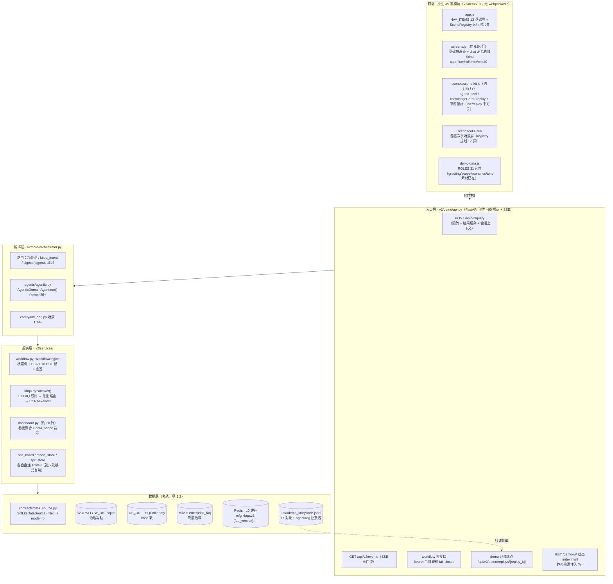
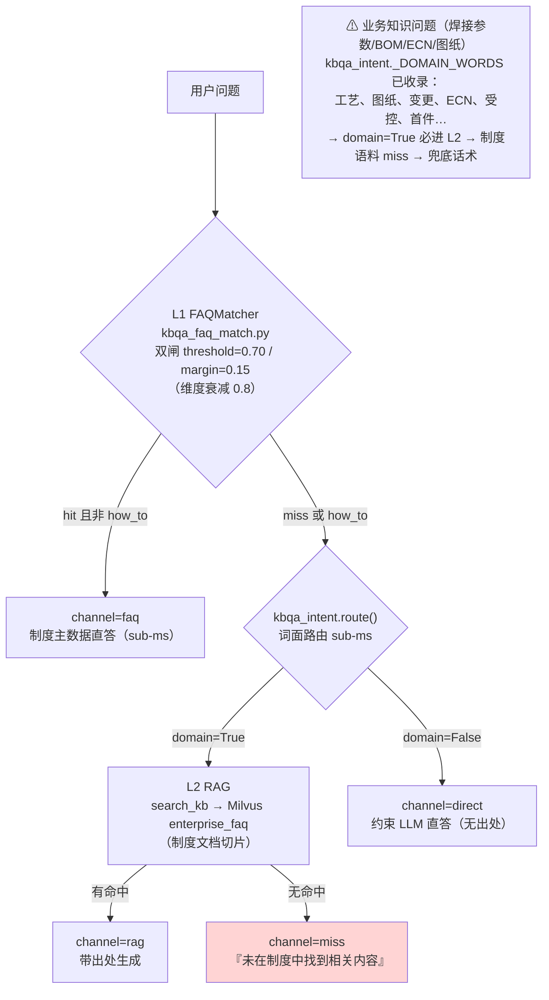

# mfg-agent-platform 架构改造推荐方向

> 版本：v1.0 ｜ 作者：架构师 高见远 ｜ 日期：2026-08 ｜ 状态：待评审
> 输入：`docs/业务改造方向-PRD.md`（产品经理 许清楚 v1.0）、`docs/参考图/参考图说明.md`（开沿 KAIYAN 21 张产品资料）
> 方法：**全部结论以读码核实为准**。文中证据一律给「文件 :: 函数名/锚点字符串」，不给行号——本仓库存在并发编辑会话（`git status` 可见 `agent_replays.jsonl` / `faqs.jsonl` / `rag_replays.jsonl` 工作区已被修改），行号会漂移。
> 纪律：本文只读代码，唯一产出即本文件。

---

## 一、现状架构识别（基于读码核实）

### 1.1 总体形态：FastAPI 单体 + 原生 JS 零构建前端 + 双装载（真实链路 / 演示回放）

```
src/mfg_agents/
├── common/          # 跨版本基础：config.py(settings/DB_URL/WORKFLOW_DB)、platform_schema.py(方言判定唯一入口)、
│                    #   kbqa_seed.py(Milvus enterprise_faq 语料)、llm_factory.py、rag_tools.py
└── v2/              # V1 已删，仅存 common + v2（已核实：src/mfg_agents 下只有这两个包）
    ├── demo/api.py            # 入口层：FastAPI 单体，约 90 个端点 + SSE（/api/v2/events）
    ├── core/orchestrator.py   # 编排层：V2Runtime + V2Orchestrator.handle() 统一问数入口
    ├── agents/agentic.py      # 智能体层：域组 ReAct 循环（MAX_STEPS=8、TOOL_TIMEOUT_S=45）
    ├── services/              # 服务层：workflow / kbqa* / dashboard / digest / site_board / report_store / spc_store …
    ├── contracts/             # 契约层：data_source.py(DataSource)、permissions.py(PermissionRegistry)
    ├── mcp_tools/             # 统一工具层：ToolRegistry（MCP / A2A / function calling 单一事实源）
    ├── data/                  # 声明式配置：queries.yaml / permissions.yaml / data_scope.yaml / metrics/*.yaml / scenarios/*.yaml
    └── demo/                  # 演示装载：loader.py + config_demo.py + ui/（原生 JS 零构建）
```



### 1.2 持久化「三轨」的真相：三轨名义、六处直连

项目记忆与 PRD 均称「持久化三轨」。读码核实：**三轨的名义成立，但「治理写直连 sqlite3」不是单点，而是已复制到 6 处的模式**——这是本次改造最关键的架构约束。

| 轨 | 名义归属 | 代码事实（锚点） | 方言/后端约束 |
|---|---|---|---|
| ① 业务读 | `contracts/data_source.py::SQLiteDataSource` | `_connect_ro()` 用 `file:...?mode=ro`，**写操作在驱动层即被拒绝**；查询走 `run_query()`（注册查询）+ `execute_readonly_sql()`（Text2SQL 审核后探查，行数封顶 200） | 可换 SQLite/MySQL（`DataSource` 三方法契约 + `describe()` 自描述） |
| ② 治理写 | `services/workflow.py::WorkflowEngine` | `_connect()` 直连 `sqlite3`；`assert_sqlite_backed()` fail-fast；不继承非 SQLite 的 `DB_URL`（`common/config.py::_resolve_workflow_db`） | **仅 SQLite**（`platform_schema.is_sqlite_target()` 是全域唯一方言判定入口） |
| ③ kbqa | `services/kbqa_store.py::get_engine()` | 自带 SQLAlchemy 引擎，管 `kbqa_faq` / `kbqa_faq_draft` / `kbqa_query_log` 三表 + `kbqa_policy` 只读镜像 | 跟随 `settings.DB_URL`，两方言共通 SQL 写法 |

**名义之外的直连 sqlite3 写点（6 处，各自带 `_connect`/`assert` 防线）**：

```
v2/services/workflow.py::WorkflowEngine._connect          # 治理写轨本体
v2/services/report_store.py::_connect                     # 报告中心（自带 assert_sqlite_backed 文案）
v2/services/site_board.py::resolve_site_db/_connect       # 现场看板推送；缺省与治理库同库（settings.WORKFLOW_DB）
v2/services/spc_store.py::_connect                        # SPC 数据
common/case_schema.py::connect                            # 案例库
v2/core/orchestrator.py::_apply_seed/_ensure_columns      # 编排器种子（import sqlite3 局部使用）
```

**推论（对 PRD 的直接约束）**：

1. R6「到货回写」若按现状实现，就是**第 7 次复制这个模式**（新 store + 新 `_connect` + 新 assert 防线），且只能落治理轨——业务表在 `mode=ro` 驱动层拒绝写入，这是「数据质量优先于智能能力」的既有边界，不是缺陷。
2. `config_demo.py::DEMO_DB_PATH`（演示治理库 `data/demo_storyline/demo_governance.db`）与 `settings.WORKFLOW_DB`（真实治理库）是**两套物理库**；演示态回写状态存哪套，PRD 未定义。

### 1.3 kbqa 链路与「路由污染」隐患（R4 的架构根因）

`services/kbqa.py::answer()` 链路（L0 Redis 缓存 → L1 双闸 → 意图路由 → L2 RAG/direct）：



**代码级证据**：`kbqa_intent.py::_DOMAIN_WORDS` 显式收录 `"工艺", "图纸", "受控", "变更", "ECN"`（拉丁缩写表 `_LATIN_RE` 亦含 `ECN`）。因此 PRD R4 验收标准③「业务知识问题不落入制度兜底话术」**不是加一个 UI tab 能解决的**——服务端 `answer()` 的路由在 L1 之后必然把这类问题送进制度语料的 L2 RAG。详见第四章质疑 Q1。

### 1.4 治理链路与三层角色差异化（平台的护城河，复用放大不重做）

- **HITL 治理**：`workflow.py::WorkflowEngine`——状态机 `TRANSITIONS`（pending → running → waiting_hitl → done/closed + escalated）；`GOVERNANCE_SLOTS` 10 个槽位（restart / eta / disposition / d8_close / complaint_reply / delivery_commit / maintenance_window / spc_action / order_review / report_publish），与 `v2/data/permissions.yaml` 的 slots 对齐（30 权限 = 10 槽 × 3 动词 propose/cosign/approve；32 治理角色）。
- **会签语义**：`select_action()` 按处置动作动态定 `required_signoffs`（退货只需采购、特采需 PQE+业务+QA 三方），`signoff_status()` 收敛满足判定；`wf_signoff` 独立签名表 + 唯一索引兜底多实例幂等（`platform_schema.py::PLATFORM_DDL`）。
- **Agent 铁律**：`permissions.yaml` 启动自检禁止 Agent 身份持 `*.approve`——Agent 只 propose、永不放行。
- **三层差异化**：菜单层 `app.js::NAV_ITEMS[].roles`（前端可见性）/ 看板数据层 `data_scope.yaml::allow_roles`（接口裁决，fail-closed，`services/data_scope.py`）/ 待办层 `workflow_scope.py`（槽位级三态 mine/domain/hidden，判据 = 是否持有该槽位权限）。
- **⚠ 两套角色口径**：前端 `demo-data.js::ROLES` 31 个岗位 id（gm/mfg/eq/…），治理侧 `permissions.yaml` 32 个角色 key（gm/manufacturing/…），靠 `PermissionRegistry` 的 aliases 归一化。R2 若新增「同事能力面」配置，**严禁造第三套角色 key**。

### 1.5 前端组织与「零 build」纪律的代价

| 文件 | 规模 | 职责 |
|---|---|---|
| `v2/demo/ui/app.js` | ~1.6k 行 | `NAV_ITEMS` 字面量（13 基础屏）+ `SceneRegistry.navItems()` 运行时合并 + 应用状态 + 后端探针 |
| `v2/demo/ui/screens.js` | ~6.6k 行 | 全部基础屏渲染（DOM 字符串拼接，无组件框架）；chat 消息管线 `renderChatMessage()` 按 `kind` 分发 |
| `v2/demo/ui/scenes/scene-kit.js` | ~1.8k 行 | SceneKit：`agentPanel` / `knowledgeCard` / `replay` + 来源徽标 `.sk-source-badge-replay`（虚线=回放，不可关） |
| `v2/demo/ui/scenes/registry.js` | — | 场景屏运行时登记（`register()`/`navItems()`/`render()`），专为「多人并行改屏不改 app.js」设计 |
| `v2/demo/api.py::_dynamic_index` | — | index.html 动态渲染：资源引用强制注入 `?v=<mtime>`（文件一改缓存自动失效） |

**关键纪律**：`tests/v2/test_架构守卫.py` 用**正则解析 `const NAV_ITEMS = [ ... ];` 字面量**（导航收敛、角色 id 有效性、看板受限等守卫）。改导航字面量有弄红守卫的风险——`registry.js` 的 docstring 明确记录了这一设计动机。**R1/R2 的一切入口改动必须走 SceneRegistry 登记或在字面量内谨慎追加。**

### 1.6 演示装载层（回放/徽标体系，PRD 要求复用）

- `v2/demo/loader.py`：从 `data/demo_storyline/` 装载 17 个对象 jsonl + `agent_replays` / `rag_replays` 回放包；`get_replay()` 统一命名空间，未命中转 404。
- `v2/demo/config_demo.py`：`DEMO_DB_PATH` 独立治理库、`DEMO_GUEST_ROLES` 5 个只读访客角色、`assert_isolated()` 外部连接特征黑名单自检（启动即失败）。
- 只读端点：`/api/v2/demo/banner` / `/objects/{name}` / `/timeline` / `/replays/{replay_id}`。
- 场景派生数据单一事实源：`data/demo_storyline/frontend/registry.json` + `sNN-*.js`（S00–S06 各屏的数据出处）。

### 1.7 测试体系基线

- 88 个测试文件、约 1493 个 `def test_`（含参数化；任务基线声明「约 1896 passed」，**改造前应实跑复核**）。
- CI：`.github/workflows/ci.yml`，Python 3.11/3.12/3.13 矩阵，`uv run pytest tests/ -q`。
- 关键守卫测试（改造碰这些面必红）：`test_架构守卫.py`（方言判定 `is_sqlite_target`、`assert_sqlite_backed`、NAV/角色交叉校验）、`test_待办可见性.py`（NAV roles × permissions.yaml 槽位持有一致性）、`test_数据范围.py`（NAV roles × data_scope allow_roles 一致性）、`test_workflow.py`、`test_kbqa_faq_tier.py` / `test_kbqa_intent.py`。

### 1.8 承载 PRD 目标时的架构瓶颈（B1–B8，代码级证据）

| # | 瓶颈 | 证据（锚点） | 卡住哪条 PRD |
|---|---|---|---|
| B1 | **回写执行面缺失**：工具面全是只读 + 建单，没有任何「派发/回写业务状态」工具 | `agents/agentic.py::AGENT_TOOLS_META` 22 个工具中仅 `create_hitl_task`（写/HITL）与 `run_scenario`（写/编排）；`mcp_tools/tools.py::build_platform_tools` 的写类工具只有 `workflow.*`（治理域） | R6、R13、U2/U5 |
| B2 | **业务读轨 `mode=ro` 与回写方向冲突**：到货状态、催交结果无法写回业务表 | `contracts/data_source.py::_connect_ro`（`?mode=ro`，驱动层拒绝写） | R6 |
| B3 | **治理写直连 sqlite3 模式已复制 6 处**：新回写 store = 第 7 次复制；抽仓储契约无时间表 | `workflow.py::_connect`、`report_store.py::_connect`、`site_board.py::resolve_site_db`、`spc_store.py::_connect`、`case_schema.py::connect`、`orchestrator.py::_apply_seed` | R6、R13 |
| B4 | **kbqa 路由污染**：业务知识问题被 `_DOMAIN_WORDS` 判域内 → 制度语料 L2 → miss 兜底 | `kbqa_intent.py::_DOMAIN_WORDS`（含 工艺/图纸/变更/ECN）、`kbqa.py::answer()` | R4 验收③ |
| B5 | **待办可见性是槽位级、无行级判据**；任务行上唯一的人员字段是无法归一化的自由文本 | `workflow_scope.py::slot_keys_for/classify`（判据 = 持槽权限）；同文件 docstring：「库里存的是『行政专员』这类自由文本，多数无法归一化……拿它做判据会静默失效」 | R9 |
| B6 | **前端零 build + screens.js 6.6k 行**：三种新消息卡片 + 同事切换器全落在 DOM 字符串拼接；NAV 字面量受正则守卫 | `screens.js::renderChatMessage`（kind 分发现成）；`test_架构守卫.py` NAV 正则 | R1、R2 |
| B7 | **口径散落三处**：注册查询 43 条（PRD 称 20 条，已过时）+ 指标 yaml + 看板硬编码聚合 | `v2/data/queries.yaml`（实测 43 个顶层查询 key）、`v2/data/metrics/*.yaml`、`dashboard.py`（约 3k 行） | R8 |
| B8 | **场景屏双实现风险**：S00–S06 静态叙事 vs R1 对话闭环，两套实现两处口径 | `scenes/registry.js`（规划 12 屏、已交付 7 屏）、`data/demo_storyline/frontend/`（回放数据单一事实源） | R14、R1 |

**附带发现（代码与描述漂移，改造时应顺手修正）**：

- `mcp_tools/tools.py::_h_workflow_governance` 描述写「21 权限 × 15 角色 × 7 槽位」，实际 `permissions.yaml` 是 **30 权限 × 32 角色 × 10 槽位**。
- `agents/agentic.py::create_hitl_task` 的工具 schema enum 与 `_SYSTEM_TEMPLATE` 的 `hitl_slot` 说明**只有 7 个槽**，缺 `order_review` 与 `report_publish`——而 U1 插单评估（PRD 用户故事）要的正是 `hitl.order_review`。**Agent 目前建不出接单评审工单**，R1 走 U1 脚本前必须补。

---

## 二、能力差距映射（PRD P0/P1 → 架构改动点）

图例：**不动** = 纯配置/前端透出，不碰架构；**轻动** = 单层内增量；**动骨** = 数据模型/契约/路由变更。

| PRD | 需求 | 架构改动点 | 判定 | 代价评估（架构视角） |
|---|---|---|---|---|
| R1 | 场景同事化交互重构 | ① `screens.js` chat 管线新增 2 种消息 kind（结论卡/待确认动作卡；flow 卡已有）；② `demo-data.js`/新 `colleague.yaml` 提供同事人格与场景清单；③ 6 条演示脚本编排（问数 → HITL 建单 → 确认全链路）；④ **补 `agentic.py` slot enum（order_review/report_publish）** | 轻动（前端）+ 单点后端 | **M~L**。前端可控（kind 分发现成、SceneKit 现成）；真正成本在 6 条 e2e 脚本与 SSE/落库联调。验收①建议拆「2 条全链路 e2e + 4 条回放承载」 |
| R2 | 岗位 AI 同事入口 | ① chat 屏顶部同事切换器（**不新增屏**，避免 NAV 正则守卫与新屏注册）；② 岗位→场景/推荐问题/工具子集的新配置层 | 轻动 | **S~M**。素材已在（`ROLES[].greeting/scope/scenarios`）。风险在「同事能力面」若造第三套角色 key 会破坏 aliases 归一化纪律 |
| R3 | HITL 闸门公示与补齐 | ① 前端透出 `required_signoffs` / `signoff_status()`（后端已有）；② 帮助中心可查 `permissions.yaml`（`/api/v2/governance/permissions` 现成）；③ 三类硬闸门 ↔ 10 槽位映射表成文 | **不动架构** | **S**。附带发现：「动钱」类当前无专属槽位（加急采购>5万 仅在 workflow.py 旧 docstring 提及，`GOVERNANCE_SLOTS` 无 procurement 槽）——映射表会暴露这个洞，见质疑 Q6 |
| R4 | 知识中枢最小版 | ① **新数据模型**：BOM 版本 + ECN 变更记录（新表，落治理轨 or 新 knowledge 轨）；② **新检索通道**：工艺参数检索（不能复用 Milvus `enterprise_faq` 制度语料）；③ **路由前置分流**：`kbqa.py::answer()` 入口前加业务知识判定；④ L0 缓存独立命名空间 + ECN 版本戳 | **动骨** | **L~XL**。四层全动（模型/检索/路由/缓存）。PRD 评 L 偏乐观 |
| R5 | 交期答复闭环 | 编排层已有（`queries.yaml`：`supply_batches_today`/`plan_by_model`/`atp_by_model` + `hitl.eta`/`delivery_commit` 槽位）；缺脚本编排 + 回复稿留痕（可归档进 `report_service`） | 不动 | **S~M** |
| R6 | 齐套催交回写 | ① 催交状态机新表（派发→供应商回复→到货确认→关闭），**落治理轨**（同 `site_board` ack/feedback 模式）；② 待办派发（`create_hitl_task` 或新工具）；③ 连接器回写契约预留 | 轻动+契约 | **M~L**。不能写业务表（B2）；演示库/治理库双库归属要定义（见质疑 Q2） |
| R7 | 质量追溯三路并查 | ① 编排层三源串联/并行（`quality__trace` + `incoming_batch_*` + `equip_alarms`/`asset__status`）；② 汇总成稿（`report_service`）；③ cases 权限过滤复用 | 轻动（编排） | **M**。数据已在（`queries.yaml`：`quality_trace_by_batch`/`batch_trace_full` + S05 批次定位 EV-0025） |
| R8 | 数据口径词典 | ① 新词典服务（`queries.yaml` 43 条 + `metrics/*.yaml` + 看板 KPI 三源汇总）；② 新屏或 help 一级页；③ 数字卡「口径」下钻（复用 `data-sk-drill`） | 轻动 | **S~M**。风险：只从 queries.yaml 生成会漏看板口径，制造新双源（质疑 Q8） |
| R9 | 行级数据权限（待办先行） | ① **`platform_workflow_task` 加行级归属列**（复用 `platform_schema._ADDITIVE_COLUMNS` 幂等加列模式）+ 存量回填；② `workflow_scope.classify` 判据从「持槽」扩展为「持槽 ∧ 行归属」；③ 测试夹具（同岗位两用户行数不同） | **动骨** | **L~XL**。PRD 评 L 且称「成本低」——与代码事实不符（质疑 Q3） |
| R10 | 老板经营对话 | `services/digest.py::build_digest` 已具备（看板遍历 + data_scope 裁决 + 未达标 KPI 排序） | 不动 | **S** |
| R11 | 呆滞料随时问 + 退供动钱闸门 | `queries.yaml::material_aging_top` 已有；**退供动钱无专属槽位**——新增槽位要动 `permissions.yaml` + `GOVERNANCE_SLOTS` + `agentic.py` enum + 前端 hitl 屏 + 可见性测试（全链 5 处） | 轻动（或不动+复用 disposition） | **S~M** |
| R12 | 落地方法论产品化 | `help-screen.js` 纯前端 | 不动 | **S** |
| R13 | 连接器框架 | ① `DataSource` 契约扩展回写侧（`write_back` 契约 + mock 实现）；② 复用 `mcp_tools/registry.py::Tool` 的 `tier 0/1/2`（预执行同意机制现成）；③ 治理写轨抽 `WorkflowRepository` 契约为 MySQL 铺路（README 生产化清单第 1 条） | 动骨（契约） | **L** |
| R14 | S07–S11 去留决策 | 决策记录 + 若废弃则 `frontend/registry.json` 回放数据迁移结论 | 不动（决策） | **M** |

**汇总**：14 条中 **不动架构 5 条**（R3/R5/R10/R12/R14-决策）、**轻动 5 条**（R1/R2/R6/R7/R8/R11 中之前端部分）、**动骨 3 条**（R4/R9/R13）。动骨的 3 条全部集中在 P0/P1 前段——**排期上必须先做数据模型与契约，再做交互包装**，否则 R1 的演示脚本会踩「Agent 建不出 order_review 工单」「业务问题掉制度兜底」两个洞。

---

## 三、推荐改造方向（分阶段）

### 3.0 总原则

1. **复用放大，不推倒重来**：HITL 治理链、回放/徽标体系、三层角色差异化是护城河，全部继承。
2. **先契约后交互**：R4 数据模型、R6 回写契约、R13 连接器接口先于 R1 交互包装落地（否则演示脚本空跑）。
3. **配置即代码**：新能力一律走 `v2/data/*.yaml` 声明式 + 启动期校验，与 `permissions.yaml` / `data_scope.yaml` 同范式，**不硬编码角色/槽位**。
4. **测试基线不破**：任何改动过 `test_架构守卫.py` / `test_待办可见性.py` / `test_数据范围.py` 三道交叉校验的面，必须同步更新两侧数据。

### 3.1 近期（P0 支撑）：R1 + R2 + R3 + R4 数据模型与路由先行

**目标**：6 大场景「一句话触发工作闭环」形态可演示；工艺问答答到现行版本且路由不污染；人机边界可查。

**关键设计决策**：

| # | 决策 | 选型/理由 |
|---|---|---|
| D1 | **同事入口不新增屏**：chat 屏顶部「同事切换器」+ 工作台「我的同事今日概况」改造 | 零 build 下新屏注册成本高（NAV 正则守卫 + registry 登记 + 可见性测试三件套）；chat 屏已是 `core: true` 主入口 |
| D2 | **chat 消息 kind 扩展**：新增 `conclusion`（结构化结论卡，复用 `knowledgeCard` 徽标模式）与 `action`（待确认动作卡，复用 `hitlChatCardHtml` 直达审批中心）；`flow` 卡（三件事）已有 | `screens.js::renderChatMessage` 按 kind 分发，增量最小；来源徽标 live/replay 不可关的纪律天然继承 |
| D3 | **新增 `v2/data/colleague.yaml`**（岗位 → 同事人格/场景清单/推荐问题/工具子集），只引用前端 `ROLES` id，**禁止第三套角色 key** | 治理能力继续走 `permissions.yaml`（32 角色），数据范围走 `data_scope.yaml`——延续 `workflow_scope.py` docstring「两个正交维度不要合并」的先例 |
| D4 | **R4 新建 knowledge 轨**：`services/knowledge_store.py`（BOM 版本 + ECN 记录），落 `WORKFLOW_DB`（治理轨同库，复用 `assert_sqlite_backed` 防线与 `platform_schema` 幂等加列）；**借 R4 第一次把「新 store」写成显式契约**（`KnowledgeRepository` ABC + SQLite 实现），为 R13 抽 `WorkflowRepository` 练手 | 终止「第 7 次复制 `_connect`」；契约先行让 R13 的连接器框架有样板 |
| D5 | **路由隔离在服务端**：`kbqa.py::answer()` 入口前置 `business_knowledge` 判定（工艺/BOM/ECN/图纸/焊接参数等业务知识词表，**独立于** `_DOMAIN_WORDS`），命中走新知识轨，不碰 `enterprise_faq` 制度语料；UI 上 kbqa 屏并列双 tab（PRD Q6 方案 B） | 只加 UI tab 不解决兜底话术（见 B4）；词表宁宽勿窄的纪律沿用 `kbqa_intent.py` docstring 的不对称代价论证 |
| D6 | **L0 缓存独立命名空间**：业务知识缓存键用 ECN 版本戳（如 `mfg:bk:v1:{ecn_version}:…`），不用 `faq_version` | 否则 ECN 生效后旧缓存不失效 → 「按旧版参数」事故（PRD R4 的核心痛点反向复现） |
| D7 | **补 `agentic.py` 槽位 enum**：`create_hitl_task` schema 与 `_SYSTEM_TEMPLATE` 的 `hitl_slot` 补 `order_review` / `report_publish`，与 `GOVERNANCE_SLOTS` 对齐 | U1 插单评估脚本的前置条件（否则 Agent 建不出接单评审工单） |
| D8 | **R3 映射表成文 + 暴露「动钱无槽」缺口**：三类硬闸门 ↔ 10 槽位映射写入帮助中心；「加急采购>5万/退供动钱」无槽位的事实明确记录为「本期复用 `disposition` 或不做」，**不 silently 新增槽位** | 新增槽位是全链 5 处改动（permissions.yaml + GOVERNANCE_SLOTS + agentic enum + 前端 hitl 屏 + 可见性测试），必须显式决策 |

**影响模块/文件清单**（相对路径）：

```
新增：src/mfg_agents/v2/data/colleague.yaml                      # 岗位同事能力面（D3）
新增：src/mfg_agents/v2/services/knowledge_store.py              # BOM 版本/ECN 契约 + SQLite 实现（D4）
新增：data/demo_storyline/ecns.jsonl + boms.jsonl 扩充 version/ecn_id 字段   # 演示语料（D4）
修改：src/mfg_agents/v2/services/kbqa.py                          # answer() 入口前置分流 + 新缓存键（D5/D6）
修改：src/mfg_agents/v2/demo/api.py                               # /api/v2/kbqa* 增加业务知识端点；demo banner 不变
修改：src/mfg_agents/v2/demo/ui/kb-screen.js                      # 双 tab（业务知识/制度知识）（D5）
修改：src/mfg_agents/v2/demo/ui/screens.js                        # chat kind: conclusion/action + 同事切换器（D1/D2）
修改：src/mfg_agents/v2/demo/ui/app.js                            # 仅状态与顶栏，NAV_ITEMS 字面量不动（D1）
修改：src/mfg_agents/v2/demo/ui/demo-data.js                      # ROLES 补 greeting/scenarios 素材（D3）
修改：src/mfg_agents/v2/agents/agentic.py                         # slot enum 补齐（D7）
修改：src/mfg_agents/v2/demo/ui/help-screen.js                    # 闸门映射表 + permissions.yaml 查询（D8）
测试：tests/v2/test_kbqa_intent.py、test_kbqa_faq_tier.py          # 路由隔离回归（D5）
      tests/v2/test_架构守卫.py                                     # 若动 NAV 需过正则（D1）
```

**与现有纪律的兼容**：零 build 不变（纯 JS/CSS 增量 + `?v=<mtime>` 自动失效）；方言判定仍走 `is_sqlite_target()`（knowledge_store 复用 `assert_sqlite_backed` 而非自造）；回放/徽标体系不变（新结论卡强制带来源徽标）；测试三道交叉校验同步更新两侧数据。

### 3.2 中期（P1 支撑）：R5 + R6 + R7 + R8 + R9

**目标：催交结果自动回流、三路并查成稿、口径单一词典、待办行级权限。**

| # | 决策 | 理由 |
|---|---|---|
| D9 | **R6 回写落治理轨，不写业务表**：新建 `services/procurement_followup.py`（催交状态机：缺口清单 → 派发待办 → 供应商回复 → 到货确认 → 关闭），同 `site_board` 模式（`resolve_site_db` 缺省 `WORKFLOW_DB` + `assert_sqlite_backed`）；**到货状态在演示层以状态机呈现，明确标注「演示回写」徽标** | 业务表 `mode=ro` 是既有边界（B2）；对外话术必须诚实（PRD 差距#6「数据真实性边界」） |
| D10 | **R6 双库归属定义**：演示态催交状态存 `DEMO_DB_PATH`（演示治理库），真实态存 `WORKFLOW_DB`；装载层 `loader.py` 增补 `followups` 对象 | 消除 `config_demo.py` 与 `settings` 双库未定义状态 |
| D11 | **R7 一期串行三查**：在 `AgenticDomainAgent` 工具循环内串行调 `quality__trace` → 来料批次 → 设备状态，汇总成稿进 `report_service`；**不新增并行编排框架** | `orchestrator.handle()` 是单链路口，并行 fan-out 是新原语（质疑 Q7）；串行已满足「一次查到底」的产品目标 |
| D12 | **R8 词典三源汇总**：`services/metric_dict.py` 合并 `queries.yaml`（43 条）+ `v2/data/metrics/*.yaml` + 看板 KPI 注册（从 `dashboard.py` 提取 KPI id/口径/负责域），词典屏标注覆盖范围；复用 `mcp_tools` 的 `metric.dict` 工具做 Agent 侧同一出口 | 防止「只覆盖 queries.yaml」的新双源（B7） |
| D13 | **R9 数据模型先行**：`platform_workflow_task` 加 `owner_scope` 列（JSON：岗位/部门/厂区，复用 `_ADDITIVE_COLUMNS` 幂等加列 + 存量回填脚本）；`workflow_scope.classify` 判据扩展为「持槽 ∧ 行归属」；`assignees` 自由文本列保持仅作展示，**不作判据**（遵循 workflow_scope.py docstring 的警告） | 行级权限缺的是任务行上的归属属性，不是判据代码（B5） |

**影响模块/文件清单**：

```
新增：src/mfg_agents/v2/services/procurement_followup.py          # R6 催交状态机（D9）
新增：src/mfg_agents/v2/services/metric_dict.py                   # R8 口径词典三源（D12）
修改：src/mfg_agents/common/platform_schema.py                    # R9 owner_scope 加列（D13）
修改：src/mfg_agents/v2/services/workflow_scope.py                # 行级判据（D13）
修改：src/mfg_agents/v2/demo/api.py                               # followup 端点 + 词典端点 + workflow/pending 行级过滤
修改：src/mfg_agents/v2/agents/agentic.py                         # R7 三查工具编排（D11）
修改：src/mfg_agents/v2/demo/ui/screens.js                        # R6 派发/回写卡片 + 词典屏（D9/D12）
修改：src/mfg_agents/v2/demo/loader.py + config_demo.py           # followups 对象 + 双库（D10）
修改：data/demo_storyline/（followups.jsonl）
测试：tests/v2/test_待办可见性.py（行级夹具）、test_workflow.py、新增 test_followup_state.py
```

### 3.3 远期（P2 + 连接器）：R10–R14 + 治理库多后端

**目标：连接器框架接真实系统的接口就绪；场景屏体系收敛；治理写轨可迁 MySQL。**

| # | 决策 | 理由 |
|---|---|---|
| D14 | **R13 连接器 = DataSource 回写侧扩展 + Tool tier 门控**：`DataSource` ABC 增加 `write_back(intent, payload) -> Receipt`（幂等键 + 审计回执）；mock 实现跑通 R6 回写链路；`Tool.tier`（0 只读/1 预执行同意/2 事后审计）承载「预执行同意」——tier=1 的工具先产 HITL 工单，会签通过才落地 | tier 机制已在 `mcp_tools/registry.py::Tool` 定义但只读工具从未用到；这是「Agent 永不放行」铁律的自然延伸 |
| D15 | **抽 `WorkflowRepository` 契约**（SQLite 实现先行，MySQL 实现排期）——这是 README 生产化清单第 1 条，也是 6 处直连模式收敛的唯一出路 | B3 的根治；`assert_sqlite_backed` 的错误信息已自带指引（「先抽 WorkflowRepository 契约再实现 SQLAlchemy 后端」） |
| D16 | **R14 与 R1 合并设计后逐屏决策**：决策记录须含 `frontend/registry.json` 回放数据迁移结论；建议「保留 S00–S06 作为交付物料，S07–S11 不建，新场景一律对话闭环承载」 | PRD Q5 方案 B 的架构侧落地；避免同一场景两套口径（B8） |
| D17 | **R10/R11/R12 随需**：digest 已就绪（R10 S）；R11 动钱槽位按 D8 结论；R12 纯前端 | 低成本项不占架构预算 |

---

## 四、对 PRD 的架构层质疑（强批判）

> 以下每条给出代码级证据与修正建议。总体判断：**PRD 的方向与资产判断准确，但 P0 工作量被系统性低估约 40%，且有 4 处「加个 UI 就能解决」的误判——问题都在服务端。**

**Q1（高）｜R4 路由隔离：PRD 说「独立 tab 与独立路由」，但真正的污染在服务端。**
证据：`kbqa_intent.py::_DOMAIN_WORDS` 已收录「工艺、图纸、受控、变更、ECN」，`kbqa.py::answer()` 在 L1 miss 后按 `kbqa_intent.route()` 分流——业务知识问题 domain=True 必进 L2 RAG，检索的是 Milvus `enterprise_faq`（制度文档切片，`common/kbqa_seed.py`），无命中即返回「未在制度中找到相关内容」。**加 tab 只是把两个入口并排，路由一步都没变。** 另外 L0 缓存键 `mfg:kbqa:v2:{faq_version}:…`（`kbqa.py::_cache_key`）以 FAQ 版本戳为命名空间——ECN 生效后缓存不会失效，「答到现行版本」会被缓存打穿。
修正：① 路由前置到 `answer()` 入口之前，业务知识词表独立维护（不与制度词表混排）；② 业务知识用独立缓存命名空间 + ECN 版本戳；③ 验收③改写为「服务端分流单测 + 缓存失效单测」，而非仅 UI 验收。

**Q2（高）｜R6 回写：PRD 说「先在演示层做状态机，预留连接器接口」——三件事被低估。**
证据：① `data_source.py::_connect_ro` 是 `?mode=ro`，「到货后状态回写」若指业务表，在 SQLite 驱动层即被拒绝，「数据质量优先于智能能力」是既有边界；② `config_demo.py::DEMO_DB_PATH` 与 `common/config.py::WORKFLOW_DB` 是两套物理库，演示态回写状态存哪套未定义，演示重启即丢；③ 「供应商回复后自动回写 ERP」在真实语义下不是接口预留问题，而是**回写语义定义问题**（幂等键、补偿、审计回执），PRD 把 L 级工作量放在了 M。
修正：R6 降级定义为「治理轨催交状态机」（缺口→派发→回复→到货确认→关闭，落 `WORKFLOW_DB`/演示库双轨按 D10），UI 明确「演示回写」徽标；真实回写语义随 R13 契约交付，不混入本期。

**Q3（高）｜R9 行级权限：PRD 称「`workflow_scope.py` 已有槽位判据可扩展，成本低」——与代码事实不符。**
证据：`workflow_scope.py::classify` 的判据是 `slot_keys_for()`（我是否持有该槽位的任一权限），这是**槽位级**判据；行级判据需要任务行上存在「归属」属性，而 `platform_workflow_task` 表（`platform_schema.py::PLATFORM_DDL`）只有 `assignees` 自由文本列——`workflow_scope.py` 模块 docstring 原话：「库里存的是『行政专员』这类自由文本，多数无法归一化……拿它做判据会静默失效」。所以 R9 不是「扩展判据」，是**数据模型变更**（加列 + 幂等迁移 + 存量回填 + 判据重构 + 测试夹具）。
修正：工作量 L → XL；或按 PRD Q4 选项 B 进一步收窄为「同槽位按 `owner_scope` 单维度过滤」，看板行级维持 P2。

**Q4（中高）｜R1 零 build 下的复杂度：UI 层可控，e2e 脚本层被低估。**
证据：前端侧确有现成管线（`screens.js::renderChatMessage` kind 分发、`scene-kit.js` 徽标、`NAV_ITEMS` 正则守卫）；但验收①「6 个场景各 1 条演示脚本，从提问到人工确认全链路走通」意味着 6 条跨 SSE 事件 + 域智能体 ReAct（`MAX_STEPS=8`、单工具 45s 超时）+ HITL 落库 + 前端确认回写的端到端链路，且其中 U1 还卡在「Agent 建不出 `order_review` 工单」（`agentic.py` slot enum 只有 7 个）的洞上。
修正：验收①拆为「2 条全链路 e2e（U1 插单 + U2 齐套）+ 4 条回放承载」；`agentic.py` enum 补齐作为 R1 的前置独立小任务。

**Q5（中）｜R2「31 岗位同事」与两套角色口径：有造出第三套口径的风险。**
证据：前端 `demo-data.js::ROLES` 31 岗位 id、治理 `permissions.yaml` 32 角色 key，靠 `PermissionRegistry` aliases 归一化；`demo/api.py::api_workflow_pending` 的越权校验（requested ⊆ token）就建立在归一化之上。R2 的「同事能力面」若新造一套岗位→能力映射的 key 体系，三套口径漂移只是时间问题。
修正：`colleague.yaml` 只引用前端 ROLES id；治理能力面继续由 permissions.yaml 裁决；在 `test_架构守卫.py` 加一条「colleague.yaml 的 role id 必须 ⊆ demo-data ROLES」的守卫。

**Q6（中）｜R3 映射表会暴露「动钱无槽」：三类硬闸门与 10 槽位不是一对一。**
证据：`workflow.py::GOVERNANCE_SLOTS` 10 槽中无「加急采购/退供动钱」类槽位（旧 docstring 提及的「加急采购>5万」未落槽）；R11 退供申请同样无槽可落。PRD 要求「闸门规则与参考图三类硬闸门的映射表成文」——成文即暴露缺口。
修正：明确记录「动钱类本期复用 `disposition`（来料处置含金额会签口径，`fin` 角色在 cosign 链）或不落槽」，把「新增槽位」的全链 5 处改动清单作为决策附件，避免 silent gap。

**Q7（中）｜R7「三路并行」缺编排原语：现有编排是单链路口。**
证据：`orchestrator.py::V2Orchestrator.handle()` 路由到场景 DAG / 域智能体 / kbqa / digest 之一；`core/yaml_dag.py` 是场景内 DAG，没有跨工具并行 fan-out。agentic 工具循环天然是**串行**多轮。
修正：一期串行三查 + 汇总成稿（产品目标「一次查到底」不受影响）；并行作为二期「编排原语」独立评估，不借 R7 夹带新框架。

**Q8（中低）｜R8 词典有制造新双源的风险。**
证据：口径实际散落三处——`queries.yaml`（实测 43 条，PRD 称 20 条已过时）、`v2/data/metrics/*.yaml`、`dashboard.py`（约 3k 行内的 KPI 聚合）。只从 queries.yaml 生成词典 = 看板口径仍在代码里 = 「各看各的表」治了一半。
修正：词典三源汇总（D12），UI 明示覆盖范围；`queries.yaml 43 条`的事实请 PRD 同步勘误。

**Q9（中低）｜R14 决策牵连回放数据资产。**
证据：`data/demo_storyline/frontend/registry.json` 是 S00–S06 场景派生数据单一事实源，`/api/v2/demo/replays/{replay_id}` 的回放包与场景屏同源。废弃场景屏 = 回放数据迁移。
修正：R14 决策记录必须含数据迁移结论；建议保留 S00–S06 作交付物料（PRD Q5 方案 B 已倾向此结论，架构侧背书）。

**Q10（汇总）｜工作量重估**：架构视角 P0 = R1（M~L）+ R2（S~M）+ R3（S）+ R4（L~XL）≈ **PRD 自评的 1.4 倍**；P1 中 R9 一项即从 L 升 XL。建议按「先契约（R4 模型/路由、R6 状态机、R13 接口形态）→ 后交互（R1/R2）→ 再权限（R9）」重排依赖。

---

## 五、风险与待明确事项清单（按严重度排序）

| # | 严重度 | 风险/待明确 | 缓解措施 |
|---|---|---|---|
| 1 | **高** | 回写通道的库归属与语义未定义：业务表 `mode=ro` 拒绝写、`DEMO_DB_PATH` 与 `WORKFLOW_DB` 双库并存、真实 ERP 回写语义（幂等/补偿/审计）无契约 | 按 D9/D10 定义「治理轨状态机 + 双库分工 + 演示回写徽标」；R13 契约单独立项，不在本期夹带 |
| 2 | **高** | R4 路由隔离只做 UI tab：服务端 `_DOMAIN_WORDS` 仍把业务知识问题送进制度 RAG，且 L0 缓存以 `faq_version` 为命名空间——ECN 更新后旧答案照旧命中 | 路由前置到 `answer()` 入口 + 独立缓存命名空间与 ECN 版本戳 + 服务端分流单测（质疑 Q1） |
| 3 | **高** | sqlite 直连模式已复制 6 处，R6 再复制第 7 处；不抽契约则 R13 连接器框架无处挂载 | 借 R4 `KnowledgeRepository` 首抽契约练手；R13 落地 `WorkflowRepository`（D15）；新 store 一律「契约 + 实现」两文件，禁止裸 `_connect` |
| 4 | **中高** | R9 数据模型变更（`platform_workflow_task` 加列 + 存量回填 + 判据重构）被 PRD 低估为 L；存量工单回填策略未定 | 按 D13 收窄为 `owner_scope` 单维度；存量未回填工单按「无归属 → domain 可见」保守降级，不隐藏 |
| 5 | **中高** | 测试基线维护：88 文件 / 约 1493 test 函数（声明基线 1896 passed 需实跑复核）；R1 6 条 e2e + R9 行级夹具会显著拉长 CI | e2e 拆 2 全链路 + 4 回放；行级用测试夹具（fake engine）不落真库；CI 矩阵保持 3.11/3.12/3.13 |
| 6 | **中** | 三套角色口径（前端 31 / 治理 32 / colleague 新增）漂移 | colleague.yaml 只引用 ROLES id；加架构守卫「colleague role id ⊆ ROLES」；治理能力一律 permissions.yaml |
| 7 | **中** | 「动钱」类闸门无专属槽位（R3 映射表成文即暴露；R11 退供同病） | 显式记录缺口与本期处置；若采纳 PM v1.1 新增 `hitl.spend_commit`（资金支出承诺）槽位，按 Q7 裁定执行全链 6 处改动（见下文 Q7 裁定），禁止只改 permissions.yaml 一半 |
| 8 | **中** | 口径词典双源（queries.yaml vs dashboard.py 硬编码）；PRD「20 条注册查询」已过时（实测 43 条） | 三源汇总（D12）；PRD 勘误；词典 UI 标注覆盖范围 |
| 9 | **中低** | `agentic.py` slot enum 缺 `order_review`/`report_publish`，U1 脚本空跑；`tools.py` 治理工具描述漂移（「21 权限 × 15 角色 × 7 槽位」） | R1 前置小任务补齐 enum 与模板；顺手修描述漂移 |
| 10 | **中低** | 场景屏 S07–S11 决策牵连 `frontend/registry.json` 回放数据 | R14 决策记录含数据迁移结论；保留 S00–S06 |
| 11 | **低** | 前端单体文件持续膨胀（screens.js 6.6k 行 / app.js 1.6k 行 / scene-kit.js 1.8k 行）与零 build 纪律的长期可维护性 | 新一律走 scenes/ 登记 + SceneKit 组件；本期不重构，但设定「单文件不超过 8k 行」的监控线 |

---

## 附：与项目记忆/PRD 的事实偏差更正（读码核实）

| 记忆/PRD 陈述 | 代码事实 | 处置 |
|---|---|---|
| `queries.yaml` 20 条注册查询 | **43 条**顶层查询 key（含 `material_aging_top`/`quality_trace_by_batch`/`batch_trace_full`/`atp_by_model` 等） | PRD R8 勘误；词典按 43 条生成 |
| 治理写「单轨」`workflow.py` 直连 sqlite3 | 直连 sqlite3 实为 **6 处**（workflow/report_store/site_board/spc_store/case_schema/orchestrator） | 本文 B3；抽契约时机提前 |
| HITL 10 槽位 | 属实（`GOVERNANCE_SLOTS` = permissions.yaml slots，10 槽 × 3 动词 = 30 权限，32 角色） | 维持；但 `tools.py` 描述「21 权限 × 15 角色 × 7 槽位」需修 |
| 测试基线约 1896 passed | 88 文件 / 约 1493 test 函数（含参数化展开）；声明值需实跑复核 | 改造前跑一次全量基线并记录 |
| `agentic.py` 工具含全部 10 槽建单能力 | `create_hitl_task` enum 仅 7 槽（缺 order_review/report_publish） | R1 前置补齐（D7） |
| 前端「13 基础屏 + S00–S06」 | 属实（`NAV_ITEMS` 13 项 + `SceneRegistry` 合并 7 屏；registry 规划 12 屏） | 维持；R14 决策时用 |

---

*本文档由架构师基于全量读码产出；所有锚点可用 grep 直接复核。建议评审顺序：第四章质疑 Q1/Q2/Q3 → 第三章阶段决策 D4/D5/D9/D13 → 第二章差距映射排期。*

---

## 附二：PRD v1.1 对齐说明（2026-08，PM 许清楚 已核实采纳）

产品经理已对本文第四章 Q1/Q2/Q3/Q4/Q8 逐条独立复核代码锚点并落入 `docs/业务改造方向-PRD.md` v1.1：R4 验收③改为服务端单测（业务知识问题不得触发 `search_kb`）；R6 降级为治理轨催交状态机 + 演示回写徽标；R9 工作量 L→XL 并采纳 owner_scope 收窄条款；R1 拆「2 条全链路 e2e + 4 条回放承载」并列「补 slot enum + assignees 归一化」为前置依赖；R8 勘误为 43 条 + 三源汇总。**无遗留分歧，本文其余结论不变。**

### Q7 裁定：新增资金类槽位（PM v1.1 待确认问题）

**支持新增，槽位 key 建议 `hitl.spend_commit`（中文名「资金支出承诺」），不建议 `hitl.procurement`。** 理由：现有槽位全部按「闸门语义」命名（cf. `delivery_commit` 交期承诺），`procurement` 是域名——采购域已有 `disposition`（来料处置会签）挂多项动作，域名作槽位 key 会把「一类动作」锁死在一个部门；`spend_commit` 语义与参考图三类硬闸门的「动钱」精确对齐，且未来其他动钱场景（备件/设备采购）可复用。新增后三类硬闸门 ↔ 槽位映射即完整：对外消息 → `eta`/`complaint_reply`；动钱 → `spend_commit`；改排产 → `restart`/`order_review`/`maintenance_window`/`spc_action`。

**新增槽位的完整改动链（架构核实，共 6 处，非「各一行」）**：

| # | 位置 | 改动 | 备注 |
|---|---|---|---|
| 1 | `v2/data/permissions.yaml` | slots 段 +1 条目（key/name/scene）、permissions 段 +3 条（propose/cosign/approve）、**角色绑定**（三动词各挂哪些角色） | 最后一项是治理决策不是代码——建议 propose=采购、cosign=财务+采购负责人、approve=总经理/财务经理，需 PM + 治理角色拍板 |
| 2 | `v2/services/workflow.py::GOVERNANCE_SLOTS` | +1 行 key | 与 permissions.yaml 启动期一致性校验自动覆盖 |
| 3 | `v2/agents/agentic.py` | tool schema enum +1 行；`_SYSTEM_TEMPLATE` hitl_slot 说明 +1 行；procurement 域 `hitl_rule` 文案同步 | 同时修 PM 发现的 `create_hitl_task` assignees 硬编码 `["质量总监"]`——建议改为从槽位 propose 角色经 `PermissionRegistry` 解析，并加「slot 不在 GOVERNANCE_SLOTS 即拒」校验 |
| 4 | `tests/v2/test_governance.py` | **4 处断言**：`== 30`→33（两处 permissions）、`== 10`→11（slots 一处、HITL 节点数一处） | 已核实锚点：`test_governance.py` 内 `len(describe["permissions"]) == 30`、`len(describe["slots"]) == 10`、`len(data["permissions"]) == 30`、`len(nodes) == 10` |
| 5 | `v2/demo/ui/screens.js::SLOT_LABEL` | +1 行中文名；**并顺手补 `order_review: "接单评审会签"`、`report_publish: "报告审定与派发"`** | 已核实该映射目前只有 7 项，缺 T15/T16 新增的两个既有槽位——新工单在前端会渲染裸 key，属既有漂移bug，借本次一并修 |
| 6 | `contracts/scenario.py` | **无需改动** | ScenarioRegistry 加载期从 `PermissionRegistry.slot_keys()` 动态取白名单，新槽位自动生效 |

**成本结论**：代码约 15 行 + 1 个治理矩阵决策；不含决策约 0.5 人日。**禁止「只改 permissions.yaml 一半」**——漏改第 2/3/4/5 处任一处的症状：工单建得出但前端显示裸 key、Agent 建单被 enum 拒、或测试基线红。

### R6 治理轨状态机建议定义（PM 问及，架构草案）

```
状态：draft（缺口清单）→ dispatched（已派发待办）→ supplier_replied（供应商已回复）
      → arrival_confirmed（到货已确认）→ closed（关闭）
升级：任一非终态超 SLA → escalated（挂 workflow.py 既有 SLA 计时，不新造计时器）
幂等键：(part_no, supplier, work_order_set) —— 重复派发同缺口返回既有工单号
落库：治理轨（真实态 WORKFLOW_DB / 演示态 DEMO_DB_PATH，按 D10 双库分工）
徽标：到货确认动作在演示态强制带「演示回写」徽标（site_board ack/feedback 同款纪律）
```
