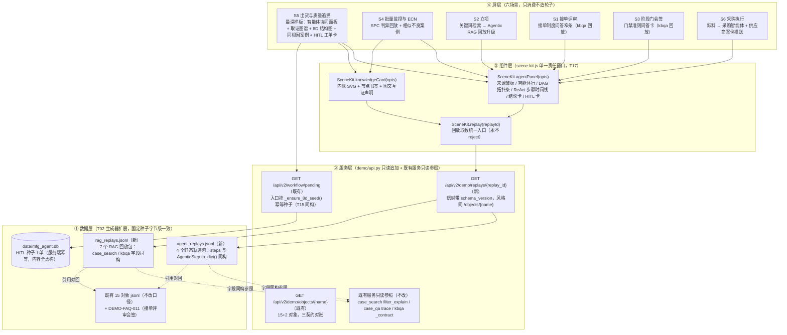
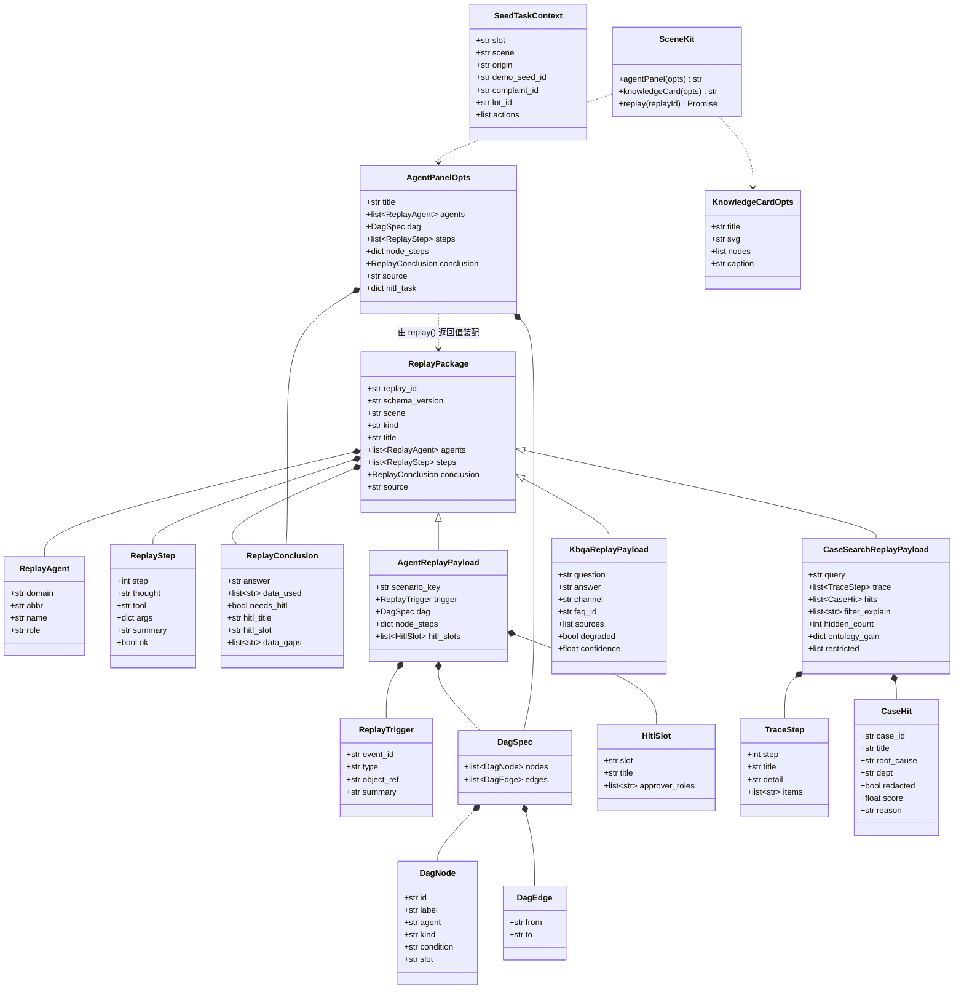
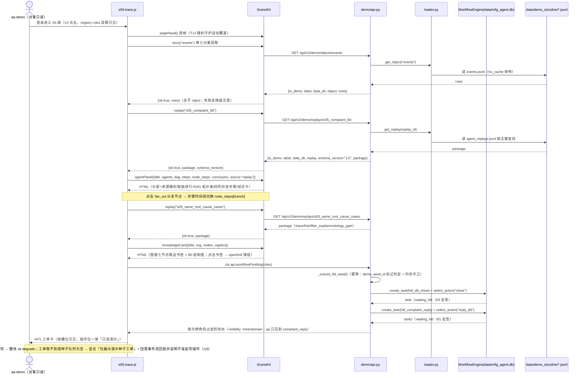
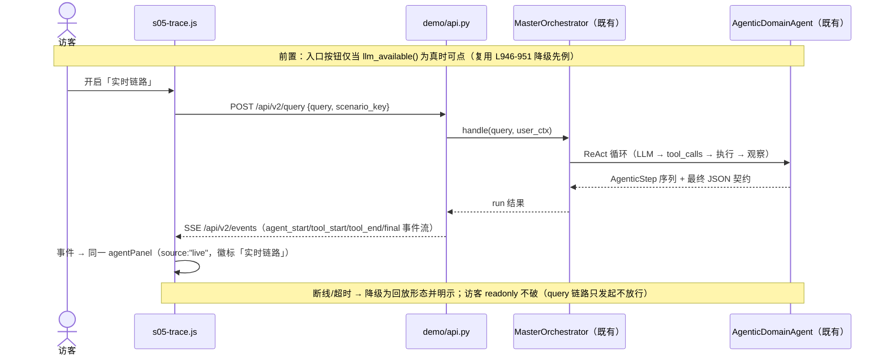
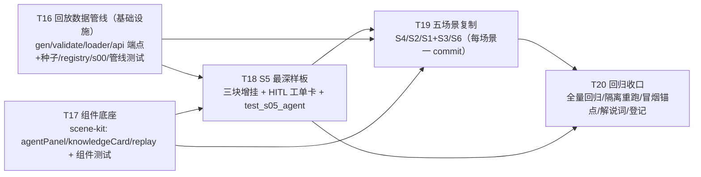

# 生态链场景智能体化（Agent/RAG 接入）· 架构设计

| 项 | 内容 |
|---|---|
| 文档版本 | V1.1（V1.0 + PM 2026-10-20 裁决 U1–U6 内嵌：§11 由「待明确事项」改写为「PM 裁决记录」；U1 拓扑层弥补动线、U3 空队列显式说明、U5 三级降级来源标记已落入组件/场景/任务验收。文件路径保持 v1.0 不变——PRD §6.1 等外部引用以此路径为准） |
| 作者 | 高见远（架构师 Bob） |
| 输入 | 《生态链场景智能体化-PRD-v1.1》（需求唯一事实源，含用户 2026-10-20 四项裁决）、《制造生态链-demo-AIGC开发顺序计划-v1.0》（T01–T15 施工事实）、《ARCHITECTURE-V2.md》（平台架构） |
| 日期 | 2026-10-20 |
| 语言 | 简体中文 |
| 基线 | `pytest tests/ -q` = 1380 passed / 5 skipped / 0 failed（T15 后）；演示装载层 15 对象 43 事件；六场景屏 S1–S6 已落地 |
| 范围 | P0 九条需求（六场景全量铺开，S5 最深样板）；P1-1 实时链路开关只做「预留」不做实现；P2 只登记不承诺 |

---

## 第一部分 · 系统设计

### 1. 实现方案总览

#### 1.1 双形态架构（回放主链路 + 实时开关预留）



**双形态的落地口径（对 PRD D1 的落实）**：

| 形态 | P0 范围内的落地物 | 预留物（P1-1，本设计只挂接点不实现） |
|---|---|---|
| (b) 确定性回放（主链路） | 本文 §2 回放数据管线 + §3 组件 + §4 六场景接入 | —— |
| (a) 真实链路 | —— | ① 组件 `opts.source` 已定义为 `'live'｜'replay'`，实时 SSE 事件映射到同一 `steps/conclusion` 结构即可驱动同一面板；② 回放包 envelope 与真实链路最终 JSON（`agentic.py` L272-279 契约）同构，来源标签切换即「实时链路」徽标；③ 入口按钮门控复用 `llm_available()`（`demo/api.py` L946-951 既有降级先例）。**P0 不写任何 SSE 代码** |

#### 1.2 与既有契约的兼容点（设计内嵌的既有纪律）

| 既有契约 | 兼容方式 |
|---|---|
| **T05 三契约**（屏/数据/组件） | 新组件走 `scene-kit.js` 扩展（屏只消费不改）；新数据走 T02 jsonl + `registry.json` 追加；屏脚本零新增文件（S1–S6 已在 `index.html` 加载，**`index.html` 本设计零改动**） |
| **T12 徽标守护**（`scene-kit.js` L754-825） | 守护包装 `SceneRegistry.register`，检查屏首帧 `.demo-flag`。新屏不新增；agentPanel/knowledgeCard 在既有屏内异步渲染，首帧徽标仍由 `pageHead()` 产出 → **守护自动覆盖，零改动**。组件自身来源徽标用独立类 `sk-source-badge`（replay=「演示回放」），**不占用 `.demo-flag`**，避免与 T12 类名判据混淆 |
| **T15 种子先例**（`_ensure_order_review_seed`） | `_ensure_8d_seed()` 同构：幂等 + 进程内内存守卫 + 落 `data/mfg_agent.db`（T15 第 0 步已证引擎实际连此库）+ 在 `/workflow/pending` 入口调用（`api.py` L755 同款一行） |
| **端点真相**（`/api/v2/demo/objects/{name}`，无 code 信封） | 新端点 `/api/v2/demo/replays/{replay_id}` 沿用 `demo_banner()` 信封风格；`test_t05_contract.py::test_scene_kit_endpoint_matches_backend_route`（L338-357）自动对账新端点（前端字符串 ↔ 后端路由） |
| **登记表纪律**（只加不删） | `registry.json` 仅：① `objects` 追加 2 条目；② `api` 追加 1 键；③ 各场景 `scenes[]` 条目 `objects` 数组追加回放对象名。零删除、零改他人条目 |
| **s00 镜像纪律**（`test_skeleton_object_mirror_matches_registry` L411-423） | `s00-skeleton.js` 的 `STORY_OBJECTS` 同步 +2（纯追加） |
| **零写操作** | 全部新功能只读；HITL 种子是服务端预种，不是前端写；屏内断言无 `POST/PUT/PATCH/DELETE` |
| **不动全局治理面** | 不改 `GOVERNANCE_SLOTS`（`workflow.py` L132-137，`d8_close`/`complaint_reply`/`spc_action` 已存在）、不改 `permissions.yaml`、不改 `workflow.py` 引擎 |

#### 1.3 技术难点与选型

| # | 难点 | 方法 |
|---|---|---|
| A1 | 回放数据必须与真实链路**同构**（G1） | 字段级同构而非风格相似：`steps` 六键（`step/thought/tool/args/summary/ok`）与 `AgenticStep.to_dict()`（`agentic.py` L59-61）一一对应；`conclusion` 与该文件 L272-279 最终 JSON 契约同键；`filter_explain/trace/ontology_gain` 与 `case_search.py` L158 / `case_qa.py` L101-105 / L123 同名同构。测试断言「键集相等」，不是「看起来像」 |
| A2 | T02 字节级一致纪律（R3） | 回放包进 `gen.py` `build()`，固定种子 20261019；重跑 diff 为空自证；`main()` 的 `glob("*.jsonl")` 清理 + 重写覆盖新文件，无孤儿文件 |
| A3 | 工单库存量夹具干扰（实测发现） | `data/mfg_agent.db` 现有 `hitl_d8_close` 416 条 `waiting_hitl`、`hitl_complaint_reply` 211 条（疑似测试夹具）。种子幂等判定**不用** T15 的 `wf_id` 判定（会被存量命中而跳过），改用 `context.demo_seed_id` 标记判定；屏端按标记过滤，只展示 DEMO-CC-001 种子工单 |
| A4 | qa-demo 的槽位可见性与 PRD 原表述冲突（**已裁决·U1**） | 权限矩阵是唯一判据（`workflow_scope.classify` L74-100：持槽才可见）。实测 `qa` 角色仅持 `complaint_reply.cosign`（无 `d8_close`）→ PM 2026-10-20 裁决「不为演示改权限，按矩阵实施」：gm 见双槽（域内）、biz 见 complaint_reply（发起人）、qa 见 complaint_reply（cosign 会签席）、mfg 双槽不可见；**DAG 拓扑层 `hitl_d8_close` 节点对所有访客可见（回放形态）**——这是 qa 看不到实时工单时的弥补，也是解说词关键动线（US-3 已按此修订）。PRD §6.1 有裁决记录 |
| A5 | 六屏共享文件并发（R1） | `scene-kit.js` 组件追加集中在 T17 单一窗口；场景窗口只消费；`registry.json` 只追加自己名下；每场景一 commit |

---

### 2. 回放数据管线设计（核心）

#### 2.1 回放包数据结构（字段同构证据）

所有回放包共用**信封**，按 `kind` 分三种载荷。存储为两个 jsonl 文件（一行一个包，`sort_keys=True`，与 T02 既有纪律一致）：

**共用信封（所有包必带）**：

| 字段 | 类型 | 同构来源 / 说明 |
|---|---|---|
| `replay_id` | str | 主键，全局唯一（如 `s05_complaint_8d`）；`registry.json` objects 的 `key` |
| `schema_version` | str | 固定 `"1.0"`；`SceneKit.replay()` 校验，缺失/不符 → 整块降级（共享知识 #1） |
| `scene` | str | `S1`..`S6` |
| `kind` | str | `agent` / `case_search` / `kbqa` |
| `title` | str | 面板标题 |
| `agents` | list | `[{domain, abbr, name, role}]`；`domain/abbr/name` 必须命中 `DOMAIN_AGENT_CONFIGS`（`agentic.py` L66-250），`role` 为一句话职责摘要（由生成器固定映射，不搬完整 prompt） |
| `steps` | list | `[{step, thought, tool, args, summary, ok}]`——与 `AgenticStep.to_dict()`（`agentic.py` L59-61）**六键全同**（注：`AgenticStep` dataclass 定义为 L48-57，`to_dict()` 为 L59-61，PRD 引 L48-61 指同一契约，无冲突）；`tool` 取值来自 `AGENT_TOOLS_META`（L31-42） |
| `conclusion` | obj | `{answer, data_used[], needs_hitl, hitl_title?, hitl_slot?, data_gaps[]}`——与 `agentic.py` L272-279 最终 JSON 契约同键 |
| `source` | str | 固定 `"replay"`（P1-1 实时形态为 `"live"`，P0 不产） |

**kind=agent 扩展**（`agent_replays.jsonl`，4 包）：

| 字段 | 类型 | 说明 |
|---|---|---|
| `scenario_key` | str | 对应 `scenarios/*.yaml` 的 `key`（`customer_complaint_v2` / `spc_anomaly_v2`；S2/S6 为单链流程，置 `""`） |
| `trigger` | obj | `{event_id, type, object_ref, summary}`——`event_id` 必须存在于 `events.jsonl` |
| `dag` | obj | `{nodes[], edges[]}`；node = `{id, label, agent, kind, condition?, slot?, branch?}`，与 YAML `steps` 一一对回（`fan_out`/`fan_in`/`hitl`/`workflow`/`agent` 五种 kind） |
| `node_steps` | obj | `{nodeId: steps[]}`——并行分支/各节点自有步骤（P0-2 验收③「点击任一节点展开该智能体 steps」） |
| `hitl_slots` | list | `[{slot, title, approver_roles[]}]`——与 YAML `hitl:` 段对回；`slot` 必在 `GOVERNANCE_SLOTS` |

**kind=case_search 扩展**（`rag_replays.jsonl`，4 包：S5/S4/S2/S6 各一）：

| 字段 | 类型 | 同构来源 |
|---|---|---|
| `query` | str | 检索问句 |
| `trace` | list | `[{step, title, detail, items[]}]`——同构 `case_qa._trace_step`（L101-105） |
| `hits` | list | `[{case_id, title, root_cause, dept, redacted, score, reason}]`——`case_id` 必在 `cases.jsonl`（测试断言，屏内零编造 case_id） |
| `filter_explain` | list[str] | 同构 `case_search.SearchResponse.filter_explain`（L158；由 `security/filter_translator.explain_filter` 产出） |
| `hidden_count` / `hidden_count_unit` | int/str | 同构 SearchResponse（L143-144，单位 `case`） |
| `ontology_gain` | obj | `{before, after, detail}`——同构 `case_qa` L123 |
| `restricted` | list | 同构 SearchResponse L163（「有但看不透」，只回 id/title/reason） |

**kind=kbqa 扩展**（`rag_replays.jsonl`，3 包：S1/S3/S6 各一）：

| 字段 | 类型 | 同构来源 |
|---|---|---|
| `question` / `answer` | str | 问答对 |
| `channel` | str | 固定 `"faq"`（L1 命中直答；不伪装来源） |
| `faq_id` | str | 必在 `faqs.jsonl` |
| `sources` | list | `[{label, source, segment}]`——同构 `kbqa._contract` 的 `sources`（L83-99）；label 形如 `FAQ #DEMO-FAQ-011` |
| `degraded` / `confidence` | bool/float | 同构 `_contract` |

**11 个回放包清单**（T02 生成，固定内容派生自既有数据）：

| 文件 | replay_id | kind | 内容锚点 |
|---|---|---|---|
| agent_replays | `s05_complaint_8d` | agent | `customer_complaint_v2` 全 DAG：intake → qa_lead → 四域并行（PQE/SQE/工程/业务）→ fan_in → capa_flow(sla 72h) → 双 HITL；四分支 node_steps + 结论数字对回 DEMO-CC-001/DEMO-LOT-002/工序 30/DEMO-EQ-006/夜班/2 批 3,952 件 |
| agent_replays | `s04_spc_anomaly` | agent | `spc_anomaly_v2` DAG：intake → spc_capability → fan_out(不良柏拉图) → hitl_spc_action → report；口径回指 EV-0013（CL=245.0/LSL=239.0/USL=251.0） |
| agent_replays | `s02_case_rag` | agent | 检索智能体四步单链 DAG：术语归一 → 本体扩展 → 授权过滤 → 引用校验（对齐 `case-retrieval-ux-innovation.md` I3/I6） |
| agent_replays | `s06_shortage_procurement` | agent | 采购智能体三步单链：缺口机械判定（T08 口径）→ 供应商案例检索 → 催料制度查询 |
| rag_replays | `s05_same_root_cause_cases` | case_search | 命中 DEMO-CASE-006（烧录异常客诉/静电接地失效）；trace 五步 + filter_explain + ontology_gain |
| rag_replays | `s04_spc_similar_cases` | case_search | 命中 DEMO-CASE-001（炉温波动导致虚焊） |
| rag_replays | `s02_case_search` | case_search | 立项视角检索（MBOM/上料类 → DEMO-CASE-008 等） |
| rag_replays | `s06_supplier_cases` | case_search | 供应商来料类 → DEMO-CASE-002（电容容舞/供应商来料批次超差） |
| rag_replays | `s01_intake_faq` | kbqa | DEMO-FAQ-011（接单评审会签，**U2 已裁决·确认新增**） |
| rag_replays | `s03_gate_faq` | kbqa | DEMO-FAQ-007（阶段门 Go 的条件） |
| rag_replays | `s06_urge_faq` | kbqa | DEMO-FAQ-008（催料任务谁来跟进） |

#### 2.2 T02 生成器扩展（`tools/demo_gen/gen.py`）

- **落点**：`build()` 返回值新增 `agent_replays` / `rag_replays` 两个键 → `main()` 自动落 `data/demo_storyline/agent_replays.jsonl` / `rag_replays.jsonl`（沿用既有 `for name, rows in data.items()` 循环，**无需改 main() 结构**）；固定种子 20261019 不变，重跑字节级一致。
- **内容派生纪律**：包内引用的案例标题/根因/FAQ 问答对**从包内已生成的行按 id 查找**（如 `case_row("DEMO-CASE-006")`），不手抄第二份；结论数字从事件 payload / lots / inspections 取。这样「屏上数字 → 回放包 → T02 数据包」三层同源。
- **agents 摘要映射**：生成器内置 `ROLE_SUMMARY = {domain: 一句话}` 固定映射（如 `quality → 客诉 8D 牵头与质量判定`）；`abbr/name` 直接抄 `DOMAIN_AGENT_CONFIGS` 的值（测试断言相等）。
- **新增 DEMO-FAQ-011**（**U2 已裁决·确认新增**）：`faqs` 构建表追加 `("接单评审会签怎么发起？", "订单过 ATP 初评与报价区间后，由业务在接单评审场景发起一次会签，工程与计划会签后业务终批。")`。理由：现有 10 条 FAQ 无接单评审制度条目，US-6 无法对回；条目内容与 T15 已落地的 order_review 治理事实（propose=业务/cosign=工程+计划/approve=业务）逐字对得上，数据自洽有出处。无任何测试硬编码 faqs 条数（已 grep 实证）。
- **行数估计**：约 +200 行（4 个 agent 包构建函数 + 7 个 rag 包构建 + 2 个查找辅助 + FAQ 一行）。

#### 2.3 `validate.py` 校验扩展

新增第五类校验 `check_replays(data)`（`data` 已由 `load()` 自动从主目录 glob 到两个新文件，**`load()` 零改动**）：

1. **信封完整**：`replay_id` 全局唯一；`schema_version == "1.0"`；`scene ∈ S1..S6`；`kind` 合法；`agents[].domain` 命中 `DOMAIN_AGENT_CONFIGS`（import `mfg_agents.v2.agents.agentic`——pyyaml/包导入均为既有依赖，零新增）。
2. **steps 同构**：每个 step 的键集恰等于 `{"step","thought","tool","args","summary","ok"}`。
3. **引用完整**：`hits[].case_id ∈ cases`；`faq_id ∈ faqs`；`trigger.event_id ∈ events`；`data_used` 中出现的 `DEMO-*` 对象 id 可在对应对象表找到（断引用报出具体位置，与既有四类校验同风格）。
4. **DAG ↔ YAML 对回**：`kind=agent` 且 `scenario_key` 非空时，`yaml.safe_load` 对应 `scenarios/<key>.yaml`，断言 node 的 `(id, label, agent, kind)` 与 YAML `steps` 一致、`hitl_slots` 与 YAML `hitl:` 段一致、`fan_out` 分支集一致。
5. **`--inject replays` 自测**：故意把一个 `case_id` 改成不存在值，校验器必须报出（沿用既有注入自测模式）。

`CHECKS` 字典 +1 项；`--inject` choices 自动扩展。行数估计：约 +70 行。

#### 2.4 `api.py` 新只读端点（`src/mfg_agents/v2/demo/api.py`）

```
GET /api/v2/demo/replays/{replay_id}
  200 → {**demo_banner(), "replay": replay_id, "schema_version": "1.0", "package": {...}}
  404 → {"detail": "demo replay not found"}
```

- **风格与 `/objects/{name}`（L274-281）一致**：同一 `demo_banner()` 信封（`is_demo/label/data_dir`）、同一 404 口径、未知 id 不泄漏内部结构。
- **为什么不是复用 `/objects/{name}`**：① 回放包需要 `schema_version` 版本信封（共享知识 #1，前向兼容）；② 语义分离——业务对象是「故事事实」，回放包是「智能体轨迹」，两种生命周期与校验规则；③ 端点可在返回前做包形状预检（畸形包 → 带 `notice` 的降级响应，不把半包喂给前端）。
- **装载层**：`loader.py` 的 `OBJECTS` 元组 +2（`agent_replays`/`rag_replays`，维持「磁盘 jsonl ↔ OBJECTS ↔ registry.json objects」三方对账）；新增 `get_replay(replay_id)` 在两个文件内按主键查找，未命中抛 `DemoDataError`（端点转 404）。
- **前端对账**：`scene-kit.js` 的 `replay()` 内写死字符串 `"/api/v2/demo/replays/"`，`test_t05_contract.py::test_scene_kit_endpoint_matches_backend_route` 自动把前端端点与 api.py 路由对账（新增路由即通过，零测试改动）。
- 行数估计：约 +35 行（端点 + loader 引用）。

#### 2.5 HITL 种子钩子（`_ensure_8d_seed()`）

```python
_8D_CLOSE_ACTIONS = [...]        # 与 customer_complaint_v2.yaml hitl_d8_close actions 同构（close/return_supplement/extend）
_COMPLAINT_REPLY_ACTIONS = [...] # 与 hitl_complaint_reply actions 同构（reply_8d/reply_buffered/escalate）
_8D_SEED_MARK = "s5_8d_v1"       # demo_seed_id 标记（A3：绕开工单库存量夹具）

def _ensure_8d_seed() -> None:
    """幂等预置 S5 客诉 8D 双 HITL 工单（d8_close + complaint_reply）。参照 T15。"""
    global _8d_seeded
    if _8d_seeded:
        return
    engine = _workflow_engine()
    seeded = {(t.governance or {}).get("demo_seed_id") for t in engine.list_tasks()}
    if _8D_SEED_MARK not in seeded:
        task = engine.create_task(
            wf_id="hitl_d8_close",
            title="客诉 8D 报告关闭确认（DEMO-CC-001 · 演示种子）",
            context={"slot": "d8_close", "scene": "S5", "origin": "demo_seed",
                     "demo_seed_id": _8D_SEED_MARK, "complaint_id": "DEMO-CC-001",
                     "lot_id": "DEMO-LOT-002", "actions": _8D_CLOSE_ACTIONS},
            assignees=["质量总监", "QA经理", "PQE", "SQE", "工程"],
            priority="P1", sla_hours=72, hitl=True,
            hitl_prompt="8D 报告关闭确认：D4 根因（烧录站静电接地失效）与 D5–D7 措施已验证，请按岗位会签")
        engine.select_action(task.task_uid, "close", actor="质量总监（演示）",
                             user_ctx={"user_id": "u-qd-demo", "roles": ["quality_director"]},
                             comment="D4–D7 证据链完整，按关闭口径发起会签")
        task2 = engine.create_task(
            wf_id="hitl_complaint_reply",
            title="对客回复确认（DEMO-CC-001 · 演示种子）",
            context={"slot": "complaint_reply", "scene": "S5", "origin": "demo_seed",
                     "demo_seed_id": _8D_SEED_MARK, "complaint_id": "DEMO-CC-001",
                     "actions": _COMPLAINT_REPLY_ACTIONS},
            assignees=["业务经理", "QA"],
            priority="P1", sla_hours=72, hitl=True,
            hitl_prompt="对客回复确认：按 8D 结论回复口径，请业务发起、QA 会签一致性")
        engine.select_action(task2.task_uid, "reply_8d", actor="业务经理（演示）",
                             user_ctx={"user_id": "u-sales-demo", "roles": ["sales"]},
                             comment="按 8D 结论回复，请 QA 会签口径一致性")
    _8d_seeded = True
```

**设计要点**：

1. **幂等判定用 `demo_seed_id` 标记而非 `wf_id`**（A3）：库里已有 416 条 `hitl_d8_close`/211 条 `hitl_complaint_reply` 存量（测试夹具），`wf_id` 判定会误判「已存在」而跳过种子。标记判定精确锚定本设计的演示种子；进程内 `_8d_seeded` 内存守卫避免每请求查库（T15 同款）。
2. **两链不混**（R3）：静态轨迹走 T02 jsonl（字节级一致）；HITL 种子走本钩子（服务端幂等落库）。种子内容全虚构（DEMO-CC-001、词表人名），落库后 `tools/demo_gen/check_isolation.py` C 类扫描自证（R6，测试子进程实跑）。
3. **槽位零新增**：`d8_close`/`complaint_reply` 已在 `GOVERNANCE_SLOTS`（`workflow.py` L132-137）与 `permissions.yaml` slots（L40-47）→ **不动全局治理面**。
4. **落库位置**：`data/mfg_agent.db`（T15 第 0 步结论：引擎实际连此库）。
5. **调用点**：`/api/v2/workflow/pending` 入口在 `_ensure_order_review_seed()`（L755）旁 +1 行 `_ensure_8d_seed()`。
6. **可见性实测推演**（按 `permissions.yaml` 角色持槽 + `workflow_scope.classify`；**U1 已裁决·按矩阵实施，不为演示改权限**）：

| 访客 | roles | d8_close 工单 | complaint_reply 工单 |
|---|---|---|---|
| gm-demo | gm | 域内可见（持 approve，会签完成后轮终批） | 域内可见（持 approve） |
| biz-demo | sales | **不可见**（sales 无 d8_close 持槽） | 发起人视角（propose 已办 → 域内只读） |
| qa-demo | qa | **不可见**（qa 无 d8_close 持槽；由 DAG 拓扑层回放弥补，见 6a） | **我的会签**（持 cosign，mine） |
| mfg-demo | manufacturing | 不可见 | 不可见 |

6a. **DAG 拓扑层弥补动线**（U1 裁决保留项）：agentPanel 的 DAG 拓扑条对所有访客渲染 `hitl_d8_close` / `hitl_complaint_reply` 两个 HITL 节点（回放形态，特殊描边 + 槽位名）——qa-demo 虽看不到 d8_close 实时工单，仍能在拓扑层看到「8D 关闭归质量总监/QA经理」的治理结构；解说词动线据此讲「不同岗位登录看到不同的待办与可见性」。此节点**不可按角色隐藏**。

7. **空队列显式说明**（U3 裁决追加·演示诚实纪律）：屏端按 `demo_seed_id` 过滤后若队列为空（种子未落库/读取失败），HITL 卡必须显式渲染「仅展示演示种子工单（当前无可见种子）」，**不得让观众误读成「没有工单」**；随后回落 T02 事件流回放（DEMO-EV-0026 8D 会签事件）并说明「不发起写操作」。写入 T18 验收。
8. **无种子时的降级**（P0-5 验收③）：工单读取失败/无标记工单 → 屏上显式「工单库无 8D 种子工单，按事件流回放，不发起写操作」，回落 T02 事件流（DEMO-EV-0026 8D 会签事件）。
9. **SLA**（**U6 已裁决·72h**）：YAML `hitl` 节点未声明 `sla_hours`，取 72h 对齐 `capa_flow` 工作流节点（口径有出处）。

行数估计：约 +75 行（两个动作常量 + 钩子 + 入口调用）。

---

### 3. 组件设计（`scene-kit.js` 扩展，T17 单一责任窗口）

三个新 API 挂到既有 `SceneKit` 导出对象（L831-855 追加 3 项）；样式走 `injectStyle()`（L196）内联 `sk-` 前缀块，复用 app.css CSS 变量（`--border`/`--primary`，`test_scene_kit_js_exposes_component_api` 已断言不得硬编码深色底）。

#### 3.1 `SceneKit.agentPanel(opts)` —— 智能体协同面板

**入参 schema**（PRD §5.2 的最小必要扩展：新增 `node_steps` 与 `dag` 可选，其余逐字保持）：

```
{
  title: string,                          // 任务标题
  agents: [{domain, abbr, name, role}],   // 参与智能体（domain 命中 DOMAIN_AGENT_CONFIGS）
  dag?: {nodes: [{id, label, agent, kind, condition?, slot?}],
         edges: [{from, to}]},            // 可选；缺省 = 轻形态（无拓扑条，S1/S3/S6 问答/推送面板）
  steps: [{step, thought, tool, args, summary, ok}],   // 主链步骤，默认折叠
  node_steps?: {nodeId: steps[]},         // 点击 DAG 节点切换到该节点步骤（并行分支）
  conclusion: {answer, data_used: [], needs_hitl, hitl_title?, hitl_slot?, data_gaps: []},
  source: "live" | "replay",              // 来源徽标；replay 必须可见
  hitl_task?: {title, slot, status, visibility, progress, required, my_action, readonly_note}
}
```

**渲染结构**（自上而下）：

1. **头部**：标题 + `sk-source-badge`（`replay` → 「演示回放」demo 语义样式；`live` → 「实时链路」）。**类名独立于 `.demo-flag`**（T12 判据不被劫持）；徽标不可去除（无 opts 开关）。
2. **参与智能体行**：域徽章（abbr）+ name + role 一句话（数据来自入参，文案摘要与 `DOMAIN_AGENT_CONFIGS` 的 name/abbr 对回，测试断言）。
3. **DAG 拓扑条**（dag 存在时）：节点小卡横向链；`fan_out` 分叉画法（一对多引出）、`fan_in` 汇聚画法、`hitl` 节点特殊描边（挂槽位名）、`condition` 显示为分支标签；点击节点 → 步骤时间线切换到 `node_steps[nodeId]`（无则该节点禁用展开并说明）。**`hitl` 节点对所有访客渲染、不按角色隐藏**（U1 裁决：拓扑层治理结构是 qa 看不到 d8_close 实时工单时的弥补动线）。
4. **步骤时间线**：竖向 step 列表，默认折叠为「工具名 + summary 一句话」；点击展开 `thought`/`args`（JSON 缩进）/`ok` 标记（失败步骤红标）。`steps` 为空数组 → **整块渲染降级文案**（「回放数据缺失，不展示编造步骤」），不渲染半面板。
5. **结论卡**：`answer` 正文 + `data_used` 出处列表（逐条）+ `data_gaps` 诚实声明（空数组时显式「无数据缺口」）；`needs_hitl=true` 时带 `hitl_title`/`hitl_slot` 行。
6. **HITL 卡**（hitl_task 存在时）：工单标题/槽位/状态/会签进度（progress）/本岗位可见性（mine/domain/不可见，取自后端 `visibility` 实测）；**操作位一律渲染「只读演示」**，无任何写按钮；`readonly_note` 说明写链路归治理窗口。**空队列纪律**（U3 裁决）：按 `demo_seed_id` 过滤后无可见种子工单时，显式渲染「仅展示演示种子工单（当前无可见种子）」，不得让观众误读为「没有工单」，随后回落事件流回放并说明「不发起写操作」。
7. **并行四列形态**（S5）：dag 含 `fan_out` 时，拓扑条下方渲染分支并发时间线——每个分支一列（列头 = 分支 label），列内为该分支 `node_steps` 的折叠步骤 + 结论摘要；列后画汇聚箭头到 fan_in。**数据驱动，非 S5 硬编码**（S4 单分支同样适用）。

**纪律**（PRD §5.2 逐条内嵌）：steps 六键同构（测试断言键集相等）；replay 徽标不可去除；零写按钮；数字全部来自入参（组件不自造）；降级路径见上。

#### 3.2 `SceneKit.knowledgeCard(opts)` —— 知识图片卡

**入参 schema**：

```
{
  title: string,
  svg: string,                    // 内联 SVG 字符串（viewBox 自适应容器宽度；零外部 URL）
  nodes: [{id, label, agent, tool, conclusion, refs: []}],   // 书签，id 与 svg 节点对应
  caption: string                 // 图文互证声明
}
```

**渲染结构**：① 图题行：标题 + `SceneKit.demoBadge()`（与 `pageHead` 同一出口的「演示数据」徽标）；② SVG 区（内联字符串直接插入，禁外链）；③ 节点书签列：图下一排书签（与 svg 节点 id 一一对应），点击书签 → SVG 内对应节点高亮（描边加粗，类名 `sk-kc-node-active`）+ 弹层显示「取证智能体/工具/结论/关联口径」（复用既有 `openDrill()`，L460）；④ 图文互证声明：caption 写明「图中结论与智能体协同面板结论同源，可逐条对回」。

**纪律**：SVG 全内联零外部资源（隔离红线友好）；几何坐标由 `frontend/sNN-*.js` 权威副本给定（与 s05 双副本纪律一致，测试深比对防漂移）；真机截图核对无黑块（T06 纪律）；不编节点结论（书签 conclusion 与回放包结论同源，测试对账）。

#### 3.3 `SceneKit.replay(replayId)` —— 回放取数统一入口

与 `story()`（L608）同纪律：**永不 reject、不抛未捕获异常、不透传 err.message**。

```
replay(replayId) → Promise<{ok: boolean, package?: obj, schema_version?: string,
                            source?: "api"|"local", degraded?: boolean, error?: string, note?: string}>
```

取数顺序：`GET /api/v2/demo/replays/{replayId}` → `window.DEMO_STORY_REPLAY[replayId]`（离线回放镜像，可选）→ `{ok:false, error:"演示回放数据未就绪"}`。`schema_version` 缺失或不等于 `"1.0"` → `{ok:false, error:"回放包版本不兼容"}`（降级，不渲染半包）。`fetchJson` 复用既有实现（L545，6s 超时 + AbortController）。

#### 3.4 徽标兼容与降级路径总表

| 场景 | 行为 |
|---|---|
| T12 守护覆盖 | 组件在既有屏内异步渲染；屏首帧徽标仍由 `pageHead()` 产出 → 守护零改动自动覆盖；新屏若忘记 `pageHead()` 仍被拦（既有机制） |
| 回放包缺失 | `replay()` → `{ok:false}` → 屏内整块 `sk-degrade`（「演示回放数据未就绪，不展示编造内容」），不影响屏上其他区块 |
| steps 为空 | agentPanel 整块降级文案（同上线纪律） |
| HITL 队列按种子标记过滤后为空 | HITL 卡显式「仅展示演示种子工单（当前无可见种子）」+ 回落事件流回放并说明不发起写操作（U3 裁决） |
| 工单取不到 | HITL 卡显式降级说明 + 回落事件流回放（P0-5 验收③） |
| 装载层离线 | `story()`/`replay()` 双降级（既有模式），屏不白屏 |
| S2 检索区三级降级（U5 裁决） | 三种状态在屏上均须有**可见来源标记**（与 agentPanel 来源徽标纪律一致）：① 回放就绪 → 「演示回放」徽标；② 回放缺失但 `story('cases')` 就绪 → 关键词匹配版 + 「关键词降级」标记；③ 两者皆缺 → 整区 `sk-degrade` |

---

### 4. 六场景接入矩阵

| 屏 | 回放包（agent / rag） | 组件 | 屏文件改点 | 数据文件改点（frontend/sNN-*.js 权威副本） | 新测试 | 对账点 |
|---|---|---|---|---|---|---|
| **S5**（最深样板） | `s05_complaint_8d` / `s05_same_root_cause_cases` | agentPanel（四域并行）+ knowledgeCard（取证图谱升级 + 8D 结构图）+ HITL 工单卡（`ctx.api.workflowPending()`） | +3 块：① 客诉智能体协同面板（区块头部）；② 追溯图谱七节点挂取证书签（几何沿用 T06，仅增书签）；③ 8D 结构图（D1–D8 新几何）+ 同根因案例卡列（命中卡 + filter_explain + trace）+ HITL 工单卡（按槽位可见，只读） | +8D 八步几何与阶段高亮、七节点书签（agent/tool/conclusion/refs）、回放 id 登记、槽位口径词典、HITL 降级文案（含 U3 空队列说明） | `test_s05_agent.py` | DAG ↔ YAML 对回；steps 六键 ↔ `AgenticStep.to_dict()`；结论数字 ↔ T02 载荷（批次/工序/设备/当班/同批库存）；case_id ∈ cases.jsonl；图谱书签结论 ↔ agentPanel 结论（图文互证）；零写铁律（扩展 T15 `test_scene_reads_live_workorder_but_never_writes_it` 模式）；首帧徽标；**DAG 拓扑层 hitl_d8_close/hitl_complaint_reply 节点所有访客可见（U1 裁决，不按角色隐藏）；HITL 卡按权限矩阵可见 + 空队列显式「仅展示演示种子工单」（U3）** |
| **S4** | `s04_spc_anomaly` / `s04_spc_similar_cases` | knowledgeCard（SPC 控制图升级：判异点挂红色书签「智能体已推相似不良 N 条」→ 点击展开 agentPanel 判异回放） | 控制图升级为知识图片卡；判异处置两卡各增「相似案例」入口；spc_action 槽位只读卡（**U4 裁决：由回放 DAG 承载，标注「演示回放」，不做真实种子工单**） | +判异书签口径、spc replay 引用、案例推送口径 | `test_s04_agent.py` | DAG ↔ `spc_anomaly_v2.yaml`；EV-0013 控制限口径不抹平（T09 纪律）；「SPC 序列 30 点/2 判异点」与「判异事件」两组数据源仍并列；DEMO-CASE-001 ∈ cases；spc_action 卡带「演示回放」来源标注；零写 |
| **S2** | `s02_case_rag` / `s02_case_search` | agentPanel（智能体检索面板） | 案例检索区升级：检索条 → trace 时间线（归一→扩展→过滤→引用）→ 命中案例卡列 → filter_explain 判定链折叠区；**现有关键词匹配保留为降级路径**（回放未就绪时回落，不白屏）；**三级降级均带可见来源标记**（U5 裁决） | +rag replay 引用、trace 五步口径、降级分级说明（含来源标记口径） | `test_s02_agent.py` | trace 五步结构可见；case_id ∈ cases.jsonl；filter_explain 与 case_search 字段同名同构；**三级降级（回放/关键词降级/整区降级）在屏上有可见来源标记，与 agentPanel 来源徽标纪律一致（U5）**；关键词降级路径保留（装载层未就绪不白屏） |
| **S1** | `s01_intake_faq`（kbqa） | agentPanel 轻形态（窄条问答卡：单智能体 + 1-2 步检索 + FAQ 直答结论） | 会签卡下方增「接单制度问答」窄条（FAQ 直答 + 出处编号）；**不动既有会签双轨结构（T15）** | +kbqa replay 引用、问答口径 | `test_s01_agent.py` | faq_id ∈ faqs.jsonl；每条答案带 FAQ 编号；`channel=faq` 标注不伪装来源；未命中照实「未收录该问题」；双轨会签结构零改动 |
| **S3** | `s03_gate_faq`（kbqa） | agentPanel 轻形态（门禁准则问答卡） | 记分卡右侧增「门禁准则问答」卡（CPK≥1.33 等阈值制度出处）；**不动三门结论与记分卡** | +kbqa replay 引用 | `test_s03_agent.py` | 同 S1；记分卡四维口径零改动 |
| **S6** | `s06_shortage_procurement` / `s06_supplier_cases` / `s06_urge_faq` | agentPanel（缺料卡折叠面板） | 缺料预警卡增「采购智能体 + 供应商案例」折叠面板：缺口机械判定口径（T08）→ 智能体视角结论 → 供应商案例/催料制度 FAQ | +replay 引用、缺口口径引用（不重新定义） | `test_s06_agent.py` | 缺口判定沿用 T08 口径（未交付且料期晚于需料日）；DEMO-CASE-002 ∈ cases；DEMO-FAQ-008 ∈ faqs；催料待办仍只读回放；零写 |

> 六屏共同纪律：`index.html` **零改动**（屏脚本已在位，组件在 scene-kit.js）；`app.js`/`NAV_ITEMS` 零改；样式全 `sk-` 前缀自注入；每屏改造完成同步更新《演示脚本.md》对应段（R5）。

---

### 5. 文件列表

#### 5.1 新增文件（3）

| 文件 | 职责 |
|---|---|
| `data/demo_storyline/agent_replays.jsonl` | T02 生成的 4 个智能体静态轨迹回放包（steps 与 `AgenticStep.to_dict()` 同构、DAG 与 YAML 对回） |
| `data/demo_storyline/rag_replays.jsonl` | T02 生成的 7 个 RAG 回放包（case_search 的 trace/filter_explain/ontology_gain 与 kbqa 的 `_contract` 字段同构） |
| `tests/demo/test_replay_pipeline.py` | 回放数据管线守卫：信封/schema 版本/steps 同构/引用对回/DAG↔YAML/生成确定性（重跑 diff）/隔离 C 类扫描子进程实跑 |

#### 5.2 最小改动文件（逐个给改点与行数估计）

| # | 文件 | 改点 | 行数估计 |
|---|---|---|---|
| 1 | `tools/demo_gen/gen.py` | `build()` +`agent_replays`/`rag_replays` 两键及构建函数；faqs +DEMO-FAQ-011；agents 摘要映射 | +200 |
| 2 | `tools/demo_gen/validate.py` | `CHECKS` +`check_replays`（五类断言，见 §2.3）；`--inject replays` | +70 |
| 3 | `src/mfg_agents/v2/demo/loader.py` | `OBJECTS` +2；新增 `get_replay()` | +15 |
| 4 | `src/mfg_agents/v2/demo/api.py` | +`GET /api/v2/demo/replays/{replay_id}`；+`_ensure_8d_seed()` 与两个动作常量；`/workflow/pending` 入口 +1 行调用（L755 旁） | +110 |
| 5 | `src/mfg_agents/v2/demo/ui/scenes/scene-kit.js` | +`agentPanel`/`knowledgeCard`/`replay` 三 API；`injectStyle()` +`sk-agent-*`/`sk-kc-*` 样式块；导出对象 +3 项 | +330 |
| 6 | `data/demo_storyline/frontend/registry.json` | `objects` +2 条目（key/fields 从 jsonl 首行实读）；`api` +`replay` 键；六个 `scenes[]` 条目的 `objects` 各追加回放对象名（**只追加自己名下**） | +25 |
| 7 | `src/mfg_agents/v2/demo/ui/scenes/s00-skeleton.js` | `STORY_OBJECTS` +2（镜像纪律，`test_skeleton_object_mirror_matches_registry` 要求） | +2 |
| 8 | `src/mfg_agents/v2/demo/ui/scenes/s05-trace.js` | +智能体协同面板区块（四域并行）+ 图谱取证书签 + 8D 结构图 + 同根因案例区 + HITL 工单卡（含降级） | +260 |
| 9 | `data/demo_storyline/frontend/s05-trace.js` | +8D 八步几何/阶段高亮、七节点书签、回放 id、槽位口径、HITL 降级文案（屏内 `INLINE_SCENE_DATA` 同源镜像） | +90 |
| 10 | `src/mfg_agents/v2/demo/ui/scenes/s04-batch-ecn.js` | 控制图升级知识图片卡 + 判异书签 + 回放面板 + spc_action 只读卡 | +150 |
| 11 | `data/demo_storyline/frontend/s04-batch-ecn.js` | +判异书签口径、spc replay 引用、案例推送口径 | +40 |
| 12 | `src/mfg_agents/v2/demo/ui/scenes/s02-npi-kickoff.js` | 检索区升级（agentPanel + trace + 命中卡 + filter_explain 折叠；关键词版降级保留） | +140 |
| 13 | `data/demo_storyline/frontend/s02-npi-kickoff.js` | +rag replay 引用、trace 口径、降级分级 | +35 |
| 14 | `src/mfg_agents/v2/demo/ui/scenes/s01-intake.js` | 会签卡下方 +FAQ 问答窄条（agentPanel 轻形态） | +90 |
| 15 | `data/demo_storyline/frontend/s01-intake.js` | +kbqa replay 引用、问答口径 | +25 |
| 16 | `src/mfg_agents/v2/demo/ui/scenes/s03-stage-gate.js` | 记分卡右侧 +门禁准则问答卡 | +90 |
| 17 | `data/demo_storyline/frontend/s03-stage-gate.js` | +kbqa replay 引用 | +25 |
| 18 | `src/mfg_agents/v2/demo/ui/scenes/s06-procurement.js` | 缺料卡 +采购智能体折叠面板 | +100 |
| 19 | `data/demo_storyline/frontend/s06-procurement.js` | +replay 引用、缺口口径引用 | +30 |
| 20 | `tests/demo/test_s05_agent.py`（新文件，§5.1 外单列以便审阅） | S5 智能体化守卫：登记/DAG 对回/steps 同构/数字对账/图文互证/镜像深比对/零写/徽标 | +200 |
| 21 | `tests/demo/test_s04_agent.py` | S4 守卫：DAG 对回/EV-0013 口径/案例对账/零写 | +120 |
| 22 | `tests/demo/test_s02_agent.py` | S2 守卫：trace 结构/降级保留/案例对账 | +110 |
| 23 | `tests/demo/test_s01_agent.py` | S1 守卫：FAQ 对账/双轨不动/零写 | +90 |
| 24 | `tests/demo/test_s03_agent.py` | S3 守卫：FAQ 对账/记分卡不动 | +90 |
| 25 | `tests/demo/test_s06_agent.py` | S6 守卫：缺口口径/案例 FAQ 对账/零写 | +90 |
| 26 | `tests/demo/test_demo_smoke.py` | 锚点数据**纯追加**（S5 智能体面板锚点 + HITL 卡锚点；不改既有断言、可见性继续从 registry 现算） | +15 |
| 27 | `data/demo_storyline/演示脚本.md` | 六屏解说词补「讲什么/点哪里」智能体面板动线（R5） | +60 |
| 28 | `docs/制造生态链-demo-AIGC开发顺序计划-v1.0.md` | 第 7.1 节登记 T16–T20 完成记录（追加） | +10 |

> **不碰**：`app.js`、`NAV_ITEMS`、`app.css`、`ui/index.html`、`services/`、`contracts/`、`common/`、`v2/agents/`、`workflow.py`、`permissions.yaml`、`GOVERNANCE_SLOTS`、既有 `tests/demo/test_s0*.py`（新断言全部进新测试文件，遵守「tests/ 只允许新增文件」纪律）。

---

## 第二部分 · 数据结构与接口

### 6. 数据结构与接口



**JSON Schema 要点**（回放包，`agent_replays.jsonl` 一行一包）：

```json
{
  "replay_id": "s05_complaint_8d",
  "schema_version": "1.0",
  "scene": "S5",
  "kind": "agent",
  "title": "客诉 8D 多智能体协同（DEMO-CC-001）",
  "agents": [
    {"domain": "quality", "abbr": "QA", "name": "质量域智能体", "role": "客诉 8D 牵头：合成 D1–D8 骨架"},
    {"domain": "rd_engineering", "abbr": "RD", "name": "研发工程智能体", "role": "设计根因分析"},
    {"domain": "supply_chain", "abbr": "SC", "name": "供应链智能体", "role": "对客口径与在库处置"}
  ],
  "scenario_key": "customer_complaint_v2",
  "trigger": {"event_id": "DEMO-EV-0024", "type": "complaint", "object_ref": "DEMO-CC-001", "summary": "客诉受理：12 片烧录异常"},
  "dag": {
    "nodes": [
      {"id": "intake", "label": "业务Agent · 意图识别", "agent": "business", "kind": "agent"},
      {"id": "qa_lead", "label": "QA · 8D 牵头", "agent": "qa_lead", "kind": "agent"},
      {"id": "fanout", "label": "四域并行取证", "agent": "", "kind": "fan_out", "condition": "complaint_found"},
      {"id": "pqe_process", "label": "PQE · 过程分析", "agent": "pqe_process", "kind": "agent"},
      {"id": "sqe_supplier", "label": "SQE · 供应商侧", "agent": "sqe_supplier", "kind": "agent"},
      {"id": "engineering", "label": "工程 · 设计根因", "agent": "engineering", "kind": "agent"},
      {"id": "business_sales", "label": "业务 · 对客口径", "agent": "business_sales", "kind": "agent"},
      {"id": "fanin", "label": "汇聚", "agent": "", "kind": "fan_in"},
      {"id": "capa_flow", "label": "客诉 8D 整改工单", "agent": "complaint_8d_flow", "kind": "workflow"},
      {"id": "hitl_d8_close", "label": "8D 报告关闭确认", "agent": "hitl_d8_close", "kind": "hitl", "slot": "d8_close"},
      {"id": "hitl_complaint_reply", "label": "对客回复确认（脱敏后）", "agent": "hitl_complaint_reply", "kind": "hitl", "slot": "complaint_reply"}
    ],
    "edges": [
      {"from": "intake", "to": "qa_lead"}, {"from": "qa_lead", "to": "fanout"},
      {"from": "fanout", "to": "pqe_process"}, {"from": "fanout", "to": "sqe_supplier"},
      {"from": "fanout", "to": "engineering"}, {"from": "fanout", "to": "business_sales"},
      {"from": "pqe_process", "to": "fanin"}, {"from": "sqe_supplier", "to": "fanin"},
      {"from": "engineering", "to": "fanin"}, {"from": "business_sales", "to": "fanin"},
      {"from": "fanin", "to": "capa_flow"}, {"from": "capa_flow", "to": "hitl_d8_close"},
      {"from": "hitl_d8_close", "to": "hitl_complaint_reply"}
    ]
  },
  "steps": [
    {"step": 1, "thought": "客诉单进入，需确认事实与影响面", "tool": "run_registered_query",
     "args": {"query_name": "complaint_detail", "params": {"complaint_id": "DEMO-CC-001"}},
     "summary": "客诉 DEMO-CC-001：12 片烧录异常，关联批次 DEMO-LOT-002", "ok": true},
    {"step": 2, "thought": "需批次全链路定位后合成 8D 骨架", "tool": "explore_data",
     "args": {"question": "DEMO-LOT-002 的工单工序设备与当班"},
     "summary": "定位链路：DEMO-WO-001 · 工序 30 ICT · DEMO-EQ-006 · 夜班；同批库存 2 批 3,952 件", "ok": true}
  ],
  "node_steps": {
    "pqe_process": [
      {"step": 1, "thought": "需确认烧录异常是否过程系统性发生", "tool": "run_registered_query",
       "args": {"query_name": "ipqc_by_op", "params": {"op": "30"}},
       "summary": "工序 30 IPQC 抽检 100、不良 3（DEMO-IB-IPQC-001），不良集中在该工序", "ok": true}
    ],
    "sqe_supplier": [{"step": 1, "thought": "从来料侧排除批次性缺陷", "tool": "run_registered_query",
       "args": {"query_name": "iqc_by_lot", "params": {"lot_id": "DEMO-LOT-002"}},
       "summary": "IQC 记录正常（DEMO-IB-IQC-001），来料侧无异常", "ok": true}],
    "engineering": [{"step": 1, "thought": "从设计侧分析烧录失效模式", "tool": "explore_data",
       "args": {"question": "烧录站静电接地点检要求"},
       "summary": "同根因历史案例 DEMO-CASE-006：烧录站静电接地失效", "ok": true}],
    "business_sales": [{"step": 1, "thought": "需准备对客口径与库存处置建议", "tool": "run_registered_query",
       "args": {"query_name": "stock_by_lot", "params": {"lot_id": "DEMO-LOT-002"}},
       "summary": "同批库存 2 批 3,952 件（同库位），建议冻结待 8D 结论", "ok": true}]
  },
  "conclusion": {
    "answer": "四域并行取证收敛：根因为烧录站静电接地失效（工序 30 · 设备 DEMO-EQ-006 · 夜班批次 DEMO-LOT-002）；同批库存 2 批 3,952 件已冻结待 8D 结论；建议按 d8_close 与 complaint_reply 双槽位流转。",
    "data_used": ["DEMO-CC-001（events 客诉受理）", "DEMO-LOT-002（lots 同批库存 2 批 3,952 件）",
                  "DEMO-IB-IPQC-001（inspections IPQC）", "DEMO-CASE-006（cases 同根因）"],
    "needs_hitl": true, "hitl_title": "8D 报告关闭确认", "hitl_slot": "d8_close",
    "data_gaps": []
  },
  "hitl_slots": [
    {"slot": "d8_close", "title": "8D 报告关闭确认", "approver_roles": ["质量总监", "QA经理"]},
    {"slot": "complaint_reply", "title": "对客回复确认（脱敏后）", "approver_roles": ["业务经理"]}
  ],
  "source": "replay"
}
```

`rag_replays.jsonl` 的 case_search 包与 kbqa 包结构见 §2.1 两张扩展表（字段与 `case_search.SearchResponse`/`case_qa.AnswerResult`/`kbqa._contract` 同名同构，测试断言键集）。

---

## 第三部分 · 程序调用流程

### 7. 程序调用流程

#### 7.1 主链路：客诉事件进 S5 → 回放端点取数 → agentPanel 渲染 → 案例 RAG 回放 → HITL 卡



#### 7.2 预留形态（P1-1，P0 不实现）：实时链路 SSE 驱动同一组件



---

## 第四部分 · 任务分解

### 8. 任务列表（按实现顺序，编号延续演示计划 T01–T15）

| Task ID | 任务名 | Source Files | Dependencies | Priority |
|---|---|---|---|---|
| **T16** | **回放数据管线（基础设施）**：T02 生成器扩展 + validate 扩展 + 装载层 + 新只读端点 + HITL 种子钩子 | `tools/demo_gen/gen.py`（改）、`tools/demo_gen/validate.py`（改）、`src/mfg_agents/v2/demo/loader.py`（改）、`src/mfg_agents/v2/demo/api.py`（改）、`data/demo_storyline/agent_replays.jsonl`（新，生成产物）、`data/demo_storyline/rag_replays.jsonl`（新，生成产物）、`data/demo_storyline/frontend/registry.json`（改，objects+api 追加）、`src/mfg_agents/v2/demo/ui/scenes/s00-skeleton.js`（改，STORY_OBJECTS+2）、`tests/demo/test_replay_pipeline.py`（新） | 无 | P0 |
| **T17** | **组件底座**：`SceneKit.agentPanel` + `SceneKit.knowledgeCard` + `SceneKit.replay`（含 sk- 样式与降级路径；scene-kit.js 单一责任窗口） | `src/mfg_agents/v2/demo/ui/scenes/scene-kit.js`（改）、`tests/demo/test_agent_panel.py`（新）、`tests/demo/test_knowledge_card.py`（新） | 无（组件单测用内联夹具，数据无关；集成验证在 T18） | P0 |
| **T18** | **S5 最深样板**：智能体协同面板 + 取证图谱升级 + 8D 结构图 + 同根因案例 + HITL 工单卡（模式验证场；**验收内嵌 U1/U3：DAG 拓扑层双 HITL 节点所有访客可见 + HITL 卡空队列显式「仅展示演示种子工单」**） | `src/mfg_agents/v2/demo/ui/scenes/s05-trace.js`（改）、`data/demo_storyline/frontend/s05-trace.js`（改）、`data/demo_storyline/frontend/registry.json`（改，s05 条目 objects 追加）、`tests/demo/test_s05_agent.py`（新） | T16, T17 | P0 |
| **T19** | **五场景复制**：S4/S2/S1+S3/S6 复制 S5 已验模式（执行上分 5 个子批次，每场景一 commit `demo(TNN): ...`；S2/S4 保留降级路径；S1/S3 不动既有会签结构） | `src/mfg_agents/v2/demo/ui/scenes/s04-batch-ecn.js`、`data/demo_storyline/frontend/s04-batch-ecn.js`、`tests/demo/test_s04_agent.py`、`src/mfg_agents/v2/demo/ui/scenes/s02-npi-kickoff.js`、`data/demo_storyline/frontend/s02-npi-kickoff.js`、`tests/demo/test_s02_agent.py`、`src/mfg_agents/v2/demo/ui/scenes/s01-intake.js`、`data/demo_storyline/frontend/s01-intake.js`、`tests/demo/test_s01_agent.py`、`src/mfg_agents/v2/demo/ui/scenes/s03-stage-gate.js`、`data/demo_storyline/frontend/s03-stage-gate.js`、`tests/demo/test_s03_agent.py`、`src/mfg_agents/v2/demo/ui/scenes/s06-procurement.js`、`data/demo_storyline/frontend/s06-procurement.js`、`tests/demo/test_s06_agent.py`、`data/demo_storyline/frontend/registry.json`（改，五个 scenes 条目 objects 追加） | T16, T17, T18 | P0 |
| **T20** | **回归收口**：全量 pytest 对 1380 基线 + 隔离脚本重跑 + 冒烟锚点 + 解说词同步 + 计划文档登记 | `tests/demo/test_demo_smoke.py`（改，锚点纯追加）、`data/demo_storyline/演示脚本.md`（改）、`docs/制造生态链-demo-AIGC开发顺序计划-v1.0.md`（改，7.1 登记） | T18, T19 | P1 |

**每任务通用验收**：`pytest tests/ -q` 对基线 1380 只涨不跌（架构守卫/数据范围/待办可见性三类不许红）；本机无 `node` → 真机浏览器加载 + 括号闭合巡检测试兜底（Q7 裁决）；屏内数字 100% 可对回 T02 数据包；每场景一 commit。

**建议施工顺序**：T16（数据与服务地基）→ T17（组件底座，可与 T16 并行）→ T18（S5 样板，模式验证）→ T19（五场景复制，S5 模式铺开）→ T20（回归收口）。

**R1–R6 风险的任务落点**（PRD §4.4 逐条回应）：

| # | 风险 | 任务落点与措施 |
|---|---|---|
| R1 | 共享文件并发冲突 | **T17**：`scene-kit.js` 组件追加单一责任窗口完成，场景窗口只消费不改组件；**T18/T19**：`registry.json` 只追加自己名下 `scenes[]` 条目与 `objects` 新条目，禁整文件重写、禁改他人条目（登记表纪律）；`index.html` 本设计零改动（共享面归零）；**T20**：复跑 `test_t12.py::test_l02_*` 双向对齐断言 |
| R2 | 屏间改造相互影响 | **T17**：组件单测（`test_agent_panel.py`/`test_knowledge_card.py`）+ 六屏渲染冒烟；**T18**：S5 各块降级路径实测（replay 缺失 → 整块降级不白屏；HITL 空队列显式说明）；**T19**：S2 升级必须保留关键词版降级（回放未就绪回落现有关键窗检索，三级降级均带可见来源标记）、S1/S3 只增挂新区块禁改既有会签卡与事件流结构；**T20**：五访客冒烟全量 |
| R3 | 回放数据与字节级一致冲突 | **T16**：静态轨迹走 T02 扩展并**重跑 diff 自证**（`test_replay_pipeline.py` 固化「重跑后字节一致」断言）；HITL 种子走 `api.py` 启动钩子幂等（`demo_seed_id` 标记），两条链路不混；`validate.py` `check_replays` 五类断言 |
| R4 | 回归面显著扩大 | **T18/T19**：每场景独立 commit（`demo(TNN): ...` 粒度，按任务回退）；每任务完成即跑 `pytest tests/ -q` 对 1380；新断言全部进**新测试文件**（不动既有用例）；**T20**：全量收口 + 三类守卫复跑 |
| R5 | 演示脚本与界面脱节 | **T19**：每屏改造完成同步更新《演示脚本.md》对应段（「讲什么/点哪里」补智能体面板动线）；**T20**：收口统一试讲（**人工关卡，本任务不能代跑**，留试讲记录表） |
| R6 | HITL 种子数据合规 | **T16**：种子内容全部虚构（DEMO-CC-001/DEMO-LOT-002 + 词表人名「（演示）」后缀）；落库后 `tools/demo_gen/check_isolation.py` C 类扫描自证（`test_replay_pipeline.py` 子进程实跑，不靠肉眼） |

### 9. 共享知识（跨文件约定，工程师必须遵守）

1. **回放包 schema 版本**：所有包必带 `schema_version: "1.0"`；`SceneKit.replay()` 校验，缺失/不符 → `{ok:false, error:"回放包版本不兼容"}` 整块降级，**不渲染半包**。升级版本时只加字段不改语义（与 ARCHITECTURE-V2 事件契约治理同律）。
2. **镜像双副本纪律**：场景派生数据的权威副本在 `data/demo_storyline/frontend/sNN-*.js`，屏内 `INLINE_SCENE_DATA` 为同构镜像；两侧字面量均为纯 JSON，由 `test_sNN_agent.py` 用 `json.loads` 深比对逐值防漂移（改一处必须同步另一处）。
3. **徽标/降级/零写统一断言模式**：① 徽标——屏首帧必须经 `SceneKit.pageHead()` 产出 `.demo-flag`（T12 守护）；组件来源徽标用独立类 `sk-source-badge`，不占用 `.demo-flag`；② 降级——取数失败一律 `sk-degrade` 文案「演示装载层/回放数据未就绪」，**不显示编造数字**；**多级降级（如 S2 三级：回放/关键词降级/整区降级）每一级都须有可见来源标记**（U5 裁决），与 agentPanel 来源徽标纪律一致；③ 零写——屏脚本内不得出现 `POST/PUT/PATCH/DELETE` 与 `workflowSelectAction/Cosign/Approve/Reject` 调用（每屏测试断言）。
4. **steps 同构铁律**：回放包 `steps` 每项键集恰为 `{step, thought, tool, args, summary, ok}`（与 `AgenticStep.to_dict()` 一致）；`tool` 取值来自 `AGENT_TOOLS_META`；测试断言键集相等，不是「字段相似」。
5. **端点口径**：新端点 `GET /api/v2/demo/replays/{replay_id}`，响应 `{is_demo, label, data_dir, replay, schema_version, package}`（无 code 信封，与 `/objects/{name}` 同风格），404 `{"detail": "demo replay not found"}`；前端一律走 `SceneKit.replay()`，**不手写端点直连**（T05 端点对账断言守护）。
6. **内容派生纪律**：回放包内所有案例标题/根因/FAQ 问答/事件载荷**按 id 从 T02 已生成数据查找派生**，不手抄第二份；`case_id`/`faq_id`/对象 id 必须真实存在于对应 jsonl（validate + 屏测试双层断言）。
7. **HITL 种子约定**：服务端幂等（`context.demo_seed_id` 标记判定 + 进程内内存守卫）、落 `data/mfg_agent.db`、内容全虚构、只在 `/workflow/pending` 读端点入口触发；屏端按 `demo_seed_id` 标记过滤展示，**不展示工单库存量夹具**；**过滤后为空时显式说明「仅展示演示种子工单」**（U3 裁决·演示诚实纪律，不得让观众误读成「没有工单」）。
8. **HITL 可见性诚实约定**（U1 裁决）：实时工单可见性以 `permissions.yaml` 持槽为唯一判据（`workflow_scope.classify`），**不为演示改权限**；DAG 拓扑层的 `hitl` 节点对所有访客渲染、不按角色隐藏（qa 看不到 d8_close 实时工单时的弥补动线）；屏上照实呈现 mine/domain/不可见，**不为叙事好看而点亮**。
9. **commit 粒度**：每场景一 commit，格式 `demo(TNN): <一句话>`（T16/T17 各一 commit，T18 一 commit，T19 五 commit，T20 一 commit）；回滚按任务粒度。
9. **可见性口径**：五访客可见性继续从 `registry.json` 的 `roles` 现算（冒烟不硬编码）；HITL 按槽位可见性以 `permissions.yaml` 持槽为唯一判据（`workflow_scope.classify`），屏上照实呈现 mine/domain/不可见，**不为叙事好看而点亮**。
10. **中文文案纪律**：禁 ASCII 直引号（用「」）；错误文案过友好化处理，不透传 `err.message`。

### 10. 依赖包清单

**预计零新增**。论证：

- `tools/demo_gen/gen.py` / `validate.py`：stdlib（`json`/`random`/`datetime`/`pathlib`）+ 既有 `pyyaml>=6.0`（`pyproject.toml` L25 已声明，YAML 对回校验使用）——零新增。
- `demo/api.py` 新端点与种子钩子：复用既有 FastAPI + `loader` + `WorkflowEngine`——零新增。
- 前端：零构建原生 JS，`scene-kit.js` 扩展不引任何库——零新增。
- 测试：pytest 既有——零新增。

（若实施中发现必须新增依赖，停下报人裁决，不自行引入。）

### 11. PM 裁决记录（2026-10-20 · 本设计 §11 原待明确事项 U1–U6 已全部裁决）

> 本设计初版提出的 U1–U6 已由 PM 2026-10-20 逐条裁决（PRD 同步新增 §6.1 裁决记录表，P0-5/US-3/P0-8 口径已按裁决修订）。以下为裁决结论与本设计的落点对照——**全部假定成立，实施按此执行，不再挂起**。

| # | 事项 | PM 裁决（2026-10-20） | 本设计落点 |
|---|---|---|---|
| U1 | qa-demo 的 d8_close 可见性与 P0-5 验收②冲突 | **确认权限矩阵方案**：实时工单按矩阵（gm 见双槽域内 / biz 见 complaint_reply 发起人 / qa 见 complaint_reply cosign 会签席 / mfg 双槽不可见）；**不为演示改权限**；**DAG 拓扑层 `hitl_d8_close` 节点所有访客可见（回放形态）**——qa 看不到实时工单时的弥补 + 解说词关键动线（US-3 已修订） | §2.5-6a（拓扑层弥补动线，hitl 节点不按角色隐藏）、§3.1 DAG 拓扑条、§4 S5 行、§9-8 可见性诚实约定 |
| U2 | 新增 DEMO-FAQ-011 | **确认新增**：faqs 10 → 11，内容即本设计拟定（与 T15 order_review 治理事实逐字对得上）；T02 确定性追加，字节级一致纪律保留 | §2.2（生成器扩展）、§4 S1 行 |
| U3 | 工单库存量夹具（416/211 条）是否清理 | **确认不清理**（只加不删 + 改库风险）；**追加要求：`demo_seed_id` 过滤后若队列为空，屏上须显式说明「仅展示演示种子工单」，不得让观众误读为「没有工单」**（演示诚实纪律，带进 T18 验收） | §2.5-7（空队列显式说明）、§3.1 HITL 卡、§3.4 降级表、§8 T18 验收、§9-7 |
| U4 | S4 的 spc_action 是否也做真实种子工单 | **确认否**：S4 HITL 卡由回放 DAG 承载（标注「演示回放」），不新增种子（Q4 裁决种子范围仅 d8_close/complaint_reply；「按槽位可见」价值已在 S5 兑现） | §4 S4 行 |
| U5 | S2 三级降级触发条件 | **确认三级**（① 回放就绪 → Agentic RAG 回放面板；② 回放缺失但 `story('cases')` 就绪 → 关键词匹配降级保留；③ 两者皆缺 → 整区 `sk-degrade`）；**追加要求：三种状态在屏上须有可见来源标记，与 agentPanel 来源徽标纪律一致** | §3.4 降级表（三级来源标记）、§4 S2 行、§9-3② |
| U6 | d8_close 种子工单 SLA | **确认取 72h**：对齐 `capa_flow` 工作流节点，口径有出处 | §2.5-9 |

**行号备注**（PM 同步）：本设计 §2.1 引 `agentic.py L59-61`（`to_dict()`），PRD 引 L48-61（`AgenticStep` 定义 + `to_dict`），两处指向同一契约，无冲突——已在 §2.1 加注防歧义。

### 12. 任务依赖图



---

## 附：代码实证索引（设计依据，file:line）

| 事实 | 位置 |
|---|---|
| `AgenticStep` 六字段与 `to_dict()` | `src/mfg_agents/v2/agents/agentic.py` L48-61 |
| `AGENT_TOOLS_META` / `MAX_STEPS=8` | 同上 L31-42 / L44 |
| `DOMAIN_AGENT_CONFIGS`（17 域） | 同上 L66-250 |
| Agent 最终 JSON 契约（answer/data_used/needs_hitl/hitl_slot/data_gaps） | 同上 L272-279 |
| 客诉 8D DAG（四域并行 + 双 HITL + sla 72h） | `src/mfg_agents/v2/scenarios/customer_complaint_v2.yaml` L16-124 |
| SPC 判异 DAG（fan_out + hitl_spc_action） | `src/mfg_agents/v2/scenarios/spc_anomaly_v2.yaml` L18-80 |
| 装载层端点 `/objects/{name}` 与 404 口径 | `src/mfg_agents/v2/demo/api.py` L268-281 |
| T15 幂等种子先例 `_ensure_order_review_seed` | 同上 L672-705；调用点 L755 |
| `/workflow/pending` 令牌裁决与 visibility | 同上 L734-816 |
| `llm_available()` 降级先例 | 同上 L946-951 |
| `loader.OBJECTS` / `get_object` / `demo_banner` | `src/mfg_agents/v2/demo/loader.py` L17-21 / L41-44 / L62-64 |
| `SceneKit` 导出与 `story()` 纪律 | `src/mfg_agents/v2/demo/ui/scenes/scene-kit.js` L831-855 / L588-660 |
| T12 徽标守护（包装 register） | 同上 L754-825 |
| `SceneRegistry` 两套 roles 口径 | `src/mfg_agents/v2/demo/ui/scenes/registry.js` L31-45 |
| kbqa 统一答案契约 | `src/mfg_agents/v2/services/kbqa.py` L83-99 |
| case_search `filter_explain` | `src/mfg_agents/v2/services/case_search.py` L158（产出：`security/filter_translator.py` L332） |
| case_qa `trace`/`ontology_gain` | `src/mfg_agents/v2/services/case_qa.py` L101-105 / L123 |
| `GOVERNANCE_SLOTS`（含 d8_close/complaint_reply/spc_action） | `src/mfg_agents/v2/services/workflow.py` L132-137 |
| 持槽可见性判据 | `src/mfg_agents/v2/services/workflow_scope.py` L48-100 |
| T02 固定种子与落盘纪律 | `tools/demo_gen/gen.py` L19 / L281-304 |
| T03 四类校验与注入自测 | `tools/demo_gen/validate.py` L141-186 |
| T05 端点对账/对象三方对账/s00 镜像断言 | `tests/demo/test_t05_contract.py` L104-128 / L338-357 / L411-423 |
| 工单库存量实测（416/211/10 条 waiting_hitl） | `data/mfg_agent.db` `platform_workflow_task`（设计时实测） |
